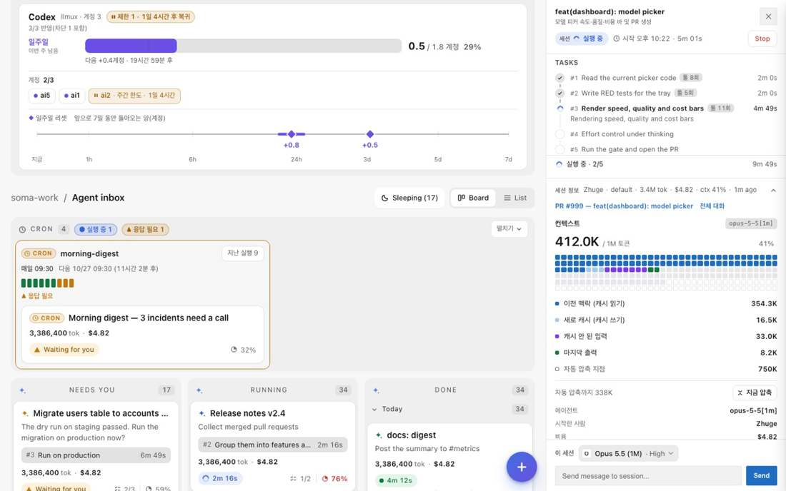

# 14 — 대시보드 × affectUI 에이전트 UI 레퍼런스 7종

Status: 출고(main `9de150c`, 2026-10-27) · Date: 2026-10-26 · 기준 main `ff6c9ac` · 에픽 #437 (서브이슈 #438–#444)
SSOT: [`affectui/ssot.md`](affectui/ssot.md) · Loop: [`affectui/loop.md`](affectui/loop.md)
앞선 계약: [`10`](10-agent-inbox-board-spec.md) 보드 · [`11`](11-dashboard-live-surfaces-spec.md) 실시간 서피스 ·
[`12`](12-dashboard-agent-tree-spec.md) 에이전트 트리 · [`12-cron`](12-cron-lane-and-llm-capacity-spec.md) 크론·가용량 ·
[`13`](13-dashboard-three-surfaces-spec.md) 세 서피스

증거 라벨: **[REF]** = affectui.com 공개 페이지·문서 청크·CSS(2026-10-26 판독) · **[CODE]** = 이 저장소 `file:line` ·
**[SHIPPED]** = 출고된 계약.

## 0. 한 줄 정의

affectUI의 에이전트 UI 일곱 개를 해부해 레퍼런스마다 문서 하나(`affectui/re-<slug>.md`)로 남기고, 그 문서대로 같은 일을 하는
대시보드 화면 일곱 곳을 고친다. 레퍼런스가 사람에게 주는 결정을 대시보드가 가진 실제 데이터로 준다 — 데이터가 없는 요소는
만들지 않고 이유를 남긴다.

## 1. 레퍼런스 → 화면 지도

| 레퍼런스 [REF] | 사람이 얻는 결정 | 대시보드 화면 [CODE] | 문서 | 서브이슈 |
|---|---|---|---|---|
| Agent Inbox | 무엇이 나를 기다리나, 무엇이 움직이나 | 세션 보드 — `renderCardFace`·`renderCardBody` | [`re-agent-inbox`](affectui/re-agent-inbox.md) | #438 |
| Agent Run (screen) | 이 실행이 어디까지 왔고, 나에게 무엇을 묻나 | 세션 패널 — task·권한·질문·머리·세션 정보 | [`re-agent-run`](affectui/re-agent-run.md) | #439 |
| AI Answer | 답이 무엇이고 근거가 어디인가 | 패널 대화의 모델 응답 — `renderTurn` | [`re-ai-answer`](affectui/re-ai-answer.md) | #440 |
| Context Window | 창이 얼마나 찼고 무엇으로 찼나 | 패널 세션 정보의 컨텍스트 — `panelInfoHtml` | [`re-context-window`](affectui/re-context-window.md) | #441 |
| Model Picker | 어떤 모델·effort가 얼마인가 | 모델·effort 선택 — `renderModelPicker`·`renderEffortPicker` | [`re-model-picker`](affectui/re-model-picker.md) | #442 |
| Memory Panel | 에이전트가 나에 대해 무엇을 기억하나, 고치거나 지우기 | 설정 › 기억 › 개인 메모리 — `settings-memory-tab.ts` (2026-10-29부터 `@2lab.ai/ui` `<ui-memory-panel>`) | [`re-memory-panel`](affectui/re-memory-panel.md) | #443 |
| Agent Queue | 일이 얼마나 쌓였고 얼마나 빨리 빠지나 | LLM 가용량 · 크론 레인 | [`re-agent-queue`](affectui/re-agent-queue.md) | #444 |

## 2. 판독 방법 [REF]

- 원천 3종: (a) 사이트가 브라우저에 내려 주는 문서 객체 — props, keyboard, accessibility, motion, responsive, aiNotes;
  (b) 데모 번들에 내장된 CSS — 색 역할 변수, 크기, 반경, 시간, easing, 컨테이너 쿼리; (c) 라이트·다크 캡처 2시점.
- 유료 항목(7종 중 6종)의 소스는 옮기지 않는다. 구조·상태·수치만 문서로 옮기고 대시보드의 기존 토큰(`--ib-*`, `--st-*`,
  `--ease-out`, `--dur-*`)과 vanilla JS로 다시 짓는다.
- 레퍼런스는 React 컴포넌트 하나에 상태를 숨기지만, 대시보드는 서버 payload + 1 Hz 타이머 + WS 패치로 그린다. 그래서 문서마다
  "데이터 계약" 칸이 레퍼런스 props → 대시보드 payload 필드 대응표다.

## 3. 공통 계약 (일곱 화면 모두)

| # | 계약 | 근거 |
|---|---|---|
| C1 | 데이터 정직성 — 모든 숫자·라벨은 payload 필드이거나 그 파생이다. 파생식은 문서 §4에 적는다. 근거 없는 레퍼런스 요소는 §3 차이표에 `불채택`과 이유 한 줄. | 유저 결정에 쓰이는 숫자는 사실이어야 한다 |
| C2 | 키보드 — 레퍼런스 문서의 keyboard 표를 대시보드 상호작용에 옮긴다. 열린 것은 Esc로 닫고 포커스를 연 자리로 돌린다. | [REF] 7종 모두 keyboard 절 |
| C3 | 움직임 — 상태 변화는 제자리에서 먼저 보이고 그다음 움직인다. 시간·easing은 대시보드 모션 토큰. `prefers-reduced-motion`에서 움직임 없이 바뀐다. | [REF] motion 절 · `.prd/10` §4 |
| C4 | 다크·라이트 — 새 색은 다크 기본값 + `[data-theme="light"]` 덮어쓰기를 함께 둔다. 13px 글자는 4.5:1. | [CODE] `:root` · light 블록 |
| C5 | 반응형 — 폰(390px)에서 잘리지 않는다. 터치 기기는 버튼 높이를 키운다. | [REF] responsive 절 |
| C6 | 접근성 — 버튼은 이름을 갖고, 상태 변화는 polite live region으로 한 번 알린다. 장식 아이콘은 `aria-hidden`. | [REF] accessibility 절 |
| C7 | 시험 — 문서 §4의 결정 번호(D1…)마다 시험이 있고, 수정 전 실패한다(RED). | `CLAUDE.md` TDD |
| C8 | 병렬 브랜치 — 각 작업은 자기 화면 구역에만 CSS·함수를 더한다. | [`loop.md`](affectui/loop.md) §병합 순서 |

## 4. 레퍼런스별 계약 요약

각 문서 §4가 정본이다. 여기에는 결정의 뼈대만 둔다.

| 문서 | 채택한 핵심 | 불채택(근거 데이터 없음) | PR |
|---|---|---|---|
| re-agent-inbox | 톤별 상태 태그 · 상태는 제자리에서 먼저(900ms) · 보드 live region · Esc로 카드 닫기 · 라벨 붙은 칸 · 카드당 잉크 주 버튼 하나 | 실패 상태·Retry · 출처 수 | #450 |
| re-context-window | 216셀 필드 · 구성 4종(캐시 읽기·쓰기·입력·출력) · 자동 압축 지점 기준 경고 단계 · 소유자 전용 "지금 압축"(요청·관측·절약량 분리) | 내용 종류별 구성(시스템·도구·파일) · 항목 제거 · 새 대화 | #451 |
| re-agent-run | 계획 카드 · "입력 필요" 머리 + 패널 승인 카드(키보드, 해결 행, 만료) · 머리 = 이번 턴 · 세부 목록 · morph 정체성 키 | 실패/건너뜀 단계 · Retry · 계획 편집 · Inline Diff | #452 |
| re-model-picker | 트리거 하나 + 메뉴 · 창·autocompact·비용 막대 · 허용 effort만 · 가격 트레이(모르는 모델은 "가격 정보 없음") | 속도·품질 점수 · 첫 토큰 시간 · thinking 스위치 · 웹 검색 | #453 |
| re-ai-answer | 답변 카드(마크다운) · 답변에 포함된 링크 카드·칩(상호 강조) · 복사 · 응답 시간 · 작성 중 행 | 재생성 · 피드백 · 후속 질문 · "출처/인용" 어휘 · 단어 스트리밍 | #454 |
| re-agent-queue | 두 섹션 한 모양 · 상태 pill + 카운트다운 · 계정 = 워커 마크 · 타일 4개(출처 필드 명시) · 다음 실행 대기열 · 24시간 발화 차트 | 일시정지 · 워커 수 · 앞으로 옮기기·취소 · 대기 p95 · 후속 지시 대기열(#447) | #455 |
| re-memory-panel | 한 장 패널 · 저장소 칩·검색·그룹 · 제자리 편집 · 실제 삭제 + 트레이 되돌리기 · 저장소별 추가 | 기억 사용 스위치 · 일시정지 · 출처·날짜 | #456 |

## 4.1 통합 화면

7개 층을 모두 쌓은 꼭대기에서 찍은 캡처는 [`affectui/loop.md`](affectui/loop.md) §통합 화면. 예:

## 5. 범위 밖

- 레퍼런스 소스 반입, 대시보드 파일 분할(#155), 새 백엔드 기능(답변 재생성·피드백 저장·큐 일시정지·기억 on/off 등) — 문서마다 불채택 이유.
