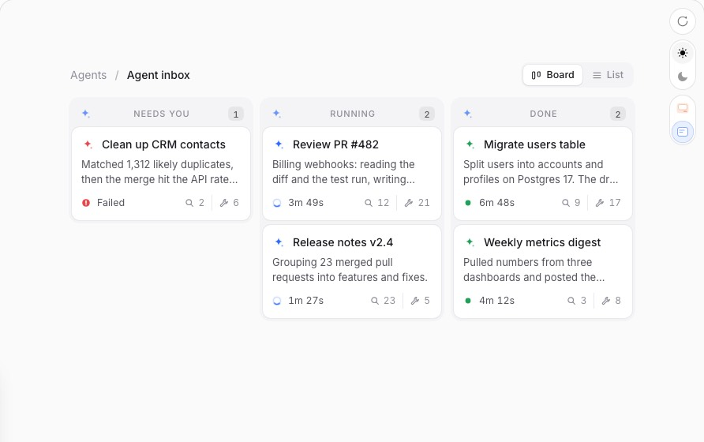

# re-agent-inbox — affectUI Agent Inbox → 세션 보드의 남은 차이

Status: 구현(Phase B, 푸시 전) · Date: 2026-10-26 · 기준 main `ff6c9ac` · 이슈 #438 (에픽 #437) · 브랜치 `feat/dashboard-affectui-agent-inbox`
> 2026-10-29: 인라인 보드(키드 리컨실러 `reconcileBoard` · `applyBoardPlan`, 홀드 `holdLanes` · `applyLaneHolds`, FLIP · 입장 · 퇴장, 카드 껍데기 `createCardShell` · `cardParts` · `applyCardParts`, 얼굴 렌더러 `renderCardFace` · `renderCardStatus` · `renderCardUsage` · `renderCardAgents` · `renderCardPr` · 소유자 배지 · 산출물 칩 · 첨부 배지 · CRON 배지, 카운트업, DONE 날짜 그룹 DOM, 알림 `announceBoard`, 스켈레톤 마크업, `.kanban` · `.card` 얼굴 CSS)는 이 설계를 옮긴 라이브러리 요소 `@2lab.ai/ui` `<ui-agent-inbox>`(0.4.3)로 바뀌었다 — 보드 `#kanban` 하나와 CRON 레인의 잡마다 하나(`view="list"`, 맨 열 하나, `slot="job:<그룹 키>"` 상자 안). D1 톤 · D2 접두어 · D3 링 · D4 팝 · D5 900ms 홀드 · D6 알림 · D7 Esc · D8 `aria-controls` · 날짜 그룹 머리 · 스켈레톤 · Board ↔ List 글라이드는 라이브러리 `agent-inbox.test.ts`가(D4 팝은 아직 테스트 없음), 데이터 매핑(`cardOf` — 상태 · `statusText` · 시계 · 작업 줄 · 서브에이전트 점(생성 순서, 중단은 사각) · 토큰 · 비용 · 툴팁 · 컨텍스트 수준 · 첨부 · PR 지표 · CRON 리드 · 소유자 배지 · 파일 칩), `BOARD_STRINGS`(보드의 기존 문구), `renderBoard`의 열 · 날짜 그룹(닫힌 날은 스텁) · `load` · `announce`, 열린 카드 본문(`slot="body:<키>"` 라이트 DOM, 열려 있을 때만 — #548), 이벤트(`ui-toggle` · `ui-group-toggle` · `ui-artifact`), 딥 링크 `reveal()`, 레이아웃 시프트의 `measure()` / `flipFrom()`는 `dashboard-affectui-agent-inbox-client.test.ts`가 고정한다. D10(열린 카드의 잉크 버튼 하나)은 본문이 페이지 것이라 그대로 페이지의 몫.
SSOT: [`ssot.md`](ssot.md) · 앞선 계약: [`../10-agent-inbox-board-spec.md`](../10-agent-inbox-board-spec.md) §3.1·§4·§5,
[`../13-dashboard-three-surfaces-spec.md`](../13-dashboard-three-surfaces-spec.md) §3.2·§3.7

증거 라벨: **[REF]** = affectui.com/components/agent-inbox(문서 청크 `docs-D_d0RPGD.js`, 컴포넌트 CSS `RE-css.txt`, 데모 번들
`demo-Bq86T0RX.js`, 캡처 `components_agent-inbox-{light,dark}-t1/t2.png`, 2026-10-26) · **[CODE]** = `src/conversation/dashboard.ts:줄`
(따로 적지 않으면 이 파일) · **[SHOT]** = 프리뷰 하네스 실측 · **[SHIPPED]** = 구현 후 표시.
라이선스: Pro 항목이다. 코드·CSS 문장·SVG 경로는 옮기지 않는다. 아래 수치는 판독한 사실만 인용한다.

## 0. 한 줄 정의

Agent Inbox는 백그라운드 실행 여러 개 가운데 **무엇이 나를 기다리고, 무엇이 돌고, 무엇이 끝났나**를 차분한 보드 하나에서 고르게 하고,
카드를 그 자리에서 펼쳐 지금 할 수 있는 결정 하나를 준다. 대시보드의 세션 보드(`#inbox`)는 이미 이 구조다(.prd/10 — 세 칸 ·
Board|List · FLIP · 펼침 카드). 이 문서는 **남은 차이**만 다룬다: 상태 태그, "상태 먼저, 이동은 나중", 낭독, Esc, 카드당 주 버튼 하나.

## 1. 레퍼런스 해부 [REF]



### 1.1 구조

```
루트(tray 반경 20, 안쪽 4, inline-size 컨테이너, data-view=board|list, keydown=Esc)
├─ 바: "Agents / {title}" · [action 버튼] · Board|List (radiogroup, 아이콘+라벨)
├─ 칸 3개 (grid 3열, 간격 4) — section[aria-label] Needs you · Running · Done
│  ├─ 머리 32px: spark · 이름 13/600 · 개수 pill(최소 20px, 11.5px)
│  └─ ul > li 카드[data-status][data-open] | li "Nothing here"
│     ├─ button 본문[aria-expanded][aria-controls] (컨테이너 ai-card)
│     │  ├─ 제목 줄: 상태색 spark 16px · 제목 14/600 한 줄
│     │  ├─ 설명 13/19, 2줄 말줄임, 왼쪽 26px 들여쓰기
│     │  └─ 바닥: 상태 태그 [아이콘 · 단어 · 시계] … 메타 [sources | tools] (1px 구분선, 좌우 9px)
│     └─ 접힘 영역[inert(닫힘)] > 위쪽 1px 선
│        ├─ agent(모델명, 12.5 흐림)
│        ├─ ol 단계: 최근 4개, 오래된 것부터. 점 6px · 1px 연결선 · 마지막 점만 잉크 · 시각 오른쪽("2m ago")
│        └─ 버튼 줄(오른쪽 정렬, 간격 6): waiting Reject + Approve(주) · failed Retry(주) · running/done Open
└─ 시각 숨김 live region(aria-live=polite): "N need you, M running"
```

### 1.2 상태

| status | 칸 | 색 역할 | 태그 내용 | 버튼 |
|---|---|---|---|---|
| waiting | Needs you | 호박(warn) | ▲ `Waiting for you · 6m 12s` | Reject · **Approve** |
| failed | Needs you | 빨강(danger) | ❗ `Failed` (시계 없음) | **Retry** |
| running | Running | 파랑(brand) | 도는 링 `Running · 3m 49s` | Open |
| done | Done | 초록(ok) | ● `Done in 6m 48s` | Open |

- 칸 = waiting·failed → Needs you, running → Running, 나머지 → Done. 칸 안 순서는 입력 순서.
- 시계: 60초 미만 `Ns`, 60분 미만 `Nm SSs`, 그 이상 `Nh MMm`. 실행·대기 카드가 있을 때만 1초 틱. running·waiting은 `startedAt`부터, done은 `elapsed`.
- 핸들러가 있으면 보드는 스스로 상태를 바꾸지 않는다(aiNotes) — 상태는 호출자 데이터만 따른다.

### 1.3 상호작용·키보드

- Tab = 보기 전환 → 카드 → 열린 카드 안 버튼. Enter·Space = 카드 열고 닫기, 버튼 누르기. 열린 카드는 하나.
- **Esc = 열린 카드를 닫고 포커스를 그 카드 버튼에 돌려준다**(루트 keydown, `stopPropagation`, `preventScroll`).

### 1.4 모션

| 대상 | 수치 |
|---|---|
| 상태 변경 | 새 상태를 **제자리에서 먼저** 보이고, **900ms 뒤** 새 칸으로 이동(reduced-motion이면 0ms) |
| 칸 이동(FLIP) | 560ms `cubic-bezier(0.32, 0.72, 0.24, 1)`, 나는 동안 z-index 2. 새 카드 = opacity 0 + `translateY(6px)` → 380ms |
| 펼침 | `grid-template-rows 0fr→1fr` 460ms `cubic-bezier(0.22, 1, 0.36, 1)`; opacity 닫힘 240ms / 열림 320ms(지연 100ms) |
| 상태 아이콘 | 바뀔 때 `scale(0.6)`·opacity 0 → 1, 360ms |
| 실행 링 | 900ms linear 회전 |
| 보기 전환 | 칸 묶음 opacity 0.4 → 1, 320ms |
| 동작 줄이기 | 모든 animation·transition 없음 |

### 1.5 토큰

- 상태 태그: 높이 24 · 안쪽 `0 10 0 8` · 반경 999 · 12.5px/500 · tabular · 아이콘 12px. 틴트(라이트 bg/fg): brand `#eaf1ff/#2456d6`,
  warn `#fff3e0/#b85c00`, ok `#e6f6ec/#1a7f45`, danger `#fdecea/#c2331f`. 다크: `#16243f/#8ab4ff`, `#3a2410/#ffa057`, `#12301f/#3dd68c`, `#3b1714/#ff977d`.
- 카드 반경 16, 안쪽 `14 14 12`, 행 간격 6. 버튼 32px · 반경 10 · 13.5/500; 주 = 잉크 바탕·카드색 글자, 보조 = 카드 바탕 + 1px 선.

### 1.6 반응형

- 루트 폭 ≤ 620px: 한 열(목록), 보기 전환 숨김 — 300px까지.
- 카드 본문 폭 ≤ 300px: 설명·바닥 들여쓰기 0, **상태 단어 숨김(failed 제외)**. 루트 ≤ 360px: 제목 줄바꿈.
- `pointer: coarse`: 보기 전환 34px, 버튼 40px(좌우 18). 다크: 조상 `.dark`/`[data-theme="dark"]`.

### 1.7 접근성

칸 = 이름 붙은 section · 카드 = button `aria-expanded`(+`aria-controls`), 닫힌 내용 `inert` · Board/List = radiogroup(`aria-checked`) ·
polite live region "N need you, M running"(N = waiting + failed, M = running).

### 1.8 데이터 계약

`AgentTask { id, title, description?, agent, status: running|waiting|done|failed, startedAt?, elapsed?, tools?, sources?, steps?: {label, time?}[] }`;
`onApprove/onReject/onRetry/onOpen(task)`, `title`, `action {label,onClick}`, `view/defaultView/onViewChange`.

### 1.9 판독 메모 — 렌더와 CSS가 다른 곳

사이트 캡처(스타일 "Clean")의 바닥 상태는 **틴트 배경 없이** 아이콘 + 회색 글자다(픽셀 표본: 태그 자리 = 카드 바탕 `#fff`/`#1e1e21`), 세 칸
spark는 모두 파랑(`#6a94fc`). 컴포넌트 CSS는 틴트 태그와 칸별 spark 색을 준다. 렌더는 ~228px 카드에서 실행·완료 단어를 숨기고 대기 단어는
말줄임으로 보인다(CSS 규칙은 ≤300px에서 failed 외 모두 숨김). 사이트 스타일 변형이 덮는 것으로 본다. 결정: 상태 태그는 **컴포넌트 CSS**
(페이지 설명도 "status tags"), 칸 spark는 **렌더**(= 현재와 같음)를 따른다.

## 2. 변경 전 [CODE] (main `ff6c9ac`)

| 영역 | 현재 | 증거 |
|---|---|---|
| 칸 | `div.kanban-col` ×3, `h3` + `.count`; section·이름 없음 | 6148–6162, CSS 3661–3666 |
| Board / List | `.seg role="group"` + `aria-pressed`, 저장 `soma-board-view`, 뷰포트 <640 기본 List | 6119–6122, `setBoardView` 10223, `defaultBoardView` 10280 |
| 좁은 인박스 | `@container inbox (max-width: 839px)` → 3칸 가로 스크롤 + snap(목록 강제 없음, 토글 유지) | 5025–5034, .prd/10 §5 |
| 카드 셸 | `.card > .card-face[role=button][tabindex=0][aria-expanded]` + `.card-expand[inert]` — **`aria-controls` 없음** | `createCardShell` 7860–7883, `applyExpanded` 7885 |
| 바닥 상태 | `.card-status` = 아이콘 + 글자, **배경 없음**. `Running · `/`Done in `(`.st-prefix`)은 **Board에서 숨김, List만** | `renderCardStatus` 8005–8024, face 8189, CSS 3742–3749·3675 |
| 실행 링 | 2px 테두리 스피너, 트랙 `--ib-pill`, 호 `--st-run`, 0.9s linear | CSS 3749, 동작 줄이기 5137–5139 |
| 메타 | `.card-metrics`: task 완료/전체 · ctx % · 첨부 · PR, 사이 1px 선 | `renderCardFace` 8165–8182, CSS 3750–3752 |
| 상태 변경 | 데이터가 바뀐 **그 렌더에서 바로** 칸 이동 FLIP(320ms `--ease-in-out`, `.is-flying`). 칸 배지 = 데이터 수 | `reconcileBoard` 7610–7664(배지 7653), `applyBoardPlan` 7729–7783, `playFlip` 7803 |
| 상태 아이콘 | face HTML이 바뀌면 통째로 교체, 상태 전환 표시 없음 | `applyCardParts` 7905–7938(`data-state` 7909) |
| 펼친 카드 단계 | task 창(실행 중·질문 대기): 점 + 연결선 + 현재 task 잉크 점 + 오른쪽 `소요 · 툴 N회` | `renderTimeline` 8219, CSS 3984–4001 |
| 버튼 줄 | `.card-foot-bar`: 모델·effort … 오른쪽 Stop/Close/Trash · Slack · **작업 로그(늘 잉크 주 버튼)** | `renderCardBody` 9761–9768, CSS 3876–3877·4015–4037 |
| 질문 답 | 단일 선택: 추천 선택이 잉크(`.card .btn-choice-recommended` 4214) → **작업 로그와 잉크 둘**. 복수 질문 `답변하기` = 보조 버튼 | 9717–9742, `renderMultiChoiceCard` 10899/10915 |
| 권한 요청 | `renderPermissionBlock(s,'card')` — ✅ Approve · ❌ Deny · 💡 Explain (Slack 카드 색, 패널과 공유) | 6515–6549, 9747 |
| 키보드 | 보드는 Enter·Space만. Esc는 문서 핸들러가 패널만 닫는다 | 14831–14838, 13013 |
| 낭독 | 보드 live region 없음(`#inbox` 안 `aria-live` = lifecycle 대화상자 상태뿐) | 6132 |
| 터치 | <640px·coarse 버튼·세그먼트 44px | 5187–5200 |

**[SHOT]** 하네스(포트 34101, 픽스처, `shots-agent-inbox/before-agent-inbox-*`, 1440·390 × light·dark): 1440에서 카드 폭 379px인데
`.st-prefix` = `display:none` · `.card-status` 배경 투명 · 칸 3개 `DIV role=null label=null` · face `aria-controls=null` ·
`#inbox` live region = `lifecycle-status` 하나 · 펼친 카드 3종에서 Esc 후에도 열림(3/3). 소유자 보기의 질문 대기 카드는 추천 선택 +
작업 로그 두 잉크 버튼(fixture는 All Users라 선택이 disabled로 찍힘).

## 3. 차이표

| # | 레퍼런스 요소 | 현재 | 결정 | 근거 (데이터 출처 / 불채택 이유) |
|---|---|---|---|---|
| 1 | 틴트 상태 태그(아이콘 · 단어 · 시계) | 아이콘 + 글자, 배경 없음 | **채택 D1** | 컴포넌트 CSS(§1.9). 톤 = 칸 + `autoResume`(§4 D1) |
| 2 | 상태 단어는 카드 폭으로 숨김(≤300px) | 보기로 숨김(Board 숨김) | **채택 D2** | 1440 보드 카드 379px — 레퍼런스라면 `Done in 4m 12s` |
| 3 | 도는 링 | 테두리 스피너(트랙 `--ib-pill`) | **변형 D3** | 틴트 위에서 트랙이 사라지지 않게 `currentColor` |
| 4 | 상태 아이콘 팝 360ms | 없음 | **변형 D4** | 우리 토큰 `--dur-move` 320ms · `--ease-out` |
| 5 | 상태 먼저, 900ms 뒤 이동 | 즉시 이동 | **채택 D5** | .prd/10 §2.2가 영상에서 관측(1.2s Approve → 2.4s 이동)했지만 출고하지 않았다 |
| 6 | 칸 배지 = 그려진 카드 | 데이터 수 | **채택 D5** | 보류 중 배지·빈 칸 문구가 칸과 어긋나지 않게 |
| 7 | polite live region | 없음 | **채택 D6** | 수 = 보드 데이터의 `waiting`·`working` 버킷 |
| 8 | Esc로 닫고 포커스 복귀 | 없음 | **채택 D7** | — |
| 9 | 카드 `aria-controls` | 없음 | **채택 D8** | — |
| 10 | 칸 = 이름 붙은 section | `div` | **채택 D9** | — |
| 11 | 카드당 주 버튼 하나(= 지금 할 결정) | 작업 로그 늘 잉크 + 추천 선택 잉크 | **변형 D10** | 결정 = 소유자의 질문 답 · 요청자의 권한 응답(`isPermissionRequester`) |
| 12 | Approve(주) + Reject(보조) | 권한 블록 Slack 색(초록·빨강 채움) | **변형 D10** | 카드 안에서만 CSS로: Approve 잉크, Deny 보조. 패널 블록·`renderPermissionBlock`은 Agent Run 몫(교차 리뷰 R1 P1) |
| 13 | `failed` 상태 · Retry | 없음 | **불채택** | 근거 데이터 없음: 끝난 실패를 나르는 필드가 없다(오류는 자동 재개 대기 `autoResume.reason`뿐, .prd/13 §3.7 미해결) |
| 14 | sources 수 | — | **불채택** | 근거 데이터 없음(읽은 출처를 세지 않는다) |
| 15 | tools 수(face) | task 완료/전체 · ctx % | 유지 | 진행 지표는 task 완료/전체(.prd/13 §3.7). 툴 수는 task 창 `툴 N회`(T7)·패널 트리 `agentRoot.toolCalls` |
| 16 | 단계 시각 `2m ago` | `소요 · 툴 N회` | 유지 | SSOT 10-22 T7 |
| 17 | 끝난 카드의 마지막 단계 | 지시 ↔ 응답 · 산출물 | 유지 | .prd/13 §3.2(task 창은 실행 중·질문 대기만) |
| 18 | agent(모델명) 줄 | 컨트롤 줄 모델 선택 | 유지 | 같은 데이터(`s.model`) |
| 19 | Open(running·done) | 작업 로그(모든 카드) | 유지 | 패널 열기 = Open |
| 20 | ≤620px 목록 강제 · 전환 숨김 | <840 가로 스크롤, <640 기본 List, 토글 유지 | **불채택** | SSOT 2026-10-24(.prd/10 §5) — 저장한 선택을 덮지 않는다 |
| 21 | coarse 34/40px | 44px | 유지 | 이미 더 크다 |
| 22 | radiogroup | `aria-pressed` 그룹 | 유지 | .prd/10 §3.1-2, `dashboard-agent-inbox.test.ts:118` |
| 23 | 설명·바닥 26px 들여쓰기, ≤360 제목 줄바꿈 | 왼쪽 정렬, 제목 한 줄 | 유지 | face에 task·토큰·칩 행이 더 있어 폭이 필요, 소유자 배지 배치(.prd/10 §3.1-3) |
| 24 | 칸별 spark 색 | 셋 다 `--ib-spark` | 유지 | 렌더가 셋 다 파랑(§1.9) |
| 25 | FLIP 560 · 펼침 460 · 진입 translateY | 320 · 240 · scale 0.97 | 유지 | .prd/10 §4 모션 표준 |
| 26 | 반경 16/20 · 제목 14px | 12/14 · 15px | 유지 | .prd/10 출고 모양 |
| 27 | 핸들러 없을 때 보드가 상태를 바꿈 | 서버 상태만 | 불채택 | 레퍼런스 aiNotes도 핸들러가 있으면 바꾸지 않는다 |
| 28 | 바의 `New task` | FAB `.new-task-fab` | 유지 | 기존 진입점 |

## 4. 계약 (TO-BE) [SHIPPED]

색 토큰은 보드 CSS 영역의 자체 `:root {…}` + `[data-theme="light"] {…}` 블록(3601·3611), 호버 규칙은 그 규칙 옆의 자체 `@media` 블록,
동작 줄이기 규칙은 공유 동작 줄이기·터치 블록 **뒤**의 자체 블록(5260–5265 — 시트의 첫 동작 줄이기 블록은 공유 블록으로 남는다)이다.
공유 `:root`(3137)·라이트(3203)·동작 줄이기(5178)·호버·터치 블록은 건드리지 않는다(에픽 위생, 교차 리뷰 R1).

**D1 상태 태그 [SHIPPED].** 바닥 줄 `<span class="card-status" data-tone="T">`(안의 `.st-icon` + `.st-text`는 그대로). 톤은 괄호로 우선순위를 밝힌 식으로 `renderCardFace`
(8396)가 정한다: 자동 재개 대기(`pendingAutoResume`) → `wait` · `waiting` → `wait` · `working` → `run` · `closed` → `rest` · 그 밖(`idle`) → `done`.
CSS(3768–3772): `inline-flex`, 높이 24px, 안쪽 `0 10px 0 8px`, 반경 999px, 12.5px/500, gap 6px, `flex: 0 1 auto`, `max-width: 100%`, 말줄임
(메트릭은 `margin-left:auto`로 오른쪽, 좁으면 기존처럼 다음 줄). `.st-ago`(`· 12m ago`)도 태그 안 같은 색(`color: inherit`).

| 토큰 | 다크 bg / fg (대비) | 라이트 bg / fg (대비) |
|---|---|---|
| `--st-run-bg/-fg` | `#1d2a47` / `#a3bdff` (7.7:1) | `#e8eeff` / `#2453c7` (5.8:1) |
| `--st-wait-bg/-fg` | `#3a2a12` / `#ffb35c` (7.8:1) | `#fff1dc` / `#8f5300` (5.5:1) |
| `--st-done-bg/-fg` | `#14301f` / `#5fd68e` (7.8:1) | `#e3f5e9` / `#136c39` (5.7:1) |
| `--st-rest-bg/-fg` | `#2f2f35` / `#b4b4bb` (6.5:1) | `#efefef` / `#555558` (6.5:1) |

아이콘 색은 지금처럼 `--st-color`(카드 `data-state`), 자동 재개 시계는 `--st-wait`.

**D2 상태 단어 [SHIPPED].** `.st-prefix`(`Running · `, `Done in `)는 두 보기 모두 기본으로 보인다. `.card-face { container: cardface / inline-size }`
(3723), `@container cardface (max-width: 300px) { .card-status .st-prefix { display: none } }`(3778, 내용 폭 300px ≈ 카드 328px). 예전의
`.st-prefix { display: none }`과 `.kanban[data-view="list"] .st-prefix`는 없다. 시계 없는 단어(`Waiting for you`, `Sleeping`, `Archived`, `Idle`,
자동 재개 줄)는 늘 보인다. 실측: 1440 보드(카드 397px) `Running · 21m 57s` / `Done in 4m 12s`, 820(카드 ~292px)은 시계만.

**D3 태그 안 링 [SHIPPED].** `.card-status .spinner`(3785): 트랙 = `currentColor` 25%(`color-mix`), 호 = `currentColor`. 자체 동작 줄이기 블록
(5262)이 `border-color: currentColor`로 정지 링을 온전히 둔다(공유 블록의 정지 링 규칙은 그대로).

**D4 아이콘 팝 [SHIPPED].** `applyCardParts`(8106)가 바꾸기 전 `data-state`를 잡아 두고, 있던 상태가 달라진 렌더에서만(새 카드·같은 상태의
face 교체·`canAnimate()` 거짓·`reduceMotion()` 제외) `popStatusIcon`(8145) → 새 `.card-status .st-icon`에 WAAPI
`[{opacity:0, transform:'scale(0.6)'}, {opacity:1, transform:'scale(1)'}]`, `MOTION.move`(320ms) · `MOTION.easeOut`.

**D5 상태 먼저, 이동은 나중 [SHIPPED].** `BOARD_HOLD_MS = 900`(7508).
- `reconcileBoard`(7700)가 슬롯을 짠 뒤 `applyLaneHolds(slots, counts)`(7726 → 7791)를 부른다. 칸 = `waiting` / `working` / `done`(DONE 날짜
  슬롯 포함). 판단은 순수 함수 `holdLanes(want, drawn, holds, now, on) → { lanes, holds, wakeAt }`(7768): 그려진 칸(`_cardEls[key]._colId`)과
  새 칸이 다르면 처음 본 시각 + 900ms까지 그린 칸에 둔다. 데이터가 원래 칸으로 돌아오면 보류를 지우고, 다른 칸으로 바뀌면 `to`만 바꾸고
  기한은 그대로. `on = canAnimate() && !reduceMotion()` — 첫 렌더·숨은 탭·동작 줄이기는 즉시 이동. 새 카드·CRON 슬롯·사라진 키는 보류 없음.
- 보류 카드는 새 칸 슬롯에서 빠져 **지금 노드가 있는 컨테이너의 지금 자리**로 들어가고, item의 `col`은 새 칸이라 face·body·`data-state`·
  `data-col`은 새 상태로 그려진다(D1 태그·D4 팝이 그 자리에서). 자리가 없어졌으면(떠난 DONE 날짜) 보류를 버리고 바로 이동한다. 보류 카드는
  먼저 모두 새 칸에서 뺀 뒤 컨테이너 순서(지금 자리의 오름차순)로 되돌려 넣는다 — 한 칸에서 함께 떠나는 카드들이 보류 동안 순서를 바꾸지 않는다
  (`[a,b,c]`에서 a·b가 떠나도 `[a,b,c]`, astra P2).
- 칸 배지(`counts`)와 빈 칸 문구는 그려진 카드 기준(빈 칸은 슬롯 item 수로 판정). 열린 DONE 날짜 묶음의 머리 개수도 그려진 카드 수다 — 날짜
  슬롯이 그 묶음의 item 배열을 그대로 쓰므로 보류 카드를 넣고 빼면 머리도 따라간다(배지와 같은 기준).
- 타이머 하나가 가장 이른 기한 + 20ms에 `renderBoard(_lastBoardData)`를 다시 부르고, 그때 기존 FLIP(`.is-flying`)으로 새 칸에 간다.

**D6 낭독 [SHIPPED].** `#kanban` 바로 앞(6212) `<p id="inbox-live" class="ib-sr" role="status" aria-live="polite" aria-atomic="true">`(`.ib-sr`
3622). `renderBoard`(7655)가 받은 데이터 그대로(CRON 레인으로 갈 대기 실행 포함, 보류 전) `announceBoard(waiting 수, working 수)`(7853) →
`boardAnnounceText`(7846) = `'응답이 필요한 세션 ' + w + '개, 실행 중 ' + r + '개'`. 첫 문장은 빈 영역에 바로 쓴다(PR #450 R1 P1 — 같은 수의
렌더가 1초 안에 다시 와도 첫 문장이 사라지지 않는다). 그 뒤로는 실제 변화만: 같은 문장은 타이머를 걸지 않고, `ANNOUNCE_MS = 1000` 안의 연속
변화는 마지막 하나만 쓴다(원래 문장으로 돌아왔으면 아무것도 쓰지 않는다). (그래서 낭독의 실행 수는 RUNNING 배지와 다를 수 있다 — CRON 레인의 실행 포함.)

**D7 Esc [SHIPPED].** `initBoardInteractions`의 `#kanban`·`#cron-lane` keydown(버블 단계, 15073) → `closeCardOnEscape(e, root)`(10446): 대상이
펼친 카드(`.card.is-expanded`) 안이면 `stopPropagation()` → `toggleCard(key, true)`(키보드 = 애니메이션 없음) → `face.focus({ preventScroll: true })`.
카드 밖이면, 또 대상이 입력란·`textarea`·`select`·편집 가능 영역이면 아무것도 하지 않는다(그 컨트롤의 Esc가 먼저 — fable P2; 문서 핸들러가
패널을 닫는 것은 그대로). capture 리스너를 쓰지 않으므로 카드 안의 모델 선택 메뉴(#442)가 자기
keydown에서 전파를 멈추면 메뉴만 닫힌다(교차 리뷰 R1 P2). 아티팩트 미리보기(window capture `artHandleKey`)가 먹은 Esc도 오지 않는다.

**D8 `aria-controls` [SHIPPED].** `createCardShell`(8059)이 `.card-expand`에 `id = 'card-x-' + (++_cardSeq)`(7505, 세션 키를 id에 쓰지 않는다)를
주고 face가 `aria-controls`로 가리킨다. 닫힌 내용 `inert`는 그대로.

**D9 칸 section [SHIPPED].** `<section class="kanban-col" id="col-<c>" data-col="<c>" aria-labelledby="col-<c>-name count-<c>">`(6214–6230),
`<h3 id="col-<c>-name">` — 접근 이름 = `NEEDS YOU 9`. id·클래스·`data-col`은 그대로다.

**D10 주 버튼 하나 [SHIPPED].** `renderCardBody`(9877)의 `canAnswerQuestion`(9889) = 형제 인스턴스가 아니고 `waiting` 칸에서
`pendingQuestion`이 있고 내가 소유자. `canDecideHere`(9981) = `canAnswerQuestion` 또는 (형제가 아니고 닫힘이 아닌 칸에서 `pendingPermissions` 중
내가 요청자인 것). 참이면 `작업 로그`는 보조(`btn-action`), 거짓이면 주(`btn-action btn-primary`). 잉크는 이 viewer가 여기서 내릴 수 있는 결정
하나뿐이다(4251–4266, 카드 안에서만):
- 질문: 추천 선택은 `canAnswerQuestion`일 때만 잉크, 아니면 `.is-quiet`(보조 — 남의 질문, 형제 인스턴스의 내 질문). 복수 질문 `답변하기`는
  소유자이고 형제가 아닐 때만 `btn-choice-primary`(`renderMultiChoiceCard` 11140). (astra P1: 형제 인스턴스의 내 카드에서 `답변하기`와 작업 로그가
  둘 다 잉크이던 것.)
- 권한 요청: `renderPermissionBlock`(6587)의 **카드 분기만** 이 viewer가 누를 수 있는 **첫** Approve에 `.is-lead`를 단다(6593). 카드의
  Approve는 기본이 보조(`.card .btn-perm.btn-perm-approve`)이고 `.is-lead`만 잉크 — 요청 두 개를 함께 받아도 잉크는 하나다(astra P1). Deny는
  보조(카드 바탕·선·`--st-fail-text` 글자). 패널은 `.is-lead`가 없고 공유 스타일 그대로다.
- 둘이 겹치면 Approve가 이긴다: `.card .card-body:has(.btn-perm-approve.is-lead)` 안의 추천 선택·`답변하기`는 보조(4266, 쉬는 상태·호버 모두).
- 호버에서도 무게가 같다: 공유 프롬프트 호버 규칙(밝기 필터, 4318) **뒤**의 자체 호버 블록(5269–5277)이 필터를 끄고 lead Approve는 잉크(특이도
  6), 다른 Approve·Deny·`.is-quiet` 추천 선택은 보조로 다시 칠한다(5).
추천이 없는 단일 선택 질문은 선택 버튼이 모두 보조이고 작업 로그도 보조다(골라야 할 결정이지 권장되는 답이 없다).

**모션·반응형·테마 요약**: 새 모션은 D4 팝과 D5 보류뿐, 둘 다 동작 줄이기에서 없다. D2만 폭에 반응한다. 새 색은 D1 토큰 8쌍(다크·라이트).

## 5. 시험

`src/conversation/__tests__/dashboard-affectui-agent-inbox.test.ts`(템플릿·CSS, 9건) + `dashboard-affectui-agent-inbox-client.test.ts`
(`clientFn` + cook, 가짜 주입, 24건). 구현 전 실행: 32건 중 30건 실패(RED), 2건 통과 — 통과한 둘은 바뀌면 안 되는 동작을 지키는 가드(결정이 없을
때·남의 결정일 때 작업 로그가 주). 권한 Approve 시험은 교차 리뷰 뒤에 더했다(`main`의 `dashboard.ts`에 `.card .btn-perm.btn-perm-approve`가 없어 RED).

| D | 시험 (describe → it) |
|---|---|
| D1 | 템플릿 `D1 — the status tag is a tinted pill…` 2건(자체 토큰 블록 8쌍 + 공유 블록엔 없음, pill 치수·톤 규칙) · 클라이언트 `D1 — the status tag carries a tone` 3건(톤 표, 재개 대기 = wait, 상태 마크업 유지) |
| D2 | `D2 — the state word hides by card width, not by view` 2건 |
| D3 | `D3 — the running ring inside the pill` 1건(공유 동작 줄이기 블록 무변경, 자체 블록은 링 규칙과 공유 블록 뒤) |
| D4 | `D4 — a state change pops the status icon` 2건 |
| D5 | `D5 — holdLanes…` 5건(처음 본 변경, 기한, 되돌아옴·재지정, 끔·새 카드·떠난 키, 900ms) · `D5 — applyLaneHolds…` 3건(자리·새 상태·배지, 함께 떠난 카드의 순서, 끔 = 즉시) |
| D6 | 템플릿 `D6 — one polite live region` 1건 · 클라이언트 `D6 — a polite announcement` 6건(첫 문장 즉시·같은 수 반복, 연속 변화 1회, 되돌아온 변화) |
| D7 | `D7 — Escape closes the open card…` 4건(안 / 입력란·select·편집 영역 / 밖 / 배선) |
| D8 | `D8 — the face names the region it opens` 1건 |
| D9 | `D9 — each column is a labelled section` 1건 |
| D10 | 템플릿 `D10 — one ink primary per open card` 2건(답변하기 + 자체 호버, 카드 Approve는 `.is-lead`만 잉크·Deny 보조·패널 무변경) · 템플릿 `D10 — the card permission answers keep their weight on hover…` 3건(호버 규칙의 순서·특이도, lead > 다른 Approve, `:has` 강등) · 템플릿 `D10 — a recommended choice … is not ink` 1건 · 클라이언트 `D10 — one primary button per open card` 5건(추천 선택 quiet, 답변하기는 소유자·이 인스턴스만) · 클라이언트 `D10 — renderPermissionBlock marks only the first Approve…` 3건(같은 요청자의 요청 둘, 첫 요청이 남의 것, 패널·남·형제 = lead 없음) |
| P2 | `P2 — the tone expression says its precedence` 1건 |

고친 기존 테스트(이유): `dashboard-agent-inbox.test.ts` — `worklogBtn` 정규식(D10: 주 버튼이 조건부). `dashboard-agent-inbox-client.test.ts` —
`답변하기` 정규식이 `class="btn-choice[^"]*"`(D10 클래스 추가). `dashboard-agent-inbox.test.ts`의 동작 줄이기 시험(시트의 첫 블록을 읽는다)은
자체 블록을 공유 블록 뒤에 두어 그대로 통과한다.

## 6. 범위 밖

- 권한 블록(`renderPermissionBlock`)의 마크업·라벨·순서와 패널 쪽 모양 — Agent Run(Approval Card) 서브이슈가 정한다. 이 카드는 그 블록을
  그대로 싣고, 카드 범위 CSS로 Approve/Deny의 무게만 바꾼다(D10).
- `failed` 상태·Retry·Reject → failed: 끝난 실패를 나르는 서버 필드가 생기면(후속 — 턴 종료 오류 표식) 빨강 톤 `--st-fail-*`과 함께 다시 본다.
- sources 수, 칸별 spark 색, 들여쓰기·반경·글자 크기, FLIP·펼침 수치, radiogroup 전환, 좁은 폭 목록 강제(§3의 유지·불채택 행).
- 한 번에 카드 하나만 열기(레퍼런스) — 여러 장을 펼쳐 비교하는 현재 동작(.prd/10 §3.1-4)을 유지한다.

## 7. 검증

- RED: 구현 전 `npx vitest run` 두 파일 → `Tests 30 failed | 2 passed (32)`(`client var BOARD_HOLD_MS not found`, `client function
  closeCardOnEscape not found`, `expected '.card-status { display: inline-flex; …' to contain 'height: 24px;'` 등).
- GREEN: 두 파일 33/33. `npx vitest run src/conversation/__tests__/ --testTimeout=60000 --hookTimeout=60000` → 64파일 중 63 통과,
  1681건 중 1680 통과. 남은 1건은 `work-log.test.ts`의 자체 30초 상한 시험이 부하(load average 50–160)로 35초 걸려 시간 초과한 것 —
  그 파일만 다시 돌리면 106/106 통과(이 변경은 work-log를 건드리지 않는다). 기본 시간 상한 실행에서 떨어진 서버 기동 시험들도 모두 시간
  초과였고 단독 재실행에서 통과했다. `npx tsc --noEmit` 0, `npx biome check src/conversation/` 오류 0(경고 687 = 기준 checkout과 같음).
- 브라우저(하네스 34111, 픽스처, 소유자 보기, `shots-agent-inbox/after-agent-inbox-*`, 1440·390 × 라이트·다크 + 820 라이트): 태그 배경이 톤별로
  칠해짐, 1440에서 접두 표시·820에서 숨김, Esc 3/3 닫힘 + face 포커스, 권한 카드의 잉크 버튼은 `✅ Approve` 하나 + 작업 로그 보조, 칸 3개
  `SECTION`·`aria-controls` 모두 유효, 보류: 실행 카드를 DONE으로 바꾼 직후 RUNNING 자리에서 `data-state=idle`·`data-tone=done`·배지 그대로,
  1.2초 뒤 DONE으로 이동·배지 15/17·낭독 갱신(`after-agent-inbox-probe.json`, `after-agent-inbox-light-desk-hold-in-place.png`).
- PR #450 리뷰 R1(grok P1×2 + P2, fable P2×2 + P3) 반영: 새·바뀐 시험 RED 확인(`Tests 6 failed | 32 passed (38)`, 이어서 `3 failed | 36 passed
  (39)`) 뒤 GREEN — 두 파일 39/39, 보드 관련 6파일 338/338, `npx vitest run src/conversation/__tests__/ --testTimeout=60000 --hookTimeout=60000`
  64/64 파일 · 1688/1688, `npx tsc --noEmit` 0, `npx biome check src/conversation/` 오류 0(경고 687 그대로). 브라우저(하네스 34121, `timeout -k 10 1200`, `shots-agent-inbox/r1-agent-inbox-*`): 라이트·다크 모두
  권한+질문 카드의 잉크 버튼은 쉬는 상태·Approve 호버·추천 선택 호버에서 늘 `✅ Approve` 하나(호버 필터 `none`), 남의 권한 카드는 Approve 비활성·
  잉크는 작업 로그 하나, 첫 렌더 직후 낭독 영역에 문장이 있음, 카드 안 `select`에서 Esc → 카드는 열린 채.
- 최종 리뷰(astra, `b34b9f3` REJECT) 반영: 새·바뀐 시험 RED 확인(`Tests 10 failed | 36 passed (46)` — 순서 시험은 `[ 'a', 'c', 'b' ]`를
  재현) 뒤 GREEN — 두 파일 46/46, 보드 관련 8파일 366건 중 365 통과(남은 1건은 `dashboard-permission-client.test.ts` 서버 기동 훅이 load
  average ~140에서 60초 초과 — 그 파일만 다시 돌리면 10/10), `npx vitest run src/conversation/__tests__/ --testTimeout=60000
  --hookTimeout=60000` 64/64 파일 · 1695/1695, `npx tsc --noEmit` 0, `npx biome check src/conversation/` 오류 0(경고 687 그대로).
