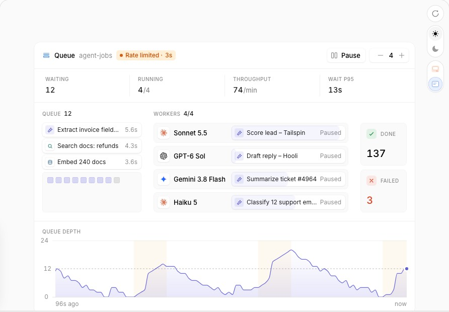

# Agent Queue → LLM 가용량 · CRON 레인

Status: 구현 [SHIPPED] · 2026-10-26 · 기준 main `ff6c9ac` · 이슈 #444 (에픽 #437) · 후속 #447 · SSOT [`ssot.md`](ssot.md)
앞선 계약: [`../12-cron-lane-and-llm-capacity-spec.md`](../12-cron-lane-and-llm-capacity-spec.md) T4·T5·T7·T9, §6(v2), §7(단순화 카드)

증거 라벨: **[REF]** = affectui.com/components/agent-queue 페이지·docs 청크·데모 CSS·번들(2026-10-26 판독, Pro 항목 — 코드·CSS 미반입) ·
**[CODE]** = 이 저장소 `file:line`(main `ff6c9ac`) · **[SHIPPED]** = 구현 후 표시.

## 0. 한 줄 정의

레퍼런스는 한 카드로 "일이 얼마나 밀려 있나, 어느 워커가 무엇을 처리하나, 지금 제공자가 막아서 멈췄나, 언제 풀리나"를 답한다.
대시보드에서 이 판단은 두 곳에 나뉜다. **LLM 가용량**에서는 llmux 계정이 워커다: 몇 개를 쓸 수 있고, 어느 계정이 한도에 걸렸고,
언제 돌아오는지를 본다. **CRON 레인**에서는 예약 실행이 대기열이다: 다음에 무엇이 언제 돌고, 지금 몇 개가 돌고, 최근 24시간에 몇 번
돌고 몇 번 실패했는지를 본다. 두 섹션은 제자리를 지키고 레퍼런스의 문법(머리 pill과 카운트다운, 숫자 칸, 워커·대기열 마크,
기록 차트, polite 알림 하나)을 함께 쓴다.

## 1. 레퍼런스 해부 [REF]



### 1.1 구조
```
.ui-agq  트레이(radius 20, pad 4) · container ui-agq/inline-size · data-state = idle|live|paused|limited
├─ head (min-h 44): 마크 · "Queue"(600) · 이름(13px muted, 말줄임) · pill · 도구[Pause 토글 · − N + 스테퍼]
└─ card (radius 16)
   ├─ dl.stats 4칸(칸 사이 1px 선): Waiting · Running r/N · Throughput n/min · Wait p95
   ├─ flow — 폭을 재서 절대 배치, 넓으면 왼쪽→오른쪽
   │   ├─ QUEUE n: 맨 앞 칩 3개(종류 아이콘·이름·기다린 시간) + 12px 칸(16px 간격) 우물 + "+N" · 비면 "Nothing waiting"
   │   ├─ WORKERS r/N: 슬롯(높이 40, 간격 6) = 로고·이름 | 레일(높이 28): 진행만큼 자라는 막대, 비면 "Idle"·"Paused"
   │   ├─ DONE n · FAILED n 칸(폭 92)
   │   └─ 잡 층: 잡마다 button(roving) + 고정 카드(dialog)
   └─ chart "Queue depth": y 격자 0·max, 영역+선, 레이트 리밋 구간 음영, 점선 backpressure + 라벨, 지금 점, 축 "96s ago … now"
└─ .sr  aria-live=polite
```
치수: 큐 열 폭 clamp(폭×0.26, 188, 236), 레일 시작 clamp(슬롯×0.4, 112, 164), 차트 높이 112(좁으면 88), 표본 96개.

### 1.2 상태
| 요소 | 상태 | 바뀌는 것 |
|---|---|---|
| 루트 `data-state` | limited > paused > live > idle | pill `Rate limited · 9s`(호박색 배경·테두리) / `Paused` / `Live`(파랑) / `Idle`. limited·live에서 점이 맥박친다 |
| Waiting 칸 | 깊이 > backpressure | 값이 호박색(`data-kind=warn`). Failed 칸 값은 늘 빨강 |
| 잡 | queued·running·done·failed + halted·flash·high·retry | 칩·칸·막대·사라짐 네 모양. halted = 막대가 멈추고 흐려지며 meta `Paused`. 실패 = 빨강 흔들림(420ms). 재시도 = 배지 + 시도 수 |
| 슬롯 | busy / limited | 빈 레일 `Idle`, 제한·일시정지 `Paused`. 리밋이 걸리면 실행 중 막대가 모두 멈추고 호박색 |
| 차트 | 리밋 구간, 선 넘음 | 리밋 구간은 호박색 7% 음영. 선을 넘으면 알림 |

### 1.3 상호작용 · 키보드
- Tab: 잡 층의 정지점은 하나(roving), 다음 Tab은 카드 버튼. 방향키 4개는 실행 중 잡을 슬롯 순서로 돈 뒤 큐를 앞에서부터 돈다. Home·End는 양끝.
- Enter·Space는 카드를 고정하거나 닫는다. Esc는 닫고 포커스를 잡으로 돌린다. 바깥을 누르면 닫힌다. hover에는 미리보기(`role=tooltip`).
- 고정 카드: 아이콘·이름·종류·세부·상태 pill·닫기 + 2열 dl(Waiting/Waited·Running·Position n of N·Worker·Priority·Attempt) +
  오류 줄 + `Move to front`·`Cancel`. 머리: Pause/Resume(`aria-pressed`), 스테퍼 `One worker less/more`(1–8, `output aria-live`).

### 1.4 모션
- 이징은 cubic-bezier(0.22, 1, 0.36, 1) 하나. 위치·크기 이동 560ms. 새 잡은 떨어진다(translateY(-10px) scale(.6) → 0, 520ms, 순서마다
  22ms, 상한 420ms). high 잡은 맨 뒤에 내린 뒤 520ms 동안 앞으로 미끄러진다. 슬롯은 420ms로 나타난다.
- 막대는 560ms로 자라고, 광택이 1500ms linear로 무한히 지나가며, 앞날이 1100ms로 빛난다. 카드는 200ms(translateY(-4px) scale(.97))로 열린다.
- 끝난 잡은 초록으로 한 박자 쉬고 Done으로 날아간다. 실패는 흔들린 뒤 Failed로 가거나 재시도 배지를 달고 큐로 돌아간다.
- 숫자는 새 값으로 부드럽게 바뀌고 차트 스케일은 미끄러진다(`@property --ui-agq-ymax`). 프레임 루프는 움직일 것이 없거나 화면 밖이면 잔다.
- `prefers-reduced-motion`이면 모든 animation·transition을 끈다.

### 1.5 토큰
- 색 역할: tray·card·ink·muted·line·chip·wash. 종류 4색(llm 보라·tool 청록·agent 슬레이트·human 파랑, 각 bg·edge·ink·sq).
  ok·error·warn(라이트 fg `#b85c00`/bg `#fff3e0`, 다크 `#ffa057`). depth(보라 선 + 16–26% 채움).
- 반경: 트레이 20, 카드 16, 슬롯·빈 12, 잡·우물·레일 8, 버튼 9, pill 999.
- 글자: 기본 14/20, stat dt 12 muted, dd 16/600 tabular, 열 머리 12 + 굵은 수, 잡 이름 12.5, meta 11.5, 빈 수 20/600, 축 11.
- 다크: 조상의 `.dark`·`[data-theme=dark]`가 변수를 통째로 바꾼다.

### 1.6 반응형
- 컨테이너 쿼리와 잰 폭을 같이 쓴다. 600 미만: flow를 쌓는다 — 큐가 위, 워커는 마크만 남고 레일이 자리를 차지하며, Done·Failed는 나란히
  높이 40, 큐 머리에 `+N more`. 560 이하: 숫자 4칸 2×2, 이름 숨김. 440 이하: Pause·스테퍼가 한 줄을 따로 쓴다.

### 1.7 접근성
- 잡은 진짜 button. 접근 이름 = 이름, 종류, 기다린·실행 시간과 %, `position n of N`, priority, attempt. 잡 층은 `role=group`
  "Jobs: r running, n waiting". 고정 카드는 `role=dialog` + 닫기 버튼, Esc는 포커스를 잡으로 돌린다.
- polite 영역 하나: 리밋 시작(`…paused for N seconds`)·해제(`Rate limit lifted – workers resumed`), 실패와 사유, 재시도, backpressure 넘음.
  첫 렌더에서는 알리지 않는다. 차트는 `role=img` + 문장 요약(지금 대기·최고·평균·선·리밋 횟수·실패 누계). pill은 limited일 때만 `role=status`.

### 1.8 데이터 계약 · 파생
- props: `jobs {id,name,kind,status,enqueuedAt,priority?,startedAt?,endedAt?,worker?,progress?,estimate?,attempt?,maxAttempts?,detail?,error?}[]`,
  `workers {id,name,detail?}[]`(개수 = 동시성), `rateLimits {from,until,label?}[]`, `paused`, `backpressure`, `window`(120000),
  `totals {done?,failed?}`, `openId`, `onPromote`/`onCancel`, `onPausedChange`, `onConcurrencyChange`, `min/maxConcurrency`(1/8), `title`/`name`.
- Throughput = 지난 60초에 `endedAt`이 든 done 수(/min). Wait p95 = 지난 60초 시작 잡의 (startedAt − enqueuedAt) ∪ 지금 대기 시간을 정렬한
  `[floor(.95n)]`. Done·Failed = `totals` ?? 목록 개수. 차트 y 최대 = max(최고×1.15, 선×1.2, 4)를 nice 목록으로 올림.
- 시간 표기: 10초 미만 `5.6s`, 60초 미만 `13s`, 그 이상 `1m 05s`. 리밋 카운트다운은 올림 초.

## 2. 변경 전 [CODE]

캡처(저장소 밖, 합성 데이터 — 크론 잡 4개와 실행 기록, llmux 2그룹 7계정 중 막힘 3): `harness/shots-agent-queue/before-{light,dark}-{desk,phone}-{folded,open}-{capacity,cron}.png`, `before-*-drawer.png`.

### 2.1 LLM 가용량
- 서버: `GET /api/dashboard/capacity`(`dashboard.ts:2161`) → `readCapacity`(`:702`, TTL 30초·실패 10초, single-flight) → `buildCapacityView`(`capacity-view.ts:512`).
  `CapacityGroupView`(`:98`) = has5h·total·now·week·binding·excluded·tierAssumed·estimated·unmeasured5h·state ok|low|empty|unknown·oldestRefreshAt·events·units.
  `CapacityUnit`(`:56`) = name·tier·tierAssumed·status·now·week·blocked·held·blocks{weekly,fiveHour,cooldownUntil,scopedUntil}·estimated·unmeasured5h·counted·excluded·binding·returnAt. `CAPACITY_LOW_PCT = 20`(`:35`).
- HTML `#capacity`(`dashboard.ts:6106`) = `.sec-toggle` + `#capacity-view`, 늘 접힌 채 시작(`secIsOpen` `:13183`). 접힌 칩
  `renderCapacitySummary`(`:13825`) = 글리프 + `Claude 지금 0.7/3.3 21% · 주 1.7/3.3 54%` + `⚠` 플래그.
- 펼친 카드 `renderCapacityGroup`(`:13867`): `.cap-pname` → 흐린 공개 줄 `capDisclosure`(`:13729`, 예 `4/4 반영(차단 2 포함)`) → 막대 2개
  `capBarRow`(`:13705`, `x / 합계 계정 %` + `다음 …` `capNextShort` `:13692`) → 7일 타임라인 `capTimeline`(`:13768`, ● 위·◆ 아래, 가까우면 합침).
- 다시 그리기 30초(`:15832`), 불러오기 60초(`:15831`). 카운트다운은 그릴 때 정해지는 문자열(`capDur` `:13673`)이라 최대 30초 멈춰 있다.
- 공백: 어느 계정이 막혔고 언제 돌아오는지가 화면에 없다 — 공개 줄의 개수와 타임라인 마커 `<title>`의 이름 목록뿐이다
  (`CapacityUnit.returnAt`·`blocks`는 서버가 주지만 클라이언트가 읽지 않는다). "모두 막힘"은 테두리 색(`.cap-prov.is-empty` `:5357`)과
  글리프로만 드러나고, 20% 기준선은 보이지 않는다. live region이 없다(`dashboard-responsive.test.ts:593`가 칩의 `aria-live` 없음을 고정).

### 2.2 CRON 레인
- 서버: `GET /api/dashboard/cron`(`dashboard.ts:2134`) → `buildCronJobsView`(`cron-view.ts:101`). `KanbanCronJob`(`:50`) =
  id·name·expression·owner·mode·target·model·nextRunAt·lastRunAt·historyCap(20)·runs. `KanbanCronRun`(`:40`) = executedAt·status
  success|failed|queued·executionPath·triggeredBy·error·session{…, activeMs, tokens, costUsd}.
- HTML `#cron-lane`(`dashboard.ts:6140`) = `.cron-lane-bar`(머리 + `.sec-toggle`) + `#cron-groups`. 서랍 `#cron-drawer`(`:6170`).
- JS: `planCronLane`(`:13273`)이 크론 카드를 칸에서 빼 잡별로 묶는다(응답 대기 > 실행 중 > 최신 > nextRunAt). `renderCronLaneHead`(`:13435`) =
  `CRON n` + `● 실행 중 n` · `▲ 응답 필요 n`. `renderCronTileHead`(`:13411`) = 배지·이름·`지난 실행 N`·스케줄 문장·`다음 HH:MM (14h 12m 후)`
  (그릴 때 고정)·12회 막대(`renderCronStrip` `:13401`)·상태 줄, 그 아래 리드 카드(`cronLaneSlots` `:13490`). 서랍 `openCronDrawer`(`:13553`,
  role=dialog, Esc, 포커스 복귀 `:13565`).
- 공백: 타일이 상태 순이라 "다음에 무엇이 언제 도나"를 한 줄로 볼 수 없다. 레인 전체의 처리량·실패 수와 시간 축 기록이 없다. 카운트다운이 멈춰 있다.

### 2.3 둘 다에 없는 것
일시정지·동시성·우선순위·취소 같은 쓰기 경로(대시보드에 크론·llmux 쓰기 라우트가 없다). 진짜 대기열 데이터 — `FollowupQueue`
(`packages/slack/src/followup-queue.ts:334`)는 대시보드에 노출되지 않는다.

## 3. 차이표

| 레퍼런스 요소 | 현재 | 결정 | 근거(데이터 출처 / 불채택 이유) |
|---|---|---|---|
| 한 카드 = 큐→워커→Done | 두 섹션 | **변형 D1** | 크론 실행과 계정을 잇는 데이터가 없다(사람 세션도 같은 계정을 쓴다). 합치면 거짓 인과를 그린다 |
| 머리 pill + 리밋 카운트다운 | 칩 글리프·테두리 색 | **채택 D2·D8·D14** | `units[].blocked`·`returnAt`, `group.state`, `events`(capNextEvent) |
| 살아 있는 카운트다운 | 30–60초 고정 문자열 | **채택 D3** | 같은 epoch(`returnAt`·`nextRunAt`·`events[].at`)를 1Hz로 다시 센다 |
| polite live region | 없음 | **채택 D4** | 그룹 상태·막힘 수 전이, 새 실패 실행, 새 응답 대기 |
| 숫자 4칸 | 없음 | **CRON 채택 D16** / 가용량 **변형**(막대 2개가 그 자리 — 12 §7) | CRON: `nextRunAt`, plan 개수, `runs[].executedAt·status`. 가용량에는 대기열·요청률이 없다 |
| WORKERS r/N + 슬롯 | 공개 줄의 개수뿐 | **변형 D10** | 계정 = 워커. 사용 가능 = `units[].binding`, 상태 = `blocked`·`held`·`excluded`·`unmeasured5h`. 사용량 막대는 넣지 않는다(12 §7) |
| 멈춘 워커 호박색 + 카운트다운 | 없음 | **채택 D10** | `blocks.*` → 사유 단어, `returnAt` → 카운트다운 |
| 고정 카드(dialog) | 계정 없음 / 잡 = 서랍 | **채택 D11**(계정) · **변형 D20**(잡 = 기존 서랍) | `CapacityUnit` 필드 / `KanbanCronJob`·`runs` |
| roving focus | 없음 | **채택 D12** | 계정 마크·대기열 칩 |
| QUEUE 열(기다린 시간) | 타일 안의 `다음 …` | **변형 D17** | 다음 실행 순서 = `nextRunAt` 오름차순, 기다린 시간 대신 남은 시간 |
| Queue depth 차트 | 가용량 7일 미래 타임라인 | **변형 D19**(CRON 24시간 실행 기록) | `runs[].executedAt·status`. 기록이 잘린 구간은 빗금(리밋 음영 자리) |
| 리밋 구간 음영 | 없음 | **채택 D13**(가용량, 모두 막힘일 때) | 지금 → 첫 `dNow`·`dWeek` > 0 이벤트. 12 T9 v1 "지금→복귀 음영"의 복원 |
| 점선 backpressure 선 | 없음 | **변형 D9**(막대의 20% 점선) | `CAPACITY_LOW_PCT` — 그 아래가 `low`(호박색) |
| 반응형 600·560·440 | JS `is-narrow`(<600) | **채택 D7** | 레인 = 컨테이너 쿼리, 가용량 카드 = 기존 `is-narrow` |
| Throughput /min | — | **변형 D16**(24시간 실행 기록 n) | 잡마다 보관 창이 다르다(15분 잡 5시간, 주간 잡 20주) — 기록 창 위의 "시간당"은 무엇의 비율도 아니다. 고정 24시간 + 잘림 `≥` |
| DONE · FAILED 누계 칸 | 잡별 12회 막대 | **불채택**(D16 칸 3·4가 대신) | 시작 이후 누계가 없다. 잡마다 FIFO 20이라 보관 누계는 20×잡수에서 멈춰 거짓이 된다 |
| Wait p95 | — | **불채택** | LLM 요청의 대기 시각이 없다. 크론은 예정 분과 실행 시각의 차이를 기록하지 않는다. 소요 p95도 잡이 만든 세션에만 있어 표본이 치우친다 |
| 종류 색(llm·tool·agent·human) | — | **불채택** | 잡 종류 데이터가 없다. mode·target은 전달 방식이지 일의 종류가 아니다 |
| 진행 막대 · 광택 · 앞날 | 리드 카드 활성 시간 | **불채택** | 세션은 진행률을 보고하지 않는다. 지난 소요로 추정하면 거짓 진척이 된다 |
| Pause / Resume | — | **불채택** | 큐 일시정지 백엔드가 없다. llmux pause는 운영자 설정이다(에픽: 백엔드 신설 금지) |
| 워커 스테퍼 − N + | — | **불채택** | 계정 수는 llmux 설정이고 대시보드는 읽기 전용이다(#803) |
| Move to front / Cancel | — | **불채택** | 크론에 우선순위가 없고 대시보드에 크론 쓰기 라우트가 없다. 세션 Stop은 카드에 이미 있다 |
| 재시도 배지 · priority 미끄러짐 | — | **불채택** | 크론은 재시도하지 않고 우선순위 필드가 없다 |
| 떨어짐·날아감·흔들림·숫자 easing | — | **불채택** | 30–60초 폴링이라 끝난 순간을 보지 못한다. 다시 그릴 때마다 지난 전이를 되풀이하게 된다 |
| pill 맥박 점(무한) | — | **불채택** | 제한은 몇 시간~며칠 간다. 그동안 무한히 깜빡이면 소음이다. 움직이지 않는 글리프(● ⏸ ✗ ▲ ◌)만 둔다 |

## 4. 계약 (TO-BE) [SHIPPED]

교차 리뷰(trinity R1 — 문서 7개 공통 + astra) 반영분은 해당 D 안에 `(R1)`로 표시했다.

### 4.0 문자열 규칙 (R1) [SHIPPED]
- 크론 잡 이름, 실행 오류, 계정·그룹 이름처럼 도구나 사람이 쓴 문자열은 모두 `esc`(본문)나 `escAttr`(속성)를 거쳐 그린다.
- 알림 영역 `#aq-live`는 `textContent`로만 쓴다.
- 알릴 문장에 들어가는 이름·오류는 `aqPlain(s, max)`로 한 줄 평문이 된다. 제어 문자, 줄바꿈, 연속 공백은 공백 하나로 바꾸고 길이를 자른다
  (이름 60자·40자, 오류 80자, 넘치면 `…`).

### 4.1 구조
- **D1 두 섹션, 한 문법 [SHIPPED].** `#capacity`(stats와 inbox 사이)와 `#cron-lane`(inbox 안, 칸 위)의 자리, 접힘 규칙(가용량 늘 접힘, CRON 840×1000),
  리드 카드 reconciler(T4)를 그대로 둔다.
  - 공통 클래스: `.aq-head`(이름 · `.aq-name` 흐린 이름 · `.aq-pill` · 도구), `dl.aq-stats > .aq-stat > dt+dd`, `.aq-col-head`(`라벨 <b>n</b>`),
    `.aq-mark`(마크 button), `.aq-pop`(고정 카드), `time.aq-left`(카운트다운).
  - 레인 안 정적 자리: `#cron-lane-top`, `.aq-lane-body > #cron-queue + #cron-groups`, `#cron-lane-chart`. 정적 `#aq-live`는 서랍 다음에 있다.
  - 레인 접기 버튼의 `aria-controls`는 접으면 숨는 네 자리를 모두 가리킨다: `cron-lane-top cron-queue cron-groups cron-lane-chart` (PR R1).
  - 합친 패널은 불채택(§3 첫 줄).

### 4.2 공통
- **D2 pill [SHIPPED].** `<span class="aq-pill is-{ok|paused|empty|low|unknown|run|wait}">글리프 문구</span>`.
  - 문서 초안의 `aq-dot` 대신 문구 첫 글자의 글리프(● ⏸ ✗ ▲ ◌)를 쓴다. 색만으로 말하지 않고, 레인 머리의 기존 문구(`● 실행 중 n`)를 그대로 둘 수 있다.
  - 색은 상태색 토큰이다. 배경 14%·테두리 45%로 섞는다(`.cron-badge`와 같은 공식).
  - live region이 아니다. 30초마다 다시 그리는 마크업이라 알림은 D4 한 곳에서만 한다.
- **D3 카운트다운 [SHIPPED].** `<time class="aq-left" role="timer" datetime="ISO" data-aq-at="epoch ms">`.
  - 문구 `aqLeft(atMs, nowMs)`: 하루 이상 `1일 5시간`, 1시간 이상 `1시간 20분`, 1분 이상 `24분`, 1분 미만 `42초`, 0 이하 `곧`. 분 단위는 버린다(12 T9).
  - 뒤따르는 말은 `<time>` 안에 함께 산다(`data-aq-sfx`): `aqLeftSfx`가 `24분 후 복귀`, 0이면 `곧 복귀`로 쓴다. "곧 후"는 없다 (PR R1).
  - 단위 (R1): 가용량 시각(`returnAt`, `events[].at`)은 epoch **초**, 크론 시각과 모든 `aq*`는 epoch **ms**다. 가용량 값은 경계에서
    `capMs(sec)` 하나로만 바꾼다.
  - 틱 (R1): 따로 `setInterval`을 두지 않는다. 공유 1Hz 경로 `updateTimers()`에 `aqTick()` 호출 하나를 더했다. `aqTick`은 `#capacity`·`#cron-lane`·
    `#cron-drawer` 안의 `[data-aq-at]`만, 바뀔 때만 쓴다. `document.hidden`이면 쉬고, 틱마다 낭독하지 않는다.
  - 서랍의 `다음 실행`도 같은 살아 있는 `14시간 12분` 형식이다 (R1).
- **D4 알림 [SHIPPED].** 정적 `<div class="aq-sr" id="aq-live" aria-live="polite" aria-atomic="true">` 하나를 다시 그리는 영역 밖(서랍 다음)에 둔다.
  - `aqAnnounce(msg)`는 비운 뒤 60ms 뒤에 쓴다. 같은 문장이 두 번 와도 다시 읽힌다.
  - 가용량은 `loadCapacity`가 받을 때마다 `capAnnounceDiff(이전, 새, now)`(모두 막힘 > 다시 사용 가능 > 20% 아래)를 부른다.
  - 레인은 보드를 그릴 때마다 `syncCronLane`이 `cronAnnounceDiff(이전 스냅샷, 새 스냅샷)`(새 실패 기록 > 새 응답 대기)를 부른다.
  - 첫 불러오기, 처음 보는 그룹, 처음 받는 잡 데이터는 기준선이다(알리지 않음).
  - 문장: `Claude 계정이 모두 막힘 — 24분 후 복귀` · `Claude 다시 사용 가능 — 계정 2/4` · `Claude 지금 20% 아래 — 0.6/3.3 계정` ·
    `크론 dependency-audit 실패: npm audit timed out…` · `크론 morning-digest 응답 필요`.
  - 계정 하나하나의 막힘·복귀는 알리지 않는다(실풀 모양 22계정, 12 §6 검증 — 소음).
- **D5 토큰 [SHIPPED].** 이 영역의 토큰 블록(R1 — 공유 `:root`·라이트 블록은 건드리지 않음):
  `:root { --aq-warn: var(--st-wait); --aq-warn-text: #f5a524; }` + `[data-theme="light"] { --aq-warn-text: #9a5b00; }`.
  - `#9a5b00`은 흰 바탕 5.4:1, pill 바탕 4.6:1이다. 라이트 `--st-wait` `#c2780a`는 흰 바탕 3.5:1이라 글자에 쓰지 않는다.
  - 나머지는 `--ib-*`·`--st-*`·`--cap-now`·`--cap-wk`를 그대로 쓴다.
- **D6 모션 [SHIPPED].**
  - 마크 상태 변화는 배경·글자색 `--dur-fade` `--ease-out`이다.
  - 고정 카드는 `opacity 0→1`·`translateY(-4px) scale(.97)→none`(`--dur-fade`)으로 열리고 즉시 닫힌다.
  - 새 대기열 칩은 `--dur-fade`로 나타나고, 차트 막대 높이는 `--dur-expand`로 바뀐다.
  - 무한 애니메이션은 없다. 이 영역의 reduced-motion 블록은 따로 있고(R1), `.aq-mark, .aq-q, .aq-pop, .aq-ch-ok, .aq-ch-run, .aq-ch-fail`을 끈다.
- **D7 반응형 [SHIPPED].** 가용량 카드는 기존 `is-narrow`(카드 폭 < 600)를 쓴다.
  - CRON 레인은 `container: aqlane / inline-size`로 판단한다.
    - 560 이하: `aq-stats` 2×2(홀수 열 구분선 없음).
    - 600 미만: 대기열 열이 잡 그리드 위로 쌓이고 차트가 88이다.
    - 그 밖: 대기열 `clamp(188px, 26%, 236px)` | 잡 그리드, 차트 112.
  - 가로 스크롤 0. coarse 포인터에서 마크·칩·닫기는 44px 이상이다.

### 4.3 LLM 가용량 = 워커
- **D8 카드 머리 [SHIPPED].** `.cap-pname` 줄이 `.aq-head`가 된다: `Claude` + `.aq-name` `llmux · 계정 N`(N = `units.length`) + pill.
  공개 줄·막대·타임라인은 12 §7 그대로다.

  | 순위 | 조건 | pill 문구 |
  |---|---|---|
  | 1 | `unknown` 또는 합계 0 | `◌ 계산 불가` |
  | 2 | `empty` | 막힌 계정이 있으면 `✗ 모두 막힘`, 없으면 `✗ 소진` + `· {D3} 후 복귀`(가장 이른 `returnAt`, 없으면 `capNextEvent(primary).at`) |
  | 3 | 막힌 계정 p > 0(`counted && blocked`) | `⏸ 제한 p · {D3} 후 복귀`(가장 이른 `returnAt`), 없으면 `⏸ 제한 p` |
  | 4 | `low` | `▲ 부족` |
  | 5 | 그 밖 | `● 사용 가능` |
- **D9 20% 선 [SHIPPED].** 각 `.cap-bar` 안에 `<i class="cap-low" style="left:20%" title="20% 아래면 부족"></i>`(점선 1px)를 둔다.
  근거는 `CAPACITY_LOW_PCT`다. 클라이언트 `var CAP_LOW_PCT = 20;`이 서버 상수와 같음을 시험이 고정한다. 막대 색은 창 색 그대로다(12 §7).
- **D10 계정 마크(WORKERS) [SHIPPED].** 막대 아래·타임라인 위에 `.aq-workers`(`role="group"`, `aria-label="Claude 계정 r/N 사용 가능"`,
  `data-aq-rove="cap:{group}"`)를 둔다.
  - 머리 `계정 <b>r/N</b>`에서 r은 ok 상태 수, N은 `units.length`다.
  - 마크는 unit마다 하나, llmux 순서 그대로다(갱신해도 자리가 안 바뀐다): `button.aq-mark.is-{state}` `data-aq-key="{group}|{name}"`.
  - 상태는 unit 자신의 필드로 정한다 (R1). `binding`은 "어느 창이 먼저 닿나"(5h/7d)일 뿐이고, ok 마크의 점 색과 카드의 `먼저 닿는 창`에만 쓴다.

  | state | 조건(`CapacityUnit`, `capUnitState`) | 보이는 것 |
  |---|---|---|
  | held | `!counted && excluded === 'held'` | 회색 `이름 · {일시정지·인증 실패·보류}`(`held`) |
  | out | `!counted`(그 밖: `noMeasure`·`unknownTier`) | 점선 테두리 `이름 · {측정 없음·티어 미지정}` |
  | paused | `counted && blocked` | 호박색 `⏸ 이름 · {사유}` + `returnAt`이면 `{D3}`, 없으면 `복귀 약속 없음` |
  | unmeasured | `counted && !blocked && unmeasured5h` | `이름 · 5시간 미측정` |
  | ok | `counted && !blocked && !unmeasured5h && now > 0` | 이름 + 점(`binding` 5h 청록 / 7d 보라) |
  | spent | `counted && !blocked && !unmeasured5h && now === 0` | `이름 · 소진` |

  - 사유는 `blocks.weekly` 주간 한도 > `fiveHour` 5시간 한도 > `scopedUntil` 모델 한도 > `cooldownUntil` 쿨다운이다. 여럿이면 이 순서의 첫째를 쓴다.
  - 마크에 사용량 막대·%·티어는 없다. 12 §7이 뺀 "계정별 막대"는 되살리지 않는다.
  - narrow이면 ok 마크를 `● 사용 가능 r` 하나로 접는다(목록은 D11 카드).
  - 접근 이름은 보이는 칸만 나열한다: `ai3, Max x5, 5시간 한도, 1시간 20분 후 복귀`.
- **D11 계정 카드 [SHIPPED].** `.aq-pop[role=dialog][aria-label="ai3 세부"][data-aq-for]`가 마크 아래에 뜬다.
  - 위치는 그린 뒤 `aqPlacePops`가 마크 아래 6px, x를 [8, W − w − 8]로 자른다. 폭은 CSS로 min(280, 줄 폭 − 16), narrow면 줄 폭 − 24다.
  - 머리: 이름·티어(`Max x5` / `x20 가정` / `티어 미지정`)·상태 pill·`닫기`.
  - 2열 dl: `지금 쓸 수 있음 {now%}` · `이번 주 남음 {week%}`(counted가 아니면 `—`) · `먼저 닿는 창` · `상태` · `추정`. `복귀 {HH:MM} · {D3}`은
    2칸을 차지한다(`is-wide`).
  - 접힌 ok 마크의 카드는 `이름 · 지금 % · 이번 주 %` 목록이다. "계정분"·"상한"은 쓰지 않는다.
  - 한 번에 하나만 연다(`_aqOpen`). 30초 다시 그리기에도 열려 있고, `paintCapacity`가 포커스를 되돌린다(`aqFocusedKey` → `aqRestoreFocus`).
  - 바깥 클릭·Esc·닫기로 닫힌다. Esc와 닫기는 포커스를 마크로 돌린다.
- **D12 roving focus [SHIPPED].** `[data-aq-rove]` 위에 위임 keydown `aqRove(e, box)` 하나가 있다.
  - 정지점은 하나다: 마지막에 포커스한 항목(`focusin` → `_aqFocusKey`), 없으면 첫 항목이 `tabindex=0`이다.
  - ←·↑ 이전, →·↓ 다음, Home·End 끝이다. Enter·Space는 native button으로 카드를 여닫는다. D17 칩도 같은 도우미를 쓴다.
- **D13 모두 막힘 구간 [SHIPPED].** `state === 'empty'`이면 `capTimeline`이 지금부터 첫 상승(`dNow`, has5h가 아니면 `dWeek` > 0)까지 그린다.
  - `<rect class="cap-tl-lim">`(`--st-fail` 12%) + 빗금 패턴, `<title>모두 막힘 — {HH:MM}까지</title>`. 상승이 없으면 7일 끝까지 그린다.
  - 다른 상태에서는 그리지 않는다.
- **D14 접힌 칩 [SHIPPED].** 막힌 계정이 있으면 측정값 뒤·`⚠` 플래그 앞에 `<i class="cap-chip-lim">⏸ p · {D3}</i>`를 둔다.
  툴팁·접근 이름에 `제한 p — {D3} 후 첫 복귀`를 붙인다. 기존 칩 시험은 그대로 통과한다(units 없는 칩에는 붙지 않는다).

### 4.4 CRON 레인 = 대기열
- **D15 레인 머리 [SHIPPED].** `CRON n` 뒤의 `● 실행 중 n` · `▲ 응답 필요 n`은 문구 그대로 `aqPill('run'|'wait', …)`이 된다.
- **D16 숫자 4칸 [SHIPPED].** 머리 바로 아래 `#cron-lane-top`의 `.aq-stats`이고, 펼친 레인에서만 보인다. 각 `dd`의 `title`이 출처를 말한다.
  - 세는 것은 실행 기록만이다 (R1). 기록의 `status`는 **발화** 결과다: `success`는 발화 성공이고, 일이 끝날 때가 아니라 발화할 때 찍힌다
    (`src/cron-scheduler.ts` `recordExecution` — `:467–474` 주입, `:589` 새 스레드). 일이 아직 도는지는 연결된 세션이 말한다.
    서버(`src/conversation/cron-view.ts:130–152`)는 이 잡이 만든 스레드의 가장 새 실행에만 `live` + working·waiting을 남긴다. 남의 세션에 주입된
    실행(`!createdByJob`)은 `activityState: 'idle'`, 같은 스레드의 이전 실행과 대기열 항목은 `live: false, idle`로 돌려준다.
  - 그래서 24시간 창의 각 기록(`KanbanCronJob.runs[]`, `queued` 제외)은 스트립(`cronRunGlyph`)과 같은 규칙으로 나뉜다 (trinity R2):
    `failed` → **실패**(발화 실패). 세션이 `live`이고 working·waiting인 `success` → **진행 중**(발화 후 세션이 아직 실행 중, 스트립의 ●·▲).
    그 밖의 `success` → **성공**(발화 후 끝남, 스트립의 ✓). PR 리뷰 R1에서 "성공은 늘 성공"으로 바꿨던 것은 잘못된 전제였고 되돌렸다 —
    그 사이 새 스레드 실행마다 스트립은 `● 실행 중`, 칸·차트는 `성공`으로 서로 어긋났다.
  - 기록 없는 보드 카드(`cronCardAsRun`의 `unrecorded`)는 세지 않는다. 시각이 마지막 활동일 수 있고 결과를 모르기 때문이다.
    살아 있으면 실행 중 칸이 보여 주고, 아니면 `결과 미확인`이다.

  | 칸 | 값 | 출처 · 파생 |
  |---|---|---|
  | 다음 실행 | `{D3} 후` + `.aq-of` 잡 이름, 없으면 `—`(title `8일 안에 없음`) | `min(KanbanCronJob.nextRunAt)` |
  | 실행 중 | `r<span class="aq-of is-n">/N</span>` | r = `plan.runningCount`, N = `plan.groups.length`. title이 "다른 인스턴스 그룹 포함, 다음 실행 열은 이 인스턴스만"을 밝힌다 |
  | 24시간 실행 기록 | `n`(잘리면 `≥n`) + 결과 미확인 카드가 있으면 `+미확인 u` | 발화 기록 수 = 성공 + 실패 + 진행 중. title `지난 24시간 발화 기록 n건(대기열 항목 제외): 성공(발화 후 끝남) a · 실패(발화 실패) b · 진행 중(발화 후 세션이 아직 실행 중) c` + 세지 않은 기록 전 카드(실행 중 · 결과 미확인) + 잘림 |
  | 실패 · 24시간 | `f`(잘리면 `≥f`), f > 0이면 `data-kind=failed`(`--st-fail-text`) | 같은 창의 `status === 'failed'` 기록 |

  - 잘림: `runs.length ≥ historyCap`이고 가장 오래된 `executedAt`이 24시간 안이면 그 잡의 기록은 잘린 것이다. 값에 `≥`를 붙이고 title에
    `dependency-audit 기록은 보관 한도 20회라 15:04부터`를 적는다.
  - 레퍼런스의 Waiting(후속 대기열)은 없다. 바쁜 세션 뒤에 줄 선 메시지(`FollowupQueue`)를 읽는 라우트가 아직 없다 — #447.
- **D17 대기열 열 [SHIPPED].** `#cron-queue`(`role="group"`, `aria-label="다음 실행 순서"`, `data-aq-rove="cron-queue"`).
  - 머리 `다음 실행 <b>n</b>`에서 n은 이 인스턴스의 잡 중 `nextRunAt`이 있는 수다. 머리 title이 "다른 인스턴스 그룹은 스케줄이 없어 빠진다"를
    밝힌다(D16 N과의 차이).
  - `nextRunAt` 오름차순 칩 4개 + `+N`이다. 칩은 `button.aq-q[data-cron-group][data-aq-key]`(시계·이름·`{D3}`)이고, 기존 위임 클릭이 그 잡의 서랍을 연다.
  - 접근 이름 `dependency-audit, 12분 후 실행, 1/4 — 지난 실행 보기`. 비면 `8일 안에 예정 없음`.
- **D18 잡 타일 [SHIPPED].** T5 계약 그대로다. `다음 HH:MM (… 후)`의 남은 시간만 `<time class="aq-left" data-aq-at>`로 살린다.
  문구는 `14h 12m` → `14시간 12분`(D3로 통일)이다.
- **D19 실행 기록 차트 [SHIPPED].** `#cron-lane-chart`(그룹 아래), 제목 `실행 기록 · 24시간` + 범례(성공 · 진행 중 · 실패).
  - 지금으로 끝나는 1시간 24칸이다. 칸은 시계의 정시가 아니라 굴러가는 1시간이라, 시작 시각으로 부른다(`14:37부터 1시간` — PR R1).
  - D16과 같은 기록 집합·같은 규칙으로 성공 `--st-done`, 진행 중 `--st-run`, 실패 `--st-fail`을 쌓는다. 범례 세 개는 뜻을 title로 말한다:
    `성공` = 발화 성공, 세션 끝남 · `진행 중` = 발화 성공, 세션 아직 실행 중 · `실패` = 발화 실패.
    기록 없는 카드는 그리지 않는다 (R1).
  - y 최대는 max(최고, 4)를 nice 목록으로 올린 값이고, 격자는 0·최대다. 축은 `24시간 전 · 12시간 전 · 지금`이다.
  - 칸마다 `title="HH:MM부터 1시간 · 성공 a · 실패 b · 진행 중 c"`. 기록 없는 카드는 어느 칸에서도 "성공"이 되지 않는다.
  - 잘린 잡이 있으면 [24시간 전, 가장 늦은 잘림 시작)에 빗금 `.aq-ch-cut` + title을 둔다(레퍼런스 리밋 음영 자리).
  - `role="img"`, 접근 이름 `지난 24시간 크론 발화 기록 41건: 끝남 38건, 실패 2건, 진행 중 1건, 가장 많은 1시간 18:37부터 6건. 15:04 이전은 일부 잡 기록이 잘림. 기록 전 카드 1개는 세지 않음.`
  - 높이 112(D7 조건 88).
- **D20 고정 카드 = 기존 서랍 [SHIPPED].** role=dialog·Esc·바깥 클릭·포커스 복귀 그대로다.
  - 레퍼런스의 Position은 서랍 메타 `다음 실행`(이제 살아 있는 카운트다운)이 맡는다. Attempt·Priority는 없다(크론에 필드가 없다).
  - `Move to front`·`Cancel`은 불채택(§3).
- 접힌 레인(12 / 10-24)은 머리와 응답 대기 잡만 보인다. 숫자 칸·대기열·차트는 쓰지 않고 CSS로 숨는다.

### 4.5 앞선 계약에서 바뀌는 것
| 앞선 계약 | 바뀐 것 | 이유 |
|---|---|---|
| 12 §7 "뺀 것: … 계정별 막대, 칩 …" | 계정마다 **상태 마크**(D10). 사용량 막대·%·티어는 없고 숫자는 고정 카드(D11)에서만 | 레퍼런스의 핵심 결정은 "어느 워커가 멈췄고 언제 돌아오나"인데, 지금은 막힌 개수만 말한다. 마크는 이름·사유 한 단어·카운트다운만 실어 §7이 거부한 수치 소음을 되살리지 않는다. 좁으면 ok 마크를 하나로 접는다 |
| 12 §7 카드 = 막대 2 + 타임라인 1 | + 머리 pill(D8), 20% 점선(D9), 모두 막힘 음영(D13) | 막대·타임라인은 그대로. 음영은 12 T9 v1 "지금→복귀 음영"의 복원 |
| 12 T9 카운트다운은 그릴 때 고정 | 1Hz로 살아 있음(D3, 공유 틱). 분 버림 유지, 1분 미만은 초 | 레퍼런스의 리밋 카운트다운. 1분 미만이 "1분"에 멈추지 않는다 |
| 12 T5 타일·서랍 `다음 … (14h 12m 후)` | `14시간 12분 후`, 살아 있음(D18, D3) | 가용량 `capDur` 형식과 하나로 |
| 12 T4 레인 = 머리 + 잡 그리드 | + 숫자 4칸, 다음 실행 열, 24시간 차트(D16·D17·D19), 펼쳤을 때만 | 대기열·처리량·기록. 응답 대기 우선 정렬과 리드 카드는 그대로 |

## 5. 시험 [SHIPPED]

새 파일 `src/conversation/__tests__/dashboard-affectui-agent-queue-client.test.ts`(시험 56건)를 만들었다.
- 하네스는 `dashboard-cron-capacity-client.test.ts` 1–60의 cook·clientFn·load다. 함수는 처음 쓸 때 잘라 온다(결정마다 따로 RED). `beforeAll`이
  한 번 미리 불러온다(부하가 큰 기계에서 5초 예산 보호).
- 가용량 입력은 실제 `buildCapacityView` 출력이다(하네스 `fixtures-agent-queue.ts`와 같은 모양).
- 구현 전 48건이 모두 RED였다(`harness/red-agent-queue.summary.txt` — `client function aqLeft not found`, `client var CAP_LOW_PCT not found`,
  `expected … to contain '<div class="aq-sr" id="aq-live"…'` 등). 리뷰 R1로 6건을 더했다.

| D | 시험(describe) |
|---|---|
| D1 | `D1 — two sections, one grammar`(정적 `#aq-live` 위치, 레인 자리 3개 + `#cron-groups` 유지) + 기존 `page wiring` 4건 |
| D2 | `D2 — the pill` |
| D3 | `D3 — a live countdown`(형식, `<time>`, 초·ms 경계 `24분` 둘 다 (R1), "곧 후" 없음 — 틱의 접미사 포함 (PR R1), 틱이 바뀐 것만 쓰고 hidden이면 쉼, `updateTimers`의 `aqTick()` 하나 (R1)) |
| D4 | `D4 — one polite sentence per load` · `D4 (lane) — …`(첫 시야 기준선, 실패 > 응답 대기, 오류 80자) |
| D5–D7 | `D5–D7 — tokens, motion, responsive`(`:root`·라이트 블록 (R1), reduced-motion 블록, 무한 루프 없음, 컨테이너 쿼리, coarse 44px) |
| D8 | `D8 — the provider head …` |
| D9 | `D9 — the 20% line on each bar`(+ `CAP_LOW_PCT === CAPACITY_LOW_PCT`) |
| D10 | `D10 — account marks (workers)`(순서, 6상태, 실제 조건 counted·blocked·unmeasured5h·now (R1), §7 금지어, 정지점, narrow 접기) |
| D11 | `D11 — the account card` |
| D12 | `D12 — roving focus` |
| D13 | `D13 — the all-blocked stretch on the timeline` |
| D14 | `D14 — the folded chip says how many are paused` + 기존 `dashboard-responsive` 칩 시험 2건 |
| D15 | `D15 — the lane head keeps its words as pills` |
| D16 | `D16 — four numbers, each from a named field`(기록만 셈, 잘림 `≥`, 다른 인스턴스 title, 기록 없는 idle 카드 반례 (R1), 서버가 내보내는 기록 모양마다 칸·차트·스트립이 같은 말 — 주입(live·idle)과 이전 실행은 성공, 이 잡의 세션이 working·waiting이면 진행 중 (trinity R2)) |
| D17 | `D17 — the next-fire queue` |
| D18 | `D18 — the tile counts down live` |
| D19 | `D19 — 24 hours of runs`(24칸 합 = D16, 첫 칸 = 24시간 전 `HH:MM부터` (PR R1), 진행 중 쌓기와 범례의 뜻, 빗금, 문장) |
| D20 | `D20 — the drawer stays the pinned card` + 기존 서랍 시험 |
| 4.0 | `R1 — names, errors and labels are text, never markup`(`<script>`·``·따옴표 주입: 칸·대기열·차트·타일·마크·카드·머리. 오류 한 줄화. `#aq-live`는 textContent) |

갱신한 기존 시험:
- `dashboard-cron-capacity-client.test.ts`의 `CAP_FNS`·`CAP_VARS` 하네스 목록에 새 함수·변수 이름을 더했다(`renderCapacityGroup`이 그것들을 부른다).
  단언은 바꾸지 않았다.
- `dashboard-responsive.test.ts`: 레인 접기 버튼의 `aria-controls` 고정값을 네 id로 바꿨다(PR R1 지적 — 접으면 숨는 자리를 모두 가리켜야 한다).

## 6. 범위 밖

- **진짜 대기열**: `FollowupQueue`(바쁜 세션 뒤에 줄 선 메시지)를 노출하면 레퍼런스의 Waiting·Wait p95를 정직하게 채울 수 있다. 읽기 라우트와 서버
  시험이 필요해 #447로 둔다.
- **llmux `in_flight`·`current_by_group`**: 읽은 순간의 값이고 화면은 최대 90초(캐시 30 + 폴링 60) 늦다. "지금 처리 중"으로 그리면 거짓이다.
- 쓰기: 일시정지, 계정 전환·추가(llmux `/switch`는 운영자 몫), 크론 지금 실행·일시정지·삭제(Slack `cron` 표면).
- `0 9 * * 1` 같은 주간 식의 문장화(`cronScheduleLabel`), 형제 인스턴스의 크론 데이터(12 §4).
- 에픽 스펙 `../14-dashboard-affectui-spec.md`은 디스패처가 7개 문서를 모아 쓴다.

## 7. 검증

- RED → GREEN: 새 파일 48건 모두 RED(구현 전) → GREEN. 교차 리뷰 R1, PR 리뷰 R1, trinity R2를 반영한 뒤 56건이다.
- 기준: `affectui-base`(origin/main `299a601` 위, PR #445의 플랜별 가중 `capacity-view.ts` 포함)로 rebase한 뒤 다시 돌렸다.
  - cron/capacity 묶음(`-affectui-agent-queue-client`·`-cron-capacity-client`·`-cron-capacity`·`capacity-view`·`-responsive`): 203/203.
- 게이트:
  - `npx vitest run src/conversation/__tests__/ --testTimeout=60000 --hookTimeout=60000`: PR 리뷰 R1 뒤 63/63 파일, 1705/1705.
    trinity R2 뒤 1694/1705 — 남은 11건은 모두 서버 라우트 시험의 60초 훅·시험 시간 초과(load average 92)였고, 그 11개 파일만 다시 돌려
    258/258 통과했다. 기계 부하(load average 90–110, 18코어)로 기본 5초 한도에서는 무관한 서버 시험 훅이 시간 초과한다.
  - `npx tsc --noEmit` 통과.
  - `npx biome check src/conversation/` 오류 0(경고는 기존 패턴 — 새 파일은 `noExplicitAny`).
- 화면(`harness/shots-agent-queue/after-*`): 합성 데이터, 라이트·다크 × 1440·390 × 접힘·펼침 + 서랍 + 계정 카드.
  - 키보드: 마크 포커스 → Enter로 카드 열림(포커스 마크 유지) → Esc로 닫힘·포커스 마크. 네 조합 모두 같았다.
  - 가로 스크롤 0px(네 조합).
  - 실제 페이지 확인(PR R1·trinity R2): 레인 접기 버튼의 `aria-controls`가 네 id, 첫 칸 `22:13부터 1시간`, 범례 세 개(성공·진행 중·실패)와
    그 뜻(title). 스트립이 `▲ 응답 필요`·`● 실행 중`인 두 잡의 최신 기록을 칸·차트도 `진행 중 2`로 센다(마지막 1시간 칸) — 서로 같은 말.
  - 캡처 포트는 34127이다. 34117 서버는 `timeout`이 `tsx` 래퍼만 끝내 node 자식이 고아로 남았다(kill 불가). 34127은
    `timeout … node --require tsx/preflight --import tsx/loader`로 서버 자신이 끝난다.
- 관찰: 미리보기에서 같은 호스트의 다른 미리보기 서버(34107, 34117)가 형제 인스턴스로 합쳐져 그 크론 카드가 보드에 들어온다. 그 카드들은
  이 인스턴스의 기록에 없으므로 `+미확인 n`과 `기록 전 카드`로 정직하게 빠졌다(D16 반례와 같은 경로).
