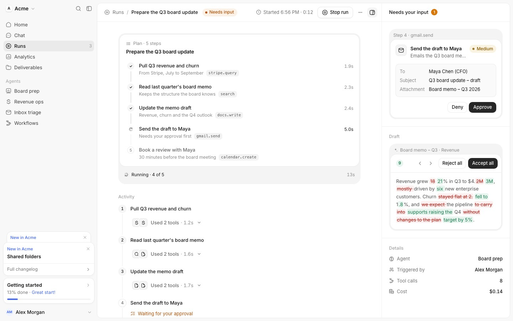

# re-agent-run — affectUI Agent Run 화면 → 세션 디테일 패널 (계획 · 입력 필요 · 머리 · 세부)

Status: 구현 (Phase B, [SHIPPED]) · Date: 2026-10-26 · 기준 main `ff6c9ac` · 이슈 #439 (에픽 #437) · SSOT [`ssot.md`](ssot.md)
레퍼런스: https://www.affectui.com/screens/agent-run (Pro — 코드·CSS·SVG를 옮기지 않는다, 구조·상태·수치만 판독)
앞선 계약: [`../13-dashboard-three-surfaces-spec.md`](../13-dashboard-three-surfaces-spec.md) §3.4–§3.6,
[`../10-agent-inbox-board-spec.md`](../10-agent-inbox-board-spec.md) §3.1-6, [`../12-dashboard-agent-tree-spec.md`](../12-dashboard-agent-tree-spec.md)

## 0. 한 줄 정의

레퍼런스는 자율 실행 하나의 상세 화면이다 — **계획이 어디까지 왔나, 지금 나를 기다리는 게 있나(있으면 그 자리에서 승인/거부), 이 실행은 누가·
무엇으로·얼마에 돌렸나.** 우리 대시보드에서 이 결정은 세션 디테일 패널(`#slide-panel`)에 산다: 고정 Tasks → **계획 카드**, 권한 요청·질문 →
**입력 필요 + 승인 카드**, 칩 줄 → **상태 pill + `시작 HH:MM · 경과` + Stop**, 세션 정보 → **세부(key/value)**. 작업 로그가 Activity다(불변).

## 1. 레퍼런스 해부 [REF]



원천: `docs-J0FQBf8r.js`(props·a11y·responsive), `demo-DyKyMcTT.js`(화면 조립·시뮬레이션), 컴포넌트 청크 — Agent Plan `CabyG3jS`, Approval Card
`D_NiR_dg`, Tool Call Card `CA_4LgO0`, Inline Diff `7zQPnK-d`, Thinking Loader `jpqc9dJC`, App Shell Inset `CpkTNaw9`, Button `x-U6EJWL`.
캡처 `ref/shots/agent-run-full-{a,b,c}.png`(실행 2/5 → 4/5 승인 대기), `screens_agent-run-{light,dark}-*`.

### 1.1 해부 (영역 트리)

```
App Shell Inset (사이드바: Home·Chat·Runs·…, 에이전트 목록, 계정)          ← 셸
└ .ui-ar  main | side panel(360px)
  ├ main
  │ ├ bar 52px: crumb [아이콘 Runs / **title** · phase pill] … [🕘 Started 6:56 PM · 0:12] [Stop run|Run again] [⋯ 메뉴] [패널 토글]
  │ └ scroll (max 680px column, gap 28px)
  │   ├ Agent Plan: head "Plan · 5 steps" + title / ol steps / foot "Running · 2 of 5 … 5s"
  │   ├ Activity: 단계별 entry(번호 원 23px + 제목) → 승인 노트 → Tool Call 그룹 "Used 2 tools · 1.2s"(펼치면 Tool Call Card들)
  │   └ Thinking Loader(sm): 현재 단계 제목 / "Waiting for your approval" / "Done in …"
  └ side panel (aria-label "Run details")
    ├ bar: "Needs your input" + 개수 배지(대기 중일 때 1)
    ├ section: Approval Card(label "Step 4 · gmail.send", actions=card) | 빈 상태 "Nothing needs you yet"
    ├ section "Draft": Inline Diff(원문 ↔ 제안, Reject all / Accept all)
    └ section "Details": dl — Agent · Triggered by · Tool calls(Σ calls) · Cost
```

Plan step 행: grid `22px | 1fr | auto`, gap 12 — marker(20px 원) · main(name 500 + sub: detail · `code` tool 칩) · aside(시간). 단계 사이 rail(1px).
Approval Card: tray(4px, r20) 안의 card(r16, padding 16) — head grid `icon 32px(r9) | titles | risk pill` → preview(r10, dl `max-content | 1fr`, gap 6×16)
→ (always 체크박스) → foot(expires · actions: [Edit ghost] [Deny quiet + `Esc`] [Approve primary + `⌘↵`]).

### 1.2 상태

| 대상 | 상태 | 바뀌는 것 |
|---|---|---|
| run phase | running · waiting · done · stopped | pill 색·문구(Running/Needs input/Done/Stopped), running·waiting은 점이 1.4s 숨쉼; 시간 `Started h:mm · m:ss` → `Done in 1m 20s`; Stop ↔ Run again |
| plan | draft · running · done (+ failed 파생) | draft만 편집(드래그·이름·추가·삭제, Run plan); foot `Running · {현재+1} of N` + 경과 / `Done in …` + Run again / `Stopped · step n failed` |
| step | pending · active · done · failed · skipped | marker: 번호 → 8-ray 스피너 → 체크(그려짐) / `!`(red) / `–`(점선); aside: active 경과(0.1s tick), done 소요; pending 이름은 흐림; failed는 오류 줄 + Retry from here; active `aria-current="step"` |
| approval | pending · approved · denied(·expired) · busy | 해결되면 pending 본문이 위로 흐려져 빠지고(280ms) 한 줄 행 `✓ Approved · just now` / `✕ Denied`; busy = approve 스피너 + 나머지 50% |
| tool call | running · success · error | 스피너/체크/경고 + 시간(ms·s); error는 자동 펼침 |
| side panel | 대기 항목 0 / ≥1 | 빈 상태 카드 ↔ 승인 카드들(최신 먼저) + 배지 |

### 1.3 상호작용 · 키보드

- Approval: `⌘↵`/`Ctrl↵` = Approve, `Esc` = Deny — **카드 안에 포커스가 있을 때**(카드 root `onKeyDown`, defaultPrevented 존중). 버튼에
  `aria-keyshortcuts`("Meta+Enter Control+Enter", "Escape"), kbd 힌트는 플랫폼으로 `⌘↵`/`Ctrl ↵`. 해결되면 포커스는 결과 행(tabIndex -1)으로.
- Plan(draft): Enter/F2 이름 바꾸기, Alt+↑↓ 이동, Delete 삭제, ↑↓ 포커스 이동. 실행 중에는 편집 없음.
- 실행 메뉴(Copy run link · Share · View in Chat), 패널 토글(`aria-pressed`), 1000px 미만에서 패널은 scrim 위 레이어.

### 1.4 모션 (ease `cubic-bezier(.22,1,.36,1)`)

| 무엇 | 수치 |
|---|---|
| marker 내용 교체 pop | scale .5→1 + fade, 360ms |
| 체크 그리기 | stroke 420ms, 지연 80ms |
| rail 채움(완료 단계 아래) | scaleY 0→1, 560ms; rail 자체는 실행 시작 240ms 뒤 fade-in |
| 스피너 | 8 ray, 800ms linear 순환(ray별 100ms 지연) |
| 승인 해결 | pending out 280ms(−6px, blur 2px) → 행 in 420ms(+4px, 지연 120ms); 카드 높이 520ms; 결과 마크 pop 460ms + draw 420ms |
| 배지 | pop scale .6→1 320ms |
| activity entry | rise 8px 420ms, 항목마다 35ms 계단 |
| pill 점 | opacity 1↔.35, 1.4s ease-in-out 무한 |
| reduced motion | 모든 animation/transition 1ms, 스피너 ray 고정 .6, 체크는 그려진 상태 |

### 1.5 토큰 (역할)

ink/text/muted/faint/line 5단 회색, tray `#f0f0f0`·card `#fff`(dark `#111113`·`#19191b`); 상태 — waiting amber(텍스트 `#b45309`, dark `#fbbf24`),
done green, failed red; risk pill low 회색 · medium amber · high red(배경 10–12% 틴트). 반경 card 16 / tray 20 / step 10 / pill 999; 글자 13.5(crumb·
제목), 13(본문·버튼), 12.5(meta·label), 11(tool 칩 mono·kbd). 버튼 높이 32–34, kbd 20.

### 1.6 반응형

- 화면: main 영역 ≤1000px → 시간 숨김, 패널은 오른쪽 레이어(min(360px, 100%−32px)) + scrim 18%; ≤600px → crumb은 제목만, 패널 100%.
- Approval(container): ≤400px → actions 한 줄 전체 폭·균등, kbd 숨김; ≤340px → padding 14, `risk` 단어 숨김. `(hover: none)` → kbd 숨김.
- Plan(container): ≤400px 힌트 숨김, ≤340px 여백 축소.

### 1.7 접근성

Plan `ol aria-label="Plan: <title>"`, 단계별 sr 상태(", In progress"), polite status가 "Step 2 done: …"/"Plan done in …"을 낭독, 시간은
aria-hidden. Approval `role="group"` + `aria-labelledby`(제목 → 해결 후 행) + `aria-describedby`(설명·만료 문장), polite status "Approved: …".
Tool call 상태 낭독("… running/finished/failed"). 아이콘은 모두 장식(aria-hidden).

### 1.8 데이터 계약

`RunStep { id, title, detail, tool, calls: { name, summary, icon?, args?, result?, duration }[], approval?: { title, description,
risk: low|medium|high, details: {label,value}[] } }`, `draft { original, suggested, label? }`, `agent`, `onApprove(stepId)`, `onDeny(stepId)`,
`onStop()`, `onDone()`; Details의 Cost는 데모 상수(`$0.14`), Tool calls = Σ `calls.length`.

## 2. 변경 전 [CODE] (`src/conversation/dashboard.ts`, main `ff6c9ac`)

| 영역 | 현재 | 증거 |
|---|---|---|
| 패널 골격 | 머리(제목·부제·×·칩 줄 `#panel-status`) → body grid: 고정 `#panel-tasks`·`#panel-artifacts` → `#panel-scroll`(세션 정보 → goal → 권한 → 질문 → 에이전트 → 작업 로그 → 대화) → 입력창 | HTML 6181–6234 |
| Tasks | 상태로 재정렬(진행 → 대기 → 완료, 완료 3개 넘으면 접기), 아이콘 이모지(✅ / 🔄 회전 / ○), `#T3` + 내용, 오른쪽 `소요 · 툴 N회`; 진행 중 시간은 `Date.now()`를 markup에 넣어 매 갱신마다 morph; 헤더 `Tasks 2/5 (40%)` | `renderPanelTasks` 6652–6716, `renderPanelTaskItem` 6727–6761, CSS 4641–4701 |
| 권한 요청 | 카드와 같은 블록(`renderPermissionBlock(s,'panel')`): `🔐 Permission Request — <code>tool</code>`, 파라미터 `<pre>`(JSON 문자열), 일치 규칙, 버튼 4개(✅ Approve · ❌ Deny · 💡 Explain · 🔓 Approve & disable rule), 요청자만 활성; 컨테이너 전체가 `aria-live` | 6515–6549, 6560–6575, 상세 GET 2933(`permissionPromptDetail` permission-prompts.ts 66), 응답 `answerPermission` 6610–6645 |
| 질문 | `❓ 질문` + 추천 먼저인 선택 버튼; 매 갱신 `innerHTML` 통째 교체(포커스 유실) | `renderPanelQuestion` 6452–6487, CSS 4273–4292 |
| 입력 필요 머리 | 없음 — 권한·질문이 머리말 없이 스크롤 영역 중간에 나온다 | — |
| 머리 칩 | `세션` + 상태 아이콘·단어(`role="status"`) + Σ 활성 시간(`card-timer-live` acc+leg) … Slack · 액션 하나 | `panelHeadHtml` 9181–9197, CSS 4833–4849 |
| 세션 정보 | 접기 버튼 = 요약 한 줄(소유자 · 워크플로 · 토큰 · 비용 · ctx · 최근) + 링크; 펼치면 `pi-grid`(소유자·워크플로·환경·입력·출력·캐시 읽기·캐시 쓰기·비용), 컨텍스트 바, Σ·압축·세션 | `panelInfoHtml` 9211–9251, CSS 4850–4871 |
| 작업 로그 | 접기 머리 `작업 로그` + task별 그룹(`wlGroupOf` 12034, 그룹 머리 `.wl-group-head` 4733) + 항목 종류(지시·도구·결과·응답…) + 상세 복사 | 6215–6218, 11557–12311 |
| 착지·포커스 | 권한 → 질문 블록에 착지, 키보드로 열면 첫 활성 버튼(= Approve)에 포커스; Esc는 패널 닫기 | `landPanel` 12480–12520, `focusPanelLanding` 12669–12680, keydown 13003–13014 |
| 시계 | 1 Hz `updateTimersIn`: `.card-timer-live`(leg/acc) · `.rel-time` · `.task-elapsed`(data-since) | 7230–7251 |

데이터(서버, 이미 클라이언트에 온다): `DashboardTask {id:'T<n>', content, activeForm?, status, startedAt?, completedAt?, toolCalls}`(312, id는
task-ledger.ts 88); 서버는 유휴 세션의 `in_progress`를 `pending`으로 내린다(`normalizeTaskProgress` 1181, `sessionHasCurrentTask` 1203 — 진행 중
task가 있으면 세션은 working·waiting·resuming). `agentRoot.toolCalls` = 메인 에이전트의 모든 도구 호출(agent-registry.ts 294), 서브에이전트는
`agents[].toolCalls`(최대 40개, `agentsTotal`). `pendingPermissions[] {approvalId, toolName, requesterId?, rules[], canDisableRule, createdAt,
expiresAt}`(permission-prompts.ts 24) — 만료 5분(permission-mcp-server.ts 142), 지나면 레코드 삭제(shared-store.ts 123). 상세 `input`은 pretty JSON
문자열, 64KB에서 잘림(`truncated`). `model`, `ownerName`, `tokenUsage.totalCostUsd`, `activeLegStartedAtMs`, `activeAccumulatedMs`.

변경 전 캡처(harness, 포트 34102): `harness/shots-agent-run/before-agent-run-{light,dark}-{desk,phone}-panel-{conv-run,conv-wait}.png`.

## 3. 차이표

| 레퍼런스 요소 | 현재 | 결정 | 근거(데이터 출처 / 불채택 이유) |
|---|---|---|---|
| Plan 카드(순서대로, marker·rail·aside) | 상태 재정렬 목록 | **변형** D1–D5 | `s.tasks`(현재 목록) 원래 순서. 패널 폭·고정 높이(≤240px) 때문에 tray/카드 이중 테두리 없이 띠 안에 |
| marker 번호(pending) | ○ | **변형** D2 | 행에 이미 `#T3` id(카드 face `#T2`와 같은 참조, 테스트 고정) — 번호를 또 그리면 이중 번호. pending = 빈 고리 |
| step detail + tool 칩 | `툴 N회`(오른쪽) | **변형** D4 | detail 원천 없음 → active 단계만 `activeForm`; 칩은 도구 이름이 아니라 `툴 N회`(task가 아는 것은 횟수) |
| step aside 시간 | `소요`/`Date.now()` 경과 | **채택** D5 | `completedAt−startedAt`, active는 `.task-elapsed`(markup에 시계 없음) |
| failed · skipped · Retry from here | — | 불채택 | TodoWrite 상태는 pending·in_progress·completed뿐, 재시도 API 없음 |
| draft 편집(드래그·이름·추가·삭제·Run plan) | — | 불채택 | 계획은 모델의 TodoWrite — 사람이 고칠 경로 없음 |
| Plan foot `Running · i of N` + 경과 / Done in | 헤더 `2/5 (40%)` | **변형** D6 | 단계 순번 대신 `완료/전체`(카드 face와 같은 어휘, spec 13 §3.1); 경과 = min `startedAt`부터 |
| Plan 낭독(`Step n done`) | 없음 | **채택** D7 | 이전 렌더와 상태 비교 |
| estimate · Run again | — | 불채택 | 추정치·재실행 경로 없음 |
| "Needs your input" + 배지 | 없음 | **채택** D9 | `pendingPermissions.length` + 질문 1 |
| 빈 상태 "Nothing needs you yet" | — | 불채택 | 한 열 패널에서 빈 상자는 대화를 밀어낸다 — 0이면 섹션을 숨긴다 |
| Approval 카드(label·icon·title·desc·pill·details·actions) | Slack 카드 복제 블록 | **변형** D10–D13 | label = 도구 + 요청 시각(`createdAt`) — 요청은 task·에이전트를 싣지 않으므로 진행 중 task에 붙이지 않는다(서브에이전트가 물었을 수 있다); desc = `input.description`(요청자만); details = 상세 JSON 최상위 키 |
| risk pill low/medium/high | 규칙 목록 | **변형** D11 | 위험 등급 데이터 없음 → 일치한 위험 규칙 수(`rules`)만: `위험 규칙 n` / `도구 승인` |
| Always allow 체크박스 | 🔓 버튼 | **변형** D12 | `approve_disable_rule`은 이 세션에서 그 규칙만 끈다 — 숨은 체크 상태 대신 보이는 ghost 버튼(`canDisableRule`일 때만) |
| Edit(ghost) | 💡 Explain | **변형** D12 | 우리 네 번째 답 `explain`이 그 자리 |
| ⌘↵ / Esc | 없음 | **채택(가드)** D14 | Esc는 카드의 **버튼**에 포커스가 있을 때만 — 키보드 착지 포커스를 카드 자체로 옮겨, 패널 닫으려던 Esc가 거부가 되지 않게 |
| busy 스피너 | `...` | 유지 | `answerPermission` 공유(카드 경로와 테스트 고정) |
| 해결 행 `✓ Approved · just now` + 낭독 | `✓ ✅ Approve` 버튼 글자 | **채택** D15 | 보낸 답(`_permAnswered`)은 이 페이지가 안다; 보드 push가 요청을 지우면 사라진다 |
| Expires in m:ss(hover·focus 때 멈춤) | — | **변형** D16 | `expiresAt` 있음(5분). 서버 시계는 멈추지 않으므로 멈춤 없음 |
| 질문 | 노란 블록 | **변형** D17 | 같은 카드 틀(제목은 질문 전문, 줄바꿈), 선택지는 버튼; 다중 질문 폼은 그대로 |
| crumb `Runs / title` | 제목 h3 + 부제 | **변형** D18 | 패널 제목이 crumb의 끝 항목, `세션` 라벨이 섹션 — 상위 경로는 보드 제목이 이미 말한다 |
| phase pill | 테두리 칩 | **변형** D18 | 마크업·클래스 유지(테스트 고정), 틴트 pill로. 점 대신 우리 상태 아이콘(스피너·시계) |
| `Started h:mm · m:ss` / `Done in` | Σ 활성 시간 | **채택** D18 | `activeLegStartedAtMs`(이번 턴), 유휴면 Σ `활성` |
| Stop run · Run again · ⋯ 메뉴 · 패널 토글 | Stop/Close/Trash 하나 + Slack | 유지 / 불채택 | 액션은 `sessionActionHtml` 그대로; 재실행·공유 경로 없음, 패널은 이미 오버레이 |
| Details(Agent · Triggered by · Tool calls · Cost) | pi-grid | **변형** D19 | model · ownerName · `agentRoot.toolCalls`+Σ`agents[].toolCalls` · `totalCostUsd` (+ 활성 시간). 세션 정보 펼침 본문에서 컨텍스트 블록(#441) 다음, 누적 토큰 `pi-grid` 앞(접힘 기본은 spec 13 그대로) |
| Activity(entry·Tool Call 그룹·Tool Call Card) | 작업 로그(task 그룹·도구·결과·상세 복사) | 유지 D20 | 같은 일을 이미 한다 — 손대지 않는다 |
| Thinking Loader | — | 불채택 | 진행 신호는 계획 스피너 + foot `실행 중`이 이미 말한다(두 번째 진행 표시 = 중복) |
| Inline Diff(Draft, Accept/Reject) | — | 불채택 | 세션에 "원문 ↔ 제안" 쌍이 없다; 수락/거절 API 없음(§6 후속) |
| App Shell Inset | 대시보드 상단바·보드 | 불채택 | 셸은 대시보드 자체 |

## 4. 계약 (TO-BE)

모든 클라이언트 코드는 `renderDashboardPage` 템플릿 안(백틱·`${` 금지, 역슬래시 이중). 모델·사용자 글자는 `esc`/`escAttr`, id는 `data-*`.
새 색 토큰 없음 — 틴트는 `color-mix(in srgb, var(--st-*|--ag-c) N%, transparent)`, 다크 기본 · light는 기존 변수로 따라온다. 모션은
`--dur-move`/`--dur-fade`/`--ease-out`, reduced motion은 전역 규칙(5126)이 끝 상태를 보이게 둔다.

**계획 카드 — `#panel-tasks` (고정 띠, `.panel-tasks` 규칙 불변)** [SHIPPED]
- **D1 순서·구조**: 현재 목록을 원래 순서로 `<ol class="pl-list" aria-label="계획 단계">`, 각 `<li class="panel-task-item pl-step <status>"
  data-step="done|active|pending" title="시작 → 완료 시각">`, grid `18px | minmax(0,1fr) | auto`, gap 10. 빈 목록 markup은 그대로
  (`Tasks` 헤더 + `아직 작업 목록이 없습니다`). 머리는 `Tasks`(+ 스코프 `· A2 …`) — 진행률은 foot로 옮긴다.
- **D2 marker**(18px 원, aria-hidden): completed = `agentIconHtml('completed')` 체크, `--ib-pill` 배경; in_progress = `agentIconHtml('running')`
  스피너, 테두리 없음; pending = 1px `--ib-card-border` 빈 고리. 직전 렌더 대비 상태가 바뀐 행에만 `pl-pop` → marker pop(scale .6→1 + fade, `--dur-move` `--ease-out`).
- **D3 rail**: 마지막 단계를 뺀 각 단계 marker 아래부터 다음 marker까지 1px `--ib-card-border`; 완료 단계 아래는 `::after`가 `--text-tertiary`로
  scaleY 0→1(`--dur-move`).
- **D4 글**: 1행 = `<span class="task-id">#T4</span>` + `<span class="task-text">내용</span>` + 칩 `툴 N회`(pending 아님, `toNum(toolCalls)`);
  2행(진행 중만) = `activeForm`이 있고 내용과 다를 때. 완료 글은 `--text-secondary`, 진행 중 `--text` 600.
- **D5 시간(aside, tabular, aria-hidden 아님)**: 완료 + 두 시각 → `formatDuration(completedAt−startedAt)`; 진행 중 → `<span class="task-elapsed"
  data-since="startedAt">` — markup에 `Date.now()` 없음(같은 데이터면 아무것도 쓰지 않는다); 쓴 뒤 `updateTimersIn(container)`.
- **D6 foot**(띠 바닥에 `position: sticky; bottom: 0`, 12.5px): 단계에서만 정한다 — 진행 중 있음 → 스피너 `실행 중 · d/N` + 오른쪽
  `.task-elapsed`(data-since = min `startedAt`); 전부 완료 → 체크 `완료 · N/N` + 오른쪽 정적 합계(max `completedAt` − min `startedAt`);
  그 외 → 점 `대기 · d/N`. d = 완료 수, 단어는 `AGENT_STATUS_LABEL`. 완료 3개 초과 접기: 가장 이른 완료부터 숨기고 그 자리에 토글 행
  (`Show N more completed` / `Hide completed` 유지). 이전 목록(`이전 task N개`)은 같은 행 렌더러, rail 없음.
- **D7 낭독**: 띠 안 `<span class="ar-vh pl-live" role="status" aria-live="polite">` — 같은 스코프의 직전 렌더와 비교해 완료로 바뀐 단계를
  `T3 완료: <내용>`으로. 패널 열기·스코프 전환의 첫 렌더는 조용하다. 활성 단계 `aria-current="step"`, 행마다 sr 상태(`, 완료`/`, 진행 중`/`, 대기`).

**입력 필요 — 권한 요청 · 질문 (`#panel-scroll` 안, `#panel-permission` 바로 앞)** [SHIPPED]
- **D8 정적 요소**: `<div class="panel-needs-head" id="panel-needs-head" hidden>` + `<p class="ar-vh" id="panel-needs-status" role="status"
  aria-live="polite">`(늘 존재, 시각적으로 숨김). `#panel-permission`의 `aria-live` 제거(만료 시계가 매초 낭독되지 않게).
- **D9 머리**: `입력 필요` + 배지(`--st-wait` 바탕, 18px, 등장 시 pop `--dur-move`) = `pendingPermissions.length` + (질문이 보이면 1, 다중
  질문도 1). 0이면 hidden. `renderPanelPermission`·`renderPanelQuestion`이 끝에서 같이 갱신. `landPanel`은 머리가 보이면 착지 위치를 머리 높이만큼
  올린다(카드가 아니라 머리말이 화면 위에 오게).
- **D10 권한 카드**(패널 전용 렌더러; 카드 face의 `renderPermissionBlock(s,'card')`는 불변): `<div class="ap-card perm-request" role="group"
  tabindex="-1" data-approval-id aria-labelledby=제목 aria-describedby=설명·만료>` — label 줄 `Bash · 오후 08:53 요청`(요청이 증명하는 것만: 도구 +
  `createdAt`; **task id·제목은 싣지 않는다** — 권한 payload에 taskId·agentId가 없어 진행 중 task가 그 요청의 주인이라는 근거가 없다, 서브에이전트일
  수 있다. 질문 카드에는 label 줄이 없다) → head(아이콘 타일 32px r8 `--ib-pill` · 제목 `Bash 실행 승인` 14px 600 · 설명 = 상세
  `input.description`(요청자만, 1줄 말줄임) · pill) → 세부 → 일치 규칙(`code id — label: description`, 기존 문구) → 보조 답 줄(ghost) → foot(만료 · 버튼).
- **D11 pill**: `rules.length > 0` → `위험 규칙 n`(`data-kind="rule"`, `--st-fail` 틴트·글자 `--st-fail-text`); 아니면 `도구 승인`(`data-kind="tool"`,
  `--ib-pill`/`--text-secondary`).
- **D12 세부·버튼**: 요청자 + 상세 로드됨 + `JSON.parse(input)`가 객체 → `<dl class="ap-details">`(`max-content | 1fr`, gap 6×16, 키 muted,
  값 pre-wrap mono 12px, 문자열은 그대로·그 외 `JSON.stringify(v,null,2)`, `description` 키는 설명으로 갔으니 제외, 목록 max-height 320px 스크롤);
  잘림·파싱 실패·객체 아님 → 기존 `<pre class="perm-params">`(+ 잘림 안내); 요청자 아님·형제 인스턴스·로딩·오류 → 기존 문구. 버튼 순서
  `[Explain] [Approve & disable rule]`(ghost, 후자는 `canDisableRule`일 때만) … `[Deny]`(quiet) `[Approve]`(primary = `--text` 바탕) — 모두
  `btn-perm` + 기존 `data-perm-key/id/decision`(위임 핸들러 그대로), 요청자 아님 → `disabled` + 잠금 title. kbd 힌트는 `data-kbd` +
  `::after { content: attr(data-kbd) / "" }`(낭독 안 됨, `answerPermission`의 `textContent` 그대로) — Deny `Esc`, Approve `⌘↵`(Mac) / `Ctrl ↵`;
  `aria-keyshortcuts`. coarse 포인터 44px.
- **D13 컨테이너 반응형**: `.ap-card { container-type: inline-size }` — 380px 미만: actions 한 줄 전체 폭·균등(flex 1), kbd 숨김; 320px 미만:
  padding 12, pill은 숫자만(`위험 n`). `(hover: none)` kbd 숨김. 폰(패널 100%)은 같은 규칙으로 접힌다.
- **D14 키보드**: `#panel-permission`·`#panel-question`에 **요소 수준** keydown(`apKeydown`, 버블링에서 문서 처리기보다 먼저) — `⌘/Ctrl+Enter`: 포커스가 활성 권한 카드 안 어디든 → 그 카드의
  Approve 클릭 / 질문 카드 → 추천 선택지가 있을 때만 그 버튼. `Esc`: 포커스가 권한 카드의 **버튼**일 때만 Deny. 처리한 키는 `preventDefault` +
  `stopPropagation`(문서 수준 Esc 처리기 — 패널 닫기 — 에 닿지 않는다); 그 밖의 Esc(카드 자체 = 키보드 착지 포커스)는 지금처럼 패널을 닫는다. `focusPanelLanding`의 질문·권한 착지는 첫 `.ap-card`(버튼 아님).
- **D15 답한 뒤**: `answerPermission` 성공 → `_permAnswered[approvalId] = decision` + 열린 패널만 다시 그린다(카드 face는 지금처럼 잠긴 버튼).
  패널 카드는 요청이 payload에 남아 있는 동안 한 줄 행 `✓ 승인함` / `✕ 거부함` / `? 설명 요청함` / `✓ 승인함 · 규칙 끔`(+ `· 방금`)으로 바뀌고
  (fade + 4px rise `--dur-move`), `#panel-needs-status`가 `승인을 보냈습니다 — Bash`(답별 문구)를 말한다. 열려 있는 동안 새 요청이 오면
  `승인 요청 — Bash`. 실패는 지금처럼 `.perm-note role="alert"`.
- **D16 만료**: foot 왼쪽 `만료까지 m:ss` = `<span class="ap-expires" data-until="expiresAt" aria-hidden="true">`, `updateTimersIn`에 한 갈래 추가
  (0에서 멈춤); 60초 이하 `--st-wait`. sr 설명엔 정적 `HH:MM에 만료`.
- **D17 질문 카드**(`user_choice`): 같은 틀(label 줄 없음 — task에 귀속하지 않는다), 제목 = 질문 전문(`pre-line`, 말줄임 없음), pill `질문`, 선택지는 세로 쌓기
  (추천 = primary 먼저, 나머지 quiet, `id. label — description`), `.panel-question-choices` + `.btn-choice` + `choiceDataAttrs` 유지(`answerChoice`
  불변). 마크업이 같으면 쓰지 않고 바뀌면 morph(포커스 유지). `user_choices`(다중) 폼은 그대로, 머리 개수에만 든다.

**머리 · 세부** [SHIPPED]
- **D18 머리 칩 줄**: `.ps-chip` 마크업·클래스 그대로(`ps-label 세션` · `ps-icon` · `ps-word role="status"`), 모양만 pill — 배경
  `color-mix(in srgb, var(--ag-c) 13%, transparent)`, 테두리 없음, r 99px, 높이 24px. `.ps-time`: 실행·대기(leg > 0) → 시계 아이콘 + `시작 <formatTaskTime(leg)> ·
  <card-timer-live data-leg-started=leg data-accumulated=0>`(title `이번 턴 시작 · 경과`); 그 외 acc > 0 → `활성 <card-timer-live 0, acc>`. Slack ·
  액션 그대로.
- **D19 세부**(`panelDetailsHtml(s)` — `panelInfoHtml` 바로 뒤의 별도 함수, `<dl class="pi-details">`, 행 = 라벨 왼쪽 muted · 값 오른쪽 `--text`
  tabular). 펼친 본문 순서는 두 브랜치 공통으로 고정: 컨텍스트 블록 `cw`(#441) → **`pi-details`** → 누적 토큰 `pi-grid`(4행) → `pi-thread`. 이 브랜치는
  본문을 `var body = panelDetailsHtml(s) + '<dl class="pi-grid">'…`로 시작한다(#441이 본문 앞에 `cw`를 둔다). 세부 행:
  에이전트 = `model`(`claude-` 제거) · 시작한 사람 = `ownerName` · 도구 호출 = `toNum(agentRoot.toolCalls) + Σ toNum(agents[].toolCalls)`
  (`agentsTotal > agents.length`면 `N+`, title `메인 a · 서브에이전트 b`) · 비용 = `$totalCostUsd.toFixed(2)` · 활성 시간 = `card-timer-live`(acc +
  진행 중 leg) · 워크플로 · 환경. `pi-grid`의 소유자·워크플로·환경·비용 행은 세부로 옮긴다(입력·출력·캐시 4종은 남는다). 접힌 요약 줄 불변.
  (도구 호출은 Σ task `toolCalls`가 아니다 — task 밖·이전 목록의 호출을 빠뜨린다. `agentRoot`가 메인의 전부를 센다.)
- **D20 작업 로그 불변**(Activity 대응): 머리 `작업 로그`, task 그룹, 문자열·마크업 그대로. [SHIPPED — 변경 없음]

**고정 문자열 — 의도적으로 바꾸는 것 1개**: `dashboard-three-surfaces-client.test.ts:521`
`'class="card-timer-live" data-leg-started="' + T0 + '" data-accumulated="65000"'` → 머리는 이번 턴만(`data-accumulated="0"` + `시작 `), Σ는 세부로(D18/D19).
그대로 지키는 것: `ps-chip is-running` · `<span class="ps-label">세션</span>` · `ps-word role="status"` · `aria-label="Stop — 세션 중지"` ·
빈 Tasks markup · `#T4`/`툴 12회` · `이전 task 1개` · `.panel-tasks` CSS · `renderPermissionBlock` 카드 출력 전부 · 위임 핸들러 문자열 ·
`renderPanelPermission(...)` 3곳 · 패널 id 순서 · 세션 정보 요약/펼침 문자열 · 작업 로그 머리.
harness 의존 목록만 늘린 테스트(문자열 변경 없음): agent-tree-client 1168, three-surfaces-client 561·1140, live-surfaces-client 349,
agent-inbox-client 2834(openPanel), permission-client 프렐류드(`_permAnswered`). spec 13 §3.1 표·§3.4 머리 칩 줄도 D18에 맞췄다.
모션: 새 애니메이션은 `--dur-move`/`--ease-out`, 끝 상태가 보이는 `both` fill — reduced motion은 전역 규칙(`*` 0.01ms)이 처리한다. 이 영역 전용
`@media (prefers-reduced-motion)` 블록은 두지 않았다: `dashboard-agent-inbox.test.ts` 453이 **첫** reduced-motion 블록에서 `.spinner, .spin`을
찾으므로, 그보다 앞(이 CSS 자리)에 블록을 두면 그 고정 테스트가 깨진다. 승인 카드의 터치(`pointer: coarse` 44px)·`hover: none`·hover 규칙은
공유 터치 블록(`@media (max-width: 639px), (pointer: coarse)`) **뒤**의 자기 블록에 있다.

## 5. 시험

`src/conversation/__tests__/dashboard-affectui-agent-run-client.test.ts`(three-surfaces-client 1–60의 harness, 37개). 변경 전 35/35 RED(§7).

| # | 시험(describe › it 요지) | D |
|---|---|---|
| T1 | plan › original order, one marker per state, the active step is the current one(행마다 sr 상태) | D1 D2 |
| T2 | plan › the rail joins the markers; the segment under a done step fills(CSS) | D3 |
| T3 | plan › id, title and tool chip on one line; the active step adds its activeForm | D4 |
| T4 | plan › a done step shows its duration; the active one a 1 Hz clock(같은 데이터 → 쓰기 1회) | D5 |
| T5 | footer › running / all done / idle; more than three done fold in place; earlier lists | D6 |
| T6 | announcements › first render silent, a completed step announced once + pop; another scope / new opening silent | D7 |
| T7 | needs-input › page markup(hidden head 앞, polite status, 카드엔 aria-live 없음); count; landing offset · 카드 포커스 | D8 D9 D14 |
| T8 | approval card › label·title·desc·rule pill·details·rules·네 답; no rule; another viewer locked · requester fetches | D10–D12 |
| T9 | approval card › **a prompt is never attributed to the task in progress**(권한·질문 카드 모두 `T3`·task 제목 없음) | D10 D17 |
| T10 | approval card › D12 key/value(escape, description 분리) · `<pre>` 대체; D13 container·kbd CSS | D12 D13 |
| T11 | keyboard › ⌘↵/Ctrl↵ approve; Esc only from a card button; locked ignored; question ⌘↵ = 추천만; **Esc end to end**(요소 처리기 → 문서 처리기 버블링: 버튼에서는 거부 + 패널 유지, 카드에서는 패널 닫힘); 두 슬롯 바인딩 | D14 |
| T12 | after an answer › 결과 행 4종; `answerPermission`이 `_permAnswered` 기록 + 패널만 다시 그림, 한 번 낭독; 열려 있는 동안 온 요청 낭독 | D15 |
| T13 | expiry › `만료까지 4:12` · 0:00에서 멈춤 · 60초 이하 `is-low` | D16 |
| T14 | question card › 같은 틀, 질문 전문, 추천 먼저; 바뀐 때만 morph, 다중 질문 폼 불변 | D17 |
| T15 | head › 실행 중 `시작 ` + leg/acc 0, 유휴 `활성` Σ, pill CSS | D18 |
| T16 | 세부 › 7행 값, `N+`, 유휴 leg 0, 기록 없으면 도구 호출 없음; 본문 순서 세부 → pi-grid → pi-thread, pi-grid엔 토큰 4종만 | D19 |
| T17 | hygiene › 새 이름 1회 선언, 새 CSS에 색 토큰 선언 없음 | 전체 |

## 6. 범위 밖 · 후속

- **새 승인 카드는 패널 전용이다.** 펼친 카드(`renderCardBody`)의 권한 블록(`renderPermissionBlock(s,'card')`)은 이 에픽에서 지금 모양을 유지한다 —
  바뀌는 것은 그 Approve가 잉크 primary가 되는 것뿐이고 #438(agent-inbox) 소유다. 카드의 task 창(`renderTimeline`)도 #438.
- 권한 요청을 task·에이전트에 귀속시키기: 권한 payload에 `taskId`/`agentId`를 싣는 서버 변경이 먼저다(그 전에는 카드에 task를 쓰지 않는다 — D10).
- Inline Diff 후속: 작업 로그의 Edit/MultiEdit 도구 상세(`old_string`/`new_string`)를 단어 단위 diff로; `.diff`/`.patch` 산출물 색칠.
- 계획 단계 → 그 task의 작업 로그 그룹으로 가는 링크; 질문 답 낭독; 다중 질문 폼의 카드 틀.
- 병합 주의: `panelInfoHtml`은 context-window(#441) 브랜치도 고친다 — 이 브랜치는 `panelDetailsHtml` 호출 한 줄 + 행 4개 이동만 한다.
  `renderPermissionBlock`·`renderTimeline`(카드)은 건드리지 않는다(#438과 겹치지 않게). `updateTimersIn`에는 `.ap-expires` 한 갈래만 더한다.

## 7. 검증

- RED(구현 전, `harness/red-agent-run.log`): `Tests 35 failed (35)` — `client function planFootHtml not found`(9), `client var AP_ANSWERED not found`(7),
  `apKeydown not found`(3), `panelDetailsHtml not found`(2), … 및 CSS·마크업 단언 실패.
- GREEN: 새 파일 37/37. 게이트 — `npx vitest run src/conversation/__tests__/ --testTimeout=60000 --hookTimeout=60000`: 62/63 files,
  1684/1685 — 실패 1건은 `public-url.test.ts`의 임시 디렉터리 정리 경합(`ENOTEMPTY …/public-url-instances-*`, 이 브랜치가 건드리지 않은 파일)이고
  그 파일만 다시 돌리면 34/34 통과(머신 load ≈115 — 기본 5s/10s 타임아웃에서는 무관한 서버 테스트가 시간 초과로 떨어진다). 같은 트리를
  `--testTimeout=120000 --hookTimeout=180000 --maxWorkers=4`로 돌린 실행은 **63 files · 1685 tests 모두 통과**. `npx tsc --noEmit` exit 0.
  `npx biome check src/conversation/` 오류 0, 경고 687 = main과 같다(새 경고 0).
- 화면(harness, 포트 34112, 샌드박스 TMPDIR의 shared store에 권한 요청 1건 시드, 요청자 상세·응답 POST는 Playwright가 대신 응답):
  `harness/shots-agent-run/after-agent-run-{light,dark}-{desk,phone}-panel-{run,run-info,wait}.png`,
  `…-desk-panel-{question,answered}.png`(카드에 포커스 → ⌘↵ → 결과 행, 상태 줄 `승인을 보냈습니다 — Bash`, 패널 열린 채).
  변경 전: `before-agent-run-*`(같은 폴더).
