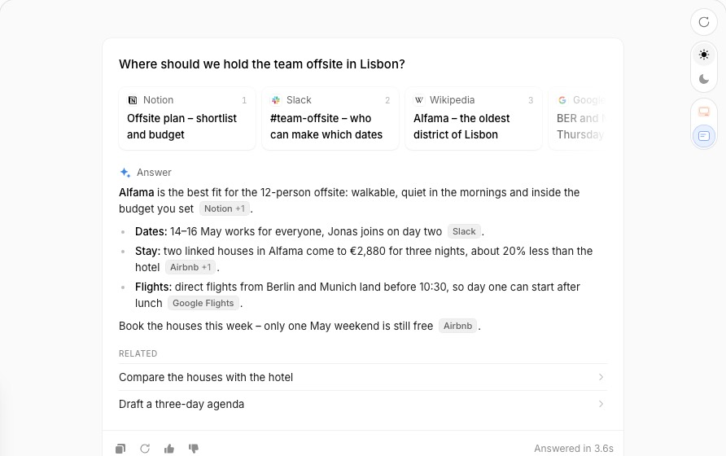

# RE — AI Answer → 세션 패널 대화의 모델 응답 턴

Status: 구현 [SHIPPED] · Date: 2026-10-26 · 기준 main `ff6c9ac` · 이슈 #440 (에픽 #437) · SSOT [`ssot.md`](ssot.md)
레퍼런스: <https://www.affectui.com/components/ai-answer> — affectUI **Pro**. 코드·CSS 본문·SVG는 옮기지 않는다. 구조·상태·수치만 읽고,
대시보드 토큰(`--surface*`, `--text*`, `--ib-*`, `--st-*`, `--ease-out`, `--dur-*`)으로 다시 짠다.

## 0. 한 줄 정의

레퍼런스는 **"이 답을 믿고 움직여도 되나"**에 답한다. 답 본문, 각 주장의 출처(카드·인용 칩), 가져가기(복사)를 한 카드에 담는다.
대시보드에서 그 자리는 세션 패널 대화(`#panel-turns`)의 **assistant 턴**이다. 접힌 면은 지금처럼 요약이고, 펼치면 **답변 카드**가 열린다.
카드에는 렌더한 마크다운, 답변에 든 링크의 번호 카드와 링크 칩(서로 강조), 복사가 들어간다. 헤더에는 응답 시간이 붙고,
답을 쓰는 동안은 `응답 작성 중` 행이 보인다. 근거 데이터가 없는 재생성·피드백·후속 질문은 만들지 않는다.
답변에 링크가 있다는 사실은 그 링크가 주장의 근거라는 증거가 아니다(결과 링크·대상·반례도 같은 모양이다). 그래서 이 표면은
레퍼런스의 **출처·인용**이라는 말을 쓰지 않고 **링크**라고 부른다(리뷰 R1 P1). 출처·인용이라는 말은 명시적 인용 매핑이 생길 때를 위해 남긴다(§6).

## 1. 레퍼런스 해부 [REF]



원천: `ref/bundle/ai-answer/docs-DnStOjCc.js`(props·keyboard·a11y·motion·responsive), `RE-css.txt`, `RE-strings.txt`, `demo-NvLm8mGU.js`.
캡처: `components_ai-answer-{light,dark}-t1`(작성 중)·`t2`(완료).

### 1.1 구조

```
.ui-ans  tray(패딩 4, 반경 20, 최대 640px, container inline-size)
├─ card(반경 16, 1px 링, 높이 glide) > inner(22/24/20)
│  ├─ h3 question                       18px/600
│  ├─ [role=list aria-label=Sources]    출처 줄: 가로 스크롤, 양끝 마스크 페이드
│  │   └─ [role=listitem] > a.source    172px, 반경 12 — site(favicon·이름·번호) + title(2줄 clamp)
│  ├─ label                             마크(눈 달린 블롭 SVG) + 단계 문구(Reading N sources → Writing → Answer)
│  ├─ answer[aria-busy]                 p / ul>li, 단어 span, button.cite(이름 [+N]), 캐럿(8px 점)
│  └─ follow                            "Related" + 후속 질문 행(→)
├─ foot(42px)                           완료: copy·regenerate·👍·👎(32px) … status[aria-live=polite] / 작성 중: Stop
├─ reasons                              👎 뒤 사유 4개(0fr→1fr)
└─ pop[role=tooltip]                    칩 미리보기: 제목 + snippet 3줄
```

### 1.2 상태

| 상태 | 바뀌는 것 |
|---|---|
| reading | 라벨 `Reading N sources`(shimmer), 출처 카드 순서대로 등장. 길이 700 + 90×N ms(번들 상수 `700`, `90`) |
| writing | 라벨 `Writing`(shimmer), 단어가 초당 38개(`speed`, rAF), 마지막 단어 뒤 캐럿, foot = `Stop`, answer `aria-busy=true` |
| done | 라벨 `Answer`, 후속 질문, 액션 4개, status `Answered in X.Xs`(시작→끝, 0.1s 반올림, 최소 0.1) |
| stopped | status `Stopped`. 단어가 0개면 `Stopped before answering.` |
| copied | 아이콘 → 초록 체크, status `Copied`, 1800ms 뒤 복귀 |
| 👍 / 👎 | `aria-pressed`. 👍 → `Thanks for the feedback`. 👎 → `What went wrong?` + 사유(`Not accurate`·`Wrong source`·`Too long`·`Out of date`) → Thanks |
| lit | 칩 hover/focus/click → 미리보기 + 그 출처 카드 링. 출처 카드 hover → 그 칩 반전 |
| 새 답 | 새 텍스트가 이전 텍스트의 접두가 아니면 처음부터 다시 그린다 |

### 1.3 상호작용 · 키보드

- Tab: 출처 카드 → 인용 칩 → 후속 질문 → 액션. Esc: 포커스한 칩의 미리보기를 닫는다.
- 칩 미리보기: 폭 min(300, 루트−16), 칩 아래 6px, 가로는 루트 안 8px로 clamp. 떠나면 140ms 뒤 닫히고, 그 사이 미리보기에 올라가면 유지된다.
  클릭은 토글이다. 터치에서는 탭으로 연다.
- 복사: 마크업을 뺀 본문 + `\n\nSources:\n[n] title – href`. Regenerate는 처음부터 다시 스트림한다. Stop은 경과를 기록한다.

### 1.4 모션

| 요소 | 동작 | 시간 · easing |
|---|---|---|
| 출처 카드 | translateY 6px·scale .96 → 제자리 | 460ms, 지연 120 + 90×i ms |
| 단어 | opacity 0·blur 3px → 선명 | 420ms |
| 인용 칩 | scale .8 → 1 | 380ms |
| 캐럿 | scale .6·opacity .45 왕복 | 1s ease-in-out 무한 |
| 단계 라벨 | 글자 위 빛 sweep | 1.6s linear 무한 |
| 미리보기 | translateY −4px·scale .98 → 제자리 | 200ms |
| 카드 높이 | inner 높이를 따라감(ResizeObserver) | 360ms |
| 액션 · 후속 질문 | fade-up 3px | 320ms(40ms 계단) · 380ms(80 + 60×i) |
| hover 색 · regenerate | 배경·색 / 아이콘 120° 회전 | 140–160ms / 300ms |

easing은 모두 `cubic-bezier(0.22, 1, 0.36, 1)`. `prefers-reduced-motion`이면 모든 animation·transition을 끄고 답을 한 번에 보인다.

### 1.5 토큰

색 역할 11개(tray·card·line·ink·text·muted·faint·chip·chip-hover·lit 반전·lit-ring)에 성공색 하나가 더해진다. light는 흰 카드 + 옅은 회색 칩이고,
dark(`.dark`/`[data-theme=dark]` 조상)는 #19191b 카드 + #232326 칩이다. lit은 잉크색과 카드색을 맞바꾼다.
반경: tray 20 · card 16 · 출처 12 · 미리보기 14 · 액션 9 · 칩 6. 글자: 질문 18/600 · site 12 · 번호 11(tabular) · 출처 제목 12.5 ·
라벨 13/500 · 본문 15/1.65(문단 간격 12, li 6) · 칩 11.5/500(높이 20) · status 12.5.

### 1.6 반응형 · 접근성

- 컨테이너 640px까지 채운다. `@container ≤480px`: 패딩 18, 질문 16.5, 출처 152px, 본문 14.5. `≤330px`: status 앞말 `Answered in`을 숨긴다.
- coarse: 액션 40px, foot 48, Stop 36, 사유 36, 후속 질문 46. 칩 히트 영역은 `::after`로 위아래 10px·좌우 4px 넓힌다.
- 칩은 출처 이름을 단 button(`Source: <titles>`)이고, 미리보기는 `role=tooltip` + `aria-describedby`다. 출처는 `role=list/listitem`이다.
  스트리밍 중에는 answer가 `aria-busy`이고, copy·feedback·stop은 polite live region이 읽는다. 장식 SVG와 캐럿은 `aria-hidden`이다.

### 1.7 데이터 계약 (props)

| prop | 타입 · 기본값 | 뜻 |
|---|---|---|
| `question` | string | 출처 위 제목 |
| `sources` | `{title, name, href?, icon?, snippet?}[]` | `name` = 칩 라벨 |
| `answer` | string | 빈 줄 = 문단, `- ` = 목록, `**굵게**`, `[1]`/`[1,3]` = 1부터 세는 인용 |
| `streaming` · `animate` · `speed` | bool · bool=true · 38 | 더 올 텍스트 / 흘려 보이기 / 초당 단어 |
| `followUps` · `onFollowUp` | string[] · fn | 완료 뒤 후속 질문 |
| `onRegenerate` · `onStop` · `onFeedback(up\|down, reason?)` · `feedbackReasons` | fn · fn · fn · 4개 | 액션 |
| `onCopy(text)` | fn | 복사한 텍스트 |

## 2. 변경 전 [CODE] (`src/conversation/dashboard.ts`, main `ff6c9ac`)

| 영역 | 증거 | 지금 |
|---|---|---|
| assistant 턴 | `renderTurn` 12777–12828 (assistant 12797–12827) | 헤더 `Assistant` · 시각. `.turn-summary-title`/`-body`는 평문 `esc`다. `summarized`인데 비어 있으면 `Summary failed` + Retry(`resummarize` 7117), 아직이면 `Generating summary...` |
| 원문 | 12807–12814, `attachRawToggleHandlers` 12857–12880, `_rawLoadedCache` 12856 | `<details class="turn-raw-details">` `Show raw response`. 처음 열 때 `GET /api/conversations/:id/turns/:turnId/raw`(web-server.ts 621–644 → `{raw}`)를 부르고 `textContent`로 넣는다. 실패하면 `Error loading: …` |
| 원문 CSS | 4899–4906, 터치 5187–5205(5198 `.turn .btn-action` 44px, 5203 summary 44px) | mono 11px, `max-height: 400px` 안쪽 스크롤 |
| 턴 산출물 | 12816–12820, `decoratePanelTurns` 14518–14536 | 이 턴이 만든 파일 칩(`.turn-arts`). `.turn[data-ts]`를 순서대로 걷는다 |
| 삽입 경로 | `openPanel` 12600–12647, `loadMorePanelTurns` 12698, `appendTurnToPanel` 12830, `updateTurnInPanel` 12843, WS `conversation_update` 11392–11415 | 요약이 도착하면 턴을 통째로 바꾼다 → **열어 둔 원문이 닫힌다** |
| 턴 payload | 2380–2392 | `{id, role, timestamp, userName, summaryTitle, summaryBody, summarized, rawContent(user만), attachments}` |
| 기록 시점 | recorder.ts 270–296(291 `timestamp: Date.now()`), 250(user = Slack 시각), stream-executor.ts 2665–2666 | assistant 턴은 **턴이 끝난 뒤 한 번** `collectedText`로 기록된다. 부분 텍스트(스트리밍)는 저장되지 않는다 |
| 링크 형식 | src/prompt/common.prompt 32 | "Links: standard `[text](url)`" |
| 마크다운 | `mdInline` 14324–14339, `renderMarkdownDoc` 14343–14427, `.md-doc` 5854–5870 | 산출물 문서에만 쓴다. http(s) 링크만 `<a target="_blank" rel="noopener noreferrer">`로 만들고 나머지는 escape한다. 맨 URL은 링크로 바꾸지 않는다 |
| 작성 중 판정 | `renderCardIo` 9511 | 카드: 최근 user 턴 뒤에 assistant가 없고 `working`이면 `응답 작성 중…`. 패널 대화에는 없다 |
| 복사 선례 | `copyWorkLogDetail` 12001–12024 | clipboard → `복사됨` 1500ms. 실패하면 텍스트를 선택한다 |
| PR·이슈 제목 | `KanbanSession` 146–151, `sessionToKanban` 1436–1441 | `prUrl`/`prTitle`/`issueUrl`/`issueTitle` |
| 없음 | — | 렌더한 답, 출처, 인용, 복사, 응답 시간, 패널 작성 중, 재생성, 피드백 |

변경 전 캡처(하네스, 포트 34103, fixture `conv-run` t2):
`harness/shots-ai-answer/before-ai-answer-{light,dark}-{desk,phone}-{turns-closed,turns-open,answer}.png`.
원문은 mono 평문이라 `**three bars**`, `` `src/…` ``, 맨 URL이 그대로 보인다.

## 3. 차이표

| 레퍼런스 요소 | 현재 | 결정 | 근거 (데이터 출처 / 불채택 이유) |
|---|---|---|---|
| 질문 제목(h3) | 바로 위 user 턴 | 불채택 | 질문은 바로 위 user 턴이 이미 보인다. 반복이다 |
| 출처 카드 줄 | 없음 | **변형** D4–D6 | 답변에 든 http(s) 링크(D3)를 **링크** 카드로(`답변에 포함된 링크 N개`). raw API는 `{raw}`만 준다(web-server.ts 632–639) — 레퍼런스처럼 명시적 `sources[]` + `[n]` 매핑이 없으므로 출처라고 부르지 않는다(R1 P1) |
| favicon | — | 불채택 | 데이터가 없다. 제3자 favicon을 요청하면 보는 사람의 IP·referrer가 새어 나간다 |
| 마스코트 + `Answer` 라벨 | — | **변형** D9 | 글자 라벨 `답변 · 링크 N`. 마스코트는 Pro SVG이고 장식이다. 아바타 🤖가 그 자리를 맡는다 |
| 단계 `Reading N sources` | — | 불채택 | "읽는 중" 단계를 알려 주는 데이터가 없다 |
| 단계 `Writing` + 캐럿 | — | **변형** D12 | `응답 작성 중` 행 + 맥박 점. 판정은 세션 `activityState` + 마지막 턴(카드 IO 9511과 같다) |
| 본문 문단·목록·굵게 | mono 평문 | **채택**(+표·코드·인용) D2 | 기존 `renderMarkdownDoc`(escape, http(s)만) |
| 인용 칩 `[n]` | — | **변형** D7 | 링크가 있던 자리가 **링크 칩**이 된다(접근 이름 `링크 n: …`). 원문의 `[n]` 글자는 정의가 없으므로 글자 그대로 둔다(D4) |
| 칩 미리보기(title + snippet) · Esc | — | **변형** D8 | snippet 데이터가 없다. 미리보기 대신 링크 카드에 불을 켜고 링크 줄을 그 카드까지 가로로 민다. 카드가 아는 것(이름·제목·URL)이 미리보기의 전부다 |
| 칩 ↔ 카드 상호 강조 | — | **채택** D8 | 같은 카드 안 `data-ans-src` |
| 묶음 칩 `+N` | — | 불채택 | 연속 인용을 묶는 장치다. 우리 링크 사이에는 라벨 글자가 남아 거의 붙지 않는다 |
| 단어 스트리밍(38/s, blur) | — | 불채택 → D15 fade 1회 | 부분 텍스트가 없다(턴 끝에 한 번 기록). 끝난 답을 단어로 다시 흘리면 가짜 스트리밍이다 |
| 카드 높이 glide 360ms | — | **변형** D15 | `<details>`가 열린다. 높이 대신 내용이 한 번 fade-in한다 |
| Stop | 패널 머리 Stop | 불채택 | 같은 동작이 머리에 있다(`sessionActionHtml`, 소유자 게이트). 중복이다 |
| Copy(+ 출처 목록) | — | **변형** D10 | raw + 번호 붙은 `링크:` 목록 |
| Regenerate | — | 불채택 | 지난 턴을 다시 만드는 엔드포인트가 없다. `POST …/command`는 새 지시(새 턴)이고 소유자 전용이다 |
| 👍/👎 + 사유 | — | 불채택 | 답 피드백을 저장할 곳도 엔드포인트도 없다. 받고 버리면 거짓이다 |
| `Answered in 3.6s` | — | **변형** D11 | 헤더 `응답 4분 12초` = assistant ts − 직전 user ts |
| Related 후속 질문 | — | 불채택 | 모델이 후속 질문을 데이터로 내지 않는다. 만들려면 LLM을 한 번 더 불러야 한다 |
| `aria-busy` · polite status | — | **채택** D13·D10 | — |
| ≤480 축소 · 가로 스크롤 줄 · coarse 히트 | — | **채택**(수치 변형) D16 | 패널 폭 440px 기준(턴 본문 ≈ 350px) |
| light / dark | 테마 토큰 | **채택** D18 | 기존 themed 변수만 |
| 요약 · Summary failed/Retry · Generating | 있음 | 유지 D1 | 접힌 면 |

## 4. 계약 (TO-BE)

### 4.1 마크업

```
.turn.assistant[data-turn-id][data-ts] > .turn-body
├ .turn-header   .turn-name "Assistant" · .turn-time · span.ans-took[title]            D11
├ .turn-summary-title / .turn-summary-body (| Summary failed + Retry | Generating…)  D1
├ .turn-arts
└ details.turn-raw-details[data-conv][data-turn]                  container: ans / inline-size
   ├ summary.turn-expand-btn "답변 전문"
   └ div.ans-card[aria-busy]
      ├ ol.ans-srcs[aria-label="답변에 포함된 링크 N개"] > li > a.ans-src[data-ans-src=n]   D6
      │    ├ span.ans-src-site > span.ans-src-name + span.ans-src-num
      │    └ span.ans-src-title
      ├ div.ans-label "답변" [" · 링크 N"]                                           D9
      ├ div.ans-body.md-doc  … a.ans-cite[data-ans-src=n] …                         D2·D7
      └ div.ans-foot > button.btn-action.ans-copy "복사" + span.ans-status[role=status][aria-live=polite]  D10
.turn.assistant.ans-pending[aria-busy=true]   항상 #panel-turns 마지막 자식, data-ts·data-turn-id 없음  D12
```

클래스 이름(`ans-src*`, `data-ans-src`)은 내부 이름이다. 화면·접근 이름·복사 문구는 모두 `링크`다.

### 4.2 결정 [SHIPPED]

| D | 결정 | 수치 · 조건 | 데이터 / 근거 |
|---|---|---|---|
| D1 | 접힌 면과 lazy 로드를 지킨다 [SHIPPED] | 요약·Retry·Generating 그대로. summary 문구 `Show raw response` → `답변 전문`. 처음 열 때만 GET, 다시 열면 `_rawLoadedCache` | 12797–12814, 12857 |
| D2 | 본문 = `renderMarkdownDoc(ansLinkify(raw))`를 `.ans-body.md-doc`에 [SHIPPED] | 본문 13.5px/1.6(≥520 컨테이너 14px). 안쪽 max-height 없음(카드가 자라고 패널이 스크롤). `mdInline`·`renderMarkdownDoc`는 바꾸지 않는다 | raw route |
| D3 | 링크 인식 `ansLinkify(raw)` [SHIPPED] | `[label](url)` · 맨 `https?://…` · `<url>` · `<url\|label>` → `[label](url)`. 인라인 코드와 코드 펜스 안은 그대로 둔다. 맨 URL 끝의 `.,;:!?*`와 짝 없는 `)`는 뺀다. http(s)만(`safeHref`) | common.prompt 32 |
| D4 | 링크 목록 `renderAnswer(raw, s).sources` [SHIPPED] | 처음 나온 순서대로 1부터. 같은 URL(끝 `/` 무시)은 링크 하나. 0개면 링크 줄도 칩도 없다. 정의 없는 `[1]`·`[1,2]` 글자는 그대로(가짜 칩 금지) | D3의 링크 |
| D5 | 이름 · 제목 · 칩 라벨 도출 [SHIPPED] | §4.3 표 | URL, 링크 라벨, 세션 `prUrl/prTitle/issueUrl/issueTitle` |
| D6 | 링크 카드 [SHIPPED] | `<ol class="ans-srcs" aria-label="답변에 포함된 링크 N개">` > `<li>` > `<a class="ans-src" data-ans-src="n" href target="_blank" rel="noopener noreferrer" title="url">`. 폭 148px(≥520: 172px), 반경 10px, 패딩 8px 10px. 이름 11px·번호 11px tabular·제목 12px 2줄 clamp. 가로 스크롤, 스크롤바 숨김, 양끝 12px 마스크 페이드, `--ans-i` = min(i, 6) | D4 |
| D7 | 링크 칩 [SHIPPED] | 링크 자리 → `<a class="ans-cite" data-ans-src="n" href target="_blank" rel="noopener noreferrer" aria-label="링크 n: 제목 (이름)">칩 라벨</a>`. 라벨이 URL 자체면 칩만 남는다. 아니면 라벨 글자(링크 아님) + 칩. 높이 18px, 패딩 0 6px, 반경 6px, 11px/500, 최대 16ch 말줄임 | D4·D5 |
| D8 | 상호 강조 [SHIPPED] | 칩 hover/focus → 같은 `.ans-card`의 같은 n 링크 카드와 칩에 `.is-lit`. 링크 카드 hover/focus → 그 n 칩에 `.is-lit`. 떠나면(`mouseout`/`focusout`) 그 카드의 `.is-lit`를 모두 끈다. 켜진 카드가 링크 줄 밖이면 **링크 줄만** 가로 `scrollTo({left})`(세로 스크롤·`scrollIntoView` 금지). `#panel-turns`에 위임 리스너 한 벌을 한 번만 단다 | — |
| D9 | 라벨 줄 [SHIPPED] | `답변`. 링크가 있으면 `답변 · 링크 N`. 12px/600 `--text-secondary` | D4 |
| D10 | 복사 [SHIPPED] | `ansCopyText(raw, srcs)` = `raw.trim()` + (링크 ≥1이면) `\n\n링크:\n[1] 제목 – url\n…`. 마크다운은 그대로 둔다(Slack·GitHub에 붙일 곳이 렌더한다). 성공: 버튼 `복사됨` 1500ms(선례 12001) + status `답변과 링크 N개를 복사했습니다`(0개면 `답변을 복사했습니다`). clipboard가 없거나 거부되면 `.ans-body`를 선택하고 `선택했습니다 — ⌘C / Ctrl+C로 복사` | raw, D4 |
| D11 | 응답 시간 [SHIPPED] | `decorateAnswerTurns()`가 `.turn.assistant[data-ts]`마다 직전 `.turn`이 `.turn.user`일 때만 `ts − 직전 ts`를 `ansTookLabel(ms)`로 쓴다. ≤0·NaN → 빈칸, <1s `응답 1초 미만`, <60s `응답 N초`, <1h `응답 N분 M초`, 그 이상 `응답 N시간 M분`. `title="지시 HH:MM → 응답 HH:MM"`. `decoratePanelTurns` 끝에서 부르므로 open·이전 페이지·WS append·update 모두에 적용된다 | turn `timestamp`(recorder 250·291). 대기·툴 시간이 포함되므로 "생성"이 아니라 "응답"이다 |
| D12 | 작성 중 행 [SHIPPED] | `ansPendingShow(s, panelConvId, lastRole)` = `s.activityState==='working'` && `s.conversationId===panelConvId` && 마지막 `.turn`이 user. 참이면 `.ans-pending`을 마지막 자식으로 둔다(새 턴이 붙으면 다시 끝으로). 거짓이면 지운다. 내용: 🤖 · `Assistant` · `<span class="ans-shimmer">응답 작성 중</span>` + `<i class="ans-dot" aria-hidden="true">`. `syncAnsPending()`은 `decorateAnswerTurns`와 `repaintPanelSession`(9100)이 부른다 | 카드 IO 9511과 같은 판정 |
| D13 | 로딩 · 오류 · 빈 답 [SHIPPED] | 열자마자 `.ans-card[aria-busy="true"]` `불러오는 중…`. 실패: `답변을 불러오지 못했습니다 (HTTP n)` + `<button class="btn-action" data-ans-retry>다시 시도</button>`(재요청). `raw===''` → `기록된 답변 내용이 없습니다`. 성공하면 `aria-busy`를 뗀다 | raw route 404/500 |
| D14 | 열림 유지 [SHIPPED] | `updateTurnInPanel`(요약 도착)이 턴을 바꿀 때, 열려 있던 답은 새 `<details open>`에 캐시로 다시 그린다. 재요청하지 않는다 | 12843 |
| D15 | 모션 [SHIPPED] | §4.4 | `--dur-*`, `--ease-out` |
| D16 | 반응형 · 터치 [SHIPPED] | §4.5 | 패널 440px(4540–4560) |
| D17 | 키보드 · 접근성 [SHIPPED] | §4.5 | — |
| D18 | 토큰 · 안전 [SHIPPED] | §4.6 | — |

### 4.3 링크 카드 도출 (D5)

우선순위: 세션 제목 > 링크 라벨 > URL 도출. 라벨 = 그 URL의 첫 `[label](url)` 중 URL 자체가 아닌 것. 세션은 `_sessionCache[panelSessionKey]`이고,
그 `conversationId`가 이 턴의 대화와 같을 때만 쓴다. 경로는 `decodeURIComponent`로 푼다(실패하면 원문).

| URL | 이름 `.ans-src-name` | 제목 `.ans-src-title` (세션·라벨이 없을 때) | 칩 라벨 |
|---|---|---|---|
| = 세션 `prUrl` / `issueUrl` | 아래 규칙 | `prTitle` / `issueTitle` | 아래 규칙 |
| `github.com/o/r/pull/n` | `GitHub` | `PR #n · o/r` | `#n` |
| `github.com/o/r/issues/n` | `GitHub` | `이슈 #n · o/r` | `#n` |
| `github.com/o/r/commit/sha` | `GitHub` | `커밋 sha7 · o/r` | `sha7` |
| `github.com/o/r[/나머지]` | `GitHub` | `o/r`(+ ` · 나머지 경로`) | `GitHub` |
| 그 밖의 http(s) | host(`www.` 제거) | 경로+쿼리(끝 `/` 제거). 경로가 없으면 host | host |

fixture `conv-run` t2의 `https://github.com/2lab-ai/soma-work/pull/999`는 세션 PR과 같다. 그래서 카드는 `GitHub 1` / `feat(dashboard): model picker`,
칩은 `#999`가 된다. 원문의 `[1]`·`[2]`·`[1,2]`는 정의가 없으므로 글자로 남는다(D4).

### 4.4 모션 (D15)

| 요소 | 동작 | 시간 · easing | reduced-motion |
|---|---|---|---|
| 답변 카드 내용(로드 완료) | opacity 0·blur 2px·translateY 3px → 제자리, 한 번 | `--dur-fade` 180ms, `--ease-out` | 없음 |
| 링크 카드(로드 때만, `.ans-card.is-in`) | translateY 6px·scale .96 → 제자리 | `--dur-move` 320ms, `--ease-out`, 지연 60ms × min(i, 6) | 없음 |
| 칩 · 카드 강조 | background · color · box-shadow | `--dur-press` 160ms ease | 즉시 |
| 링크 줄 이동(D8) | `scrollTo({left})` | `smooth` | `auto` |
| `응답 작성 중` | 글자 위 그라데이션 sweep | 1.6s linear 무한 | `animation: none`, `--text-tertiary` 정적 |
| 맥박 점(8px) | scale .6·opacity .45 왕복 | 1s ease-in-out 무한 | `animation: none` |
| 복사됨 | 버튼 문구 | 1500ms 뒤 복귀 | 같다 |

전역 reduce 규칙(5126)은 duration을 0.01ms로 줄일 뿐이라 무한 animation이 깜빡인다. 그래서 `.ans-shimmer`, `.ans-dot`, `.ans-src`,
`.ans-card.is-in > *`에는 `animation: none !important`를 명시한다(spinner 선례 5137). 이 규칙과 coarse 규칙은 **공유 블록을 고치지 않고**
따로 둔 `@media` 블록이다. 위치는 공유 터치 블록(5187–) 바로 뒤다. `dashboard-agent-inbox.test.ts` 452가 파일의 **첫**
reduce 블록을 보드 블록으로 읽으므로, 5126보다 앞에 reduce 블록을 두면 그 시험이 깨진다. 캐시로 다시 그릴 때(D14)는 `is-in`이 없어 움직이지 않는다.

### 4.5 반응형 · 키보드 · 접근성 (D16 · D17)

- `.turn-raw-details { container: ans / inline-size }`. 컨테이너는 카드를 감싼 `<details>`다(컨테이너 쿼리는 자기 자신이 아니라 자손만 고친다 —
  카드 패딩을 바꾸려면 카드가 자손이어야 한다). 기본(패널 440px → 카드 ≈ 350px, 폰 시트 ≈ 300px): 패딩 12px 14px 10px, 반경 12px.
  `@container ans (min-width: 520px)`(패널을 넓힌 경우): 패딩 16px 18px 12px, `.ans-src` 172px, 본문 14px.
- 링크 줄은 카드 패딩까지 붙여(좌우 음수 margin) 가로로 스크롤한다. 줄바꿈하지 않는다. 위아래 4px 여백은 카드의 focus 링이 잘리지 않게 한다.
- 터치: `.ans-cite::after`로 히트 영역을 위아래 10px·좌우 4px 넓힌다. 복사·다시 시도는 기존 `.turn .btn-action` 44px(5198),
  summary는 기존 44px(5203)를 따른다. 링크 카드는 최소 높이 64px. coarse에서 칩은 말줄임 없이 전부 보인다(히트 영역이 잘리지 않게 `overflow: visible`).
- Tab 순서: `답변 전문` → 링크 카드 → 본문 칩 → 복사(→ 다시 시도). Esc는 미리보기가 없어 해당 없고, 패널 Esc 닫기는 그대로다.
- 칩 접근 이름은 `링크 n: 제목 (이름)`이다. 목록 이름은 `답변에 포함된 링크 N개`, 카드 링크 이름은 보이는 글자(이름 · 번호 · 제목)다.
- `aria-busy`: 로딩 중인 카드(D13)와 작성 중 행(D12). 맥박 점은 `aria-hidden`. 복사 결과는 `.ans-status[role=status][aria-live=polite]`가 읽는다.
- focus-visible: `outline: 2px solid var(--border-focus); outline-offset: 2px`(칩·링크 카드).

### 4.6 토큰 · 안전 (D18)

| 역할 | 레퍼런스 | 대시보드 |
|---|---|---|
| 카드 바탕 · 선 | card + 1px line, 반경 16 | `var(--surface)` + 1px `var(--border)`, 반경 12px |
| 링크 카드 · 칩 바탕 / hover | chip / chip-hover | `var(--surface-raised)` / `var(--ib-pill)` |
| 강조 칩(반전) | lit / lit-text | `var(--text)` / `var(--surface)` |
| 강조 카드 링 | lit-ring 1.5px | `inset 0 0 0 1.5px var(--text-tertiary)` |
| 이름 · 번호 · 라벨 | muted / faint | `var(--text-secondary)` / `var(--text-tertiary)` |
| 맥박 점 | ink | `var(--st-run)`(보드의 실행색) |

- 새 색 토큰도 hex도 없다(`:root`·light 블록을 고치지 않는다). 모두 `[data-theme="light"]`(3203–3247)가 이미 덮는 변수다. 새 CSS는 턴 CSS 옆(4899–)에 둔다.
- 모델이 쓴 글자는 모두 `esc`/`escAttr`로 넣는다. href는 `safeHref`만, `data-ans-src`는 정수만 쓴다. onclick 문자열에 모델 글자를 넣지 않는다.
  복사·다시 시도·강조는 `#panel-turns` 위임 핸들러로 처리한다. 칩 치환은 `renderMarkdownDoc`가 만든 `<a href="…" target="_blank" rel="noopener noreferrer">`
  형식에만 적용한다(입력 HTML은 이미 escape돼 있다).
- 서버는 바꾸지 않는다. 클라이언트(`renderDashboardPage` 템플릿)만 바꾼다. 백틱·`${` 금지, 백슬래시는 두 번 쓴다.

## 5. 시험

파일: `src/conversation/__tests__/dashboard-affectui-ai-answer-client.test.ts`(three-surfaces-client 1–60의 `clientFn`/cook 하네스, 함수 추출은 메모).
**RED** = Phase A 커밋 `bba2643`의 `dashboard.ts`에서 실패한다. 구현은 Phase A 승인 직후 시작했다. 아래 RED 로그는 **최종 시험 파일**을 그 커밋의
임시 worktree(`git worktree add --detach … bba2643`, 시험 파일만 복사)에서 돌린 결과다.

| # | 시험 | D | `bba2643` |
|---|---|---|---|
| 1 | `renderTurn`(assistant)에 `답변 전문`·`turn-raw-details`·`ans-took`·바쁜 카드가 있고 `Show raw response`는 없다. Summary failed + Retry와 `Generating summary...`는 그대로다 | D1·D11 | RED |
| 2 | `ansLinkify`: 맨 URL → `[u](u)`, 끝 `).`·`,` 분리, 위키식 `(bar)` 유지, `<u\|l>` → `[l](u)`. 마크다운 링크·인라인 코드·펜스·`javascript:`·`ftp:`는 그대로 | D3 | RED |
| 3 | 링크 목록: 순서·중복(끝 `/`)·나중 라벨이 제목. 링크 0개 → `[]`, 정의 없는 `[1]`은 글자로 남고 `ans-cite`가 없다 | D4 | RED |
| 4 | 이름·제목·칩 표(PR·이슈·커밋·repo 경로·`www.` host·경로 없는 host·라벨 제목·세션 `prTitle`/`issueTitle` 우선) | D5 | RED |
| 5 | 카드 markup: `<ol class="ans-srcs" aria-label="답변에 포함된 링크 2개">`, 카드 2개, 번호, 라벨 `답변 · 링크 2`, 링크 줄이 본문 앞. 링크 없음 → 줄 없음·`답변`, 빈 답. 계단 `--ans-i` 상한 6 | D6·D9 | RED |
| 6 | 칩: fixture 맨 PR URL → 칩 `#999` 하나 + `aria-label="링크 1: feat(dashboard): model picker (GitHub)"`, URL 글자는 안 보인다. 라벨 링크 → 라벨은 `<a` 밖 글자 + 칩 | D7 | RED |
| 7 | 안전: `**a** <script>` → `<strong>a</strong>`·`&lt;script&gt;`. `<script` 없음, 따옴표 든 라벨은 `&quot;`로 속성 안에 갇힌다 | D2·D18 | RED |
| 8 | `ansLight`(fake): 같은 n만 `.is-lit`, 해제는 전부. 밖의 카드 → 줄만 `scrollTo({left: 184})`(reduce면 `auto`), 보이는 카드 → 스크롤 없음, `scrollIntoView` 없음. `ansBind` 두 번 → 리스너 5개 한 벌 | D8 | RED |
| 9 | `ansCopyText` 정확한 문자열(`링크:`). `copyAnswer`: 성공 → `복사됨`·`답변과 링크 1개를 복사했습니다`·1500ms. clipboard 없음·거부 → 선택 + `선택했습니다 — ⌘C / Ctrl+C로 복사` | D10 | RED |
| 10 | `ansTookLabel` 표(0·−5·NaN·500·42 000·252 000·3 780 000 ms), `ansTookFor`는 직전 user만. `decorateAnswerTurns`(fake DOM)가 DOM 순서로 채우고 title을 단다. `decoratePanelTurns`가 부른다 | D11 | RED |
| 11 | `ansPendingShow` 진리표, `ansPendingHtml`(바쁨·shimmer·숨긴 점·턴 정체성 없음), `syncAnsPending` 추가·제거, `repaintPanelSession`이 부른다 | D12 | RED |
| 12 | **실제 삽입 경로**(리뷰 R1): 작은 목록 DOM 위에서 진짜 `decoratePanelTurns`·`appendTurnToPanel`·`updateTurnInPanel`. 지시로 열면 `user pending` → 지시가 하나 더 붙어도 `user user pending`(행이 끝으로 돌아간다) → 턴을 다시 그려도 그대로 → 답이 오면 `user user assistant` + `응답 1분 0초`. 세션이 working을 떠나면 행이 사라진다 | D12·D11 | RED |
| 13 | 상태 markup(로딩·오류 `HTTP 404`+`data-ans-retry`·빈 답). `ansLoad`: 캐시면 요청 없이 그리고 `aria-busy`를 뗀다. 404 → 오류+다시 시도, 200 → 캐시를 채우고 칩을 그린다(URL은 `encodeURIComponent`) | D13 | RED |
| 14 | `updateTurnInPanel`: 열려 있던 답은 새 요소에서 `open` + `ansLoad`. 닫혀 있던 답은 닫힌 채 | D14 | RED(열림) · 통과(닫힘 — 이전에도 닫혔다) |
| 15 | CSS: `container: ans / inline-size`, `@container ans (min-width: 520px)`의 172px, 148px, `ans-pop`·`ans-in`·지연 계산, `1.6s linear infinite`, `1s ease-in-out infinite`, 따로 둔 reduce 블록의 `animation: none !important`, coarse `::after` 히트 영역, `.ans-*` 규칙에 hex·rgba 없음 | D15·D16·D18 | RED |
| 16 | 위생: 새 함수는 각각 한 번만 선언. **R1 P1** — 답변 코드(`ansCiteHtml`·`ansSourcesHtml`·`renderAnswerCard`·`ansCopyText`·`copyAnswer`·`ansStateHtml`)에 `출처`·`인용`이 없다 | D4·D7·D10 | RED |
| 17 | 회귀: artifacts-client "T1 — markdown answers render as documents, safely"(324), user-media `renderTurn` user 분기 순서(137), agent-inbox-client `renderTurn`/`attachRawToggleHandlers` stub(2881), three-surfaces `_rawLoadedCache`(811), agent-inbox "reduced motion stops the spinner"(452 — 첫 reduce 블록) | D1·D2·D15 | 통과 유지 |

RED 로그(`bba2643`, 최종 시험 파일 40건, 로그 `harness/ai-answer-logs/red-phaseA-final.txt`):

```
 Test Files  1 failed (1)
      Tests  39 failed | 1 passed (40)
  19 Error: client function ansUnesc not found
   5 Error: client function ansTookLabel not found
   2 Error: client function ansLight not found        (ansPendingShow · ansStateHtml도 2)
   1 Error: client function ansBind not found         (ansCiteHtml · ansPendingHtml도 1)
   1 AssertionError: expected '<style>…' to contain 'container: ans / inline-size'
   1 AssertionError: expected '<style>…' to match /@media \(pointer: coarse\) \{[^@]*\.a…/
   1 AssertionError: expected 0 to be greater than 10   (.ans-* 규칙이 아직 없다)
   ✓ a closed answer stays closed                       ← 유일한 통과: 이전 코드도 닫힌 답을 열지 않는다
```

## 6. 범위 밖

- **출처·인용**이라는 말. 답변이 주장과 근거를 명시적으로 잇는 데이터(예: 참조식 정의 `[1]: https://…`, 각주 `[^1]`, 또는 서버가 내는 `sources[]` + `[n]` 매핑)가 생기면
  그때 그 매핑에 한해 출처 카드·인용 칩으로 부른다. 지금은 모두 `링크`다(R1 P1).
- 링크 대상의 실제 제목·snippet·favicon. 서버 unfurl이 필요하다(네트워크·프라이버시 결정 필요).
- 재생성, 👍/👎 피드백, 후속 질문, 답변 카드 안 Stop. 백엔드가 없다(§3).
- 실시간 부분 텍스트 스트리밍. 서버가 턴 끝에서만 기록한다. 진행 상황은 작업 로그(`#panel-worklog`)가 이미 보인다.
- 최신 답을 자동으로 펼치는 일. 후속 후보다(지금은 요약이 면이다).
- user 턴, 턴 셸(아바타·왼쪽 선·간격), 패널 섹션 순서. agent-run 서브이슈의 범위다. `/conversations` 뷰어(viewer.ts 182)와
  카드 IO 응답 줄(`renderCardIo` 9503–9517)은 그대로 둔다.

## 7. 검증

- 시험: `dashboard-affectui-ai-answer-client.test.ts` 40건 모두 통과(위 RED 39건 → GREEN).
- 게이트: `npx vitest run src/conversation/__tests__/ --testTimeout=60000 --hookTimeout=60000` → 63 files, 1688 tests 중 1687 통과.
  남은 1건은 `dashboard-permission.test.ts` 121의 `beforeEach`가 자기 30 s 한도에 걸린 것이다(공유 머신 load average ≈ 114). 그 파일만
  다시 돌리면 25/25 통과한다. 기본 5 s 한도에서는 무관한 서버·import 시험이 시간 초과로 떨어진다. 실제로 실패한 단언은 한 번뿐이었다.
  첫 reduce 블록을 읽는 agent-inbox 452가 깨졌고, 블록 위치를 옮겨 고쳤다(§4.4). `npx tsc --noEmit` 0, `npx biome check src/conversation/` 0(경고 687건은 기존 것).
- 브라우저(하네스 `PORT=34113`, fixture `conv-run`, `shoot-ai-answer.mjs`): `harness/shots-ai-answer/after-ai-answer-{light,dark}-{desk,phone}-`
  `{turns-closed,turns-open,answer,answer-lit,pending}.png`. 확인한 것: 헤더 `응답 1분 0초`. 링크 카드 `GitHub 1` / `feat(dashboard): model picker`
  (세션 PR 제목). 라벨 `답변 · 링크 1`. `**three bars**` → 굵게, `` `src/…` `` → 코드, 맨 PR URL → 칩 `#999`, `[1]`·`[2]`·`[1,2]`는 글자.
  칩 hover → 칩 반전 + 카드 링(light·dark). t3(user) 뒤 `응답 작성 중` 행 + 점.
- 상호작용(`harness/ai-answer-logs/interact.mjs`, desk·phone): 칩 focus → `.is-lit` 2개, Tab 순서 `ans-src → ans-cite → ans-copy`.
  복사 → 버튼 `복사됨`, status `답변과 링크 1개를 복사했습니다`, 클립보드 = 원문 + `\n\n링크:\n[1] feat(dashboard): model picker – https://github.com/2lab-ai/soma-work/pull/999`.
