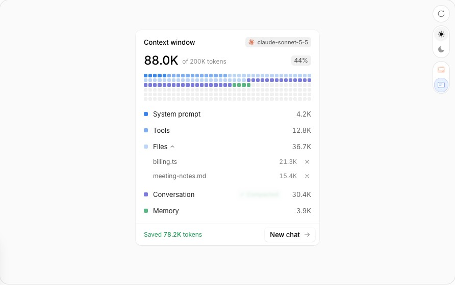

# re-context-window — Context Window → 패널 세션 정보의 컨텍스트 블록 + 카드 ctx 메트릭

Status: 구현 (Phase B) · Date: 2026-10-26 · 기준 main `ff6c9ac` · 서브이슈 #441 (에픽 #437) · 브랜치 `feat/dashboard-affectui-context-window`
앞선 계약: [`../13-dashboard-three-surfaces-spec.md`](../13-dashboard-three-surfaces-spec.md) §3.7(ctx 단계)·§3.4(세션 정보),
[`../11-dashboard-live-surfaces-spec.md`](../11-dashboard-live-surfaces-spec.md) · SSOT [`ssot.md`](ssot.md)

## 0. 한 줄 정의

레퍼런스는 "모델이 지금 무엇을 쥐고 있나, 얼마나 찼나 — 지금 비울까"를 한 카드에서 결정하게 한다(칸으로 된 필드 + 부분 목록 + Compact).
대시보드에서는 **패널 › 세션 정보(펼침)** 맨 위의 컨텍스트 블록이 집이고, **접힌 카드의 ctx 메트릭**과 세션 정보 요약 줄은 같은 단계를 숫자 하나로
보여 준다. 부분은 SDK가 실제로 주는 마지막 요청의 토큰 분류(캐시 읽기·캐시 쓰기·캐시 안 된 입력·출력)이고, 한계선은 이 세션이 실제로 압축되는
지점(autocompact)이다.

## 1. 레퍼런스 해부 [REF]



원천: `docs-*.js`(props·keyboard·a11y·motion·responsive·aiNotes), `RE-css.txt`, 데모 번들, 캡처 `components_context-window-{light,dark}-t1/t2.png`.

### 1.1 구조

```
.ui-cw [role=group, aria-labelledby=title, data-level=ok|warn|full]   ← 트레이(바깥 면, 4px 안쪽 여백, 반경 20)
├─ .card (반경 16, 12/14/8 여백, 1px 테두리)
│  ├─ head: title "Context window" · model 태그(12px 로고 + 모노 11px, 높이 20, 최대 62%)
│  ├─ figure: big 숫자(롤링, aria-hidden) · "of 200K tokens"(swap) · % pill · sr 문장
│  ├─ field [aria-hidden]: 셀 216개 = 36열 × 6행, 셀 = limit/cells 토큰, 부분 순서대로 채움, 나머지 free
│  └─ parts <ul>: 행 = swatch 7px · label(+items면 chevron) · [Compact] · value(우측, 최소 52px)
│     └─ items 있는 부분: 행이 button[aria-expanded] → fold(접히면 inert) → 항목(모노 11.5px · 토큰 · × 제거)
└─ foot(트레이 위): caption [aria-live=polite](상태 문장 swap) · action 버튼("New chat →")
```

### 1.2 상태

| 상태 | 조건 | 바뀌는 것 |
|---|---|---|
| ok | used/limit < warnAt(0.8) | pill 회색, caption "88K free"(limit−used) |
| warn | ≥ 0.8 | pill·caption 호박색, caption "24.4K left" |
| full | ≥ 0.95 | pill·caption 빨강, caption "Window is full" |
| hot | 행/셀에 마우스, 또는 행 버튼·Compact에 포커스 | 그 부분 셀 scale 1.12, 다른 칠한 셀 opacity .22(free 제외), 다른 행 .55, 그 행 배경; big → 부분 토큰, "of…" → 부분 라벨, caption "**Files** · 18.4% of the window"(10% 미만 소수 1자리) |
| compacting | Compact 누름 ~ promise 정착(최소 1.3s) | 그 부분 셀 shimmer wave, 버튼 스피너, caption "Compacting…", 다른 Compact 비활성 |
| compacted | 정착 후 | 버튼 → 초록 ✓ "Compacted" 1.5s → 0.4s 사라짐; 부분이 다시 커질 때까지 버튼 없음; caption "Saved **78.2K** tokens"(초록) 3.2s |
| item 제거 | × | 항목이 0.24s 접힌 뒤 빠짐, 셀이 앞으로 당겨짐 |
| empty items | items=[] | "Nothing attached" |

### 1.3 상호작용 · 키보드

- Tab: 열 수 있는 부분 → Compact → 항목 제거 → action. Enter/Space: 열기/닫기, Compact, 제거.
- hover는 `pointerType === 'mouse'`만. 루트 pointerleave가 hot을 지운다. 셀 hover = 그 셀의 부분 hot.
- Compact는 `compact`가 있고 `locked`가 아닌 부분 행에만, 다른 compact 진행 중·토큰 0·이미 압축됨이면 disabled.
  `onCompact` 없으면 부분이 스스로 기본 0.3배로 줄어든다(데모용 가짜 축소).

### 1.4 모션

| 무엇 | 수치 | 감속 |
|---|---|---|
| 셀 색 변화(채움·비움) | background 380ms, delay `i × 2ms`(왼→오 sweep) | ease |
| hot 흐림 / 들림 | opacity 220ms · scale 1.12 300ms | `cubic-bezier(.32,.72,.24,1)` |
| shimmer wave | 900ms 무한, delay `i × 15ms`, 50%에서 opacity .28 · scale .72 | ease-in-out |
| 숫자 롤 | 640ms, `1−(1−p)^4`, 위·아래 양방향 | — |
| 행 hot 배경 / dim | 160ms / 220ms | ease |
| fold | grid-rows 420ms + opacity 240ms(열 때 320ms, 80ms 지연); 항목 240/180ms | 위 곡선 |
| caption swap | in 320ms(opacity 0·blur 2px →), out 220ms, 260ms 뒤 제거 | ease |
| Compact 완료 | ✓ 1.5s 유지 → leave 400ms(opacity 0 · blur 3px · scale .92) | 위 곡선 |
| 스피너 | 700ms linear | — |
| reduced-motion | 모든 animation·transition 없음, 숫자 즉시 | — |

### 1.5 토큰 · 타이포 · 반응형

색 역할: tray·card·line·ink·text·muted·well·free, 부분색 c1–c6(무채 3 + 파랑 2 + 회색 1, 순환), warn(호박)·warn-bg, full(빨강)·full-bg,
ok(초록)·ok-bg, focus 링. 다크는 `.dark`/`[data-theme=dark]` 조상에서 전환. 숫자: Inter 13/20; big 24px/600, lh 30, -0.02em,
tabular; of·pill·caption 12.5px; 셀 gap 2px, 정사각, 반경 26%; 행 최소 30px; Compact 높이 22 반경 7 12px; action 높이 26 반경 10.

**반응형** — 컨테이너 최대 360px(`container-type: inline-size`). 310px 미만: 열 `max(8, round(cols×2/3))`=24, 모델 태그 최대 42%, Compact 아이콘만.
`pointer: coarse`: 행 38, Compact 30, 항목 34, 제거 30, action 30.

### 1.6 접근성 · 데이터 계약

group + 제목 이름; 롤링 숫자 aria-hidden, sr 한 문장 "88.0K of 200K tokens used, 44 percent"; 필드는 장식(모든 수치가 목록에 있음);
items 행은 `aria-expanded`+`aria-controls`, 닫힌 목록 inert; 제거 버튼 "Remove <label>"; Compact "Compact <label>" / "<label> is compacted";
caption이 polite live(압축 중·절약량·남은 양 — hot 문장도 같은 영역).

**데이터 계약 (props)** — `parts: {id,label,tokens?,items?,locked?,compact?,color?}[]`(순서대로 채움; items면 합계가 tokens) · `limit` · `title`("Context window") ·
`model` · `modelIcon` · `onRemoveItem(partId,itemId)` · `onCompact(partId) → void|Promise` · `action {label,onClick}` · `warnAt`(0.8) ·
`cells`(216) · `columns`(36). 토큰은 세지 않는다(공급자 수치를 받는다). 비-빈 부분은 최소 1셀.

## 2. 변경 전 [CODE] (main `ff6c9ac`, 캡처 `harness/shots-context-window/before-context-window-*`)

| 무엇 | 증거 |
|---|---|
| 세션 정보(펼침)의 컨텍스트 = 4px 막대 하나 + "컨텍스트 41% · autocompact 750.0K" 한 줄. 무엇으로 찼는지, 어디서 압축되는지 위치가 없다 | `dashboard.ts:9241-9245`(`panelInfoHtml`), CSS `:3977-3981` |
| 막대 위 격자 `입력/출력/캐시 읽기/캐시 쓰기`는 **세션 누적**(2.8M 등)인데 라벨에 그 말이 없다 — 현재 컨텍스트로 읽힌다 | `:9233-9238`, `tokenUsageOf` `:1273-1297` |
| 요청 단위 현재 토큰(`currentInput/Output/CacheRead/CacheCreate`, `contextWindow`)은 서버에만 있고 합계 %만 보낸다 | `types.ts:83-88`, `tokenUsageOf` `:1288-1295`, `modelFields` `:1300-1312`(`contextTokens`=합계) |
| 압축 직후 4개 카운터는 분류가 아니라 `post_tokens` 총량 하나를 `currentInputTokens`에 담은 **점유 인코딩**이다 | `packages/slack/src/session-usage-math.ts:72-101`, `stream-executor.ts:2252` |
| 단계는 창 % 구간(60 경고 / 80 위험). 그러나 세션은 그 전에 압축된다 → Claude 세션에서 위험 단계는 도달 불가 | `ctxLevel` `:8124-8129`; 표 §2.1 |
| face ctx 메트릭: `◔ 41%` + 단계 class, title "Context window used[ — 80% 넘게 찼다]" | `renderCardFace` `:8170-8175`, CSS `:3755-3761` |
| 요약 줄 "ctx 41%"(단계 없음) | `:9218` |
| `.card .context-bar*` CSS는 카드가 더는 그리지 않는 죽은 규칙(spec 13) | `:3972-3976` |
| 압축 진행·결과(`compactPreTokens/PostTokens`, `autoCompactPending`)는 카드 payload에 없다 | `types.ts:728-743`; `sessionToKanban` `:1404-1470` |
| 패널 너비 기본 440px(320–50vw) → 세션 정보 본문 ≈408px, 폰 358px, 최소 288px | `:4549`, `:5904`, resize `:6394-6398` |

### 2.1 단계 기준 — 창 %가 아닌 autocompact 지점이어야 하는 근거

| 프로필 | 창 | autocompact | 창 대비 | 60/80 구간에서 |
|---|---|---|---|---|
| `claude-*[1m]` (opus·fable·sonnet) | 1,000,000 | 750,000 (`model-profile.ts:299-331`) | 75% | 위험(>80) 도달 불가, 경고는 60–75% 구간뿐 |
| 200K 모델(legacy % 기본 80) | 200,000 | 160,000 (`autocompact-policy.ts:156-158`, `user-settings-store.ts:468`) | 80% | 위험 도달 불가 |
| `gpt-5.6-sol[1m]` | 1,000,000 | 600,000 (`model-profile.ts:112`) | 60% | 경고 = 이미 압축 |
| `gpt-5.6-sol` / `gpt-6-astra` | 372K / 272K | 340K / 240K (`:211-264`) | 91% / 88% | 정상 |

창 %는 "얼마나 찼나"의 숫자로 맞지만, 경고는 "곧 압축된다(기록이 요약으로 줄어든다)"를 말해야 한다. 그 지점은 세션마다 다르고
(`resolveEffectiveAutoCompact` `:135-159`: 세션 override → 모델 → legacy %), 서버가 이미 `autoCompactTokens`로 보낸다. 미리보기 고정값
`conv-run2`는 창 76%로 호박색이지만 autocompact 160K의 475% — 지금 단계는 틀린 신호를 준다(캡처 `…-conv-run2-info.png`).

### 2.2 Compact 경로 조사 — 실제·소유자 한정 경로가 있다

`POST /api/dashboard/session/:key/command {message}` (`dashboard.ts:2554-2580`) — authMiddleware + CSRF + `resolveSelfActionKeyAndOwner`
(`:621-627` → `requireSessionOwner` `:832-840`, 소유자 또는 admin-mode, 아니면 403) → 호스트 `injectDashboardMessage`(`src/index.ts:760-833`:
스레드에 "via Dashboard" 에코 후 **소유자 이름으로** `slackHandler.handleMessage`) → `CommandRouter` → `CompactHandler`
(`src/slack/commands/compact-handler.ts:25-27`, `command-parser.ts:699-711` `^/?compact(\s+--yes)?$`). `compact --yes`는 확인 없이
`continueWithPrompt: '/compact'`(SDK 내장 압축, `:89-92`); 그냥 `compact`는 Slack 예/아니오 블록을 띄운다(`:53-87`). 턴이 도는 중이면
follow-up 큐에 들어가 턴 뒤에 실행된다(`slack-handler.ts:1156-1192`, `isQueueableFollowup` `:2632`). **모델 전환이 이미 같은 경로를 쓴다**
(`index.ts:851-858` `dispatchCompact → injectDashboardMessage(key, 'compact --yes')`). 압축 경계에서 `compactionCount++` + broadcast
(`stream-executor.ts:2200-2201`), 그 직후 `compactPre/PostTokens` 기록(`:2222-2224`). → **채택**(D12).

## 3. 차이표

| 레퍼런스 요소 | 현재 | 결정 | 근거 / 데이터 출처 |
|---|---|---|---|
| 셀 필드 216 / 36열, 셀 = limit/cells, 비-빈 부분 ≥1셀 | 4px 막대 | **채택** | `contextParts`(D1) ÷ `window` |
| 부분 = 내용 분류(System·Tools·Files·Conversation·Memory) | 없음 | **변형** — 캐시 분류 4개 | SDK가 주는 것은 요청의 캐시 분류뿐(`types.ts:83-88`); 내용 분류는 지어내야 한다 |
| 부분 목록 swatch · label · tokens | 누적 격자 | **채택** | D6 |
| items 있는 부분 펼침 · 항목 × 제거 · "Nothing attached" | — | **불채택** | 파일·항목 단위 토큰 귀속 데이터 없음, 컨텍스트에서 떼어낼 경로 없음 |
| big 롤링 숫자 "88.0K of 200K tokens" + % pill | "컨텍스트 41%" 한 줄 | **채택** | `contextTokens`·`window`·`contextUsagePercent` |
| warnAt 0.8 호박 / ≥0.95 빨강 | 창 60/80 | **변형** — 같은 0.8/0.95를 **autocompact 지점**에 | §2.1; 지점 모르면 기존 창 60/80 유지 |
| 한계선 = limit | autocompact 숫자만 | **추가** — 필드 위 autocompact 지점 표시 + 범례 행 | `autoCompactTokens`(`:1304`) |
| hover ↔ 셀 하이라이트, 나머지 흐림, big·of가 부분으로 | — | **채택**(caption은 그대로) | 장식 연결; live 영역 소음 회피(D11) |
| 부분 행의 Compact, shimmer, ✓ Compacted | — | **변형 채택** — 블록 하나의 "지금 압축", 요청 보냄 → ✓ 압축 관측됨 | 압축은 대화 전체에 작용(부분별 아님); 경로 §2.2; 요청과 압축은 상관 불가(D12) |
| `onCompact` 없을 때 0.3배 가짜 축소 | — | **불채택** | 수치 위조 |
| tray "Saved 78.2K tokens" | — | **변형** — "새 압축 관측됨 · N 줄임" | 그 압축의 `lastCompact.preTokens − postTokens`(D4)가 왔을 때만; 누른 압축이라고 하지 않음 |
| tray "X free / X left / Window is full" | — | **변형** | 남은 양 = autocompact까지; `compactPending`이면 "다음 입력 때 자동 압축"(D3, D10) |
| action "New chat →" | — | **불채택** | 새 세션은 보드의 새 작업(FAB); 스레드 세션 리셋(`/new`)은 컨텍스트 패널의 결정이 아님 |
| model 태그 + 로고 | 컴포저에 모델명 | **변형** — 텍스트 태그만 | 모델 로고 자산 없음; 창 크기가 모델을 따르니 태그는 유지 |
| 트레이 + 카드 이중 면, 반경 20/16 | 평평한 패널 섹션 | **변형** — 평평한 블록 + foot 구분선 | 패널은 면 하나(Bauhaus), 중첩 카드 금지 |
| 컨테이너 쿼리 310px | — | **채택** + 넓은 패널 54열 | D14 |
| 롤링 숫자 양방향 640ms | 카운트업은 위로만 900ms(`:7175-7203`) | **채택**(별도 롤러) | 압축 뒤 숫자가 내려가야 한다 |

## 4. 계약 (TO-BE) — 모두 **[SHIPPED]** (`dashboard.ts` 줄 번호는 이 브랜치 기준)

### 4.1 서버 — `KanbanSession`에 필드 추가 (`sessionToKanban` `:1514` `...contextFields(s)`, 살아 있는 세션만; archived는 없음)

- **D1** [SHIPPED `:209`, `contextFields` `:1345`] `contextParts?: { window; cacheRead; cacheWrite; input; output; unsplit? }` —
  `s.usage.contextWindow > 0`일 때만, `currentCacheReadTokens / currentCacheCreateTokens / currentInputTokens / currentOutputTokens`(유한·양수,
  아니면 0 — `tokenCount` `:1336`). 합 = `contextTokens`, 합/window×100 = `tokenUsage.contextUsagePercent` — 출처 하나(커밋된 표본; 진행 중
  턴의 live 호출은 접지 않음 §6).
- **D2** [SHIPPED] `unsplit`: cacheRead = cacheWrite = output = 0 이고 input > 0 이면 — `s.compactPostTokens`가 유한수이고 input과 같으면
  `'compact'`(점유 인코딩, `session-usage-math.ts:72-101`), 아니면 `'unknown'`. 그 밖에는 없음.
- **D3** [SHIPPED] `compactPending?: true` — `s.autoCompactPending === true`(다음 사용자 턴이 `/compact`로 시작, `compact-threshold-checker.ts:1-16`).
- **D4** [SHIPPED] `lastCompact?: { preTokens; postTokens; trigger? }` — `compactPreTokens`·`compactPostTokens`가 둘 다 유한수일 때(경계 메타,
  `stream-executor.ts:2222-2225`; 다음 주기 시작에 null `compact-hooks.ts:64-80`; 런타임 전용 — 재시작 뒤 없음) **그리고** `compactionCount > 0`일 때만 —
  `/new`·`/renew`는 같은 세션 객체에서 count만 0으로 돌리고 옛 수를 남긴다(`session-registry.ts:1468`, `:1530`; PR 리뷰 R1). trigger는 `manual|auto`일 때만.

### 4.2 마크업 · 단계 (`panelInfoHtml` 펼침 본문 맨 앞, `contextParts`가 있을 때만; 기존 `.pi-ctx` 막대·문장 삭제)

- **D5** [SHIPPED `contextBlockHtml` `:9541`] 호출은 한 줄 — `panelInfoHtml`의 return(`:9388`):
  `'<div class="pi-body" id="panel-info-body">' + contextBlockHtml(s) + body + '</div>'`. 펼침 본문 순서는 두 브랜치 공통으로 고정
  (trinity R1): **`cw`(이 문서) → `pi-details`(agent-run #439, `body` 앞머리) → `pi-grid`(누적 4행, D17) → `pi-thread`**.
  `<section class="cw" role="group" aria-labelledby="cw-title" data-level="ok|warn|full">` ⟶ `.cw-head`(`#cw-title` "컨텍스트" · `.cw-model`
  모델 짧은 이름 — 기존 `replace(/^claude-/…)` 규칙) · `.cw-figure`(`.cw-big[aria-hidden][data-to]` · `.cw-of[aria-hidden][data-total]` ·
  `.cw-pill[aria-hidden]` · `.cw-sr`) · `.cw-field[aria-hidden]`(셀 `<i class="cw-cell" style="--i:N;--c:…" data-part=…>` × 216) ·
  `ul.cw-parts`(`li.cw-part[data-part][data-tok][data-of]` = `i.cw-sw` · `.cw-label` · `.cw-val`; 마지막 `li.cw-mark`) · `.cw-foot`(`.cw-say`
  · `.cw-sr[aria-live=polite]` · `button.cw-compact`). 새 함수(열 0, 단일 정의, `:9403-9790`): `cwShort` `cwParts` `cwCells` `cwMarkIndex`
  `cwPhase` `cwSay` `cwCanCompact` `cwCompactHtml` `contextBlockHtml` `cwObserve` `cwLater` `cwRoll` `cwApply` `cwBind` `cwCompact`.
- **D6** [SHIPPED `cwParts`] 부분(순서 = 프롬프트 순서: 캐시된 앞부분 → 새로 캐시 → 캐시 밖 꼬리 → 응답). 0인 부분은 목록·필드에서 뺀다.

  | key | 출처 | 라벨 | 색 토큰 |
  |---|---|---|---|
  | `read` | cacheRead | 이전 맥락 (캐시 읽기) | `--cw-c1` |
  | `write` | cacheWrite | 새로 캐시 (캐시 쓰기) | `--cw-c2` |
  | `input` | input | 캐시 안 된 입력 | `--cw-c3` |
  | `output` | output | 마지막 출력 | `--cw-c4` |
  | `total` (unsplit) | input | `'compact'` → 압축 후 맥락 · `'unknown'` → 맥락 (분류 없음) | `--cw-c1` |
- **D7** [SHIPPED `cwCells` `cwMarkIndex`] 필드: `CW_CELLS = 216`, 셀 = window/216 토큰. 할당은 누적 반올림
  `end = min(216, max(start + (t>0 ? 1 : 0), round(cum / perCell)))` — 비-빈 부분 ≥1셀, used > window면 전부 칠함. autocompact 지점
  `m = round(auto / perCell)`(0–216으로 자름, auto ≤ 0 또는 ≥ window면 없음): index ≥ m 인 셀은 `data-past` — 빈 셀은 속이 빈 칸(1px 안쪽 링).
  칠한 셀은 표시하지 않는다(시각 확인에서 링이 소음이었다; 넘음은 단계·tray가 말한다). 1M·750K → m=162(36열에서 마지막 1.5행). 범례 행
  `.cw-mark`: 빈 칸 견본 · "자동 압축 지점" · `cwShort(auto)`.
- **D8** [SHIPPED] 숫자: big = `formatTokens(used)`, of = `'/ ' + cwShort(window) + ' 토큰'`(`cwShort` = formatTokens에서 `.0K/.0M` 제거),
  pill = `ctxPercent(contextUsagePercent) + '%'` — `ctxPercent`(반올림, 100 상한) 하나를 face·요약 줄·pill이 같이 쓴다(PR 리뷰 R1 P2: 요약 줄이 105%였다). sr = "컨텍스트 412.0K / 1M 토큰 사용, 41%, 자동 압축 750K".
- **D17** [SHIPPED `:9377-9380`] 누적 격자 라벨: `누적 입력 · 누적 출력 · 누적 캐시 읽기 · 누적 캐시 쓰기`(현재 요청 부분과 구분).
- **D18** [SHIPPED] 삭제: `.pi-ctx` 마크업·CSS. `.card .context-bar*`는 그대로(§6).

- **D9** [SHIPPED `ctxLevel` `:8255`] `ctxLevel(pct, used, auto, pending)` — 1-인자 호출은 그대로(>80 / >60). `pending` → `ctx-danger`;
  used > 0 && auto > 0 → f = used/auto, `f ≥ 0.95` → `ctx-danger`, `f ≥ 0.8` → `ctx-warn`, 아니면 `''`. `data-level`: '' → ok, warn → warn,
  danger → full. face 메트릭·요약 줄 `ctx N%`(`span.pi-cs`에 같은 class)·블록이 이 함수 하나를 쓴다.

### 4.3 tray 문장 (`cwSay`, 우선순위 위에서 아래) · hover 연결

- **D10** [SHIPPED `cwSay` `:9486`] ① 요청: 보내는 중 "압축 요청 보내는 중…", 보냄 "압축 요청 보냄 — 압축을 기다리는 중"(누른 때 턴이 슬롯을 잡고 있었으면 — working·waiting —
  "압축 요청 보냄 — 지금 턴이 끝나면 압축") ② 무장 — 화면 "지난 대화가 요약으로 줄어듭니다"(버튼이 이미 "한 번 더 눌러 압축"이라 말한다),
  읽기 "한 번 더 누르면 압축 — 지난 대화가 요약으로 줄어듭니다" ③ 실패 "압축 요청 실패" / 상한 "압축 결과를 아직 받지 못함"(빨강, 4s)
  ④ 압축 관측(D12): 그 압축의 SDK 수가 오면 3200ms "새 압축 관측됨 · **748K** 줄임 (812K → 64K)"(ok), 오기 전 "새 압축 관측됨"
  ⑤ `compactPending` "다음 입력 때 자동 압축" ⑥ auto 앎: used ≥ auto "자동 압축 지점을 넘음", full "자동 압축 임박 · 30K 남음", 그 밖
  "자동 압축까지 338K"(warn은 호박) ⑦ auto 모름 "창에 588K 남음". 문장은 `data-mk` 키로 바뀌어 swap-in 320ms(퇴장 애니메이션은 생략 —
  morph가 옛 노드를 바로 뗀다). **live 영역(trinity R1 P2)**: 보이는 줄(`.cw-say`)은 live가 아니다. 옆의 `.cw-sr[aria-live=polite]`에는
  전이(①–⑤, `CW_ANNOUNCE`)만 쓰고, 거리 문장(⑥⑦)은 사용량 갱신마다 바뀌므로 비워 둔다.

- **D11** [SHIPPED `cwApply` `cwBind`] 마우스(`pointerType === 'mouse'`)가 부분 행 또는 칠한 셀 위 → `_cwHot = key`: 필드 `data-hot`, 그 부분 셀
  `data-on`(scale 1.12), 다른 칠한 셀 opacity .22(빈 셀 그대로), 다른 행·범례 `data-dim`(.55), 그 행 배경 `--ib-pill`. big은 부분 토큰으로 롤,
  of는 "<라벨> · 창의 N%"(10% 미만 소수 1자리). `#panel-info`를 떠나면 해제. 매 쓰기 뒤 `cwApply`로 다시 건다(morph가 속성을 지운다).
  tray·live 영역은 바꾸지 않는다.

### 4.4 지금 압축 (채택)

- **D12** [SHIPPED `cwCanCompact` `cwCompactHtml` `cwObserve` `cwCompact`] `button.cw-compact` "지금 압축" →
  `POST /api/dashboard/session/<key>/command {"message":"compact --yes"}`(CSRF 헤더, 403이면 토큰 갱신 후 1회 재시도 — `sendCommand` 패턴).
  보임: `contextParts` 있고 used > 0, 종료·휴면 아님(컴포저와 같은 기준 `terminated || SLEEPING` — 누르면 휴면 세션을 깨운다, PR 리뷰 R1), 마지막 압축 뒤 늘어난 것이 있음(`used > lastCompact.postTokens`, 관측한 압축의 수를 기다리는
  동안은 숨김). 비활성(+title): 소유자 아님(`READ_ONLY_MSG`), 다른 인스턴스("Open <instance> (host:port) to act on this session"),
  `pendingModel`("모델 전환이 압축을 기다리는 중"), `compactPending`("다음 입력 때 자동 압축됩니다"). **두 번 누름**: 첫 누름은 무장(라벨
  "한 번 더 눌러 압축", 4000ms, Esc — 패널은 닫지 않음 — · focusout · 시간 초과로 해제), 두 번째가 보낸다 — Slack의 그냥 `compact`가 묻는
  예/아니오와 같은 확인 한 번(`compact-handler.ts:53-87`), 모달 없음.
  **요청 결과와 관측을 나눈다(PR 리뷰 R1 astra P1)**: 요청마다 id(`_cwSeq`)를 붙이고 `_cw.req`(sending · sent · failed)는 그 id의 답만
  바꾼다 — 다른 패널 세션·다시 시작한 세션·더 새 요청 뒤에 온 답은 아무것도 건드리지 않는다. 답보다 먼저 관측된 압축은 `obsInReq`로 남겨 답이
  결정한다(실패면 실패를 보이고, 성공이면 바로 관측 완료). count가 내려가면(`/new`·`/renew`) 블록 상태를 처음부터 시작한다.
  **요청과 압축은 상관시키지 않는다(trinity R1 P1, 선택 (b) — 서버 변경 없음)**: 턴이 돌면 요청은 큐에 들어가고, 자동·Slack 압축이 먼저 올 수
  있으며, 경계 broadcast(`compactionCount++`, `stream-executor.ts:2200-2201`)는 pre/post 기록(`:2222-2225`)보다 먼저다. 그래서 상태를 나눈다:
  `sending`(스피너 "보내는 중") → POST ok면 `sent`("요청 보냄", `aria-busy`, 칠한 셀 wave) → 이 세션 `compactionCount`가 오르면 **압축 관측**:
  ✓ "압축 관측됨" 1500ms → leave 400ms. 절감량은 **그 압축의** `lastCompact`가 왔을 때만 말한다 — 오르기 전에 카드에 있던 `lastCompact`
  (이전 압축의 수)와 다른 값이어야 한다. 수가 끝내 안 오면 다음 컨텍스트 표본에서 기다림을 끝내고 절감량은 말하지 않는다. 어느 문장도
  "누른 압축"이라고 하지 않는다. POST 실패 → 해제 + ③. 상한 300000ms → 해제 + ③. (모델 전환의 `compactTs` 상관은 서버 측
  `switchSessionModel` 상태라 카드에서 닿지 않는다 — 후속 §6.)

### 4.5 모션 (dashboard 토큰; 새 수치는 아래뿐) · 반응형

- **D13** [SHIPPED CSS `:4930-4996`] 셀 색 `transition: background-color 380ms var(--ease-out)`, delay `calc(var(--i) * 2ms)`(최대 ≈430ms) —
  morph가 같은 216 노드를 유지하므로 live 갱신이 sweep으로 보인다; 흐림 opacity 220ms; 들림 scale 1.12 `var(--dur-move) var(--ease-out)`;
  wave `cw-wave` 900ms 무한, delay `i × 15ms`, 50% opacity .28 · scale .72; 숫자 롤 `CW_ROLL_MS = 640`, `1−(1−p)^4`, 양방향(`canAnimate()`
  거짓·reduced·다른 세션이면 즉시); 행 배경 `var(--dur-press)`, dim 220ms; swap-in 320ms; 완료 hold 1500ms + leave 400ms. reduced-motion:
  공유 블록(`:5126`)은 건드리지 않는다 — wave·스피너 회전은 이 영역의 `@media (prefers-reduced-motion: no-preference)` 안에서만 돌고, 바탕
  규칙 `.cw-cell[data-busy] { opacity: 0.5 }`가 정지 상태로 진행을 보인다(스피너는 정지 링).

- **D14** [SHIPPED] `.cw { container: cw / inline-size; max-width: 560px }`. 기본 36열(6행); `@container cw (max-width: 309px)` → 24열(9행),
  모델 태그 최대 42%, 압축 버튼 아이콘만(이름은 aria-label에); `@container cw (min-width: 520px)` → 54열(4행). gap 2px, 정사각, 반경 2px.
  기본 패널 408px → 셀 ≈9.4px, 폰 358px → ≈8px, 최소 288px → 24열 ≈10px. 터치는 이 영역의 별도 블록
  `@media (pointer: coarse), (max-width: 639px)`: 버튼 44px, 행 36px(공유 블록 `:5187`과 기존 시험이 찾는 문자열은 그대로).

### 4.6 접근성 · 테마 · 카드 face · 요약 줄

- **D15** [SHIPPED] group + `#cw-title`; 롤링 숫자·of·pill aria-hidden, `.cw-sr`(이 영역의 sr-only) 한 문장; 필드 aria-hidden; 부분은 `<ul>` 텍스트;
  live는 `.cw-foot .cw-sr` 하나(D10 — 전이만); 버튼 `type=button`, `aria-label="지금 압축 — 컨텍스트 압축"`(보이는 라벨 먼저), `aria-busy`,
  focus-visible `--accent` 링. 단계는 색만으로 말하지 않는다(tray 문장·title). 텍스트 대비 ≥4.5:1: warn `--cw-warn`(다크 `--st-wait`, 라이트
  `--yellow` #a16207 — `--st-wait` 라이트는 흰 바탕 4.5 미만), full `--st-fail-text`, ok `--green`.
- **D19** [SHIPPED] 토큰은 이 영역의 별도 `:root {…}` + `[data-theme="light"] {…}`(공유 `:3137`/`:3203` 블록은 그대로): `--cw-c1: var(--accent)`,
  `--cw-c2: color-mix(accent 45% / 라이트 38% white)`, `--cw-c3: var(--purple)`, `--cw-c4: var(--green)`, `--cw-free`, `--cw-warn`, `--cw-warn-bg`,
  `--cw-full-bg`, `--cw-ok` — 모두 다크·라이트 값 둘.

- **D16** [SHIPPED `renderCardFace` `:8304-8314` — 클래스·title 계산만, face 배치는 agent-inbox 소유] face ctx 메트릭 =
  `ctxLevel(ctxPct, s.contextTokens, s.autoCompactTokens, s.compactPending)`. title: auto 앎 → "컨텍스트 41% · 자동 압축 750K까지 338K" /
  pending "… · 다음 입력 때 자동 압축" / 넘음 "… · 자동 압축 지점을 넘음"; auto 모름 → 기존 문구 그대로("Context window used",
  "— 80% 넘게 찼다" — 이 말은 단계가 아니라 pct > 80을 따른다: 예정된 압축은 50%에서도 danger). 세션 정보 요약 줄 `ctx N%`는 같은 class의 `span.pi-cs`.
- **D20** [SHIPPED `renderPanelInfo` `:9390`] live: 기존 `repaintPanelSession → renderPanelInfo → writePanelPart` 그대로; 쓰기 전 `cwObserve(s, now)`,
  쓴 뒤(바뀌었을 때) `cwApply(el)`, `cwBind(el)` 한 번. 블록 상태(`_cwHot`, `_cw{key,count,armedAt,reqId,req,reqAt,obsInReq,queued,doneAt,
  observedAt,savedWait,usedAtRise,lcSeen,lcAtRise,savedAt,failAt,timedOutAt}`)는 패널 세션이 바뀌거나 count가 내려가면 초기화. 시간이 지나 끝나는 상태는 `cwLater(ms)`가 다시 그린다.

## 5. 시험 (`src/conversation/__tests__/dashboard-affectui-context-window{,-client}.test.ts`)

| # | D | 내용 | 변경 전 |
|---|---|---|---|
| S1 | D1 | GET /sessions: current* → `contextParts` 4값 + window; 합 = `contextTokens`; % 일치; usage 없음·window 0·archived → 없음 | RED (부재 사례는 GREEN) |
| S2 | D2 | post_tokens 인코딩(input = compactPostTokens, 나머지 0) → `'compact'`; 나머지 0·불일치 → `'unknown'`; 정상 분류 → 없음 | RED |
| S3 | D3·D4 | `autoCompactPending` → `compactPending: true`; pre/post 둘 다 수이고 count > 0일 때만 `lastCompact`(+trigger); `/new` 뒤 옛 수 → 없음 | RED |
| C1 | D5·D6·D18 | 블록 마크업·부분 순서·라벨·0 부분 생략·unsplit 라벨; `contextParts` 없으면 블록 없음; 호출 한 줄; `.pi-ctx`/`context-bar` 사라짐 | RED |
| C2 | D7 | `cwCells`: 216칸, [77,3,7,2,127], 비-빈 부분 ≥1, 넘침; `cwMarkIndex(750000, 1e6)` = 162; `data-past` 54칸 | RED |
| C3 | D8·D9 | `ctxLevel` 1-인자 60/80 그대로, 0.8/0.95, pending → danger; `ctxPercent` 하나로 face·요약·pill 100% 상한; `data-level`; `cwShort` | RED |
| C4 | D10 | `cwSay` 상태별 문장(요청·무장·실패·상한·관측·절감·pending·거리); live 영역에는 전이만, 거리 문장은 없음 | RED |
| C5 | D11·D20 | 가짜 DOM hover → data-hot/on/dim, of 문장, 롤 대상; 해제; 쓰기 뒤 `cwApply`·쓰기 전 `cwObserve`; 롤 640ms 양방향 | RED |
| C6 | D12 | 게이팅(소유자·sibling·종료·pendingModel·compactPending·압축 뒤 무증가), 무장 4s·Esc·focusout, fetch URL·body `compact --yes`·CSRF 재시도, sending→sent, 실패·상한; **(1)** 무관한 압축이 먼저 와도 "관측"만, 이전 수는 절감이 아님 **(2)** 수보다 count가 먼저 **(3)** 수가 나중에 오면 그때 절감량; 답 전 관측 + 실패 → 실패, A→B→A 옛 답은 새 요청을 못 건드림, count 감소 → 초기화, 휴면 → 버튼 없음·전송 없음, waiting → 큐 | RED |
| C7 | D13·D14·D15·D19 | CSS 계약: sweep·흐림·들림, no-preference 안의 wave, `@container cw` 24/54열, 터치 44px, 토큰 다크·라이트 둘, sr-only | RED |
| C8 | D16 | face title·class(auto 앎 / pending / 넘음 / 모름 → 기존 문구), 요약 줄 class | RED (모름 사례는 GREEN) |
| C9 | D17 | 누적 라벨, 블록이 격자보다 앞 | RED |

기존 시험 — 그대로 GREEN: face ctx 문자열을 고정한 `dashboard-three-surfaces-client.test.ts:1386-1406`(`ctxLevel(61)`, `"Context window used"`,
`"— 80% 넘게 찼다"`, `.ctx-danger` 대비) — 이 픽스처엔 `contextTokens`가 없어 창 구간 경로를 탄다. `dashboard-agent-inbox.test.ts`는 face ctx
문자열을 고정하지 않는다(헤더 필드 `contextwindow`는 `dashboard.test.ts:1861`). 의도적으로 고친 단언: `dashboard-three-surfaces-client.test.ts`
세션 정보 로더(`contextBlockHtml` 추가)·열린 본문(`autocompact 750000`·`class="context-bar"` → `누적 입력`, 막대 없음)·"one threshold
table"(`var cls = ctxLevel(ctx);` → 세 호출 지점의 확장 인자), `dashboard-agent-inbox.test.ts` 모션 계약(`panelInfoHtml`의 `transform:scaleX(`
→ `contextBlockHtml`의 `cw-field`).

## 6. 범위 밖 · 후속

- **진행 중 턴의 점유**: 블록·face %는 커밋된 표본(`current*`)이다. 턴 중 live 호출이 더 클 수 있다(`model-switch.ts:122-127`, `live-usage.ts`).
  `max(committed, live)`를 서버 한 곳에서 face·패널에 같이 — 후속.
- **자동 압축 진행 중 shimmer**: 시작 신호에 broadcast가 없고(`compact-hooks.ts:442`), 경계 broadcast(`stream-executor.ts:2201`)가 메타 기록(`:2222`)
  보다 먼저라 `compactStartedAtMs`로는 "압축 중"을 정직하게 끌 수 없다. 이번엔 대시보드에서 보낸 요청만 진행(wave)을 그린다 — 후속: 시작 broadcast + 경계 순서.
- **요청 ↔ 압축 상관**: 카드에는 "이 요청이 그 압축"을 말할 필드가 없다(모델 전환은 서버 측 `compactTs`로 상관, `model-switch.ts:216-269`).
  같은 방식으로 `POST …/command`가 보낸 `compact --yes`의 ts를 세션에 남기고 경계에서 짝지으면 "요청한 압축 완료"를 말할 수 있다 — 후속.
- 내용 분류(시스템 프롬프트·도구·파일·대화)와 항목 제거, New chat — 데이터·경로 없음(§3).
- 세션 정보 Σ 줄의 "압축 N"은 세션 값(`compactionCount`)인데 줄은 스레드 합계다(`threadCompactionCount`는 보내지만 안 씀, `:9246`) — 별건.
- `.card .context-bar*` 죽은 CSS(`dashboard-agent-inbox.test.ts:460`이 고정) 정리 — 별건. autocompact 출처(session/model/legacy) 표시 — 데이터 미전송.

## 7. 검증

- **RED** (구현 전, 두 새 시험 파일): `Tests 38 failed | 2 passed (40)` — `client var CW_CELLS not found`, `client function cwApply/cwBind
  not found`, 서버 `expected undefined to deeply equal { window: 1000000, … }` 등. 처음부터 GREEN이던 2건은 부재 사례(아카이브·창 없음 → 부분 없음,
  창을 모르는 face의 옛 문구)다. 이후 trinity R1·PR 리뷰 R1 반영으로 시험을 늘려 최종 49건(서버 6 + 클라이언트 43). PR 리뷰 R1의 휴면·waiting 큐·80% 문구 3건은 고치기 전 RED 확인; astra P1·P2 시험은 `1503a71`에 대해
  서버 `/new` 사례 RED, 클라이언트 파일은 `client function ctxPercent not found`로 수집 단계 RED.
- **GREEN**: `dashboard-affectui-context-window.test.ts`(5) · `dashboard-affectui-context-window-client.test.ts`(38) 통과; 의도적으로 고친
  `dashboard-three-surfaces-client.test.ts` · `dashboard-agent-inbox.test.ts` 포함 4파일 159건 통과. 게이트: `npx vitest run
  src/conversation/__tests__/ --testTimeout=60000 --hookTimeout=60000` → `Test Files 64 passed (64) · Tests 1691 passed (1691)`(기계 부하
  load ≈130에서 기본 5s 제한은 손대지 않은 서버 시험을 시간 초과시킨다 — 단독 재실행으로 확인), `npx tsc --noEmit` EXIT 0,
  `npx biome check src/conversation/` 오류 0 · 경고 688(기준선과 같음, 새 파일 경고 0).
- **시각** (고정값 사본 `harness/cw/fixtures.ts` — 4부분·경고·넘음·압축 직후 unsplit·자동 압축 예정; 미리보기 34124): `harness/shots-context-window/
  after-context-window-{light,dark}-{desk,phone}-{board, conv-run-info, conv-run-hover(데스크톱), conv-run-armed, conv-run-sent, conv-wait-info,
  conv-idle-info, conv-run2-info, conv-sleep-info}.png`. 비교: `before-context-window-*`. face title 실측: "컨텍스트 66% · 자동 압축 160K까지 28K"
  (`ctx-warn`), "컨텍스트 76% · 자동 압축 지점을 넘음"(`ctx-danger`, 이전엔 창 구간으로 `ctx-warn`), "컨텍스트 83% · 다음 입력 때 자동 압축".
  두 번째 누름 뒤 실측: tray·live 모두 "압축 요청 보냄 — 지금 턴이 끝나면 압축"(미리보기는 명령 처리기가 없어 압축이 오지 않는다 — 관측 단계는
  시험 C6 (1)–(3)이 고정). 시각 확인으로 바꾼 것: 무장 문장 단축(D10 ②), 넘은 칠한 셀의 빨간 링 제거(D7).
