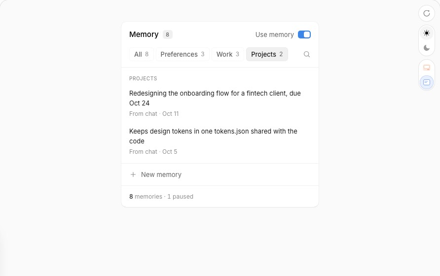

# affectUI Memory Panel → 설정 › 기억 › 개인 메모리 (L1)

Status: 계약(Phase A) · 작성 2026-10-26 · 기준 main `ff6c9ac` · 에픽 #437 / 서브이슈 #443 · SSOT [`ssot.md`](ssot.md)
앞선 계약: SSOT 2026-10-23 T3/T5(기억 탭 — 항목마다 한 행, 저장소마다 용량 미터, 한 항목 삭제는 즉시 + 되돌리기, `모두 지우기`는 개수를
말하는 확인, 모든 편집은 불러온 revision 조건부 · 409면 초안 보존) — 조사 원문 [`docs/misc/research/2026-10-23-dashboard-settings-memory-ui.md`](../../docs/misc/research/2026-10-23-dashboard-settings-memory-ui.md)

## 0. 한 줄 정의

레퍼런스는 "어시스턴트가 나에 대해 기억하는 것 중 **틀린 것을 바로 고치거나 지우게**" 한다 — 범주 칩으로 좁히고, 행에서 제자리 편집·잊기,
잊은 것은 트레이에서 5초 안에 되돌린다. 대시보드에서 이 결정은 **설정 › 기억 탭의 개인 메모리(L1)** 다(`/dashboard/settings#memory`,
`#m-l1`). 지금은 저장소 카드 두 장(에이전트 노트 · 사용자 프로필)이 항목마다 상자 + `수정 · 삭제` 링크 + 늘 열린 추가 칸을 나란히 그린다.
이를 **패널 하나 — 저장소 칩 · 검색 · 저장소별 그룹 · 제자리 편집 · 잊기 + 트레이 되돌리기**로 바꾼다. 지식 페이지 · 관찰 기록 섹션,
서버, `settings-page.ts`는 건드리지 않는다.

## 1. 레퍼런스 해부 [REF]



출처: `docs-BYw0IeXU.js`(props · keyboard · a11y · motion · responsive · aiNotes), `RE-css.txt`, `RE-strings.txt`, 데모 번들
`demo-CEgv5bR9.js`, 캡처 `components_memory-panel-{light,dark}-t1/t2.png`. affectUI Pro — 구조·수치만 판독, 코드·CSS·SVG는 옮기지 않는다.

### 1.1 구조

```
.root role=group aria-labelledby=title [data-off]  max-width 380 · pad 4 · r20 · 트레이 배경 · container-type inline-size
├─ .card r16 (선 1px + 그림자)
│   ├─ head 48px: title "Memory" 13.5px/600 · count 배지(20px, r5, tabular, aria-hidden) · switch "Use memory"(28×16 트랙, role=switch)
│   ├─ fold#note (꺼지면 펼침) "The assistant won't use or save memories in new chats. Nothing here is deleted."
│   ├─ filters (grid 1fr auto) [data-searching]
│   │   ├─ chips role=radiogroup "Category" — All n · <범주> n (메모리가 있는 범주만) · 가로 스크롤 + 끝 14px 페이드
│   │   ├─ search(검색 중에만, chips 자리를 덮음): 돋보기 · input "Search memories" · × "Close search"
│   │   └─ 돋보기 버튼 "Search memories" aria-expanded
│   ├─ list max-height 360(prop) · 위 구분선 · 내부 스크롤
│   │   └─ section.fold aria-label=<범주> ×범주 → h3 그룹 제목(12px/500 muted) → ul → li.fold--row → .item[data-memory]
│   │        text 13px/20px ink · meta(min-h 24): "source · date" · Paused 태그 · acts(Edit · Pause/Resume · Forget, 26px 아이콘)
│   │        편집 중: textarea(자동 높이) + acts(Cancel · Save)
│   │   └─ fold empty: "Nothing remembered yet" / "No memories here" / "No memory mentions “q”"
│   ├─ bottom(위 구분선): fold "+ New memory"(32px) ⇄ fold editor(textarea "Something the assistant should remember…"
│   │   + radiogroup "Category of the new memory" + Cancel · Save(빈 값이면 disabled))
└─ foot 38px: caption aria-live=polite(교차 페이드) · [Undo 버튼 | action 버튼(prop)]
```

### 1.2 상태

| 상태 | 바뀌는 것 |
|---|---|
| 기본 | 칩 All 선택, 행 액션 숨김(opacity 0), 트레이 "**8** memories · 1 paused"(숫자 굵게) |
| hot(마우스 진입·포커스) | 행 배경 well, 액션 보임, 그 범주 칩 `data-linked`, 트레이 "**Work** · used in answers / paused, not used in answers / memory is off" |
| 범주 선택 | 다른 범주 그룹·행이 접히고(fold) inert, 칩 aria-checked |
| 검색 | 칩이 흐려지며(blur 2px) 검색 입력이 그 자리를 덮음, 범주 필터 해제, 텍스트·범주명 부분 일치(소문자) |
| 편집 | 행 배경 well, 텍스트 → textarea, 트레이 "Enter to save · Esc to cancel"; 저장 시 공백 접기(`\s+`→한 칸), 같으면 무시 |
| 새 메모리 | 버튼 접히고 편집기 펼침, 범주 기본값 = 선택된 칩 또는 첫 범주, 트레이 "Pick a category · Enter to save" |
| 잊는 중 | 행 `data-leaving` 접힘 + blur, 320ms 뒤 목록에서 제거 · `onForget` |
| 잊음(5s) | 트레이 "Forgot “<b>text</b>”"(따옴표 사이만 말줄임) + Undo; Undo → 옛 자리에 다시 끼우고 펼침 · 스크롤 · `onRestore` |
| 일시정지 | 텍스트 muted, Paused 태그 등장, 아이콘 pause→play (총계에 포함) |
| 꺼짐 | 목록·필터 opacity .5(hover/focus .85), 안내 펼침, 트레이 "Memory is off" |

### 1.3 상호작용 · 키보드

- Tab: 스위치 → 선택된 칩(radiogroup 탭 정지 1) → 검색 → 각 메모리의 Edit · Pause · Forget → New memory → 트레이 버튼.
- 칩: ←/→/↑/↓ 순환 이동 + 선택(선택이 포커스를 따른다), Home/End, `scrollIntoView({inline:'nearest'})`.
- Enter = 편집·새 메모리 저장, Shift+Enter = 줄바꿈, Esc = 편집 취소 / New memory 닫기 / 검색 닫기(입력 지움). 닫으면 포커스는 연 버튼으로.
- 저장·취소 후 포커스는 그 행의 Edit 버튼. 추가·Undo 후 그 행이 목록 밖이면 120ms 뒤 `scrollTo(top − 8px)`.

### 1.4 모션

| 대상 | 수치 |
|---|---|
| fold(필터·그룹·안내·편집기) | `grid-template-rows 0fr↔1fr` 420ms `cubic-bezier(.32,.72,.24,1)`; opacity 열 때 320ms(80ms 지연), 닫을 때 220ms |
| 잊는 행 | rows 320ms + opacity 200ms + `filter: blur(2px)` 200ms, 제거 대기 320ms |
| 행 배경 · 액션 | 배경 160ms, 액션 opacity 180ms, 텍스트 색 240ms |
| 트레이 문구 | 들어옴 320ms(opacity 0 + blur 2px에서), 나감 220ms, 겹침 260ms 뒤 정리 |
| 숫자(머리·트레이) | 520ms 롤, `1−(1−t)^4`, rAF |
| reduced-motion | 모든 transition·animation 없음, 스크롤 `auto`, 숫자 즉시 |

### 1.5 토큰 · 크기

라이트/다크: tray `#f0f0f0/#111113`, card `#fff/#19191b`, line `#ececec/#2a2a2e`, ink `#171717/#ededed`, text `#404040/#c8c8cc`,
muted `#8f8f8f/#8b8b92`, well `#f4f4f5/#222225`, hover `#ececee/#2c2c30`, red `#b42318/#ff9b93`(+ 배경 10%/16%), focus 링 2px offset 2px.
반경: root 20 · card 16 · item 10 · chip/icon/button 8 · cat 6 · count 5. 글자: 본문 13/20, 제목 13.5/600, chip 12.5, meta·group 12, tag 11.5.

### 1.6 반응형 · 접근성 · 데이터 계약

- 폭: 컨테이너 ≤ 380, 300부터 동작. `@container ≤340px` 칩 개수 숨김, `≤320px` 스위치 라벨 숨김. 칩은 넘치면 가로 스크롤.
- `(pointer: coarse)`: 액션 늘 보임, 아이콘 32, meta 32, 칩·텍스트 버튼 32, cat 30, 스위치·추가 36, 트레이 버튼 30.
- a11y: 그룹은 제목으로 이름, 스위치 aria-checked + 안내 aria-controls, 칩 radiogroup(탭 정지 1), 범주마다 이름 붙은 section,
  액션 이름에 메모리 문장(`Forget “Prefers TypeScript…”`), 키보드 포커스에도 액션 표시, 걸러지거나 접히는 행은 `inert`, 트레이 polite.
- props: `memories: {id, text, category, source?, date?, paused?}[]`, `onChange/onAdd/onEdit/onPause/onForget/onRestore`,
  `enabled/defaultEnabled/onEnabledChange`, `categories`, `title="Memory"`, `maxHeight=360`, `undoFor=5000`, `addedSource="You added"`,
  `action {label,onClick}`. aiNote: "백엔드가 복원을 못 하면 undoFor 동안 soft delete로 들고 있으라"(복원할 수 있으면 실제 삭제 + onRestore).

## 2. 변경 전 [CODE]

변경 전 캡처(저장소 밖): `harness/shots-memory-panel/before-{light,dark}-{desk,phone}-l1.png`, `before-*-desk-page.png`, `-l1-hover.png`
(픽스처 8항목 — 에이전트 노트 5 · 사용자 프로필 3; 메모리 API는 Slack 사용자가 필요해 `GET /api/memory`를 픽스처로 응답).

| 무엇 | 증거 |
|---|---|
| L1 섹션 껍데기: `#m-l1` → header(h2 `개인 메모리` + 설명) → `#mem-l1-body.l1-grid` | `settings-memory-tab.ts:31-34` |
| 두 카드 격자 `repeat(auto-fit, minmax(300px,1fr))`, 항목 = 테두리 상자, 전역 `textarea` 스타일 | `settings-memory-tab.ts:65-81` (`.l1-*`·`.entries`·`.meter-line`·`.counter`) |
| 라벨·파일 맵 `L1_LABELS`·`L1_FILES`, 되돌리기 상태 `_memUndo {target,text}` | `settings-memory-tab.ts:110-112` |
| 카드 렌더 `renderL1Card(target, block, editing)`: 제목 + 파일, `<meter>` + `x / y자`(80% `is-warn`, 100% `is-full` `· 가득 참`), 빈 안내, `<ol class="entries">` 의 `<li>` 마다 `수정`·`삭제` 링크(onclick `l1EditStart/l1Delete('t',i)`), 편집 = textarea rows 3 + 저장·취소 버튼, 카드 안 `삭제했습니다. 되돌리기`, 늘 열린 추가 칸 + 실시간 카운터 + `추가`·`모두 지우기` | `:203-232` |
| 단일 다시 그리기 `paintL1(editing, opts)`: 추가 칸 초안·열린 편집기(원문으로 재부착)·잃을 초안(→ 빈 칸 → 복구 상자)을 지킨다 (review R9–R10) | `:238-283` |
| 쓰기 경로 `l1Write`: 탭 전체 hold(`memHold.at`) + 카드 잠금, 409면 다시 불러와 초안 복귀, 성공 시 `_mem.l1[t]` 교체 후 `paintL1` | `:312-356`, `restoreL1Draft :357-368` |
| `l1Delete` = 즉시 `DELETE …/:index` → 성공하면 `_memUndo` + 다시 그림(시간 제한 없음, 다음 삭제가 덮음) | `:392-399` |
| `l1Undo` = `POST /api/memory/l1/:t {text, revision, restore:true}` — 정확한 원문 복원, **목록 끝에 추가**(`되돌렸습니다 (목록 끝에 다시 추가)`), 거절되면 원문을 추가 칸/복구 상자로 | `:400-413` |
| `l1Clear` = 개수를 말하는 확인 대화 → `DELETE /api/memory/l1/:t` (되돌리기 없음) | `:414-423` |
| 성공·오류 문구는 탭 맨 위 `#mem-status`(`role=status`/오류 `alert`) — 패널에서 멀다 | `:119-125`, `:29` |
| API: `GET /api/memory` → `l1.{memory,user} = {entries[], charLimit, totalChars, percentUsed, perEntryCap, revision}` | `memory-routes.ts:128-138`, `l1View :45-47` |
| 쓰기: POST(add/restore) · PUT `:index` · DELETE `:index` · DELETE(clear), 모두 revision 조건부(409) + CSRF | `memory-routes.ts:146-215` |
| 저장소: 항목 = `\n§\n`로 이은 문자열 배열, 한도 memory 2,200 · user 1,375자, 한 항목 상한 30%(660 · 412), 중복 거절, restore는 끝에 추가 | `user-memory-store.ts:11-13,73-75,144-151,413-453` |
| 항목에 출처·날짜·일시정지 필드 없음, 켜고 끄는 설정 없음 — 모든 항목이 세션 프롬프트에 들어간다 | `user-memory-store.ts:18-28,458`; `prompt-builder.ts:428-432` |
| Slack `memory clear N`은 저장소별 1부터의 번호 | `slack/commands/memory-handler.ts:50-65` |
| 설정 페이지 토큰(대시보드 `--ib-*`가 아님): `--bg --surface --surface-raised --border --border-focus --text(-secondary/-tertiary) --accent --green --yellow --red --danger-bg --ease-out --dur-press --dur-fade`; 라이트 덮어쓰기에 `--yellow` 없음 | `settings-page.ts:40-51` |
| 이미 쓰는 클래스 `.chips`·`.chip`·`.switch`(개인 설정 탭) — 이름 충돌 주의 | `settings-page.ts:109-113` |
| 기존 시험: 카드 마크업(`<meter min="0" max="2200"`, `30 / 2,200자`, `<li>` 2개, onclick 문자열, `한 항목 최대 660자`, `모두 지우기`, `l1-edit-memory`), undo R5, 다시 그리기 R9–R13(가짜 DOM은 `getElementById`만, `l1-new-<t>` 두 칸이 늘 있다고 가정), 쓰기 경로 | `__tests__/settings-memory-tab.test.ts:59-649` |
| 열린 PR #380이 고치는 줄: `settings-memory-tab.ts:113`(`PAGE_GROUPS`), `settings-page.ts:25·35·497·512·522·533` 부근 | `gh pr diff 380` |

## 3. 차이표

| 레퍼런스 요소 | 현재 | 결정 | 근거 (데이터 출처 / 불채택 이유) |
|---|---|---|---|
| 머리 "Memory **n**" | h2 `개인 메모리` | 변형 — h2 옆 개수 배지 | n = `l1.memory.entries.length + l1.user.entries.length` |
| Use memory 스위치 + 꺼짐 안내 | 없음 | **불채택** | 켜고 끄는 설정도 경로도 없다 — `prompt-builder.ts:428-432`가 늘 넣는다 |
| 범주 칩 radiogroup + 개수 | 카드 2장 | 채택 — `전체 n · 에이전트 노트 n · 사용자 프로필 n` | 범주 = 저장소(target), n = `entries.length` |
| 메모리 없는 범주는 칩 숨김 | — | 변형 — 두 저장소 칩·그룹은 늘 보임(0 포함) | 추가가 저장소 그룹에 붙는다(D11), 빈 저장소도 결정 대상 |
| 검색(칩 자리를 덮음) | 없음 | 채택 | `entries[i]` 텍스트 + 저장소 라벨 부분 일치 |
| 범주별 그룹 + 제목 | 카드 제목 + 파일 | 채택 + 그룹 머리에 용량 미터 유지 | `totalChars / charLimit` — 저장소마다 한도가 따로다(미터 없는 레퍼런스와 다름) |
| 행 meta "source · date" | 없음 | 변형 — `#N · L자` (+ `· 한 항목 한도 초과`) | 저장소에 출처·날짜가 없다. N = `i+1`(Slack `memory clear N`과 같은 번호), L = `entries[i].length`, 초과 = `L > perEntryCap` |
| Paused 태그 · Pause/Resume | 없음 | **불채택** | 항목 단위 일시정지 필드·경로 없음(`user-memory-store.ts:18-28`) |
| hot 트레이 "범주 · used in answers" + 칩 `data-linked` | 없음 | **불채택** | 모든 항목이 똑같이 프롬프트에 들어가 행마다 같은 문장 — 정보 없음 + 포커스마다 낭독 소음 |
| Edit → 제자리 textarea, Enter/Shift+Enter/Esc | rows 3 상자 + 저장·취소 | 채택 + IME 조합 중 Enter 무시 · 공백 접기 없음 · 실시간 `L / 상한자` | 한국어 입력, Slack 항목은 여러 줄일 수 있다(`.entries .text` pre-wrap) |
| Forget → 행 접힘 + blur | 즉시 삭제 후 다시 그림 | 채택 — **실제 DELETE**와 동시에 접힘 | aiNote: 복원할 수 있는 백엔드는 실제 삭제 + restore — 우리는 `restore:true`가 있다 |
| 트레이 "Forgot “…” · Undo" 5초 | 카드 안 `삭제했습니다. 되돌리기`(무기한) | 채택 — 5,000ms + 트레이에 포인터·포커스가 있는 동안 멈춤 | `_memUndo` + `l1Undo`(기존 경로). 멈춤은 WCAG 2.2.1 |
| Undo → 옛 자리에 펼침 | 끝에 추가 | 변형 — 그룹 끝에 펼침 + 스크롤 + 문구 `목록 끝에 다시 넣었습니다` | restore는 끝에 append(`user-memory-store.ts:150`). 제자리 복원은 §6 후속 |
| soft delete(지연 삭제) | — | **불채택** | 5초 동안 에이전트·Slack이 지운 항목을 계속 보고, 그사이 revision이 바뀌면 지연 DELETE가 409 · 페이지를 떠나면 삭제 유실 — hold/409 경로를 둘로 가른다 |
| New memory + 범주 picker | 카드마다 늘 열린 추가 칸 | 변형 — 그룹마다 `+ <저장소>에 추가` → 제자리 편집기 | 저장소마다 한 항목 상한·남은 용량이 달라 카운터가 그 저장소 것이어야 한다; 초안 보존 계약(R9–R13)이 `l1-new-<t>` 두 칸에 서 있다 |
| 트레이 "**8** memories · 1 paused" 롤 | 없음 | 변형 — `**8**개 항목 · 에이전트 노트 297 / 2,200자 · 사용자 프로필 107 / 1,375자` | 개수 + `totalChars/charLimit` |
| 트레이 action 버튼(Export) | 없음 | **불채택** | 내보내기 경로 없음, 요구 없음 |
| list max-height 360 내부 스크롤 | 없음 | 변형 — 내부 스크롤 없음 | 설정은 전체 페이지; 폰에서 이중 스크롤 |
| 빈 상태 3종 | 카드별 `아직 항목이 없습니다…` | 채택 | 그룹 비었음 / 검색 일치 없음 |
| `모두 지우기`(레퍼런스에 없음) | 카드 버튼 + 확인 | 유지 — 그룹 추가 줄 오른쪽 | 기존 계약(T5) |
| 반응형 · 터치 · 다크 · reduced-motion · inert · polite | 760px 1열만 | 채택 — 설정 토큰으로 | §4 D15–D17 |

## 4. 계약 (TO-BE)

범위 규칙: 바뀌는 곳은 `settings-memory-tab.ts`의 L1 블록뿐 — HTML `:31-34`, CSS `:65-81`, 클라이언트 `:202-423`(새 상태 변수도 이 블록
안에 둔다, `:109-113` 근처 금지 — PR #380과 인접 hunk 충돌). `settings-page.ts`·서버·지식 페이지·관찰 기록은 그대로.

- **D1 구조.** `#mem-l1-body`의 클래스 `l1-grid` → `mp`(`container-type: inline-size`). h2에 `<span id="l1-total" class="mp-count" aria-hidden="true">`.
  본문 = `.mp-filters` → `.mp-list` → `.mp-foot`. 모든 새 클래스는 `mp-` 접두(설정의 `.chip(s)`·`.switch`와 충돌 금지).
- **D2 단일 다시 그리기 유지.** `paintL1`이 여전히 유일한 전체 렌더 경로이고 R9–R13 계약(초안·편집기 재부착·hold·잠금)을 그대로 지킨다. id
  `l1-edit-<t>`·`l1-new-<t>`·`l1-count-<t>`·`mem-l1-body` 유지. 필터·검색·편집기 열고 닫기는 다시 그리지 않고 속성만 바꾼다(`l1ApplyView()` —
  `data-open`·`inert`·`aria-*`). 새 코드는 `getElementById`로 찾는다(시험 가짜 DOM, `querySelector` 없음에도 안전).
- **D3 저장소 칩.** `.mp-chips role=radiogroup aria-label="저장소"` 안에 `button.mp-chip role=radio` 3개 — `전체` · `에이전트 노트` ·
  `사용자 프로필`, 각 `<span class="mp-chip-n">n</span>`(검색과 무관한 저장소 전체 개수). 기본 `전체`. 상태 `_l1View.target ∈ {null,'memory','user'}`.
- **D4 칩 키보드.** 로빙 tabindex(선택만 0), ←/↑ 이전 · →/↓ 다음(순환) · Home/End, 선택이 포커스를 따른다.
- **D5 검색.** `.mp-search-open`(aria-label `개인 메모리 검색`, aria-expanded, aria-controls) → 칩 자리에 `input type=search`(placeholder
  `항목 검색`) + `×`(`검색 닫기`). 열면 `target=null`, 입력에 포커스. 일치 = `text.toLowerCase()` 또는 저장소 라벨에 `q.trim().toLowerCase()`
  포함. Esc / `×` = 닫고 비우고 포커스는 돋보기로. 검색 중 칩은 `inert`.
- **D6 그룹.** `section.mp-group#l1-g-<t> aria-labelledby="l1-h-<t>"`(fold). 머리 = `h3#l1-h-<t>` 라벨 + `.sub` 파일명 + 기존 `.meter-line`
  (`<meter min=0 max=charLimit …>` + `x / y자`, ≥80% `is-warn`, ≥100% `is-full · 가득 참`). `<ol class="mp-items">`의 `<li>`는 속성 없는
  `<li>`(접힘은 안쪽 `.mp-fold#l1-f-<t>-<i>`). 걸러진 그룹·행은 접히고 `inert`. 빈 그룹: `비어 있음 — Slack에서 "기억해줘"라고 하거나 아래에서
  추가하세요.` 검색 일치 없음(목록 전체): `“q”가 들어간 항목이 없습니다`.
- **D7 행.** `.mp-row#l1-row-<t>-<i>`: `.mp-text`(pre-wrap, `esc`) · `.mp-meta` = `#N · L자`(+ `· 한 항목 한도 초과`, `L > perEntryCap`) ·
  `.mp-acts` = `수정`·`삭제` 텍스트 버튼(onclick `l1EditStart('t',i)` / `l1Delete('t',i)` 유지, `data-act`, aria-label `수정: “앞 40자…”`).
  액션은 hover·`:focus-within`에서 보이고(opacity 180ms), coarse에서는 늘 보인다. `§`는 어디에도 없다.
- **D8 제자리 편집.** 텍스트 자리에 `textarea#l1-edit-<t>.mp-edit`(rows 1, 내용 높이 자동, 커서 끝, 테두리 없음, 행 배경 `--surface-raised`).
  meta에 실시간 `L / 상한자`(초과 `is-over`) + `취소`·`저장`. Enter(조합 중 아님 — `isComposing`/keyCode 229 제외) = `l1Save`, Shift+Enter = 줄바꿈,
  Esc = `l1Cancel`. 공백을 접지 않는다. 원문과 같으면 요청 없이 닫는다. 빈 값은 기존 오류 문구. 저장·취소 후 포커스는 그 행의 `수정`.
- **D9 삭제(잊기).** `l1Delete`는 지금처럼 즉시 `l1Write('DELETE', …)`(hold·이중 클릭 차단 그대로)를 보내고, 같은 순간 그 행에
  `data-leaving`(접힘 320ms + opacity 200ms + blur 2px). 응답이 접힘보다 빠르면 접힘이 끝난 뒤 다시 그린다. 실패면 행을 다시 펴고 기존
  `#mem-status` 오류. 성공 후 포커스: 같은 그룹 다음 행의 `삭제` → 이전 행 → 그룹 추가 버튼.
- **D10 트레이 되돌리기.** 성공한 삭제는 `_memUndo = {target, text}` + 트레이 `삭제함 “<b>text</b>”`(따옴표 안만 말줄임) + `되돌리기` 버튼.
  5,000ms 뒤 `_memUndo`를 비우고 트레이는 기본 문구로. 포인터가 트레이 위에 있거나 포커스가 트레이 안이면 타이머를 멈추고, 떠나면 남은
  시간부터. 새 삭제가 덮는다. `되돌리기` = 기존 `l1Undo`(`restore:true`) — 성공하면 복원된 행이 그룹 끝에서 펼쳐지고(`data-entering`) 화면
  밖이면 120ms 뒤 스크롤(−8px), 포커스는 그 행 `수정`, 트레이 `되돌렸습니다 — 목록 끝에 다시 넣었습니다`. 거절은 기존대로 원문을 추가 칸/복구 상자로.
  `모두 지우기`는 되돌리기 없음(기존 확인 대화).
- **D11 저장소별 추가.** 그룹 끝 `.mp-addrow`: `button.mp-add`(`+ 에이전트 노트에 추가`, aria-expanded, aria-controls=`l1-newbox-<t>`) ⇄
  fold `#l1-newbox-<t>`(`label` `새 항목 (한 항목 최대 N자)` · `textarea#l1-new-<t>` · `.counter#l1-count-<t>`(`l1Count` 그대로) · `취소`·`추가`).
  접혀도 textarea는 DOM에 있다(inert). Enter = `l1Add`, Shift+Enter 줄바꿈, Esc/취소 = 접기(초안 유지, 포커스는 추가 버튼). 초안이 있는
  편집기는 다시 그려도 열린 채다. 추가 성공 → 칸 비움(기존 `clearAdd`) + 접기 + 새 행 펼침·스크롤 + 포커스 추가 버튼. 오른쪽 `모두 지우기`
  (항목이 있을 때만, 기존 `l1Clear`).
- **D12 트레이 문구.** `.mp-foot` → `span.mp-caption aria-live="polite"` + (되돌리기 창 동안만) `button.mp-undo`. 상태 우선순위: 삭제함(D10) >
  알림(성공 문구 3s: `저장했습니다`·`추가했습니다`·`되돌렸습니다 — …`·`모두 지웠습니다`) > 편집 중 `Enter 저장 · Shift+Enter 줄바꿈 · Esc 취소`
  > 추가 중 `Enter 추가 · Shift+Enter 줄바꿈 · Esc 닫기` > 기본 `<b>8</b>개 항목<span class="mp-cap"> · 에이전트 노트 297 / 2,200자 · 사용자 프로필
  107 / 1,375자</span>`. 문구가 바뀔 때만 교체(들어옴 320ms / 나감 220ms 교차 페이드). L1 성공 문구는 `#mem-status` 대신 트레이로(오류·409는
  `#mem-status` 그대로 — `role=alert`).
- **D13 숫자 롤.** `#l1-total`과 트레이 개수는 이전 값에서 새 값으로 520ms `1−(1−t)^4`(rAF). reduced-motion이면 즉시.
- **D14 모션.** fold `grid-template-rows 0fr↔1fr` `.mp` 범위 변수 `--mp-fold: 320ms` + `var(--ease-out)`(레퍼런스 420ms → 대시보드 `--dur-move` 리듬, 설정 `:root`에는 없어 범위 변수로), opacity 열림 240ms
  (60ms 지연)·닫힘 `var(--dur-fade)` 180ms; 잊는 행 D9; 행 배경 `var(--dur-press)` 160ms; 검색 교차 220ms + blur 2px. 움직이는 것은
  opacity · filter · grid rows뿐(목록을 가로질러 미끄러지지 않는다). `@media (prefers-reduced-motion: reduce)`에서 `.mp` 안 transition·animation
  없음, 스크롤 `auto`.
- **D15 토큰 · 테마.** 설정 토큰만 쓴다: 카드 `--surface`, well(선택 칩·hot 행·편집기) `--surface-raised`, 선 `--border`, 잉크 `--text`, 본문
  `--text-secondary`, 흐림 `--text-tertiary`, 삭제 hover `--red`/`--danger-bg`, 포커스 2px `--border-focus` offset 1px, 트레이 배경 `--bg`.
  반경: 행·칩·편집기·버튼 8, 개수 배지 5. 글자: 본문 13/20, meta·칩 12, 그룹 제목 13/600. 라이트의 `is-warn`은 `.mp` 범위 변수
  `--mp-warn`(라이트 `#9a6700`, 다크 `var(--yellow)`)로 4.5:1 이상. 레퍼런스 CSS·SVG·클래스명(`ui-mp`)은 쓰지 않는다 — 아이콘은 돋보기 하나(자체 원 + 선).
- **D16 반응형.** 내부 스크롤 없음. `@container (max-width: 480px)`: `.mp-cap` 숨김, 그룹 머리의 미터 줄이 제목 아래 한 줄로.
  `@container (max-width: 340px)`: `.mp-chip-n` 숨김. 칩 줄은 넘치면 가로 스크롤(스크롤바 숨김, 끝 14px 페이드). `(pointer: coarse)`: 액션 늘
  보임, 행 액션·칩·검색 버튼 32px, `.mp-add`·`.mp-undo` 36px(설정 페이지의 coarse 16px 입력 규칙 유지).
- **D17 접근성.** D3 radiogroup, D6 이름 붙은 section, 걸러지거나 접히는 것은 `inert`, D7 액션 이름에 항목 문장(보이는 라벨이 먼저 — 2.5.3),
  D12 polite 트레이, D8–D11 포커스 복귀, Enter의 IME 가드.

## 5. 시험

새 파일 `src/conversation/__tests__/dashboard-affectui-memory-panel.test.ts` — `settings-memory-tab.test.ts`의 `clientFn`/`clientVar`/`load`
하네스(String.raw라 cook 단계 없음) + 가짜 DOM(`getElementById`만) + `vi.useFakeTimers`. 구현 전 T1–T12는 RED(함수·마크업 없음), T13은 GREEN 유지.

| T | 내용 | D |
|---|---|---|
| T1 | `MEMORY_TAB_HTML`: `#mem-l1-body`가 `class="mp"`, h2에 `id="l1-total"`·`aria-hidden="true"`; 지식 페이지·관찰 기록 마크업(`mem-page-list`·`mem-page-detail`·`mem-ep-date`·`mem-ep-body`·`mem-ep-new`)은 그대로 | D1 · D2 |
| T2 | 패널 렌더: radiogroup `aria-label="저장소"`, 칩 3개 `전체 8 · 에이전트 노트 5 · 사용자 프로필 3`, 선택만 `aria-checked="true"`·`tabindex="0"` | D3 |
| T3 | 칩 키: → / ← 순환, Home/End, 선택이 포커스를 따름 → 다른 그룹·행 fold `data-open` 없음 + `inert` | D4 · D6 |
| T4 | 검색: 대소문자 무시 일치, 저장소 라벨 일치, 일치 없음 문구, Esc가 닫고 비움 · 포커스 돋보기 | D5 |
| T5 | 행: 속성 없는 `<li>`, `#2 · 18자`, 상한 초과 문구, `aria-label="수정: “…”"`·`삭제: “…”`, onclick 문자열 유지, `esc` 적용, `§` 없음 | D6 · D7 |
| T6 | 편집 키: Enter → PUT, Shift+Enter → 요청 없음, Esc → 닫힘, `isComposing` → 요청 없음, 같은 텍스트 → 요청 없이 닫힘, 포커스 `수정` | D8 |
| T7 | 삭제: DELETE 즉시 1회(두 번째 클릭 무시), 행 `data-leaving`, 성공 → 트레이 `삭제함 “…”` + `되돌리기`, 실패 → 행 다시 펼침 + 오류 | D9 · D10 |
| T8 | 되돌리기 창: 5,000ms 뒤 사라짐, 트레이 hover/focus 동안 멈춤, 되돌리기 → `POST … restore:true`, 문구 `목록 끝에` | D10 · D12 |
| T9 | 추가: `aria-expanded`, 접혀도 `l1-new-<t>` 존재, Enter → POST, Esc → 접힘 + 초안 유지, 초안 있으면 다시 그려도 열림, 성공 → 접힘 | D11 |
| T10 | 트레이: 기본 문구(개수 + 두 저장소 `x / y자`), 편집·추가 힌트, `aria-live="polite"`, L1 성공 문구가 `#mem-status`로 가지 않음 | D12 |
| T11 | 숫자 롤: reduced-motion이면 즉시, 아니면 rAF로 중간값을 거쳐 최종값 | D13 |
| T12 | CSS: `.mp` 안 reduced-motion·coarse·`@container 480/340` 블록, 설정 토큰만(16진 색은 `--mp-warn` 라이트 값뿐), `ui-mp` 문자열 없음 | D14–D16 |
| T13 | 회귀: `settings-memory-tab.test.ts` 전체(R5 undo, R9–R13 초안·hold·잠금, 쓰기 경로) 그대로 통과 — 카드 단위 문구 시험이 바뀌면 이유를 보고 | D2 |

게이트: `npx vitest run src/conversation/__tests__/` · `npx tsc --noEmit` · `npx biome check src/conversation/`. 화면: 하네스(포트 34106)에서
라이트/다크 × 1440/390, 기본 · 칩 선택 · 검색 · hover · 편집 · 추가 · 삭제 직후 트레이.

## 6. 범위 밖 · 후속

- 지식 페이지 · 관찰 기록 섹션, 기억 탭 사이드 내비, `settings-page.ts`(PR #380이 고치는 파일 — 이 변경은 그 줄들과 겹치지 않는다;
  `settings-memory-tab.ts:113` `PAGE_GROUPS` 한 줄만 #380이 바꾸고, 우리는 그 앞뒤 줄을 건드리지 않는다).
- 서버·API·저장소 변경 없음. 후속 후보: `restore`에 `index`를 받아 **제자리 복원**(레퍼런스 "옛 자리에") — `editMemoryAt` + 시험.
- 항목 출처·날짜(언제 어디서 기억했나)는 저장소가 문자열만 들고 있어 없다 — 메타데이터를 저장하려면 포맷 변경(별 이슈).
- 기억 켜고 끄기, 항목 일시정지 — 프롬프트 빌더에 경로가 생기면 그때 스위치·Pause를 붙인다.
- 대시보드 본문(`dashboard.ts`)은 이 이슈와 무관(기억은 설정 페이지에만 있다).
