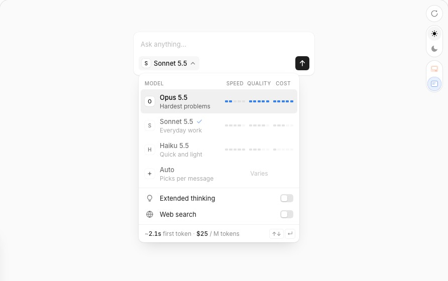

# affectUI Model Picker → 대시보드 모델 · effort 선택기

Status: 구현(Phase B) · 작성 2026-10-26 · 기준 main `ff6c9ac` · 에픽 #437 / 서브이슈 #442 · SSOT [`ssot.md`](ssot.md)
앞선 계약: [`../13-dashboard-three-surfaces-spec.md`](../13-dashboard-three-surfaces-spec.md) §3.1(모델 · effort의 집 — 펼친 카드 컨트롤 줄, 패널 입력창 옆),
SSOT 2026-10-22 T4/T5(대표 모델 전환 · compact 후 전환), 2026-10-23 T1(세션 effort) · T6(상단 기본값 칩)

## 0. 한 줄 정의

레퍼런스는 "다음 메시지를 어느 모델로, 얼마나 생각하게 보낼지"를 **보내기 전에 대가(속도·품질·가격)를 보면서** 한 메뉴에서 고르게 한다.
대시보드에서 이 결정은 **세션 하나의 모델 · effort**다 — 펼친 카드의 컨트롤 줄과 패널 입력창 옆(`renderModelPicker` · `renderEffortPicker`
×2 서피스). 지금은 네이티브 `<select>` 두 개라 모델끼리 무엇이 다른지(창 · autocompact · 가격) 보이지 않는다. 같은 트리거 → 메뉴 하나로
바꾸고, 막대와 트레이에는 **대시보드가 실제로 아는 숫자만** 싣는다.

## 1. 레퍼런스 해부 [REF]



출처: `docs-B2vZk3kt.js`(props · keyboard · a11y · motion · responsive · aiNotes), `RE-css.txt`, 데모 번들, 캡처 `components_model-picker-{light,dark}-t1/t2.png`.

### 1.1 구조

```
root [data-open][data-side=bottom|top][data-align=start|end]
├─ button.trigger  aria-haspopup=dialog · aria-expanded · aria-controls · aria-label "Model: <name>[, extended thinking]"
│   glyph 18px(이름 첫 글자) · name(교차 페이드) · flag(전구 — thinking일 때 펼침) · chevron(열리면 180°)
└─ pop  role=dialog "Model settings" · 닫히면 inert · 320px · 트레이 배경 · r20 · pad 4
    ├─ card r16 · pad 6
    │   ├─ head (aria-hidden)  "Model" | Speed · Quality · Cost (열 3×34px, gap 8)
    │   ├─ listbox "Model" tabindex=0 · aria-activedescendant · [data-pointing]
    │   │   └─ option ×N  aria-selected · aria-label "<name>, <desc>. Speed s, quality q, cost c of 5"
    │   │       glyph 22px · 제목(이름 + 현재면 ✓) / 설명 12px 한 줄 · 막대 3개(5칸, 높이 5px, 칸 간격 2) | 라우터면 "Varies"
    │   └─ settings (위 구분선)
    │       ├─ switch "Extended thinking" (28×16)
    │       ├─ fold 0fr→1fr: "Effort" + radiogroup Low·Medium·High (3×58px, 흰 thumb 슬라이드)
    │       └─ switch "Web search"
    └─ foot 38px  캡션 "~2.1s first token · $25 / M tokens" | kbd ↑↓ ↵ | sr-only aria-live=polite
```

### 1.2 상태

| 상태 | 바뀌는 것 |
|---|---|
| 닫힘 / 열림 | pop 투명·`visibility:hidden`·inert ↔ 보임, 트리거 배경 well, chevron 180° |
| 가리킴(마우스가 목록 위) | `data-pointing`: active 행 배경 well, **나머지 행 opacity .5**, active 행 막대가 칸 순서대로 진하게 채워짐, 트레이가 그 행으로 |
| 키보드 active | 목록 `:focus-visible` → active 행 안쪽 1.5px 링(외곽 outline 없음) |
| 선택됨 | 제목 옆 ✓(팝 320ms), `aria-selected=true` |
| thinking on | 트리거 전구 펼침, Effort 줄 펼침, 트레이 지연 ×1.6 / ×2.5 / ×4(low/medium/high) |
| web search 가리킴/포커스 | 캡션이 검색 설명 문장으로 교체 |
| 라우터 모델(강점 값 없음) | 막대 대신 "Varies", 트레이는 설명 문장 |

### 1.3 상호작용 · 키보드

| 위치 | 키 | 동작 |
|---|---|---|
| 트리거 | Enter · Space · ↓ (↑도) | 열고 목록으로 — active = 현재 모델 |
| 목록 | ↑ ↓ (순환) · Home · End | active 이동, 트레이가 따라감 |
| 목록 | Enter · Space / 클릭 | 고르고 닫고 트리거로 |
| 목록 | Tab | thinking · Effort · Web search로 |
| Effort | ← → (↑ ↓) | 이동 **즉시 선택**(radio 패턴) |
| 어디서나 | Esc | 닫고 트리거로. 바깥 pointerdown · 포커스가 루트 밖으로 → 닫힘 |

### 1.4 모션 (수치)

열기 opacity 200ms ease + transform `translateY(-4px) scale(.96)→none` 320ms `cubic-bezier(.32,.72,.24,1)`, 트리거 모서리 원점(side=top이면
+4px · 아래 모서리) · 닫기 opacity 160 / transform 220, visibility 220ms 지연 · chevron 300ms · 막대: 칸 배경 180ms, 켜질 때 지연
`열×70ms + 칸×45ms` + scaleY 1→1.6→1 360ms · ✓ scale .6→1 320ms · 스위치 knob 280ms · fold 행 420ms + opacity 320ms(지연 100) · thumb
320ms · 캡션 교차 페이드(들어옴 320ms opacity+blur 2px, 나감 220ms) · 숫자 롤 560ms ease-out-quart · reduced-motion이면 전부 정지.

### 1.5 토큰 · 크기 · 반응형 · 접근성 · 데이터 계약

- 색 역할: tray(밝 #f0f0f0 / 어둠 #111113) · card · line · ink · text · muted · well · bar-on · bar-off · switch · focus 링(ink 22% / 흰 30%).
  어둠은 `.dark` / `[data-theme=dark]` 조상으로 전환.
- 글자: 기본 13/20 · 설명 12/17 · 헤드 11/16 · 캡션 12.5(tabular-nums) · kbd 10.5 · glyph 10.5/600.
- 반경: 트리거 10 · pop 20 · card 16 · 행 10 · glyph 6 · segmented 9/thumb 7 · kbd 5 · 막대 칸 1.5. 높이: 트리거 30 · 행 ≥48 · 스위치 행 34 ·
  effort 버튼 24 · foot 38.
- 반응형: 폭 `min(320px, 100vw − 32px)`, 화면 가장자리 12px 안으로 translate 보정. 컨테이너 ≤300px: 행 glyph·키 힌트 숨김, 막대 30px/gap 6,
  effort 들여쓰기 0, 세그먼트 52px. `pointer: coarse`: 트리거 36 · 행 54 · 스위치 42 · effort 30, 키 힌트 숨김.
- 접근성: 트리거 haspopup/expanded/controls, 목록은 listbox + `aria-activedescendant`(포커스는 목록에 머묾), 스위치 `role=switch`,
  Effort는 탭 정지 하나인 radiogroup, 닫힌 메뉴 inert, 트레이 숫자는 굴러갈 때가 아니라 바뀐 뒤 한 번 polite로 읽힘.
- props: `models: {id, name, description?, icon?, speed?, quality?, cost?(1–5), latencyMs?, pricePerM?}[]` · value/onChange ·
  thinking · effort `low|medium|high` · webSearch · open · `side bottom|top` · `align start|end`. aiNotes: 메뉴는 트리거 기준 absolute —
  조상 overflow가 visible이어야 잘리지 않는다. 설명은 2–3단어.

## 2. 변경 전 [CODE]

캡처(하네스 :34105, fixture): `harness/shots-model-picker/before-model-picker-{light,dark}-{desk,phone}-{board,panel,owner-card,owner-panel,owner-panel-controls}.png`.

| 영역 | 현재 | 증거 |
|---|---|---|
| 데이터 | 대표 모델 6개 `{nickname, model, label, contextWindow, autoCompactTokens}`가 페이지에 주입, effort 5단계 | `src/session/model-switch.ts:35,106` · `dashboard.ts:3113–3123, 6319–6320` |
| 세션 필드 | `model · effort · effortEffective`(모델이 단계를 깎을 때만) · `contextTokens · autoCompactTokens · pendingModel` | `dashboard.ts:1093–1112`(cardDerivedFields) · `1300–1312`(modelFields) |
| 카드 | 컨트롤 줄 첫 칸: `<select class="cb-model-select" aria-label="모델 변경">` + effort `<select class="cb-model-select cb-effort-select">`; 640px 미만은 `.cfb-model-toggle` 뒤로 접힘 | `dashboard.ts:9662, 9676–9688, 9779` |
| 모델 옵션 | `nickname · autocompact 750.0K[ · compact 후 전환]`(현재 아닌 모델의 autocompact < 지금 컨텍스트), 목록 밖 모델은 disabled 첫 옵션, `pendingModel`·쓰기 중이면 disabled | `renderModelPicker` `9802–9819` |
| effort 옵션 | `Effort · Extra high` 5개, capped면 title "이 모델은 High까지 실행합니다" | `renderEffortPicker` `9893–9909` |
| 읽기 전용 | `<span class="cb-model-name">opus-5-5[1m]</span>` + `Max → High` 텍스트 | 같은 함수의 `!canSwitch` 분기 |
| 쓰기 | `changeModel(key, select)` → POST `…/model {model:nickname}` → `switched·compacting·unchanged`; `changeEffort` → POST `…/effort`; 세션·작업당 쓰기 하나(`_busy`), 거절 시 `resetPicker` | `9828–9883, 9910–9955` · 라우트 `2644–2703` |
| 안내 | 줄 아래 `renderModelNote`(대기 전환 role=status, 오류 role=alert) | `9820–9827, 9845, 9927` |
| 패널 | `#panel-controls`: "이 세션" + 같은 두 select, 640px 미만·높이 560px 미만이면 `.pc-toggle` 접힘(뜨는 패널), Esc가 먼저 접음 | `renderPanelControls` `9959–9991` · Esc `13007` |
| 실시간 | 포커스된 select가 있으면 카드 몸통·패널 컨트롤을 다시 쓰지 않음 | `isPickingModel` `10108` · `applyCardParts` `7923` · `renderPanelControls` `9964` |
| CSS | `.cb-model*` · `.cfb-model-toggle` · `.panel-controls/.pc-*` `3874–3904`, 접힘 `5166–5184`, 44px `5199` | |
| 상단 칩 | `#td-model/#td-effort` — 새 세션 **기본값**(PATCH `/api/settings/:key`, role=menu · menuitemradio · "열린 세션에도 적용"), Slack 로그인 없으면 숨김 | `6036–6042, 6906–7066` |

**canSwitch 판정(하네스 메모).** 클라이언트 UX 게이트일 뿐이다: `isOwner = s.ownerId === currentUserId`(카드 + `col≠closed`·`!terminated`·
`!sibling`, 패널은 + `sessionState≠SLEEPING`). `currentUserId`는 로그인 신원이 아니라 URL `/dashboard/:userId`(`3048–3051 → 3102 → 6307,
6340`) 또는 사용자 select(`selectUser` `7284`)다. 관리자 모드(`soma_admin_mode` → `X-Admin-Mode`, `6833–6880`)는 선택기 게이트에 쓰이지 않고
서버 쓰기 권한(`_hasWriteAccess` `818` — bearer 헤더/쿠키는 항상 허용)에만 쓰인다. ⇒ 하네스는 `/dashboard/U094E5L4A15`로 열면 전환 가능한
선택기가 그려진다(`/dashboard`는 읽기 전용). 하네스에는 전환 핸들러가 없어 POST는 501. (관리자 모드 ON인 관리자가 남의 세션에서 읽기 전용
선택기를 보는 불일치는 기존 동작 — §6.)

**런타임 사실.** effort는 thinking과 무관하게 매 턴 적용된다(`build-stream-options.ts:391` clamp, thinking은 `405`부터 별개).
세션 thinking은 존재하지만(`types.ts:509`, Slack `%thinking` `session-command-handler.ts:360`) payload에도 대시보드 쓰기 경로에도 없다.
가격은 서버에만 있다: `getModelPricing`(`metrics/model-registry.ts:381`)은 모르는 id(예: `grok-4.6`)에 **조용히** `FALLBACK_SPEC`(Sonnet
요율, `355`)을 돌려준다. 모델별 effort 메뉴는 카탈로그 `getEffortsFor`(`model-catalog.ts:150`)·`clampEffortToModel`(`322`). 첫 토큰 지연·
속도·품질 점수는 `src`에 출처가 없다.

## 3. 차이표

| 레퍼런스 요소 | 현재 | 결정 | 근거 |
|---|---|---|---|
| 트리거(glyph · 이름 · chevron) | select 2개 | **변형** — 트리거 하나, 이름 옆에 `· effort` | `REPRESENTATIVE_MODELS[].label`(대표가 아니면 modelShort), `s.effort` — effort도 같은 메뉴라 닫힌 상태에서 보여야 한다 |
| 전구 flag(thinking) | — | 불채택 → 후속 | `thinkingEnabled`가 payload에 없고 대시보드 쓰기 경로가 없다 |
| 320px 메뉴, side/align | 네이티브 드롭다운 | **변형** — body 단의 fixed 메뉴, side는 서피스별 + 자동 뒤집기 | `.card-expand-inner{overflow:hidden}`(접힘 애니메이션) — absolute면 잘린다(aiNotes). 선례 `.art-peek` fixed `5806` |
| 헤드 "Model" + 열 이름 | — | 변형 — "이 세션 모델" + `창 · 압축 · 비용` | 상단 칩의 "새 세션 기본 모델"과 구별 |
| 행 glyph | — | 채택 | nickname 첫 글자 대문자 |
| 행 이름 | nickname | 채택 — label | `label`("Opus 5.5 (1M)") |
| 행 설명 2–3단어 | 옵션 문구 | **변형** — 지금 옵션 문구를 설명 줄로 | `nickname · autocompact X[ · compact 후 전환]` — 마케팅 문구는 출처 없음 |
| 현재 ✓ | selected | 채택 | `m.model === s.model` |
| Speed 막대 | — | 불채택 | 지연·처리량 측정값 없음 |
| Quality 막대 | — | 불채택 | 품질 점수 출처 없음 |
| Cost 막대 | — | 채택 | 출력 $/M ÷ 목록 최대(D4·D5) |
| (추가) 창 · 압축 막대 | 문구 속 autocompact | 변형 | `contextWindow` · `autoCompactTokens` ÷ 목록 최대 |
| 가리키면 채움 · 다른 행 물러남 | — | 채택 | — |
| 라우터 "Varies" | — | 불채택 | Auto 라우터 모델 없음 |
| Extended thinking 스위치 | — | 불채택 → 후속 | 위 flag와 같음 |
| Effort 세그먼트(3단계, thinking 아래 접힘) | select 5개 | **변형** — 허용 단계만, 늘 보임 | 카탈로그 effort ∩ `EFFORT_LEVELS`(D6); effort는 thinking과 무관하게 적용 |
| Web search 스위치 | — | 불채택 | 세션별 web search 설정 없음 |
| 트레이 첫 토큰 `~2.1s`, effort 배수 | — | 불채택 | TTFT 데이터 없음 |
| 트레이 가격 `/ M tokens`(롤) | — | 채택(변형: 입력·출력 둘) | `findModelPricing`(D5) — 모르면 "가격 정보 없음" |
| (추가) 트레이 창 | — | 채택 | `contextWindow` |
| 키 힌트 ↑↓ ↵ · sr polite | — | 채택 | — |
| 대기 전환 · compacting | select disabled + 안내 | 유지(변형: 옵션 aria-disabled + 메뉴 안 대기 줄) | `pendingModel`, `_busy` |
| capped effort | title + `→` | 유지 | `effortEffective` |
| 640px 접힘 토글 | `.cfb-model-toggle` · `.pc-toggle` | **제거** | 트리거 하나가 접힘의 일을 한다 |
| 상단 기본값 칩 · 새 작업 대화상자 | role=menu / select | 범위 밖(D17) | 다른 결정(새 세션 기본값) |

## 4. 계약 (TO-BE)

클래스 접두사 `mp-`. 클라이언트 상태 `var _mp = { key: null, surface: null, active: 0, pointing: false };`(한 줄 var). 모든 모델·라벨 텍스트는
`esc`/`escAttr`, 값은 `data-*`, 클릭은 위임 또는 모델 텍스트 없는 인라인 호출만.

- **D1 트리거 [SHIPPED].** owner(`canSwitch`)에게 `renderModelPicker(s, canSwitch, modelShort, surface)`는
  `<button type="button" class="mp-trigger" aria-haspopup="dialog" aria-expanded="false|true" aria-controls="mp-menu" data-mp-key="…" data-mp-surface="card|panel">`
  = `.mp-glyph`(nickname 첫 글자) + `.mp-name`(대표 label, 아니면 modelShort) + `.mp-level`(`· <effortLabel(effortEffective||effort)>`) +
  `.mp-chev`(CSS로 그린 꺾쇠, 열리면 뒤집힘). aria-label `모델 <이름>, effort <Effort 전체 이름> — 바꾸기`. `aria-expanded`는 열린 메뉴 상태(`_mp`)에서
  그린다. 쓰기 중이면 `aria-busy="true"`(비활성화하지 않음 — effort는 모델 대기 중에도 바꿀 수 있다). `onclick="event.stopPropagation();mpToggleFrom(this)"`,
  `onkeydown="mpTriggerKey(event,this)"`(모델 텍스트 없음). 읽기 전용 출력은 지금과 **바이트 단위로 같다**(`cb-model-name`, `meta-effort`).
- **D2 메뉴 호스트 · 배치 [SHIPPED].** `#mp-menu`(첫 열기 때 `mpHost()`가 `document.body`에 한 번 생성) `role="dialog" aria-label="이 세션의 모델 · effort"`,
  닫히면 `inert` + `visibility:hidden`. 열린 메뉴는 하나. `position: fixed; z-index: 150`(패널 101 위, 크론 서랍 190 아래). `mpPlace(rect, w, h, vw, vh, side)`:
  폭 `min(320px, 100vw − 32px)`, align start, 가장자리 12px로 clamp; side 카드 = bottom, 패널 = top, 그 쪽이 모자라고 반대쪽이 더 넓으면 뒤집는다.
  스크롤·resize는 rAF로 따라간다. **앵커의 카드가 움직이면 닫는다**(교차 리뷰 R1 #1 — 900ms 뒤 칸 이동 · FLIP · 보드 리플로):
  열 때 `mpSpot(trigger)` = 화면 위치 + 모든 조상의 scroll 오프셋(페이지·칸 스크롤이 상쇄된다)을 적고, 열린 동안 150ms 감시(`mpWatch`)가
  2px 넘게 달라지면(`mpMoved`) `mpClose(false)`. 스크롤 타이밍에 기대지 않는다(처음엔 "300ms 안에 스크롤 없음"으로 했다가 하네스에서
  스크롤 이벤트보다 감시가 먼저 돌아 닫히는 경합을 보고 바꿨다).
  트리거가 DOM에서 사라지거나 화면 밖이면 닫힘. 바깥 pointerdown · 메뉴와 트리거 밖으로 포커스 이동 → 닫힘.
- **D3 모델 목록 [SHIPPED].** `renderModelMenu(s)` 안 `role="listbox" aria-label="모델" tabindex="0" aria-activedescendant="mp-opt-<i>"`. 옵션은
  `REPRESENTATIVE_MODELS` 순서, `id="mp-opt-<i>" role="option" data-mp-i data-mp-nick aria-selected`, 내용 = glyph + 제목(label + 현재면 ✓) + 막대 +
  설명(`nickname · autocompact <formatTokens>[ · compact 후 전환]` — 규칙은 그대로: 현재 아님 && `contextTokens > autoCompactTokens`). 행은 grid
  `"g t b" / "g d d"` — 설명은 제목 아래 막대 밑까지 펼치고 2줄까지 감싼다(구현 중 변경: 한 칸에 두면 `opus[1m] · autoco…`로 잘렸다).
  세션 모델이 목록 밖이면 첫 옵션 `aria-disabled="true"` "<modelShort> / 현재 · 전환 목록 밖". 옵션 aria-label은 이름·설명·창·가격을 문장으로.
- **D4 막대 [SHIPPED].** 열 3개 `창 · 압축 · 비용`(헤드 aria-hidden), 각 5칸(`.mp-seg[data-on]`). `mpSegments(v, max) = clamp(round(5·v/max), 1, 5)`,
  값이 없거나 0이면 막대 대신 `—`. 창 = `contextWindow ÷ max`, 압축 = `autoCompactTokens ÷ max`, 비용 = `price.output ÷ max(price.output)` — 최대는
  메뉴에 실린 모델들 중에서. (현 데이터: 창 1M→5 · grok 500K→3; 압축 750K→5 · 600K→4 · 450K→3; 비용 $25→3 · $50→5 · $15→2 · $30→3 · grok —.)
- **D5 가격(서버) [SHIPPED].** `model-registry.ts`에 `findModelPricing(model): ModelPricingSpec | null`(레지스트리 행이 맞을 때만; FALLBACK이면 null).
  `getModelPricing`·비용 계산은 그대로(모르는 id는 계속 Sonnet 요율). `renderDashboardPage`가 각 대표 모델에 `price: {input, output}`($/M)을 맞을 때만
  붙인다(`withPickerPrice`; `listRepresentativeModels`는 그대로).
- **D6 effort 허용 단계(서버) [SHIPPED].** `KanbanSession.effortLevels?: EffortLevel[]` = `pickerEffortLevels(modelCatalog.getEffortsFor(s.model))` —
  카탈로그 메뉴 ∩ `EFFORT_LEVELS`(그 순서), 카탈로그가 모델을 알고 교집합이 비지 않을 때만(`cardDerivedFields`). 없으면 클라이언트는 전부.
- **D7 Effort 세그먼트 [SHIPPED].** 목록 아래 구분선 뒤, 늘 보인다. 1줄: "Effort" + (capped면) `설정 Max → 이 모델은 High까지 실행`; 2줄:
  `renderEffortControl(s)` = `role="radiogroup" aria-labelledby="mp-effort-label"` 버튼 `role="radio" data-mp-effort aria-checked tabindex aria-label`,
  짧은 라벨 `Low · Medium · High · XHigh · Max`(aria-label은 `EFFORT_LABELS`), 체크 = `effortEffective || effort`, 체크된 것만 `tabindex="0"`.
  thumb `style="--i;--n"`, `repeat(var(--n), 1fr)`, thumb 폭 `(100% − 4px)/var(--n)`. `renderEffortPicker(s, true)`도 이것을 돌려준다.
  고르면 메뉴는 열린 채. 서버가 받은 값은 곧바로 세션 캐시에 반영(`mpApplyEffort`)되어 thumb가 폴링을 기다리지 않는다; 실패면 세션 값 그대로 +
  메뉴 안 `.mp-err` 한 줄(시각용 — 알림은 줄 아래 `renderModelNote`의 role=alert).
- **D8 트레이 [SHIPPED].** foot = 빛나는 행(가리키는 중이면 active, 아니면 현재)의 `mpTray(o)`: `입력 $5 · 출력 $25 / M · 창 1.0M`, 가격 없으면
  `가격 정보 없음 · 창 500.0K`(달러: 목표가 정수면 정수). `<kbd>↑↓</kbd><kbd>↵</kbd>`. 행이 바뀌면 달러가 `MP_ROLL_MS` 560ms
  ease-out-quart로 구른다(`mpRollTray`, reduced-motion이면 즉시). sr-only `aria-live="polite"` 하나가 `<이름>: 입력 $5 · 출력 $25 / 백만 토큰, 창 1.0M`
  — 글자가 같으면 morph가 다시 쓰지 않아 한 번만 읽힌다.
- **D9 키보드 [SHIPPED].** 트리거 Enter·Space(버튼 클릭)·↓·↑ → 열고 목록 포커스(active = 현재); 열린 트리거의 Esc → 닫음 + 전파 중지.
  목록 ↑↓ 순환 · Home · End(가리킴 = 빛남), Enter·Space → 현재 아니고 막히지 않았으면 `changeModel(key, nickname)` → 닫고 트리거로(현재 행은 닫기만).
  Tab → 체크된 effort; 그 뒤 Tab · 목록에서 Shift+Tab → 닫고 트리거로. effort ←→↑↓ · Home · End → 이동 + 선택(`changeEffort(key, level)`).
  Esc → 닫고 트리거로(대상은 `data-mp-surface`+`data-mp-key`로 다시 찾음). **메뉴의 keydown은 모든 키의 전파를 멈춘다**(교차 리뷰 R1 #2 —
  카드 Esc · 패널의 document Esc · 보드 단축키 `n`이 보지 못한다).
- **D10 포인터 [SHIPPED].** 마우스가 옵션 위 = active(트레이 따라감), 목록 `data-pointing` → active 아닌 옵션 opacity .5, 목록을 떠나면 해제.
  빛나는 옵션(`data-lit`)의 켜진 칸은 `--accent`, 지연 `열×70ms + 칸×45ms`, scaleY 1→1.6→1 360ms.
- **D11 쓰기 · 잠금 [SHIPPED].** API·결과 문구는 그대로(`postModelSwitch`·`postEffortSwitch`·`modelSwitchNote`·`effortSwitchNote`·`_modelNotes`·
  `renderModelNote`). `changeModel(key, nickname)` · `changeEffort(key, level)` — 값으로 받는다(`resetPicker` 제거: 거절되면 세션 값으로 다시
  그려진다). `setBusy`/`isBusy` 잠금, 다른 서피스 즉시 repaint 유지. `pendingModel` 또는 `isBusy(key,'model')` → 모델 옵션 전부 `aria-disabled`,
  목록 위 대기 줄(`compact 후 grok[1m](으)로 전환 대기 중` / `모델 전환 중…`), Enter 무시. `isBusy(key,'effort')` → radiogroup `aria-disabled`, 화살표 무시.
- **D12 실시간 · 포커스 [SHIPPED].** `isPickingModel(root)` = `root.querySelector('.mp-trigger[aria-expanded="true"]')` — 메뉴가 열린 동안 그 카드
  몸통은 다시 쓰지 않고, `renderPanelControls`도 같은 검사로 건너뛴다(닫을 때 `mpClose`가 둘 다 따라잡는다). 메뉴는 `_sessionCache`에서
  `mpRepaint()`로 다시 그린다 — active가 바뀔 때마다, 자기 쓰기 전후, 그리고 패널 갱신 경로(`renderPanelControls`)마다. morph라 목록 포커스가 남는다.
- **D13 모션 [SHIPPED].** 열기 opacity 200ms + transform `translateY(∓4px) scale(.96)→none` `var(--dur-move) var(--ease-out)`, 원점 = 트리거 쪽 모서리
  (`data-side`). 닫기 opacity 160ms · transform 220ms · visibility 220ms 지연. chevron 300ms · ✓ scale .6→1 320ms · thumb `var(--dur-move)` · 트리거 배경
  `var(--dur-press)`. reduced-motion: 전역 규칙이 길이를 끄고, 자기 블록 `@media all and (prefers-reduced-motion: reduce)`가 scale·칸 채움·지연까지 끈다.
- **D14 토큰 · 테마 [SHIPPED].** 자기 CSS 구역의 별도 `:root { --mp-well; --mp-bar; --mp-bar-off }` + `[data-theme="light"] { … }`(공유 블록은 손대지
  않음 — R1 #3). 나머지는 기존 토큰: 트레이 `--ib-col`, 카드 `--ib-card`, 선 `--ib-card-border`, 글자 `--ib-text/-2/--ib-muted`, 세그먼트 `--ib-seg`/thumb
  `--ib-seg-on`(보드의 Board|List와 같은 짝), 강조 `--accent`, 대기 `--st-wait`, 오류 `--st-fail-text`, 포커스 `--border-focus`. 반경 트리거 8 · pop 16 ·
  card 12 · 옵션 10 · glyph 6 · segmented 9/7 · 칸 1.5.
- **D15 반응형 · 터치 [SHIPPED].** `.mp-pop{container-type:inline-size; max-height: calc(100vh − 24px)}`; `@container (max-width: 300px)`: 옵션 glyph·키 힌트
  숨김, 막대 열 30px/gap 6. 자기 블록 `@media (pointer: coarse), (max-width: 639px)`: 트리거·effort 버튼 ≥44px, 옵션 ≥54px, 키 힌트 숨김(공유 44px 블록에서는
  옛 선택자만 지웠다). 패널 입력창 줄(639px 이하 · 높이 560px 이하)에서 트리거는 `max-width: 42%` + 말줄임, "이 세션"은 숨김.
- **D16 접힘 제거 [SHIPPED].** `.cfb-model-toggle`·`_cardModelOpen`·`toggleCardModel`, `.pc-toggle`·`.pc-pick`·`_panelControlsOpen`·`togglePanelControls`,
  `.cb-model-select`, Esc의 `_panelControlsOpen` 분기를 지웠다. 패널의 "이 세션" 표기는 트리거 앞 `.pc-scope`로 남는다.
- **D17 범위 [SHIPPED — 변경 없음].** 상단 `#td-model/#td-effort`와 새 작업 대화상자는 그대로 — 결정이 다르다(새 세션 기본값, PATCH `/api/settings`,
  옵션은 설정 레지스트리 행, Slack 로그인 없으면 숨김, "열린 세션에도 적용" 체크) → 후속.
- **D18 접근성 요약 [SHIPPED].** 트리거 haspopup/expanded/controls · listbox + activedescendant(포커스는 목록) · radiogroup 탭 정지 하나 · 닫힌 메뉴
  inert · polite 한 번 · Esc/선택 후 트리거로 포커스 복귀 · 헤드·막대·캡션 aria-hidden(옵션 aria-label이 같은 내용).

## 5. 시험

새 파일 `src/conversation/__tests__/dashboard-affectui-model-picker-client.test.ts`(three-surfaces 하네스 헤더, 45개)와
`dashboard-affectui-model-picker.test.ts`(서버, 4개). 처음 작성한 41 + 4개가 전부 RED(`client var _mp not found` 28, `mpPlace not found` 3,
`mpTriggerKey not found`, `findModelPricing is not a function`, `pickerEffortLevels is not a function`, `renderCardBody`가 select를 그린다 …);
교차 리뷰 반영으로 4개 추가(트리거 Esc 전파 중지 · 카드 이동 감시 2 · 자기 reduced-motion 블록).

| # | 시험(describe › it 요지) | D |
|---|---|---|
| T1 | D1 › 트리거 마크업 · 목록 밖 모델 이름/escape · 읽기 전용 바이트 동일 · busy·expanded | D1 |
| T2 | D3 › 6개 순서·선택·✓ · compact 후 전환 규칙 · 목록 밖 첫 행 · aria-label 문장 · 가리킴/빛남 | D3, D10 |
| T3 | D4 › `mpSegments` · 행별 막대 칸 수 `[5,5,3] … [3,3,—]` | D4 |
| T4 | 서버 › `findModelPricing`(grok null, `getModelPricing` 폴백 유지) · 페이지 주입 `price` | D5 |
| T5 | 서버 › `pickerEffortLevels` · 카드 `effortLevels`(카탈로그 spy) | D6 |
| T6 | D7 › 5단계·탭 정지 하나 · 허용 단계만 + capped 줄 · busy 비활성 · 메뉴 안 위치 + `.mp-err` | D7 |
| T7 | D8 › 트레이 문구 · 달러 형식 · 키 힌트 + live region 하나 · 롤(ease-out, reduced-motion 즉시) | D8 |
| T8 | D9 › ↑↓ 순환·Home/End · Enter 선택 → 닫힘+포커스 · Space 현재=닫기 · Esc 전파 중지 · 잠금 시 Enter 무시 · Tab 경계 · effort 화살표 · 트리거 Esc 전파 중지 · 트리거 ↓ | D9 |
| T9 | D11 › 모델 잠금(POST 1회, peer busy) · effort 결과 즉시 캐시 반영 | D11 |
| T10 | D2 › `mpPlace` 정렬·뒤집기·12px · `mpSpot`/`mpMoved`(스크롤은 상쇄, 레이아웃 이동 = 닫힘) · 감시는 열린 동안만 | D2 |
| T11 | D12 › `isPickingModel` · 패널 컨트롤(owner 트리거 / 읽기 텍스트 / 열린 동안 건너뛰고 메뉴만 다시 그림) · 카드 줄 | D12 |
| T12 | D13–D15 › `.mp-pop` 규칙 · 칸 지연·물러남·thumb · 토큰 light 짝 · 자기 터치 블록(공유 블록에 `.mp-` 없음) · 자기 reduced-motion 블록 | D13–D15 |
| T13 | D16 › 접힘·select 흔적 없음 · 메뉴 함수 한 번씩 선언 | D16 |

고친 기존 시험(마크업을 일부러 바꿨기 때문):
- `dashboard-live-surfaces-client.test.ts` "model switch on the open card": select/option 단언 → 메뉴 단언(의미 동일: 6개 nickname 순서, 현재 선택,
  compact 후 전환 문구, 목록 밖 현재 항목, 대기 중 잠금). 읽기 전용 span · `modelSwitchNote` · `renderModelNote` 단언은 그대로.
- `dashboard-effort-client.test.ts` "card effort picker": owner select → radiogroup(onchange·키가 인라인에 없음). 읽기 전용 `Max &rarr; High`와 상단 칩 T6은 그대로.
- `dashboard-three-surfaces-client.test.ts`: `_cardModelOpen` var 제거; 컨트롤 줄 시험 — owner는 `[MODEL]`만, 읽는 사람은 `[MODEL][EFFORT]`; 모델 잠금 시험은
  값 인자로; "floating pickers" → "Esc가 메뉴를 먼저 닫고 전파를 멈춘다(패널은 그대로)"; Esc 순서 핀은 남은 패널 Esc 줄에서; busy 핀
  `renderEffortPicker` → `renderEffortControl`.
- `dashboard-agent-tree-client.test.ts` "a refused model switch …": `resetPicker` 대신 "되돌릴 것이 없다 — 거절 안내, 시작·정착 때 카드 다시 그림 4회".
- `dashboard-auto-resume-client.test.ts`: var 목록에서 `_cardModelOpen` 제거.
- 수정 없이 통과: `dashboard-goal-client`(isPickingModel), `dashboard-live-surfaces`(주입 목록 + price), `dashboard-agent-inbox`(첫 reduced-motion·44px
  블록을 읽는 시험 — 그래서 내 블록은 `all and …` / `(pointer: coarse), (max-width: 639px)`로 문자열이 다르다).

## 검증

- RED → GREEN: 새 시험 45/45 실패(로그 `harness/mp/red-model-picker.txt`) → 49/49 통과.
- 게이트: `npx vitest run src/conversation/__tests__/ --testTimeout=60000 --hookTimeout=60000` → 64 파일 · 1697개 통과(기기 load average ~130이라
  기본 5초/10초로 돌린 앞선 실행에서는 내 변경과 무관한 서버 시험 38개가 hook/test 시간 초과로만 실패했고, 긴 타임아웃에서 전부 통과) ·
  `npx tsc --noEmit` exit 0 · `npx biome check src/conversation/` exit 0 · `src/metrics/__tests__/` 통과.
- 화면(하네스, fixture, `/dashboard/U094E5L4A15`, 메뉴 열림 — :34115의 첫 서버는 코드 변경 전 것이라 kill 없이 새 포트 :34135로 다시 띄움):
  `harness/shots-model-picker/after-model-picker-{light,dark}-{desk,phone}-{owner-card,card-menu,card-menu-keys,owner-panel,panel-menu}.png`, 데스크톱
  가리킴 `…-desk-card-menu-hover.png`. 확인: 카드 메뉴는 아래 공간이 모자라 위로 뒤집힘(desk 536,88 · 320×454), 패널 메뉴는 위로 열림, ↓↓ 뒤
  포커스 링, Esc 뒤 메뉴 닫힘 · 포커스 트리거 · 패널 열린 채(8개 조합 모두), 가리킨 Fable 행만 막대가 켜지고 트레이가 `$10 · $50`으로 구름.

## 6. 범위 밖 · 후속

- thinking 스위치 + 트리거 전구: `POST …/thinking` + `KanbanSession.thinking`(= `session.thinkingEnabled ?? 사용자 기본값`)이 먼저 필요.
- 상단 기본값 칩 · 새 작업 대화상자를 같은 메뉴로(D17).
- 속도 · 품질 막대, 첫 토큰 지연, effort 지연 배수, web search, Auto 라우터 — 근거 데이터가 생기면.
- 관리자 모드 ON인 관리자에게 남의 세션 선택기를 열어 줄지(서버는 이미 허용) — 게이트 정책 결정이라 이 이슈 밖.
- 패널 컨트롤 줄의 오류 안내를 메뉴 안으로 옮기는 일(지금은 줄 아래 한 곳).
