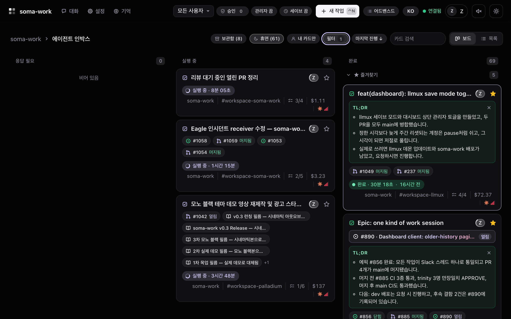
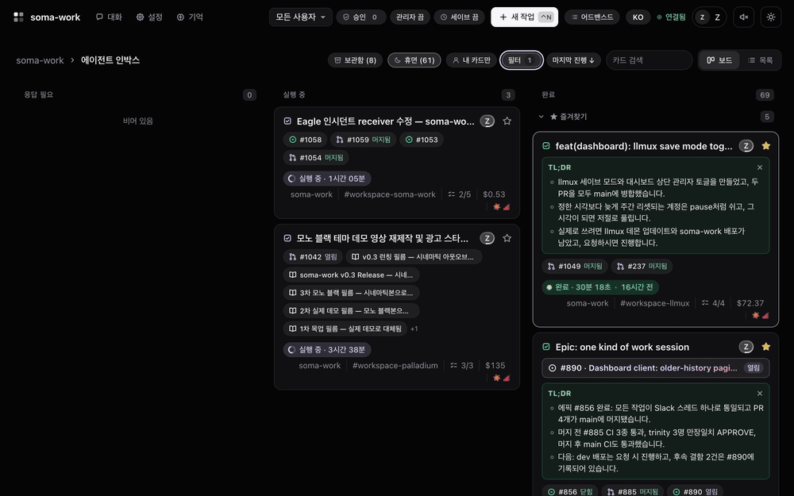
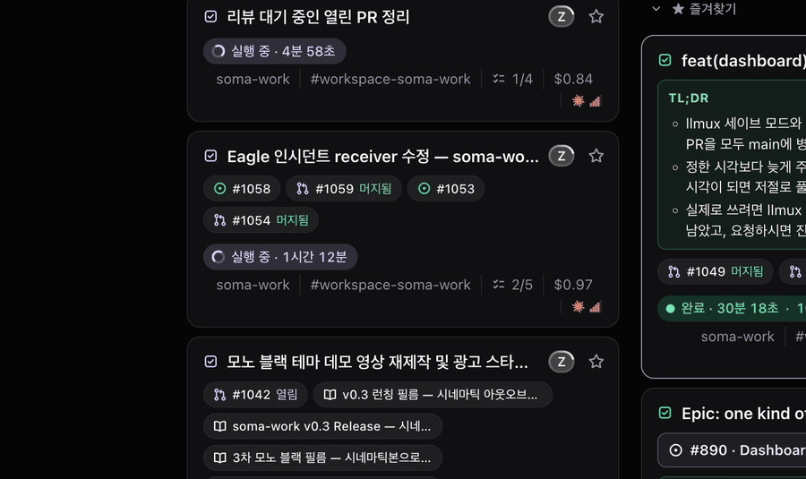
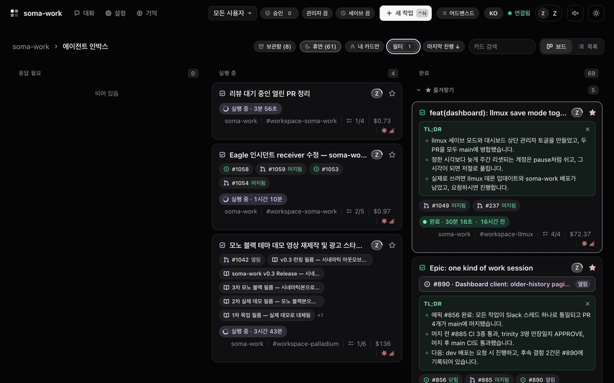

<h1 align="center">soma-work</h1>

<p align="center"><strong>슬랙에 말하면, 일하는 게 보입니다.</strong></p>

<p align="center">직접 띄우는 슬랙 봇으로, 팀을 위해 Claude Code 에이전트를 돌립니다. 맡긴 일마다 카드가 생기고, 열어 볼 수 있습니다.</p>

<p align="center">
  <a href="https://github.com/2lab-ai/soma-work/actions/workflows/ci.yml"></a>
  <a href="https://github.com/2lab-ai/soma-work/blob/main/LICENSE"></a>
</p>

<p align="center">
  <a href="#맡기기">맡기기</a> · <a href="#지켜보기">지켜보기</a> · <a href="#끼어들기">끼어들기</a> · <a href="#실행하기">실행하기</a> · <a href="#문서">문서</a> · <a href="./README.md">English</a>
</p>



<sub>실제 대시보드 화면입니다. 이 저장소 카드만 걸러 보여 주고, 비공개 카드는 숨겼습니다.</sub>

## 맡기기

어느 방법이든 슬랙 스레드 하나와 보드 카드 하나가 생깁니다.

- **슬랙:** 채널에서 봇을 멘션하거나, 봇의 스레드에 답글을 남깁니다.
- **대시보드:** **새 작업**(`Ctrl+N`)을 열고, 쓰고, 보냅니다.
- **음성:** 새 작업에서 **받아쓰기**를 누르고 말합니다.





## 지켜보기

카드를 엽니다.

- **대화:** 슬랙 스레드 그대로입니다. 내 지시와 에이전트의 답이 보입니다.
- **작업:** 에이전트의 계획. 단계마다 완료·진행 중·대기가 표시됩니다.
- **작업 로그:** 도구 호출 하나하나가 실행되는 대로, 작업별로 묶여 쌓입니다.



## 끼어들기

- **먼저 묻기:** 권한 요청이나 질문이 생기면 카드가 **응답 필요**로 옮겨집니다. 카드에서도, 슬랙에서도 답할 수 있습니다.
- **방향 바꾸기:** 일하고 있는 에이전트에게 카드 입력창으로 지시합니다.
- **중지·되돌리기:** 멈추거나, 문맥을 이전 시점으로 되돌립니다.

## 돌아오는 것

- 작업의 PR·이슈·문서가 카드에 붙습니다. PR과 이슈는 상태도 보입니다.
- 일이 끝나면 TL;DR이 붙습니다.
- 카드마다 비용·토큰·모델이 보입니다.

## 실행하기

내 컴퓨터에서 직접 띄웁니다. 지금은 소스에서 실행합니다(Node.js 20 이상).

1. [`infra/slack/slack-app-manifest.json`](infra/slack/slack-app-manifest.json)으로 슬랙 앱을 만들고 설치합니다. 봇 토큰(`xoxb-`)과 `connections:write` 권한의 앱 토큰(`xapp-`)을 복사합니다.
2. Claude를 연결합니다. 같은 컴퓨터에 [llmux](https://github.com/2lab-ai/llmux)가 떠 있으면 시작할 때 알아서 찾고, 아니면 `.env`에 `CLAUDE_CODE_OAUTH_TOKEN`(`claude setup-token`으로 발급)을 넣습니다.
3. 빌드하고 띄웁니다.

```bash
git clone https://github.com/2lab-ai/soma-work.git && cd soma-work
npm install && npm run build
cp .env.example .env    # SLACK_BOT_TOKEN, SLACK_APP_TOKEN, BASE_DIRECTORY
npm run dev
```

대시보드는 `http://127.0.0.1:3000/dashboard`입니다(`main`이 아닌 브랜치에서는 33000번 포트). 전체 안내: [soma-work 실행](docs/misc/guides/setup.ko.md)

## 워크플로우만 쓰기

soma-work의 에이전트 워크플로우 `zworkflow`는 Claude Code 플러그인입니다. 슬랙 없이 쓸 수 있습니다.

```text
/plugin marketplace add 2lab-ai/soma-work
/plugin install zworkflow@soma-work
```

자세한 내용: [zworkflow 플러그인 README](./src/local/README.ko.md)

## 문서

- [soma-work 실행](docs/misc/guides/setup.ko.md): 설치, 설정, 배포, GitHub, 문제 해결
- [명령어](docs/misc/guides/commands.ko.md): `/z`, `%`, `$`, 접두어 없는 명령어
- [기능과 아키텍처](docs/misc/guides/features.ko.md): 기능 전체
- [soma-work 개발](docs/misc/guides/contributing.ko.md): 프로젝트 구조, 설계 원칙, 테스트
- [문서 지도](docs/README.md), [ADR](docs/adr/README.md)

이 저장소에서 일하는 AI 에이전트라면 [`CLAUDE.md`](CLAUDE.md)와 [`AGENTS.md`](AGENTS.md)를 먼저 읽으세요.

## 라이선스

[ISC](./LICENSE)
