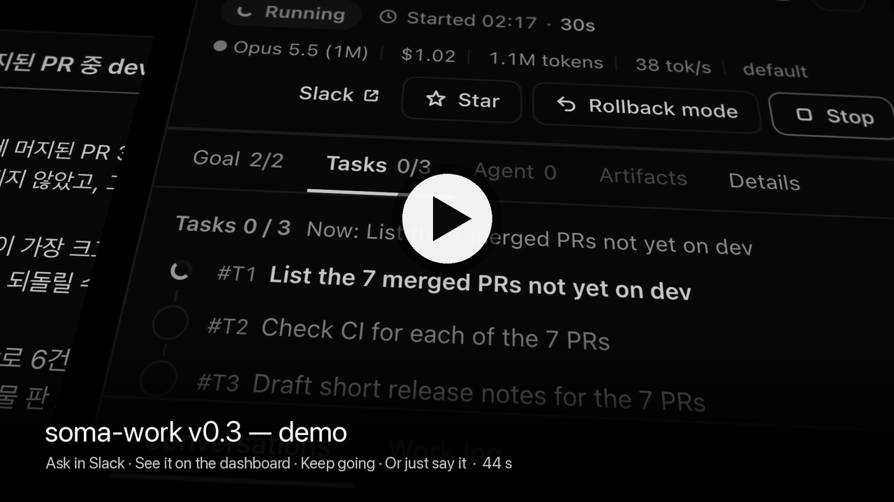
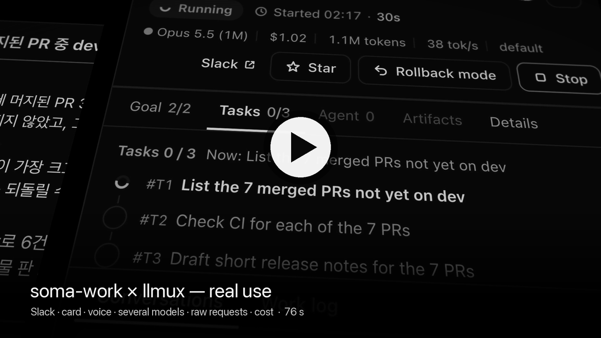
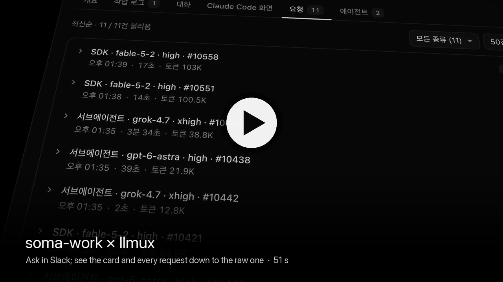

<h1 align="center">soma-work</h1>

<p align="center"><strong>Ask in Slack. Watch it work.</strong></p>

<p align="center">A self-hosted Slack bot that runs Claude Code agents for your team. Every task is a card you can open.</p>

<p align="center">
  <a href="https://github.com/2lab-ai/soma-work/actions/workflows/ci.yml"></a>
  <a href="https://github.com/2lab-ai/soma-work/blob/main/LICENSE"></a>
</p>

<p align="center">
  <a href="#ask-in-slack">ask in Slack</a> · <a href="#pick-it-up-on-the-dashboard">pick it up</a> · <a href="#keep-going-from-the-card">keep going</a> · <a href="#watch-it-work">watch</a> · <a href="#or-start-on-the-dashboard">start on the dashboard</a> · <a href="#step-in">step in</a> · <a href="#run-it">run it</a> · <a href="#docs">docs</a> · <a href="./README.ko.md">한국어</a>
</p>

[](https://github.com/2lab-ai/soma-work/releases/download/v0.3/soma-work-v0.3-demo-en.mp4)

<p align="center"><sub>▶ <a href="https://github.com/2lab-ai/soma-work/releases/download/v0.3/soma-work-v0.3-demo-en.mp4">Demo film, 44 s</a>: ask in Slack, see it on the dashboard, keep going from the card, or just say it. One real session, recorded from Slack and the dashboard. (<a href="https://github.com/2lab-ai/soma-work/releases/download/v0.3/soma-work-v0.3-demo-ko.mp4">Korean UI</a> · <a href="https://github.com/2lab-ai/soma-work/releases/tag/v0.3">v0.3 release</a>)</sub></p>

<p align="center">
  <a href="https://github.com/2lab-ai/soma-work/releases/download/v0.3/soma-work-llmux-demo-en.mp4"></a>
  <a href="https://github.com/2lab-ai/soma-work/releases/download/v0.3/soma-work-x-llmux-en.mp4"></a>
</p>

<p align="center"><sub>▶ <a href="https://github.com/2lab-ai/soma-work/releases/download/v0.3/soma-work-llmux-demo-en.mp4">Real-use demo, 76 s</a>: ask in Slack, keep going from the card, say a task, split one across several models, then open every request and what it cost. ▶ <a href="https://github.com/2lab-ai/soma-work/releases/download/v0.3/soma-work-x-llmux-en.mp4">soma-work × llmux, 51 s</a>: every call the agent makes goes through <a href="https://github.com/2lab-ai/llmux">llmux</a>, and you can open each one. (Korean versions: <a href="https://github.com/2lab-ai/soma-work/releases/download/v0.3/soma-work-llmux-demo-ko.mp4">demo</a> · <a href="https://github.com/2lab-ai/soma-work/releases/download/v0.3/soma-work-x-llmux-ko.mp4">soma-work × llmux</a>. The multi-model part is the same Korean session in both.)</sub></p>


<sub>The real dashboard, filtered to this repository (private cards hidden). It starts in Korean: press EN at the top right, or send the bot `lang en`. Card titles and TL;DRs are written by the agent, so some are in Korean.</sub>

## Ask in Slack

Mention the bot in a channel. It starts a thread for the task and answers there.


## Pick it up on the dashboard

The same request is a card on the board. Open it: in **Conversations**, your Slack message comes first, the agent's reply under it.


## Keep going from the card

Write your next instruction in the card's message box. It goes into the same Slack thread (marked "via Dashboard"), so the agent carries on where it was.


## Watch it work

- **Conversations:** your instructions and the agent's answers.
- **Tasks:** the agent's plan. Each step is done, running or waiting.
- **Work log:** every tool call as it runs, grouped by task (your own tasks; admins see all).


## Or start on the dashboard

- **New task:** type, **Start task**. It starts a Slack thread in the channel you pick.
- **Dictation:** press it in New task or a card's message box and speak; the words appear as you talk.


## Step in

- **When it asks:** a permission prompt or a question moves the card to **Needs response**. Answer on the card or in Slack.
- **Steer:** while it runs, ↵ queues your note as the next step; ⌘↵ (Ctrl+↵) steers it now. The chat shows the note at once with what is happening to it — waiting, processing, applied.
- **Stop or roll back:** stop it, or roll its context back to an earlier point.

## What comes back

- The PRs, issues and docs of the work, on the card. PRs and issues show their state.
- A TL;DR when the work ends.
- Cost, tokens and model, per card.

## Run it

You run it on your own machine. From source, today (Node.js 20+):

1. Create a Slack app from [`infra/slack/slack-app-manifest.json`](infra/slack/slack-app-manifest.json) and install it. Copy the bot token (`xoxb-`) and an app-level token with `connections:write` (`xapp-`).
2. Give it Claude: an [llmux](https://github.com/2lab-ai/llmux) on the same machine (found at start; ▶ [what llmux shows, 48 s](https://github.com/2lab-ai/llmux/releases/download/v0.2.26/llmux-intro-en.mp4)), or `CLAUDE_CODE_OAUTH_TOKEN` in `.env` (from `claude setup-token`).
3. Build and start:

```bash
git clone https://github.com/2lab-ai/soma-work.git && cd soma-work
npm install && npm run build
cp .env.example .env    # SLACK_BOT_TOKEN, SLACK_APP_TOKEN, BASE_DIRECTORY
npm run dev
```

The dashboard is at `http://127.0.0.1:3000/dashboard` (port 33000 off `main`). Full guide: [Running soma-work](docs/misc/guides/setup.md).

## Only the workflow

soma-work's agent workflow, `zworkflow`, is a Claude Code plugin. Use it without Slack:

```text
/plugin marketplace add 2lab-ai/soma-work
/plugin install zworkflow@soma-work
```

Details: [zworkflow plugin README](./src/local/README.md).

## Docs

- [Running soma-work](docs/misc/guides/setup.md): install, configuration, deployment, GitHub, troubleshooting
- [Commands](docs/misc/guides/commands.md): `/z`, `%`, `$` and bare commands
- [Features and architecture](docs/misc/guides/features.md): every feature in detail
- [Working on soma-work](docs/misc/guides/contributing.md): project structure, design principles, tests
- [Docs map](docs/README.md) and [ADRs](docs/adr/README.md)

If you are an AI agent working on this repository, read [`CLAUDE.md`](CLAUDE.md) and [`AGENTS.md`](AGENTS.md) first.

## License

[ISC](./LICENSE)
