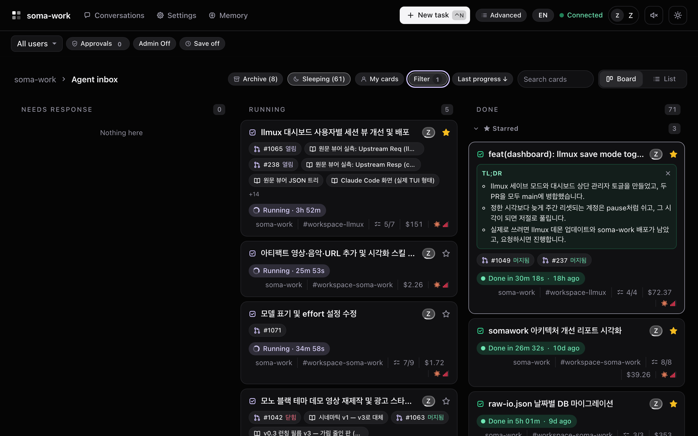
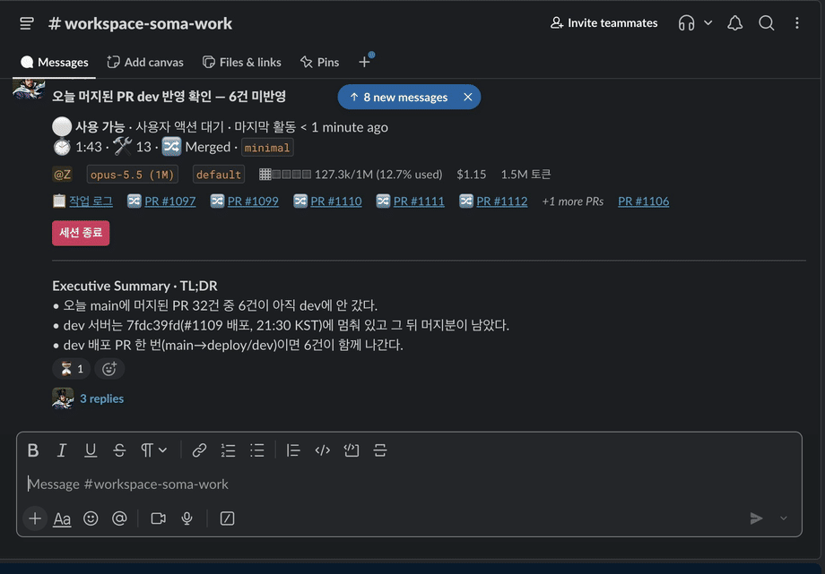
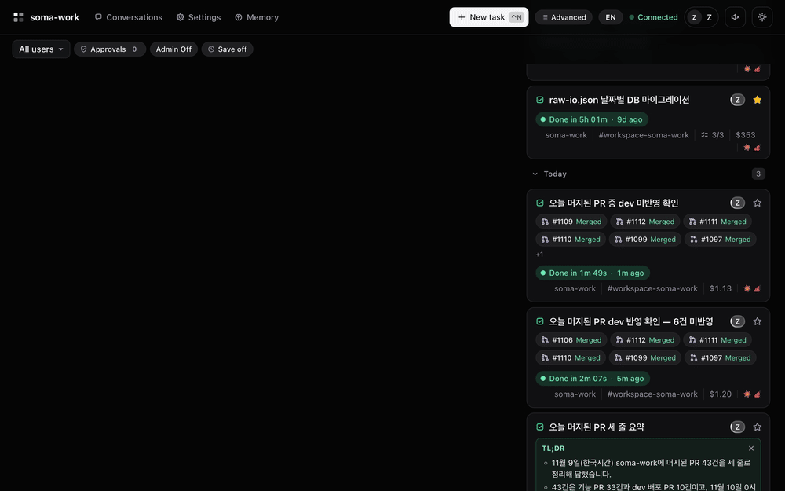
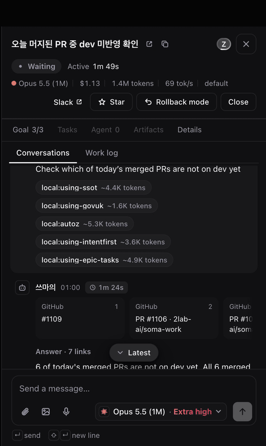
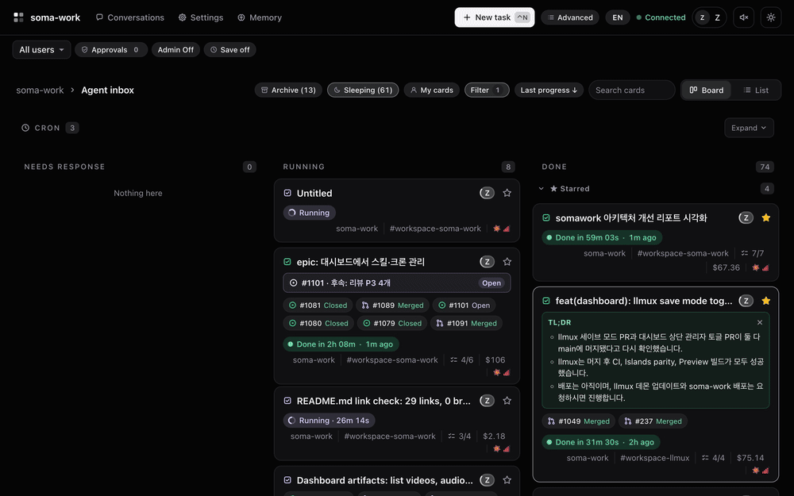
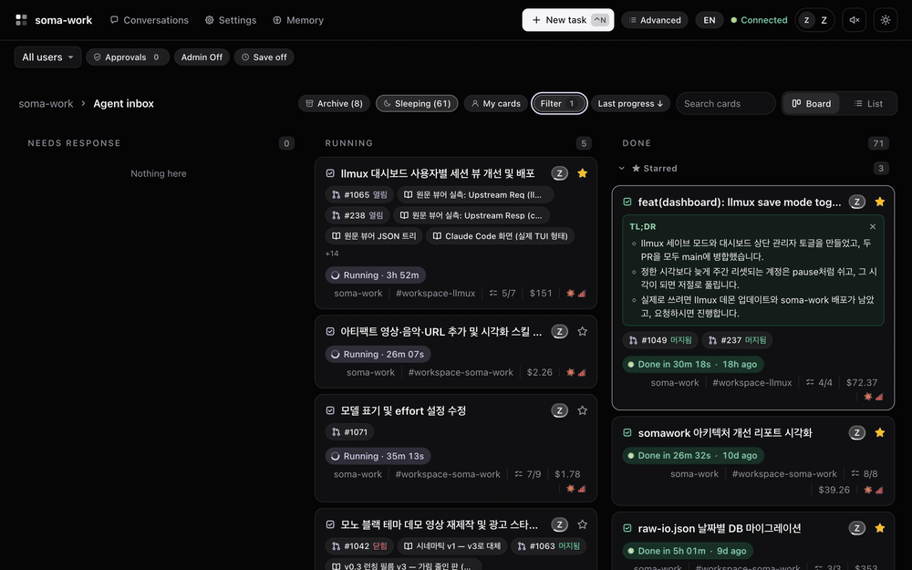
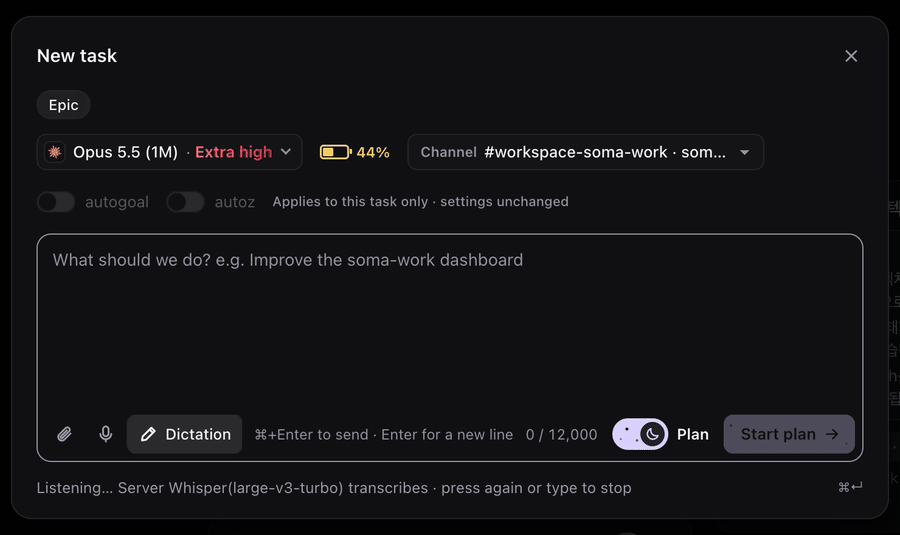

<h1 align="center">soma-work</h1>

<p align="center"><strong>Ask in Slack. Watch it work.</strong></p>

<p align="center">A self-hosted Slack bot that runs Claude Code agents for your team. Every task is a card you can open.</p>

<p align="center">
  <a href="https://github.com/2lab-ai/soma-work/actions/workflows/ci.yml"></a>
  <a href="https://github.com/2lab-ai/soma-work/blob/main/LICENSE"></a>
</p>

<p align="center">
  <a href="#ask-in-slack">ask in Slack</a> · <a href="#pick-it-up-on-the-dashboard">pick it up</a> · <a href="#keep-going-from-the-card">keep going</a> · <a href="#watch-it-work">watch</a> · <a href="#step-in">step in</a> · <a href="#run-it">run it</a> · <a href="#docs">docs</a> · <a href="./README.ko.md">한국어</a>
</p>



<sub>The real dashboard in English, filtered to this repository (private cards hidden). Task titles are the words people asked in, so some are Korean.</sub>

## Ask in Slack

Mention the bot in a channel. It answers in the thread, and that thread is now a task.



## Pick it up on the dashboard

The same request is a card on the board. Open it: your Slack message is at the top, the agent's reply under it.



## Keep going from the card

Write to the agent from the card's message box. It is the next message of the same thread, so the work goes on where it was, and Slack shows it too.



## Watch it work

- **Conversation:** the Slack thread: your instructions and the agent's replies.
- **Tasks:** the agent's plan. Each step is done, running or waiting.
- **Work log:** every tool call as it runs, grouped by task.



## Or start on the dashboard

- **New task** (`Ctrl+N`): type, send. It starts a Slack thread in the channel you pick.
- **Dictation:** press it in New task and speak. The words are written in as you say them.





## Step in

- **Asks first:** a permission prompt or a question moves the card to **Needs response**. Answer on the card or in Slack.
- **Steer:** write to the running agent from the card.
- **Stop or roll back:** stop it, or roll its context back to an earlier point.

## What comes back

- The PRs, issues and docs of the work, on the card. PRs and issues show their state.
- A TL;DR when the work ends.
- Cost, tokens and model, per card.

## Run it

You run it on your own machine. From source, today (Node.js 20+):

1. Create a Slack app from [`infra/slack/slack-app-manifest.json`](infra/slack/slack-app-manifest.json) and install it. Copy the bot token (`xoxb-`) and an app-level token with `connections:write` (`xapp-`).
2. Give it Claude: an [llmux](https://github.com/2lab-ai/llmux) on the same machine (found at start), or `CLAUDE_CODE_OAUTH_TOKEN` in `.env` (from `claude setup-token`).
3. Build and start:

```bash
git clone https://github.com/2lab-ai/soma-work.git && cd soma-work
npm install && npm run build
cp .env.example .env    # SLACK_BOT_TOKEN, SLACK_APP_TOKEN, BASE_DIRECTORY
npm run dev
```

The dashboard is at `http://127.0.0.1:3000/dashboard` (port 33000 off `main`). Full guide: [Running soma-work](docs/misc/guides/setup.md).

## Only the workflow

soma-work's agent workflow, `zworkflow`, is a Claude Code plugin. Use it without Slack:

```text
/plugin marketplace add 2lab-ai/soma-work
/plugin install zworkflow@soma-work
```

Details: [zworkflow plugin README](./src/local/README.md).

## Docs

- [Running soma-work](docs/misc/guides/setup.md): install, configuration, deployment, GitHub, troubleshooting
- [Commands](docs/misc/guides/commands.md): `/z`, `%`, `$` and bare commands
- [Features and architecture](docs/misc/guides/features.md): every feature in detail
- [Working on soma-work](docs/misc/guides/contributing.md): project structure, design principles, tests
- [Docs map](docs/README.md) and [ADRs](docs/adr/README.md)

If you are an AI agent working on this repository, read [`CLAUDE.md`](CLAUDE.md) and [`AGENTS.md`](AGENTS.md) first.

## License

[ISC](./LICENSE)
