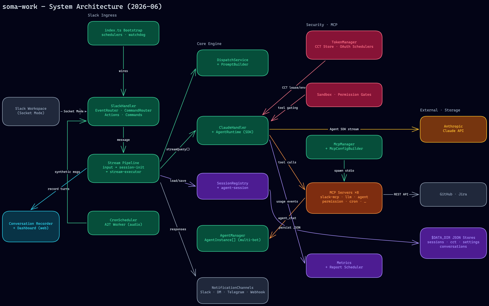

# Architecture Overview

soma-work (Slack multi-tenant AI Assistant) 아키텍처 문서. 2026-06-10 기준 전면 재작성.

> 편집 가능한 다이어그램 원본: [`architecture-diagram.excalidraw`](./architecture-diagram.excalidraw) (excalidraw.com에서 열기)



## Process Model

단일 Node 프로세스(`src/index.ts`, ~1,100 LOC)가 Slack Bolt(Socket Mode)로 기동하며, 부트스트랩 시 다음 백그라운드 컴포넌트를 와이어링한다:

| 컴포넌트 | 역할 | 위치 |
|----------|------|------|
| TokenManager + CCT Store | Claude OAuth 토큰 슬롯 풀, 자동 회전 | `src/token-manager.ts`(2.1k), `src/cct-store/` |
| OAuth/Usage Schedulers | 토큰 갱신·사용량 폴링 | `src/oauth/` |
| GitHub Auth | App installation 토큰 자동 갱신 | `src/github-auth.ts`, `src/github/` |
| McpManager | MCP 서버 프로비저닝 (stdio) | `src/mcp-manager.ts`, `src/mcp/` |
| PluginManager | 플러그인/마켓플레이스 라이프사이클 | `src/plugin/` |
| AgentManager | 멀티 에이전트 인스턴스 기동 | `src/agent-manager.ts`, `src/agent-instance.ts` |
| Claude Child Registry | Agent SDK 자식 프로세스 소유, 종료 시 bounded TERM→KILL 회수 | `src/agent-runtime/claude-child-process-registry.ts` |
| A2T Service | 음성→텍스트 (Python worker) | `services/a2t/worker.py` |
| CronScheduler | 예약 synthetic 메시지 트리거 | `src/cron-scheduler.ts` |
| Release notes | deploy 워크플로우의 `release_notes` 디렉티브 → `StreamExecutor` (deploy 세션만 `routeReleaseNotes` 조회) → `postReleaseNotes`: 채널 루트 헤더 + 스레드 전문. 채널은 `SOMA_RELEASE_NOTES_CHANNELS` (`config.getReleaseNotesChannels` → `routeReleaseNotes`) | `packages/slack/src/directives/release-notes-directive.ts`, `packages/slack/src/release-notes-poster.ts`, `src/release-notes-routes.ts` |
| Conversation Recorder | 대화 기록 + 리플레이 웹 대시보드 | `src/conversation/` |
| Metrics Schedulers | 토큰/비용 텔레메트리 집계·리포트 | `src/metrics/` |
| Socket Watchdog | Socket Mode 헬스 모니터 | `src/slack-socket-watchdog.ts` |

부트스트랩 초반(`acquirePidLock(DATA_DIR)` 이후, 세션 복원 `slackHandler.loadSavedSessions()` 이전)에는 `src/deploy/`의
1회성 이관이 순서대로 돈다. 전 유저 opus 기본 모델 이관 바로 다음이 `migrate-all-users-minimal-once.ts`로, 모든 유저의
`defaultLogVerbosity`를 `minimal`로, `sessions.json`의 모든 세션 마스크를 `LOG_MINIMAL`로 바꾼다. 마커
(`.all-users-log-minimal-once-2026-10-16.json`)는 존재만 확인하고 데이터보다 먼저 기록하므로 다시 돌지 않으며, 이후 유저가
바꾼 값은 덮지 않는다. 세션 복원보다 먼저 돌기 때문에 복원된 세션은 바뀐 마스크를 읽는다.

## Controller Process (`somawork`)

데몬과 **별개의 프로세스**가 하나 더 있다. `dist/cli/index.js`(소스 `src/cli/`)는 설치된 런타임을
운영하는 컨트롤러이고, Slack 이벤트를 처리하지 않는다. 데몬이 "돌면서 일하는 쪽"이라면 컨트롤러는
"세팅하고 들여다보는 쪽"이다.

| 축 | 데몬 (`src/index.ts`) | 컨트롤러 (`src/cli/`) |
|---|---|---|
| 수명 | launchd가 유지하는 장기 프로세스 | 커맨드 하나당 한 번 |
| 입력 | Slack Socket Mode 이벤트 | argv |
| 상태 | 프로파일 config·data·session archive | 없음 (읽기 + materialize 후 종료) |
| 부수효과 | Slack·Claude·MCP·파일시스템 | 주입된 seam 경유 (`src/cli/production-seams.ts`가 유일한 실제 배선) |

컨트롤러의 온보딩 state machine은 `src/cli/setup/orchestrator.ts`에 있고, 단계마다 어댑터를
호출한다: llmux 기동 → Slack CLI 인가 → Slack 앱 생성/설치 + 훅으로 런타임 토큰 수집 →
`materialize.ts`가 프로파일 트리 작성(0700 디렉터리 / 0600 파일) → `doctor.ts` 게이트 →
`service.ts`가 launchd user agent 설치. 마커를 신뢰해 단계를 건너뛰지 않는다 — 매 실행마다
어댑터가 실제 상태를 다시 검증하고, 단계 N을 완료하면 그 뒤의 마커는 모두 잘라낸다.

프로파일은 `preview` / `production` 둘뿐이고 경로·서비스 레이블이 겹치지 않는다
(`src/cli/profile.ts`가 SSOT). 자격증명은 `<configDir>/secrets.env`(0600)에만 있고,
`.env`·argv·stdout·setup state 어디에도 들어가지 않는다.

## Runtime Bundle

`scripts/deploy/stage-bundle.sh`가 만드는 불변 트리를 두 소비자가 공유한다: 레거시 플릿 배포
(rsync 후 노드에서 `npm ci --omit=dev`)와 패키지 설치(런타임 루트). 런타임 루트 기준 고정 경로는
`dist/cli/index.js`(실행 비트) · `dist/run-with-rotating-logs.js` · `dist/index.js` ·
`config.default.json` · `.system.prompt.example` · `infra/slack/slack-app-manifest.json`.

계약의 실행 가능한 진술은 `scripts/smoke/setup-package.js`다 — staged 트리를 외부 소비자처럼
구동하고, 하드링크 사본에서 asset을 하나씩 제거해 실패를 확인한다. `scripts/smoke/deploy-bundle.js`는
배포/워크스페이스 패키지 쪽 계약을 계속 소유한다.

## Core Request Flow

```
Slack Event (Socket Mode)
  → SlackHandler (src/slack-handler.ts, 1.5k)
      EventRouter · CommandRouter · Actions(9) · Commands(20+)
  → Stream Pipeline (src/slack/pipeline/)
      input-processor → session-initializer → stream-executor
      ├ SessionRegistry.getOrCreate (src/session-registry.ts, 2.2k)
      ├ DispatchService 워크플로우 분류 + PromptBuilder 프롬프트 조립
      └ McpConfigBuilder 툴 목록 구성
  → ClaudeHandler + AgentRuntime (src/claude-handler.ts, src/agent-runtime/)
      ├ TokenManager: CCT lease + query env 주입 (src/auth/)
      ├ Sandbox·Permission 게이트 (src/sandbox/, somalib/permission/)
      └ Claude Agent SDK streaming
  → 스트림 이벤트 처리 (text / tool_use / tool_result)
      ├ MCP 툴 호출 → packages/mcp-servers/*
      ├ Metrics 이벤트 적재
      └ Conversation Recorder 기록
  → NotificationChannels (src/notification-channels/)
      Slack · DM · Telegram · Webhook 출력 라우팅
```

## Native assistant status

`packages/slack/src/assistant-status-manager.ts` owns native Slack status writes.
`SlackApiHelper.setAssistantStatus` sends them through
`WebClient.apiCall('agents.sessions.setStatus')`: nonempty status strings map to
`processing`, and the empty string maps to `active`. These strings express loading
intent, not custom lifecycle display text. Clearing legacy
`assistant.threads.setStatus` loading text does not clear the new agent-session
lifecycle. `active` means ready for the next input, not a closed session.

The epoch and writer guards are unchanged. Each `(channelId, threadTs)` has a turn
epoch, desired status, heartbeat and serialized writer in process memory. Set, heartbeat and clear share that writer; a completed
network request cannot restore an older desired status. Epoch-scoped setters reject
closed or superseded turns, and epoch-scoped stale clears are rejected.
Transient terminal clears get at most three attempts. Cleanup bounds the caller's
wait, not the network request: an ordered clear remains queued after timeout, but
remote removal is not guaranteed when requests hang or all retries fail.

`SlackHandler` starts a setup-owned status after command and working-directory
validation for real user input when the source thread has no active request.
Cleanup invalidates the captured source epoch and requests a clear on initialization
failure, halt or migration; it cannot clear the newer execution epoch on the same thread.
`TurnSurface.begin()` starts execution status independently of `chat.startStream`.
Live Slack QA showed that opening a stream resets the lifecycle to `active`.
After successful startup returns a stream timestamp, `TurnSurface` restores
`processing` with the captured `expectedEpoch`, only while the turn remains current
and is not closing. Closed or superseded callbacks cannot re-enable processing.
`end()` and `fail()` invalidate the epoch and request `active` before waiting for
stream or plan cleanup.
`StreamExecutor.execute()` keeps surface initialization and initial runtime-status
updates inside its terminal-cleanup boundary, including setup failures.

## Major Subsystems

### Multi-Agent (`src/agent-manager.ts`, `src/agent-instance.ts`, `src/agent-runtime/`, `src/agent-session/`)
- `AgentManager`가 config의 agent 항목마다 `AgentInstance` 소유
- 각 인스턴스는 격리된 Bolt App(별도 봇 토큰), SessionRegistry, PromptBuilder 보유
- 메인 에이전트의 Claude 턴에서 agent MCP(`packages/mcp-servers/agent/`)의 `agent_chat`으로 라우팅 — 단, 실제 Claude SDK query 통합은 아직 placeholder (agent-mcp-server.ts TODO). 직접 @멘션/DM 처리도 `SlackHandler` 통합 대기 중 (`src/agent-instance.ts` TODO)
- `agent-session/`: turn runner, session phase, continuation handler

### Auth / Token (`src/token-manager.ts`, `src/cct-store/`, `src/oauth/`, `src/auth/`)
- CCT 슬롯 풀: v2 스키마, CAS 기반 atomic slot flip
- OAuthRefreshScheduler가 5시간/7일 임계값으로 자동 회전 + Slack 알림
- 쿼리마다 `ensureActiveSlotAuth()` → lease → env 주입 → release
- **런타임 auth 백엔드 전환 (#1189)**: 라이브 모드는 `src/auth/auth-runtime.ts` 소유 (`data/auth-runtime.json` 영속, 우선순위 persisted > `AUTH_MODE` env > 부팅 llmux 프로브). `llmux` 모드는 CCT lease를 synthetic lease로 단락하고 `ANTHROPIC_BASE_URL`을 주입. Slack `auth` 카드/명령으로 무재시작 전환 (mutation은 admin 전용)
- **llmux SDK 인증 격리**: `buildQueryEnv`는 테넌트 URL/키를 한 쌍으로 전달하고 상속 환경과 운영자 overlay에서 OAuth·Bearer·다른 프로바이더 플래그를 제거한다. SDK는 이 맵을 자식 환경 전체로 사용하며 부모 환경을 재병합하지 않는다. `ANTHROPIC_CUSTOM_HEADERS`에서는 `authorization`/`x-api-key`만 제거한다. 다른 헤더와 CCT 동작은 유지한다. [실제 SDK 전송 계약](../../current/spec/llmux-sdk-auth.md).
- **`auth` 카드 용량 오버뷰 (#auth-capacity-overview)**: llmux 모드 렌더 와이어링은 `CommandRouter`/`/z auth` → `createAuthTopicBinding.renderCard` (`src/slack/z/topics/auth-topic.ts`) → `fetchLlmuxStatus` (`src/auth/llmux-client.ts`, `GET /llmux/status`) → 순수 그룹·용량 헬퍼 (`src/slack/auth/capacity.ts`) → `buildAuthCardBlocks` (`src/slack/auth/builder.ts`). 버튼·모달 핸들러는 `registerAuthActions` (`src/slack/auth/actions.ts`)가 공유 Bolt app에 등록. 기본 렌더는 admin 포함 전원 readonly 오버뷰이고 관리 표면은 [Admin mode] 클릭으로만 진입 — 네비게이션 버튼은 `{viewerMode,page}`를 카드에 인코딩하지만 매 클릭 서버에서 actor 권한을 재검증한다(위조/스테일 admin 스탬프는 readonly 강등). 데이터 계약과 상한(정규화 계정분 합계, Grok 합성 리셋 억제, usage_control 읽기 전용 등)은 `.prd/07-auth-capacity-spec.md`가 SSOT. 레거시 CCT는 `renderCctCard({embed})`로 슬롯 단위 페이지네이션하며 `cct/auth-origin.ts`가 버튼 값과 모달 metadata에 출처/페이지를 보존해 변경 후 `renderAuthCard`로 돌아온다. 직접 `cct` 경로는 기존 렌더를 유지한다.

### MCP (`src/mcp-manager.ts`, `src/mcp-config-builder.ts`, `packages/mcp-servers/`)
- 내장 서버(등록 조건은 `McpConfigBuilder`가 SSOT): slack-mcp, agent, model-command, server-tools, devops-tools, permission, cron, mcp-tool-permission
- devops-tools는 Slack 컨텍스트가 있는 세션에서 config.json에 `devops-tools` 섹션과 `permission` 맵이 있을 때만 등록 (`hasDevopsToolsConfig` / `buildDevopsToolsServer`, 콜 타임아웃 `DEVOPS_TOOLS_CALL_TIMEOUT_MS = 360_000` — MCP 중계의 전체 대기 상한 355초보다 길게)
- devops-tools는 키를 갖지 않고 unix 소켓으로 `packages/devops-broker`에 중계한다. 브로커는 root 소유 코드로 별도 OS 유저로 돌고, `packages/devops-broker/install/install.sh`로 설치 (절차: `packages/devops-broker/install/README.md`)
- 외부 MCP는 config.json 기반 프로비저닝, GitHub 인증 주입

### Security (`src/sandbox/`, `somalib/permission/`, `src/dangerous-command-filter.ts`)
- 실행 문맥(#597, `src/agent-runtime/execution-context.ts`): 턴은 서버가 만든 `ExecutionContext`(사용자·관리자 여부·권한 모드·세션 키·태스크·작업 폴더) 아래에서만 돈다. 슬랙 턴은 슬랙 이벤트의 사용자로(`executionContextFromSlack`), 슬랙 없는 태스크는 저장된 태스크로(`executionContextForTask` — 작업 폴더는 소유자 `/tmp/<ownerId>/` 안이어야) 만든다. 문맥이 없으면 `ClaudeHandler.streamQuery`가 리스 전에 `ExecutionContextMissingError`로 거부하고(인시던트 시도는 자체 격리 옵션), `buildStreamOptions`는 문맥 없이는 도구 0개·SDK 기본 권한, `McpConfigBuilder`는 사용자 없이는 `NO_CONTEXT_PERMISSION_MODE`(`legacy`)·게이트 MCP 차단이다 — 예전 "슬랙 문맥 없음 → bypass, 정책 훅 없음"은 없다. 슬랙 없는 태스크도 같은 PreToolUse 정책 훅(`evaluateToolPolicy`)을 타고, 슬랙에서라면 사용자에게 물을 `classify → ask`는 대시보드 승인(#599 ⑤b, 아래)을 기다린다 — 승인기가 없으면 deny. 슬랙 전용 서버·권한 프롬프트·압축 훅·환경 스킬 어드민 요청은 슬랙 턴에만 붙는다.
- 에픽 호스트 도구(E4 ④a, `.prd/19` D3·D8, `src/task-turn/epic-server.ts`): 같은 프로세스 SDK MCP 서버 `epic`은 **에픽 자신의 태스크 턴에만** 붙는다(`attachesEpicServer`: 실행 문맥이 `origin: 'task'`이고 `kind: 'epic'`이며 `parentTaskId`가 없음 — `executionContextForTask`가 저장 기록에서 `kind`·`parentTaskId`를 싣는다). 자식 턴·일반 태스크·슬랙 턴에는 없다(깊이 1). `McpConfigBuilder.buildConfig`가 서버를 넣고 `allowedTools`에 `mcp__epic`을 더한다. 그래서 권한 프롬프트 서버가 없는 `legacy` 태스크 턴에서도 묻지 않는다. `tool-policy.ts`는 그대로다(게이트 없는 `mcp__`). 도구 인자에는 신원이 없다. 에픽 ID는 턴을 만들 때 문맥에서 잡고, 매 호출마다 호스트로 기록을 다시 읽는다(닫히는 중이거나 에픽이 아니면 거절). 호스트(레지스트리 읽기·`setEpicPlan`·자식 작업 로그의 마지막 final)는 `index.ts`가 `setEpicHost`로 꽂는다(순환 import 없음). 도구: `plan_write`(계획 전체 교체, `setEpicPlan(…, 'epic')`. 거절은 코드와 함께 돌려주고 아무것도 바꾸지 않는다. 저장 실패의 내부 메시지는 모델에 넘기지 않는다), `child_status()`(계획 트리·노드별 상태(`epicNodeStatus`)·판정·만든 자식 전부. 닫힌 자식은 `closed`. 자식이 쓴 글은 넣지 않는다), `child_status(childId)`(이 에픽의 자식만. 상태·마지막 결과·마지막 final 발췌). `spawn_child(planNodeId, instruction, folder?, title?)`(E4 ④b, D4·D9 a): 계획에 있는 노드만 받는다. 같은 노드에 라이브 자식이 있으면 새로 만들지 않고 그 ID를 돌려준다(`made: false`) — 끊긴 턴 뒤 재호출도 같은 자식이다. 자식은 7개까지이고 닫힌 자식도 센다(`childTaskIds`). 순서는 다음과 같다: 트리 판정 dry run(`canStart(owner, text, {root, role: 'child', initiator: 'host'})`) → 폴더 → 실행 중인 형제와의 폴더 겹침 거절(같은 폴더, 또는 경로 세그먼트 단위로 한쪽이 다른 쪽을 품음, `foldersOverlap`) → `createTask({부모 소유자, parentTaskId, planNodeId})` → 호스트 시작(`initiator: 'host'`, 트리 슬롯·창·비용 상한 적용). 폴더를 생략하면 새 `session_*`이고, 주면 에픽 폴더 안의 상대 경로다(`resolveChildFolder`: `..`·절대 경로·심볼릭 링크로 에픽 폴더 밖 금지). `instruct_child(childId, instruction)`(D8): 이 에픽의 라이브 자식에게만 쓴다. 평문만 받고 `/`·`%`로 시작하면 이유와 함께 거절한다. 같은 호스트 시작이며, 도는 자식은 `busy`(컨트롤러의 409)다. 질문을 기다리는 자식에게 보내면 그 질문을 대체한다. 다시 돌리기 전에 실행 중인 형제와의 폴더 겹침을 거절한다. 새 작업 API의 `kind`는 ④a-2다.
- 슬랙 없는 태스크의 턴(#598 ④a, `StreamExecutor`): 실행 문맥을 받으면 런타임에 그 문맥을 넘기고 슬랙 문맥은 넘기지 않는다. 턴이 레지스트리에 쓰는 호출(활동 상태, SDK 세션 초기화, 세션 링크, 소스 작업 폴더, 머지 통계)은 태스크면 키 형태(`setActivityStateByKey`·`clearSessionIdByKey`·`setSessionLinksByKey`·`addSourceWorkingDirByKey`·`addMergeStatsByKey`)로 간다 — 빈 채널로는 슬랙 키를 만들 수 없다. 대화 기록이 없으면 채널 없이도 만들어 턴이 기록된다. 슬랙 출력 경로(스레드 패널·`say`·알림)는 ④b, 진입점은 ④c 몫이고, 태스크 턴에는 아직 model-command·cron 서버가 붙지 않는다.
- 슬랙 없는 태스크의 출력(#598 ④b1, `src/task-turn/`): 태스크 턴은 호스트당 한 번 만드는 두 번째 `StreamExecutor`(`createTaskTurnExecutor`)가 돈다. 출력 그래프 전체를 이 팩토리가 소유한다 — 대시보드 패널(`DashboardTurnPanel`, 실행기가 부르는 `TurnPanelPort`만 구현), 모든 호출을 기록하고 거부하는 Slack API(클라이언트를 내주지 않음), 채널 없는 알림기, 자체 도구 이벤트·할 일 표시·도구 추적기. 턴 단위 바인딩(세션 키·대화·턴 ID)에 묶인 `say`와 작업 로그 writer가 쓰이고, 작업 로그는 호스트 파이프라인(`createSessionWorkLogAppender` — 에이전트 표시·카드 갱신·산출물 캡처)을 지나 promise를 영수증으로 남긴다. Slack 신원 갱신·이메일 게이트·봇 ID 조회는 건너뛰고, 텍스트 JSON 질문은 구조화된 `pendingQuestion`(호스트 발급 `askId`)으로 한 번 등록된다. 실행기는 두 종료 반환에서만 원시 종료 신호(`ExecuteResult.terminal`)를 내고, 러너(`createTaskTurnRunner`)가 턴마다 한 번 커밋한다: 영수증 배출 → `deriveTaskTurnOutcome`(순서표, 질문은 배출 뒤 다시 읽음) → 현재 턴 펜스 → `commitTaskTurnOutcome`(결과와 끝 활동 상태를 한 번에 엄격 저장, 실패 시 둘 다 복원·재던짐, 저장 뒤에만 브로드캐스트와 idle 훅) — 유일한 idle/waiting 전이. 비종료 반환은 `nonTerminal`로 이유를 돌려주고, 아무도 재개하지 않는 반환(분류 불가, 재진입 미연결)은 `interrupted`로 커밋한다. 대화 기록은 `createConversationDurable`로 저장이 끝난 뒤에만 쓴다. 진입점은 ④c(아래).
- 슬랙 없는 태스크의 진입점(#598 ④c, `src/task-turn/task-turn-controller.ts`): 대시보드 `POST /api/dashboard/session/:key/command`는 슬랙 없는 태스크면 409 대신 `setDashboardTaskCommandHandler`로 연결된 `TaskTurnController.start`에 넘기고, 그 상태·본문으로 답한다(슬랙 세션은 기존 경로). 컨트롤러는 첨부·슬래시/`%` 명령(정확히 `/compact`만 허용)을 거부하고(D8), 실행 문맥(`executionContextForTask`)이 없으면 409, 같은 태스크가 실행 중이면 409, 같은 소유자의 다른 태스크가 실행 중이거나 10분 10회를 넘으면 429(D9), 종료 중이면 503. 에픽 트리(E4 ③, `.prd/19` §2.1)는 이 슬롯과 별도다. 에픽(`kind: 'epic'`)과 그 자식(`parentTaskId`)은 소유자당 트리 하나(`ownerTree`)에서 돈다. 소유자는 일반 태스크 하나와 트리 하나를 함께 돌릴 수 있다. 다른 트리가 돌면 429, 같은 트리에서 동시에 도는 자식은 3개까지다(넷째는 429). 트리 시작은 트리마다 10분 30번 창을 쓰고 A0 창에 세지 않는다. 런처가 새 에픽을 만들며 하는 첫 시작(`newTask`)만 A0 창에 센다. 부모 체인이 끝나도 자식이 돌면 트리 슬롯이 남고, 닫기 타임아웃은 그 구성원만 놓는다. 호스트가 대신 하는 시작(`initiator: 'host'` — 자식 만들기·지시·깨우기)은 트리 누적 비용(`epicTreeCostUsd`: 에픽 + 라이브 자식 + 닫힌 자식의 최신 아카이브, 카드와 같은 식 `sessionCostUsd`)이 소유자 상한(`epicCostLimitUsd`, 기본 50달러)에 닿으면 429다. 소유자 자신의 지시는 막지 않는다. `canStart(ownerId, text, tree?)`는 트리를 받아 같은 판정을 미리 한다. 열린 질문은 새 지시로 대체한다. 첫 턴의 시작이 저장된 뒤(`SessionRegistry.beginTaskTurn`: `working` + `activeTaskTurnId` 엄격 저장)에만 202로 받고, 체인은 백그라운드에서 돈다: 공유 `RequestCoordinator`에 체인 하나의 abort를 등록해 Stop(`user-stop`)·종료(`shutdown`)·Close(`controller.close` → `session-close`, 끝난 뒤 `terminateSession`)가 홉 사이에도 닿는다. 재진입은 폴백 압축만 — `/compact` 홉(압축 경계가 폴백을 해제했을 때만 성공) 뒤 저장해 둔 지시를 다시 돌리며, 모든 홉이 디스패치 예산 3에 든다. continuation은 태스크에서 재개하지 않고 `interrupted`로 커밋, 자동 재시도는 없다(D10). 체인마다 ID(`randomUUID`) 하나를 모든 홉에 넘기고, 홉마다 `completed`면 체인이 이어지는지(`/compact` 홉이고 재실행할 지시와 예산이 있을 때만)를 함께 넘긴다 — 재실행할 지시가 없는 `/compact` 홉의 `completed`는 결과가 아니라 실패 알림("압축 뒤 재실행 못 함")으로 체인을 끝낸다(E2 ③). 시작 전에 커밋되는 결과(대화 생성 실패)는 체인을 settle하지 않고, 버려지거나(`abandonTurn`) 종료 취소로 끝나는(`endStranded`) 턴은 체인을 닫는다. 러너는 `execute`가 던지면 `failed`로 커밋 후 재던지고, 결과 저장 실패는 저장만 재시도(1·5·30초)한 뒤 메모리에만 보관(`holdUnsavedTaskTurnOutcome`, `recordFailure`)한다. 재시작 때 `working`으로 저장된 태스크는 그 턴을 `interrupted`(`process ended before the outcome was recorded`)로 기록하고 idle로 둔다 — 다시 실행하지 않는다. 실행기 진입 가드는 `TaskTurnRefusedError`(코드)로 던진다.
- 대시보드 닫기(`src/task-turn/task-close.ts` `createDashboardCloseHandler`, E4 ⑦ D10 b·c): 에픽을 닫으면 실행 중인 자식마다 `closedBy: parent`를 저장한 뒤(실패는 로그만, 닫기는 계속) 모든 자식을 한꺼번에 취소하고(`controller.close` — session-close, 자식마다 최대 60초 뒤 슬롯을 풀고 카드는 보정까지 `working`) 에픽을 닫는다. 자식 카드는 지우지 않는다(연쇄 삭제 없음, `parentTaskId` 유지, 일반 시계). 자식을 닫으면 먼저 에픽에 `closed` 이벤트를 붙인다(실패는 로그만). 닫힌 에픽은 깨우지 않는다(깨우기가 `terminated`를 거절).
- 지시 스레드 알림 전달기(E2 ⑤, `src/task-turn/task-notice-deliverer.ts` `createTaskNoticeDeliverer`): 슬랙 없는 태스크의 알림을 지시 스레드(`originThread`)에 게시하는 유일한 곳(D10 — 태스크 실행기는 계속 슬랙을 부르지 않는다). `index.ts`가 원장(`task-notification-ledger.json`)을 읽은 뒤에만 켠다(못 읽으면 꺼 둔 채 알림은 태스크 기록에 남는다). 입력은 셋: 레지스트리 리스너(`setTaskNoticeListener` — 링크 의도를 쓴 `createTask`, 체인 끝 결과를 쓴 엄격 저장 뒤; 메모리 보관 결과는 제외), 삭제 직전 경계(`SlackHandler.setTaskNoticeHandoff` — 같은 `setBeforeSessionDelete` 슬롯에서 follow-up 취소 뒤·백그라운드 drain 앞에 `handoff`가 남은 의도와, 체인이 열려 있거나 `working`이면 `<taskId>:<체인|턴>:interrupted`를 원장에 넘기고, 원장 쓰기가 실패하면 throw로 삭제를 거부), 부팅 스캔(웹 서버 기동 뒤 라이브 태스크의 `notices`를 등록하고 `deliver({ retryFailed: true })`). 게시는 태스크마다 링크 먼저, 원장에 `claim` 뒤 게시·`markPosted`; 실패는 `maxAttempts`(3)까지 30초 뒤 스스로 재시도하고 소진되면 `failed` — 카드에 "슬랙 스레드에 못 보냄"(`setTaskNoticeFailureProvider` → `noticeFailures`)으로 보이고 다음 부팅에 한 번 더 보낸다. 게시 전 원장 쓰기(`claim`)가 실패해도 이 프로세스에서 연속 `maxAttempts`번까지만 다시 해 보고, 그 뒤로는 `failed`처럼 카드에 보이며 다음 부팅 패스가 다시 시도한다(E2 ⑨). 결과 `final`을 못 읽으면 한 번 더 읽고, 그래도 못 읽을 때만 "결과를 읽지 못했어요"를 보낸다. 종료 때는 `stop()`이 진행 중인 게시가 끝나고 표시가 저장될 때까지 기다린다(최대 3초). 대시보드 닫기가 이 거부에 걸리면 500이 아니라 409와 이유를 돌려주고 카드 토스트가 그 이유를 보여 준다. 원장을 못 읽은 프로세스에서는 체인을 취소하기 전에 거부한다. 게시는 됐는데 표시 저장이 실패한 것은 이 프로세스에서 다시 보내지 않는다(재시작 시 중복 1건). 질문은 그 태스크가 아직 같은 `askId`로 기다릴 때만 보내고 아니면 `resolved`/`superseded`로 닫는다. 결과 본문은 그 턴의 주 에이전트 `final`(`readTurnFinal`, 작업 로그)을 슬랙 세션 최종 답과 같은 `markdownToBlocks`로 렌더한 메시지 1건이고, 넘치거나 잘리면 "…(이하 카드에서)"와 카드 링크(`getDashboardSessionUrl`)를 붙인다. 게시되거나 닫힌 의도는 라이브 태스크 기록에서 빠진다(`pruneTaskNotice`, 다음 저장이 싣는다). 승인(E2 ⑥): 태스크 승인자(`createTaskApprover`)가 승인마다 프로세스 안 사건을 낸다 — 저장 직후 `requested`, 끝나면 `resolved`(allow·deny·expired·aborted·no-window·error; `expired`는 승인자 자신의 `expiresAt`로 판정, 공유 저장소 응답에는 이유가 없다). 사건에는 ID·도구 이름·턴·마감만 있고 도구 입력은 없다. `ClaudeHandler.setTaskApprovalListener` → 전달기 `approval()`: 요청은 바로 원장(`<taskId>:<턴>:approval:<id>`)에 등록해 게시하고(아직 열려 있을 때만 — `isTaskApprovalOpen`, 렌더 뒤·claim 직전에 다시 확인), 해소는 그 행에 `resolution`으로 적으며(`annotate`), 만료만 "실행하지 않았어요" 1건(`…:approval-expired:<id>`)을 더 낸다. 소유자 거부·창 없음은 알리지 않는다. 원장 쓰기가 실패해도 승인은 그대로 진행된다(로그만). 재시작 뒤 `interrupted` 알림은 그 턴에 해소 없이 남은 승인 요청 행이 있으면 "승인 대기 중 중단"으로 쓰고, 더는 열려 있지 않은 요청 행은 보내지 않고 `superseded`로 닫는다(D13).
- 슬랙 없는 태스크의 "필요해요" 응답(#599 ⑤, `src/task-turn/task-answer.ts`·`task-approver.ts`): 태스크가 대시보드에서만 답을 받는 두 경우. **질문** — 카드의 `pendingQuestion`이 `askId`를 싣고, `answer-choice`·`answer-multi-choice`·`submit-recommended`는 태스크면 `askId`가 필수이며(`routeTaskAnswer` → `setDashboardTaskAnswerHandler`) `TaskTurnController.answer`로 간다. 태스크의 지시(`command`)와 답은 Slack 스레드와 같이 로그인한 사용자 누구나 보낼 수 있고, 그 턴은 보낸 사람의 신원으로 돈다(SSOT 2026-11-02 — `requireInstructAccess`, `executionContextForTask(session, actor)`: 신원·관리자 여부·권한 모드는 보낸 사람, 작업 폴더는 소유자 루트 안에서 검증). viewer token은 아무도 가리키지 않으므로 태스크에는 지시하지 못하고, 에픽과 그 자식은 자식이 소유자 권한으로 시작하므로 소유자나 관리자 모드의 관리자만 지시한다. 중지·닫기·휴지통은 #716 그대로(소유자·관리자 모드). 컨트롤러는 입장 검사에서 보낸 사람이 비어 있지 않은지와 에픽 트리면 소유자·관리자인지를 다시 확인하고(아니면 403), 소유자의 한 번에 하나·시작 창은 소유자 기준으로 센다. 답은 `waiting`·`askId` 일치도 확인한다(어긋나면 409). 답은 명령으로 거르지 않되(`%`로 시작해도 실행) SDK가 명령으로 읽을 `/단어`로 시작하는 답만 422로 돌려주고 `/`로 시작하지 않는 자유 지시로 바꿔 보내라고 안내한다. 클라이언트는 단일 선택의 식별자와 폼의 선택 상태를 `askId`에 묶고(같은 문장의 다른 질문에 늦은 응답이 붙지 않고, 이전 질문의 선택이 새 `askId`로 나가지 않는다), 폼의 모든 동작(선택·직접입력·변경·제출·추천대로 모두)은 화면에 그려진 질문의 `askId`를 들고 가 캐시의 질문과 다르면 거부하고 다시 그린다. 질문은 폴링·단일 세션 갱신 때도 다시 그리고, 성공 응답은 그 질문의 선택 상태만 지운다. 그다음 답을 슬랙과 같은 텍스트(`buildTaskAnswerText` — 단일 선택은 id, 폼은 `질문: id. 라벨` 줄)로 만들어 `start`와 같은 입장 검사로 새 체인을 시작한다. 한 번만 받는 근거는 `start`가 첫 await 전에 질문을 동기적으로 지우는 것이다. **승인** — 태스크 턴의 정책 훅에서 분류기가 허용하지 않은 `classify`는 deny 대신 `ClaudeHandler`가 넣은 `createTaskApprover`로 간다(`execCtx.origin === 'task'`일 때만, 매처 timeout 330초). 승인기는 공유 승인 파일 저장소에 `task_key`(태스크 세션 키)·`turn_id`(그 순간의 `activeTaskTurnId`)·`user`(그 턴을 돌리는 사용자 — 지시한 사람, SSOT 2026-11-02)를 묶어 쓰고 기다린다 — 만료 시각은 5분과 훅의 SDK 마감(`deadlineAt` = 훅 진입 + 330초 − 여유 10초) 중 이른 쪽으로 기록하고, 저장이 끝난 뒤 그 시각까지 남은 시간만 기다린다(남은 시간이 없으면 기록을 지우고 deny). 시작할 때 1초도 안 남았으면 묻지 않고 deny. 승인만 allow, 거부·만료·중단·저장 오류는 deny. 대시보드 색인은 태스크 프롬프트를 `task_key`+`turn_id`로 따로 두어 그 태스크 카드에만, 그것도 지금 도는 턴의 것만 올린다(채널 없는 슬랙 프롬프트가 모든 태스크 카드에 붙지 않게). 라우트(`resolvePermissionTarget`)는 태스크면 `{ taskKey, turnId: activeTaskTurnId }`를 대상으로 삼고, `promptBelongsToThread`·`answerPermissionPrompt`가 같은 키·턴인지 다시 확인한다 — 턴이 끝났거나 재시작 뒤의 프롬프트는 404, 기다리는 훅이 없으니 아무것도 실행되지 않는다. 승인하고 규칙 끄기는 그 태스크 키에 걸되, 저장 전과 규칙을 바꾸기 직전(그 사이 await 없음)에 그 턴이 아직 도는지 레지스트리에서 다시 읽는다 — 턴이 바뀌었으면 저장하지 않거나(404) 규칙을 바꾸지 않는다.
- 대시보드 새 작업 → 슬랙 없는 태스크(#600 ⑥, `src/task-turn/task-launcher.ts`): `POST /api/dashboard/new-task`가 `destination: 'task'`면 슬랙 공급자·채널 없이 `setDashboardTaskLauncher`로 연결된 `createTaskLauncher`에 넘긴다(같은 로그인·CSRF·새 작업 게이트 — 요청 ID 멱등, 진행 중 1건, 10분 10건). 본문은 `parseDashboardTaskSubmission`(지시 필수·12,000자, 첨부 거부(D8), 폴더 이름·모델 별칭)으로 검사하고, 모델 별칭은 런처가 대화상자와 같은 모델 목록(`offeredNewTaskModels` — 대표 모델 + 유저 기본 모델, 슬랙 호출 없음)에서 실제 모델로 바꾼다(목록에 없으면 400, 아무것도 만들지 않음 — #640 R1·R2). 런처는 순서대로 ① `TaskTurnController.canStart(ownerId, 지시)`(종료 중 503, 명령형 첫 지시 `/word`·`/plugin:skill`·`%word` 400, 소유자의 다른 태스크 실행 중·시작 창 초과 429 — 부작용 없는 입장 예행)가 거부하면 아무것도 만들지 않고, ② 소유자 루트 자체가 링크·파일이거나 실제 경로가 다른 곳이면 422(없으면 새 폴더가 만든다), ③ 폴더는 새 `session_*`(`createSessionBaseDir`) 또는 소유자 루트 바로 아래 기존 폴더 이름(경로·`.`·`..` 불가)만 받으며, ④ 턴의 실행 문맥과 같은 `taskDirectoryFor`(실제 경로가 소유자 루트 안)로 검사해 422, 이름으로 고른 폴더가 다른 세션의 정리 대상(`sourceWorkingDirs` — 그 세션이 끝나거나 잠들 때 지운다)과 겹치면 409(`cleanupOwnerOf`, 폴더 목록에서도 뺀다 — #640 R2). 태스크 자신의 폴더는 정리 대상이 되지 않는다: 아카이브에서 되살린 태스크는 폴더를 정리 대상으로 등록하지 않고, 태스크 폴더 자체를 source working dir로 등록하는 요청은 거부한다(#640 R3), ⑤ `createTask`(엄격 저장, 제목은 지시의 첫 줄 80자), ⑥ 소유자로 첫 지시를 `start`한다. ④·⑤가 실패하면 이번에 만든 빈 새 폴더는 지운다(이름으로 고른 폴더는 지우지 않는다). 태스크를 만든 뒤 시작이 거부되면(경합) 카드는 남기고 `status: 'not-started'`와 이유를 돌려주며, 대화상자는 그 지시·폴더·모델을 남겨 둔다. 대시보드 쪽: 새 작업 대화상자는 대시보드 태스크가 연결돼 있을 때(컨텍스트에 `taskFolders` — 소유자 루트 바로 아래 실제 폴더 이름, 링크·숨김 제외, 최신순 50개) "Slack 채널 / 대시보드 작업"을 고르게 하고, 대시보드 작업이면 채널·effort·autogoal/autoz·첨부를 숨기고 폴더("새 폴더" 또는 이름)를 고른다. 이미 붙인 첨부가 있으면 제출할 수 없고 그 이유를 바로 보여 주며(조용히 버리지 않음), 제출 중에 목적지를 바꿔도 제출한 내용 그대로 보낸다, 컨텍스트를 다시 받을 때 더는 제시되지 않는 목적지·폴더는 기본값으로 되돌린다(`ntReconcile`). 카드에는 `slackless: true`와 마지막 턴(`taskOutcomeHtml` — 완료·실패·중지됨·중단됨·입력 대기, 이유, 기록 실패 경고)이 보이고, 패널 작성기는 태스크에서 첨부·이미지·마이크(`pcToolsOpen`)와 "지금 압축"(`cwCanCompact`)을 끈다.
- 에픽 만들기(E4 ④a-2, `.prd/19` D12): 새 작업 API(`POST /api/dashboard/new-task`, `destination: 'task'`)가 `kind: 'epic'`을 받는다(`parseDashboardTaskSubmission`. 다른 값은 400). 런처는 소유자의 `epicTasks` 플래그가 꺼져 있으면 아무것도 만들지 않고 403으로 답한다. 켜져 있으면 컨트롤러의 트리 판정(`canStart(owner, text, {role: 'root'})` — 다른 트리가 돌면 429)을 거친다. 그다음 `createTask({…, kind: 'epic'})`로 만들고, 첫 시작(`newTask`)을 A0 창에 센다. 작성 창의 "에픽" 선택은 E4 ⑨, 슬랙에서 에픽 만들기는 미룬다.
- 도메인 allowlist, 툴 권한 레벨(admin/elevated/user), dangerous command 감지
- 쓰기 경계: SDK 샌드박스가 Bash(·`Monitor`) 쓰기를 작업 디렉터리 + `/tmp/{userId}`(`allowWrite`)로 묶고, 호출이 고른 로컬 경로에 쓰는 네이티브 도구(`NATIVE_WRITE_TOOLS`: `Write`/`Edit`/`NotebookEdit`, `Artifact`의 `out_dir` — 그 아래 저장 이름은 서버가 정하므로 action과 상관없이 거부, `EnterWorktree`·`Agent(isolation: worktree)`가 만드는 `.claude/worktrees/` — linked worktree면 메인 저장소 쪽도, 그리고 작업 디렉터리를 옮기는 `EnterWorktree` `path`·`Agent` `cwd` — 샌드박스가 현재 작업 디렉터리에 Bash 쓰기를 허용하므로)는
  `build-stream-options.ts` → `ToolPolicyContext.checkNativeWrite` → `evaluateToolPolicy` 3b단계가 같은 루트로 묶는다(비관리자, 샌드박스 ON일 때.
  `src/agent-runtime/policy/native-write-boundary.ts`: 경로는 SDK처럼(앞뒤 공백 제거, `~` 확장) 읽은 것·쓴 그대로·NFC 모두 검사, 대상은 realpath 해석, 루트는 `/`부터 한 이름씩 걸어 파일 시스템 표기(별칭·대소문자·유니코드)로 맞춰 서로 비교하고 루트 이름 자체나 루트 안의 심볼릭 링크를 거치면 루트를 신뢰하지 않고 그동안 네이티브 쓰기 전부 거부 · `..`·끊긴 심볼릭 링크·하드 링크 거부, 훅 매처는 `TOOL_POLICY_MATCHERS` 5번째 항목). 계획 파일은 `plansDirectory: .claude/plans`로
  작업 디렉터리 안에 둔다. 남은 틈: 판정과 SDK 쓰기 사이에 심볼릭 링크를 바꿔 끼우는 경합. Lean: `verification/lean/SomaVerify/ToolPolicy/ProofsNativeWrite.lean`
- devops-secret 가드(`src/agent-runtime/policy/devops-secret-guard.ts`, `tool-policy.ts` deny tier 1b): `gh auth token` · `gh auth status --show-token` · `gh auth git-credential` · `security` 키체인 비밀 읽기와 브로커 경로(`/usr/local/{libexec,var}/soma-devops`) 접근을 모든 권한 모드에서 admin 포함 거부. 어휘 검사라 방어 심층일 뿐이고, 실제 경계는 브로커의 별도 OS 유저
- 권한 승인 UI는 Slack 액션(`src/slack/actions/permission-action-handler.ts`)과 웹 대시보드(`POST /api/dashboard/session/:key/permission`) 두 곳. 둘 다 `src/permission-prompt-response.ts`의 `answerPermissionPrompt`로 응답한다 — 요청자 본인만, `kind: 'tool_permission'` 레코드만(같은 pending 디렉터리의 mcp-tool-permission grant 요청 제외), store claim으로 1회만.
- 대시보드는 `src/conversation/permission-prompts.ts`가 웹 서버 listen 동안 1초마다 shared store의 pending 디렉터리를 다시 읽어 세션 스레드별 인덱스를 만들고, 바뀌면 보드를 푸시한다. 보드 페이로드에는 도구 입력이 없다(요청자 전용 `GET .../permission/:approvalId`).
- 환경 스킬(배포가 `plugin.envPlugins`로 표시한 플러그인의 스킬)은 어드민만 바로 쓴다. 모델의 `Skill` 호출과 그 플러그인 파일 읽기·쓰기(`Read`·`Glob`·`Grep`·`Bash`·`Write`·`Edit`·`NotebookEdit`)는 `evaluateToolPolicy` 6b단계가(비어드민 샌드박스 Bash에는 OS 수준 `denyRead`도), `$plugin:skill`은 `SkillForceHandler`가 같은 판정 함수(`src/env-skill-registry.ts`)로 막는다. 집행은 PreToolUse 훅의 `onEnvSkillDenied`(→ `ClaudeHandler.setEnvSkillPermissionRequester`, SlackHandler가 배선) → `src/slack/env-skill-permission-request.ts`(어드민 DM), 어드민 답은 `env_skill_perm_*` 액션(`src/slack/actions/env-skill-permission-action-handler.ts`). 허용 저장은 `user-skill-grants-store.ts`의 예약 소유자 `env-skills`. 운영 설명: `docs/runbook/add-new-deploy.md` §8.5.

### Observability (`src/metrics/`, `src/conversation/`)
- 이벤트 기반 텔레메트리(토큰·툴콜·레이턴시), 주기 리포트
- 대화 레코더 + 웹 대시보드(`src/conversation/dashboard.ts`). 세션 하나의 세 서피스(`.prd/13`): 접힌 카드 `renderCardFace`(분류) ·
  펼친 카드 `renderCardBody`(상태별 섹션, 에이전트 트리 compact 밀도, 컨트롤 줄 `sessionActionHtml`) · 패널(`repaintPanelSession` 하나가
  `renderPanelHead`·`renderPanelInfo`·`renderPanelGoal`·`renderPanelControls`·`repaintPanelScope`를 openPanel·WS·폴링에서 쓴다, 트리 rich 밀도).
  쓰기 중 상태는 `_busy[key|op]` 하나를 두 서피스가 읽는다.
- 패널 부제(`titleSub`, `src/conversation/title-sub.ts`): 비어 있으면 로그인한 누구나 `POST /api/dashboard/session/:id/ensure-title`로
  채운다(덮어쓰지 않음, 대화별 LLM 호출 1회, 실패 후 1분 쿨다운). 바꾸기는 `POST …/generate-title` — owner 또는 Admin mode admin만(#716 쓰기 게이트)
- 카드 제목(`displayTitle`, `@soma/common/format/display-title`): 첫 메시지에 텍스트가 없으면(음성 메모·이미지·파일만) dispatch가 돌지 않아
  호스트 임시 제목(`PLACEHOLDER_SESSION_TITLE` = "New Session", `SESSION_RESET_TITLE`, `SKIP_DISPATCH_TITLE`)이 들어간다. 임시 제목이 남아 있는 동안
  실제 유저 턴마다 `StreamExecutor`가 `<session-title-pending>` 안내(`packages/slack/src/pipeline/session-title-notice.ts`, 최대 3턴)를 프롬프트에 붙이고,
  모델이 의도(SSOT)를 파악하면 `UPDATE_SESSION { title, titleFillOnly: true }` → `SessionRegistry.fillPlaceholderSessionTitle`(임시 제목일 때만 덮어씀,
  `sanitizeSessionTitle`로 Slack 멘션·링크 제거)로 제목을 채운다. 일반 `UPDATE_SESSION { title }`은 기존대로 무조건 덮어쓴다
- 채팅 goal 명령: 스레드 입력·`@bot goal`·`@bot /z goal`(세션 있는 스레드는 `EventRouter.isThreadGoalCommand`가 ZRouter 대신 호스트로 넘김)·파일 업로드가
  모두 `CommandRouter.isGoalIntakeText` 하나로 판정 → follow-up fence의 `SlackHandler.runGoalCommandNow`가 즉시 처리(스티어링 큐 아님).
  상세 `docs/goal-command/spec.md` §Goal Commands While a Turn Runs
- 슬랙 지시 → 대시보드 태스크 입구 준비(E2 ⑦, `.prd/18` D1·D2, 동작 변화 없음): 라우터는 원래 app_mention의 글자(멘션 제거 뒤, ZRouter가 바꾸기 전)가 평범한 지시면 `routeContext.taskEntryCandidate: true`를 단다(`isTaskEntryCandidate` — 합성 이벤트·DM·`files`를 실은 app_mention·`/`(`/z` 포함)·`%`·`!`·`new <text>`·빈 멘션·봇 ID를 몰라 멘션을 못 뗀 경우는 후보가 아니고, 인시던트·`file_share` 경로는 표식 자리까지 오지 않는다; follow-up 큐 저장을 견딘다. 표식은 힌트다 — 첨부가 있는 멘션도 `files` 없이 오는 경우가 많고 naked 명령·`$skill`도 후보라서, 호스트(⑧)가 파일·처리된 명령·강제 스킬을 다시 확인한다). 신규 유저 승인 게이트는 `runNewUserGate`(`packages/slack/src/pipeline/session-initializer.ts`)로 뽑았다 — `pass`/`new`(대기 기록·안내·관리자 요청, 실패는 로그만)/`pending`(다시 안내, 게시 실패는 throw). 슬랙 세션 경로는 `pass`가 아니면 방금 만든 세션을 닫고 `halted`로 끝낸다(결과는 전과 같다). 유저 설정 `slackTaskEntry`(기본 꺼짐, `getUserSlackTaskEntry`/`setUserSlackTaskEntry`)는 새 태스크를 만들 때만 본다. 셋 다 읽는 곳은 ⑧이다
- 슬랙 지시 → 대시보드 태스크 입구(E2 ⑧, `.prd/18` D1·D2·D3·D11·D12, `src/slack/task-entry.ts` `createSlackTaskEntry`): `index.ts`가 알림 전달기를 켠 경우에만 `SlackHandler.setTaskEntry`로 꽂는다(전달기 없이는 링크·결과가 스레드에 갈 길이 없다). `processMessage`에서 명령 라우팅·Gate B 뒤, 작업 폴더·세션·thinking 상태 앞에 `run`이 돈다. 호스트가 라우팅 결과로 허용 목록을 다시 만든다(`isTaskEntryAllowed` — 라우터 힌트 `taskEntryCandidate`, DM 아님, 그 스레드에 슬랙 세션 없음, `/z` 목표 재진입·goal 오프닝·`!`·인라인 `%`·처리된 명령·명령 이어가기·강제 스킬·강제 워크플로·goal 목표·`%model`·`%nogoal` 아님, 첨부 0). 그다음 유저 플래그(`slackTaskEntry`)를 보고, 순서는 고정이다: 신규 유저 게이트(`runNewUserGate`, 지시 스레드에 안내 — `pass`가 아니면 `blocked`) → 대시보드가 듣는 중인가(`isDashboardListening`, 아니면 "대시보드가 꺼져 있어 슬랙 세션으로 진행합니다" 뒤 슬랙 경로) → `canStart`(429·503이면 거절 안내 후 끝, 400은 슬랙 경로) → 채널 문맥(`inputContext`, 못 읽으면 없이) → `taskLauncher.launch({ originThread: { channel, threadTs: thread_ts ?? ts, messageTs: ts }, inputContext })`. 만들기가 throw하면 eyes를 떼고 warning을 달고 "작업을 만들지 못했어요"; 같은 멘션이 동시에 두 번 와서 `OriginThreadTakenError`인데 그 스레드의 태스크가 같은 `messageTs`면 조용히 끝낸다. 만들었는데 시작 못 하면(`not-started`) 전달기 `notStarted`가 링크 뒤에 "작업을 만들었지만 시작하지 못했어요" 1건을 원장에 등록한다(`<taskId>:create:failure`). 카드 링크는 여기서 보내지 않는다 — 태스크 첫 저장의 링크 의도를 전달기가 보낸다. 지시 스레드 보호(D2 (2)): 라우터가 app_mention(`/z` 종결 결과 뒤)과 "세션 없음 + 봇 멘션" `file_share` 경로에서 `guardInstructionThread`를 부르고, `processMessage`도 맨 앞(eyes·`!` 중단·명령 라우팅 전)에서 같은 `guard`를 부른다 — 태스크가 만들어지는 사이 큐에 들어간 메시지(`!`·`%`·명령·두 번째 멘션·같은 멘션의 `file_share` 사본, 큐는 `taskEntryCandidate`를 보존한다)와 그 스레드를 부모로 한 인시던트 턴도 여기서 막힌다. 어느 경로든 라이브 태스크가 그 스레드(`thread_ts ?? ts`)를 잡고 있으면 아무것도 돌리지 않고 카드 링크 안내 1건("이 스레드는 대시보드 작업에 연결돼 있어요")을 남긴다. 지시 메시지 자신의 재전달은 조용히, 그 늦은 `file_share` 사본이면 첨부가 작업에 안 갔다고 알린다. 같은 메시지는 10분 안에 한 번만 답한다. 토글: `/z taskentry on|off`(`taskentry` 명령·`/z taskentry` 카드·대시보드 설정 "Slack 지시 → 대시보드 작업"), 관리자 승인 전 유저는 바꿀 수 없다(저장소 setter가 없는 기록을 승인 상태로 만들기 때문)
- **작업 큐 (#726, `packages/slack/src/work-queue/`)**: `src/index.ts`가 `setWorkQueuesConfig(appConfig.workQueues)`로 큐를 설치(키 없음 = 기본 dev2 배포 큐, `[]` = 끔; `config-loader`가 `workQueues`를 원문 그대로 통과시켜 플러그인 저장에도 남는다). `SlackHandler`가 프로세스당 `WorkQueueService` 하나를 만들고 `SessionInitializer`(deps `workQueue`)·`ActionHandlers`(ctx `workQueue`)에 넘긴다. 게이트는 `handleConcurrency` 두 곳(일반 경로 끝, `createBotInitiatedThread`의 새 키) 바로 앞에서 동기로 `decide` — 대상 브랜치를 `matchWorkQueue`(트리거 `repo source -> target` 파싱, 화살표가 없으면 대상 단어 탐색)로 찾거나 세션의 영속 `workQueueId`로 찾고, 자리가 없으면 `halted` + 바쁨 카드(`work_queue_wait`/`work_queue_cancel`). 자리 해제: holder 세션이 idle이 되면 즉시(`registerOnIdle`), 15초 스윕(`WorkQueueManager.tick`: 세션 없음 → 즉시, 턴 없음·10분 넘게 자기 질문 대기 → 60초 유예 뒤), 세션 삭제(`setBeforeSessionDelete` 콜백 안에서 `onSessionDeleted`). 대기 요청은 자리가 나면 원문을 `handleMessage`로 같은 스레드에 재생(`routeContext.skipAutoBotThread`)하고, 그 세션이 `new`로 다른 워크플로우가 됐으면 취소. 큐 표는 메모리만 — 재시작 뒤 진행 중이던 배포는 자동 재개되며 같은 게이트로 자리를 다시 잡는다
- **CRON 레인 (`.prd/12`)**: 크론 발동 이벤트가 `cron:{jobId, jobName}`을 싣고(`src/cron-scheduler.ts`), `SessionInitializer`의 디스패치 우회 분기가 새 세션에 `cronJob` 스탬프 + 잡 이름 임시 제목(`titleProvisional`)을 단다(`packages/slack/src/pipeline/cron-origin.ts`). 턴 요약 콜백은 `canApplySummaryTitle`(`src/session-title-policy.ts`)로 임시 제목을 교체한다. 잡·실행 기록은 `src/index.ts`가 `setDashboardCronSource(cronStorage)`로 대시보드에 주입 → `GET /api/dashboard/cron`(`src/conversation/cron-view.ts`, 프롬프트 비노출). 카드 `KanbanSession.cronJob`
- **LLM 가용량 (`.prd/12`)**: `GET /api/dashboard/capacity` = `fetchLlmuxStatus` → `buildCapacityView`(`src/conversation/capacity-view.ts`) + 티어 맵 `getLlmuxAccountTiers()`(`SOMA_LLMUX_ACCOUNT_TIERS` + `src/auth/llmux-tiers.ts` 기본값). v2(2026-10-25): 그룹마다 계정분(티어 `weight` × 잔여) `now`/`week`/`total`, 차단 원인별 추적, 계정별 이벤트 재생 `events[]`(cause `5h`·`7d`·`release`, `dNow`/`dWeek`)와 `units[]`; 구독 프로바이더(티어가 정의된 그룹)만. 클라이언트 `renderCapacityGroup`이 두 줄 헤더·칸 막대·계정별 막대·5h/주간 레인을 그린다. 30초 캐시·single-flight, llmux 실패는 고정 사유의 `available:false`(500 없음). 시험 이음매 `setCapacitySource`
- 작업 아이템 goal 목록: 카드 데이터 `KanbanSession.goal`(현재 goal·상태·대기 목록), 쓰기 `POST /api/dashboard/session/:key/goal`
  → `setDashboardGoalHandler` → `SlackHandler.handleHostGoalAction`(Slack goal 목록 Delete 버튼도 `setHostGoalActionHandler`로 같은 경로).
  새로 시작되는 goal의 첫 턴은 follow-up fence로 접수(`admitGoalOpeningTurn`). 상세 `docs/goal-command/spec.md` §Dashboard Goal List
- 세션 effort: 카드·세션 패널 상단 → `POST /api/dashboard/session/:key/effort` → `setDashboardEffortHandler`
  → `switchSessionEffort`(`src/session/effort-switch.ts`, `%effort`와 같은 세션 범위, 다음 턴부터). 카드 `effortEffective` = 모델이 낮춰 실행하는 값(`clampEffortToModel`)
- 개인 설정: `GET /api/settings`·`PATCH /api/settings/:key`(`src/conversation/settings-routes.ts`, 로그인 본인만, 쓰기 auth+CSRF)
  → `setSettingsRegistry(productionSettingsRegistry())` → `src/user-settings-registry.ts`(Slack `/z` 카드 `apply*`·같은 검증기 재사용).
  대시보드 top bar 기본 모델·effort 칩과 설정 페이지 `GET /dashboard/settings`(`src/conversation/settings-page.ts`, 탭 셸 + 개인 설정 탭)가 이 경로를 쓴다. `SLACK_SETTER_COVERAGE` 계약 테스트가 Slack 설정 명령 전수와 대조
- 개인 기억(설정 페이지 "기억" 탭): `src/conversation/memory-routes.ts` `/api/memory/*`(본인만, revision 조건부, 409 충돌) →
  `user-memory-store.editMemoryAt` · `hierarchicalMemoryStore.writePage/removePageAt/readEpisodicDay/editEpisodicEntry`.
  host·MCP·대시보드 모든 메모리 쓰기는 `somalib/model-commands/memory-lock.ts`(`{DATA_DIR}/{uid}/memory/.lock`: 소유자 파일 `owner-<token>.json`을 넣은 임시 디렉터리를 `rename`으로 올려 획득, 해제·회수는 그 파일의 `rename`(원자적 비교-삭제) 뒤 `rmdir`, 같은 호스트의 살아 있는 소유자는 나이로 회수하지 않음, 프로세스 내 재진입)를 잡는다.
  양식에 무손실로 담기지 않는 지식 페이지는 `PUT /api/memory/page/raw`(원문 markdown, revision 조건부)로만 고친다(`getPageWithRevision().representable`).
  `SLACK_MEMORY_COVERAGE` 계약 테스트가 Slack 메모리 쓰기 전수와 대조
- **새 작업 (대시보드 New task, 2026-10-23)**: `GET /api/dashboard/new-task/context` · `POST /api/dashboard/new-task` (`dashboard.ts`, 로그인한 Slack 유저 본인으로만 — body의 userId·admin mode 무시, CSRF, 라우트 bodyLimit) →
  `setDashboardNewTaskProvider` ← `src/index.ts`의 `createNewTaskProvider` (`src/conversation/new-task-provider.ts`). 컨텍스트 = 대표 모델+공유 풀 배터리(`new-task-usage.ts`: llmux `/llmux/status` 또는 CCT 슬롯) ·
  유저 기본 effort/autogoal · 채널(ChannelRegistry repo 매핑 ∩ `users.conversations` 멤버십, 멤버십 미확인 시 빈 목록) · 기본 채널(`LastCommandChannelStore` → 최근 세션). 제출은 멱등 게이트(`createNewTaskGate`, requestId·유저당 동시 1건)와 fresh 멤버십 재검증(`parseNewTaskSubmission`) 뒤
  `launchNewTask` (`new-task-launcher.ts`): 채널 루트 게시 → `files.uploadV2`(스레드) → `SlackHandler.handleMessage`에 비-synthetic 유저 메시지
  `{thread_ts = ts = rootTs, modelOverride, effortOverride, autoGoalOverride, files, routeContext.skipAutoBotThread}` (autoz on → 지시 끝 `$autoz`). `setBotThread`는 부르지 않는다 — 루트에 지시 원문이 남고 진행 패널은 스레드 안에 생긴다.
  `effortOverride`는 `SessionInitializer`가 세션에, `autoGoalOverride`는 `SlackHandler`의 autogoal 판정에 적용한다.
- 작업 로그 방출 이음매: 턴 안의 항목(지시·서술·도구·최종 답변·오류, 임계치 자동 압축 예고)은
  `StreamContext.workLog` → `streamExecutorProviders.appendWorkLog(conversationId, entry)`로 턴의 `turnId`와 함께,
  대화 단위인 압축 시작/완료 공지는 compact-hooks가 `recordConversationWorkLog`로 `turnId` 없이 같은 provider에 넣는다. 출력 수준과 무관하게 항상 방출된다
  (타입 `packages/slack/src/work-log.ts`).
- 에이전트 귀속 (spec 12, `.prd/12-dashboard-agent-tree-spec.md`): SDK 프레임의 `parent_tool_use_id`를 매퍼가 중립 이벤트의
  `parentToolUseId`로 싣고, 스트림 프로세서가 서브에이전트의 작업 로그 항목에 `agentId`(스폰 호출과 그 결과에는 `agentRef`)를 붙인다.
  서브의 TodoWrite는 `onTodoUpdate`(Slack 플랜 블록·세션 task ledger)가 아니라 `StreamCallbacks.onAgentEvent` →
  `streamExecutorProviders.recordAgentEvent(sessionKey, event)` → `src/index.ts` → `applyAgentEvent`로 세션의
  에이전트 레지스트리(`src/session/agent-registry.ts`, `ConversationSession.agents`, `sessions.json`·아카이브에 영속)에 들어간다.
  작업 로그 provider는 `stampWorkLogAgent`로 그 항목을 만든 에이전트의 task로 스탬프하고, 메인이 만든 `tool` 항목은 레지스트리 루트
  통계(`AgentRegistry.root`)에 센다. 카드 payload `KanbanSession.agents`(서브) + `agentRoot`(루트 = 메인 노드의 툴 수) — 대시보드는
  둘을 한 노드 타입의 트리로 재귀 렌더한다(spec 12 §4 rev 2).
  서브의 호출별 usage는 비용 합에만 들어가고 컨텍스트 점유율(`liveOccupancyCall`)에서는 빠진다(`sidechain`).
  태스크별 일(SSOT 2026-10-29 T5, `.prd/15`): 메인 task ledger(`src/session/task-ledger.ts`)는 새 목록을 슬롯으로 매칭한다(같은 문구 → 유사도·`activeForm`·위치 점수, 상태를 되돌리지 않고 문구 유사도 하한 있음, 합치기 없음). 첫 TodoWrite 전의 일은 `emptyTaskLedger`로 들고 있다.
  호출별 usage는 `onLiveUsage` → provider `notifyLiveUsage(sessionKey, call)` → `creditTaskUsage`로 진행 중 태스크들에 나눠 귀속(토큰 + `calculateTokenCost` 비용, 메인·서브 모두),
  실시간 프레임의 출력은 시작 시점 값이라 호출의 최종 usage로 교정한다: `src/session/task-usage-reconcile.ts`가 메인 transcript를 증분으로 읽어(호출마다 세션당 10초 1회 + `turn_end`) `recreditTaskUsage`(실시간으로 받은 호출만, 같은 태스크에 차액), 서브 호출은 `agent-spend` 리더의 `onCalls`가 같은 교정,
  서브의 `tool` 항목은 `recordAgentToolCall`로 메인 진행 중 태스크의 `agentToolCalls`에도 센다. 진행 중 태스크가 없을 때의 일은 다음 목록이 바로 완료한 태스크로, 없으면 `outside`.
  스트림 컨텍스트의 `sessionId`는 getter다(새 SDK 세션의 첫 턴 TodoWrite가 버려지지 않게).
  지출(spec 12 §2.5 rev 3): 서브마다 자기 transcript(`<CLAUDE_CONFIG_DIR>/projects/<cwd>/<sdkSessionId>/subagents/agent-<taskId>.jsonl`)를
  `src/session/agent-spend.ts`가 증분으로 읽어 `AgentRecord.spend`(토큰·API 환산 비용)를 채운다 — `recordAgentEvent`·서브 작업 로그
  항목이 계기(실행 중 10초 1회), `turn_end`가 봉인. 기동 시 `backfillAgentSpend`가 로드된 세션을 한 번 순차로 읽는다. task(카드) 합계는 같은 턴 지출을 받는 영속 `ConversationSession.taskUsage`
  (`creditTaskSpend`/`foldTaskSpend`, 리셋·재시작에도 유지)이고, 카드 payload는 `tokenUsage`(task 합계 + 진행 중 턴) +
  `subagentSpend`(서브 합계, 상한이 지운 레코드 포함)를 싣는다.
- **작업 로그 (spec §3.3)**: 유저 지시·모델 내레이션·툴 호출 등 verbose 스트림은 Slack이 아니라 대시보드 작업 로그로 간다. 스토어 `src/conversation/work-log.ts` = 대화별 append-only JSONL + seq 예약 사이드카(seq는 엄격 증가, 구멍 허용, 발행된 seq는 재사용하지 않음) + 항목 원문(툴 입력·결과 전체, 256 KiB 상한)을 담는 별도 append-only 파일(항목 줄은 그 레코드 위치만 가리켜 작게 유지). 조회 `GET /api/dashboard/session/:conversationId/worklog` (`work-log-routes.ts`, 대화 owner·admin만), 항목 하나의 원문 `GET /api/dashboard/session/:conversationId/worklog/:seq/raw` (같은 인증·권한, 원문 없음 404·스캔 예산 부족 503, 401·리다이렉트 포함 모든 응답 `Cache-Control: no-store`), 실시간 WS 이벤트 `work_log`(목록 항목처럼 `rawBytes`·`rawTruncated`만 싣고 원문과 그 위치는 싣지 않음). 발신 경로 = `src/index.ts`가 `setStreamExecutorProviders`로 `appendWorkLog`를 스트림 실행기에 주입(fire-and-forget). 로그인 후 원래 화면 복귀는 `soma_next` 쿠키(`src/conversation/oauth.ts`). 브라우저 로그인은 Google · Microsoft · Slack `dashboard` 링크뿐이다(토큰 로그인 폼·`POST /auth/token` 없음 — viewer token은 `Authorization` 헤더 API 접근용이고, 이전에 발급된 `bearer:` 쿠키는 만료 전까지만 인정). 이미 로그인된 브라우저의 `/login`은 계정 페이지다 — 현재 계정(이름·이메일·provider), 대시보드로, 다른 계정으로 로그인, 로그아웃(`GET /auth/logout`). 대시보드 상단 `Logged in as` 필이 이 페이지로 링크한다

- **세션 산출물 (SSOT 2026-10-23)**: 모델이 Slack에 보낸 파일(slack-mcp `send_file`/`send_media`)과 블록 구조(제목·목록·표·코드·인용)가 있는 최종 답변. 수집 = 같은 `appendWorkLog` provider 안에서 `captureArtifactFromWorkLog`(`src/conversation/artifact-capture.ts`)가 work-log 항목 전에 받는다 — `tool` 항목에서 `/tmp` 하위 일반 파일만 스냅샷(심링크·경로 탈출 거부, 100 MB 초과는 메타데이터만), 같은 `toolUseId`의 `tool_result`가 `uploaded: true`일 때만 기록, `final` 항목은 마크다운이면 답변 산출물. tool-use id는 `WorkLogInput.toolUseId`로 에미터(`packages/slack/src/stream-processor.ts`)가 싣고 work-log 스토어는 저장하지 않는다. 기능 도입 전 업로드는 `backfillArtifactsFromWorkLog`가 대화당 한 번 작업 로그에서 복구한다(목록 API 요청 시, 카드 빌드 시 직렬 큐). 스토어 `src/conversation/artifacts.ts`(`atomicWriteJson` 인덱스). 카드 데이터 `KanbanSession.artifacts`(개수·최신 몇 개), 조회 `GET /api/dashboard/session/:conversationId/artifacts`, 본문 `GET …/artifacts/:artifactId/content`(`artifact-routes.ts`: Range 206, `nosniff`, html은 `CSP: sandbox allow-scripts`(same-origin·팝업·폼·중첩 프레임 없음), svg·md·text는 `CSP: sandbox`). 권한 = 대화 턴과 같은 로그인 사용자 전체(#716). 실시간 WS 이벤트 `artifact_update` + 해당 카드 `sessionUpdated`. 데몬 자체 업로드(사용량 카드·시스템 프롬프트·스킬 파일)는 산출물이 아니다
- **지시 첨부 = 유저 미디어 (SSOT 2026-10-25)**: 유저가 지시와 함께 보낸 파일. 인덱스는 유저 턴 자체(`ConversationTurn.attachments`, 타입 seam `@soma/slack/user-media`), 바이트만 `src/conversation/user-media.ts`(`UserMediaStore`)가 보관한다. 수집 = 스트림 실행기가 유저 턴을 기록하기 직전, 모델 시작 전에 `streamExecutorProviders.captureUserMedia`(→ `recorder.captureUserMedia`)를 await — 이 프로세스가 받은 `slack-file-*`만(`realpath(os.tmpdir())`·`/tmp` 바로 아래, 심링크 거부), 3초·턴당 20개·200 MB 안에서 `.pending-<id>`로 복사, 넘으면 메타데이터만(`stored:false`). `recordUserTurn(…, attachments)`가 턴 저장 후 `commit`해 확정한다(사본 없는 첨부는 `<id>.remote` 표식, 1시간 넘은 pending은 정리). 첨부만 있는 메시지도 턴으로 기록된다. 실행 중 steering된 메시지는 `slack-handler.ts settleSteeredFollowup`이 SDK `completed`(소비 확인) 때 텍스트·파일을 같은 경로로 기록한다(되돌려진 메시지는 drain의 일반 턴이 기록). `FileHandler`는 영상·전사하지 않는 음성도 50 MB 상한 안에서 내려받고(프롬프트에는 그 경로를 싣지 않음), 50 MB 초과·다운로드 실패 파일은 지우지 않고 `unavailable` 메타데이터로 남긴다. 카드 데이터 `KanbanSession.userMedia.count`, 조회 `GET /api/dashboard/session/:conversationId/media`, 본문 `GET …/media/:mediaId/content`(`user-media-routes.ts`: 턴에 있는 id만, Range 206, `nosniff`, html·svg·md·text는 항상 `USER_MEDIA_CSP`(`sandbox; default-src 'none'` — 스크립트 없음), 공유 `sendStoredFile`의 `active`는 호출자가 명시). 권한 = 대화 턴과 같은 로그인 사용자 전체(#716). 실시간은 `conversation_update`의 유저 턴이 싣는다
- **문맥 되돌리기 (#743, `docs/current/spec/context-rollback.md`)**: `ClaudeHandler.streamSdkQuery`가 메인 에이전트의 SDK 프레임마다 `trackChainPoint`(`@soma/slack/context-anchor`)로 안전한 절단 지점(`tool_use` 없는 assistant, 열린 호출을 모두 닫는 `tool_result`)을 `session.contextAnchor`에 갱신하고, 턴 옵션을 만든 직후 `consumePendingRewind`로 대기 중인 되돌리기를 `options.resumeSessionAt`에 1회 싣는다. 실행기는 유저 턴(`ConversationTurn.anchor`)과 작업 로그 엔트리(`WorkLogEntry.anchor`)에 `turnStartAnchor(session)`을 함께 기록한다. 요청은 `requestContextRollback`(`src/session/context-rollback.ts`) 한 곳에서 판정한다(주인만, 턴 진행 중 금지, 같은 SDK 세션·압축 이후 지점만, transcript에 uuid가 있어야 함). 스레드 `rollback` 명령은 `RollbackHandler`.
- **유저가 입력하지 않은 턴 = 한 줄 (SSOT 2026-10-27)**: 유저 턴은 누가 넣었는지(`ConversationTurn.origin.by`)를 함께 기록한다 — 스트림 실행기가 `recordUserTurn(…, { origin })`에 넘기는 값으로, 호스트 턴(합성 이벤트·continuation, `isUserInput === false`)과 임계치 자동 압축(유저 이벤트의 텍스트를 `/compact`로 바꾸고 원문을 `pendingUserText`에 둔 턴)은 `system`, 나머지는 `user`. `/compact` 턴은 기록 때 대화의 직전 압축 시간을 `compact.estimateMs`로 싣고, 압축이 끝나면(`compact-hooks` 완료 경로, 사이클당 1회) `recordConversationCompact` → `streamExecutorProviders.recordCompactResult` → `recorder.recordCompactResult`가 그 턴에 `compact`(endedAt·durationMs·preTokens·postTokens·trigger)를 덧붙이고 `conversation_update`로 다시 보낸다(SDK가 일반 턴 안에서 스스로 압축한 경우엔 `/compact` 턴이 없어 기록하지 않는다). 세션 상세 API 두 곳(`/api/dashboard/session/:id`, `/api/conversations/:id`)이 유저 턴의 `origin`·`compact`를 싣는다. 대시보드 대화창(`renderTurn` → `sysTurnInfo`)은 텍스트로 종류를 읽어(출처가 없는 예전 턴 포함) `/compact`(자동 압축/압축 — 진행 중엔 경과/예상·진행률, 끝나면 전→후 토큰·소요 시간), 재시작 재개(`restart.prompt`), 오류 자동 재시도, goal continuation(`Goal #n/m`), cron(`[cron:<name>]`), background-work-resume(`[background-work-resume n/m]`, `background-wait.ts`), `/renew` 저장·불러오기, 그 밖의 `system` 턴을 뱃지 한 줄로 그리고 클릭하면 사실 목록과 원본 프롬프트를 펼친다. `origin.by === 'user'`인 턴은 `/compact`·`/renew` 외에는 시스템 턴으로 읽지 않는다. `<invoked_skills>` 블록(`$skill`·autoskill)은 지시 본문에서 떼어 `스킬명 · ≈토큰(추정)` 뱃지로 그리고, 뱃지를 누르면 그 스킬 본문을 처음 열 때 그린다. 인박스 카드의 지시 / 응답(`renderCardIo`, SSOT 2026-10-28)도 같은 판별을 쓴다: `fetchCardIo`가 마지막 유저 턴 전체(raw·origin·compact)를 싣고, `ioInstructionHtml`이 시스템 턴은 뱃지 한 줄(`<details class="io-sys">`)로, 사람 턴은 말 + 스킬 뱃지로 그린다. `/compact`면 응답 자리가 압축 진행률(`cpTick`이 카드 노드도 갱신)과 결과다. 카드 본문은 morph로 다시 그려지므로 펼침 상태는 대화별 `_ioOpen`에 두고 마크업에 반영한다. 작업 로그의 `instruction` 엔트리도 같다: 실행기가 `by`(턴 origin)와 `compactTurn`을 함께 남기고(`work-log.ts` 저장), `renderWorkLogEntry`가 시스템 턴은 뱃지 한 줄로, 사람 지시는 말 + 스킬 뱃지(행 밖)로 그리며, 행을 펼치면 사실 목록(`wlEntryFactsHtml`) 위에 원본을 보여 준다. 자동 압축 등으로 가로챈 호스트 턴(합성 이벤트)은 재생 경로 내내 `hostTurn`을 달고 가서(`pendingEventContext` → 재생 큐 → `routeContext.hostTurn` → 실행기) `system`으로 기록된다. 각 프롬프트 생산자의 문구는 `dashboard-system-turns-client.test.ts`가 소스에 고정한다

## Data Stores (`$DATA_DIR`, JSON 파일 기반)

| Store | 내용 |
|-------|------|
| `sessions.json` | 세션 상태·goal·instruction (SessionRegistry). `starred` = 대시보드 즐겨찾기 — sweep·재시작 로더가 sleep·archive하지 않음, `starClearedAt` = 별 해제 시각(유휴 시계의 하한). `taskId` = 태스크 ID(#595) — 슬랙 채널·스레드가 아닌 태스크 주소. 세션 생성 때 발급하고 `/new`·봇 스레드 이전·재시작·살리기에도 바뀌지 않는다(봇 스레드 이전은 원본 종료가 성공한 뒤에만 새 세션으로 옮긴다 — `adoptTaskId`. 로드·살리기에서 살아 있는 다른 세션이 그 ID를 쓰면 새로 발급). 조회는 `SessionRegistry.getSessionByTaskId`(O(1), 수명 계약은 그 주석). 이 필드가 없는 옛 파일은 첫 로드 때 발급해 바로 다시 저장한다. `slackless: true` = 슬랙 없는 태스크(#596, `SessionRegistry.createTask`) — `channelId`는 `''`, `threadTs` 없음, `key`·레지스트리 키는 `task:<taskId>`(슬랙 키 `work:<channel>:<thread>` 옆). SDK 세션이 없어도 생성 때부터 저장되고(저장이 실패하면 생성도 실패) 보드에 보이며, 로드는 채널·스레드 대신 `taskId`로 키를 만든다. 표시가 없는데 채널이 빈 레코드는 그대로 격리(건너뜀)한다. 유휴 sweep은 이 태스크에 슬랙 만료 알림을 보내지 않는다. `originThread` = 슬랙 지시로 만든 태스크의 지시 스레드(E2 ①) — 채널·루트 스레드(`thread_ts ?? ts`)·지시 메시지·(메인 봇이 아니면) 에이전트 인스턴스. 슬랙 바인딩이 아니어서 `channelId`·`threadTs`는 여전히 비고, 옮겨 간 세션의 `sourceThread`와도 다르다. 슬랙 없는 태스크만 가지며(`putSession`이 다른 세션에서는 지운다), 첫 엄격 저장에 함께 쓰이고 저장·로드·아카이브·살리기를 따라간다. 조회는 `SessionRegistry.getTaskByOriginThread(channel, threadTs)`(O(1), 로드 때 기록에서 다시 만드는 메모리 색인) — 라이브 태스크만 찾는다. 지시 스레드 하나에 라이브 태스크 하나: 이미 잡힌 스레드로 `createTask`하면 저장 전에 `OriginThreadTakenError`, 로드·살리기에서 겹치면 먼저 잡은 쪽이 갖고 나중 쪽은 스레드 없이 남는다. 형식이 틀린 값은 버린다(`sanitizeOriginThread`). 대화 ID 보정은 이 필드를 보지 않는다. `inputContext` = 슬랙 지시로 만든 태스크가 만들어진 채널의 문맥(E2 ②) — 채널 이름·설명·repo·위키를 만들 때 복사해 둔다(`sanitizeTaskInputContext`: 비지 않은 문자열만, 남는 게 없으면 없음). 슬랙 없는 태스크만 가지며, 태스크 턴의 시스템 프롬프트에 슬랙 세션과 바이트까지 같은 `<channel-description>`·`<channel-repository>` 블록으로 들어간다(`buildStreamOptions` — 태스크 턴은 이 스냅샷, 슬랙 턴은 슬랙 문맥만 읽는다). 프롬프트 텍스트일 뿐 슬랙 문맥이 아니다: 태스크 턴의 `slackContext` 금지, MCP 구성(slack-mcp·model-command·cron·권한 프롬프트 없음)은 그대로다. `openChain` = 지금 도는 체인의 ID(E2 ③) — 체인의 첫 턴 시작(`beginTaskTurn(key, turn, chainId)`)이 엄격 저장으로 열고, 이어지는 `/compact` 홉은 열어 두며, 체인의 마지막 결과 커밋(`commitTaskTurnOutcome(…, { chainId, ends: true })`)이나 재시작 보정이 닫는다. 재시작 때 `working`이거나 `openChain`이 남은 태스크는 `interrupted`("완료"로 남기지 않는다). `notices` = 지시 스레드(`originThread`)가 있는 태스크에 갚을 알림 의도 — 카드 링크는 생성 때 첫 엄격 저장에(`<taskId>:create:link`, E2 ⑤), 나머지는 체인이 끝날 때 결과와 **같은 엄격 저장**으로 붙는다(result·question+askId·failure·interrupted, ID `<taskId>:<체인>:<종류>[:<askId>]`, 한 번만). 저장 실패면 결과와 함께 되돌리고, 메모리 보관(`holdUnsaved`)이면 다음 저장에 같이 실린다. 재시작 보정은 체인 ID로 `interrupted` 의도 하나를 붙인다. 전달 상태는 여기 없고 알림 원장(E2 ④)에 있다. 게시되거나 닫힌 의도는 전달기(E2 ⑤)가 빼고 다음 저장이 싣는다. 에픽 관계(E4 ①, `.prd/19` D1): `kind: 'epic'` = 에픽 태스크(호스트가 만들 때만 정하고 바꾸지 않음), `parentTaskId` + `planNodeId` = 자식 태스크(같은 소유자의 라이브 에픽, 노드 ID는 짧은 slug), `childTaskIds` = 에픽의 자식 ID 목록(덧붙이기만 함 — 자식을 만드는 같은 엄격 저장에서 덧붙이고 저장이 실패하면 함께 되돌림, 닫히거나 아카이브된 자식도 남음). 슬랙 없는 태스크만 가지고(`putSession`이 다른 세션에서는 지움), 자식은 에픽일 수 없고 에픽만 자식 목록을 가진다(`sanitizeEpicRelation`). 저장·로드·아카이브·살리기를 따라가고, 부모 → 라이브 자식 조회는 `getChildTasks(parentTaskId)`(로드 때 다시 만드는 메모리 색인). 로드가 충돌로 새 태스크 ID를 발급하면 관계도 새 ID를 따라간다(`relinkRemintedEpicIds`). 에픽이면 자식들이 새 ID를 가리키고, 자식이면 에픽 목록의 옛 ID가 새 ID로 바뀐다. 이 결과는 로드 직후의 되쓰기 저장에 실린다. 같은 로드에서 아카이브되는 에픽·자식은 관계를 고친 뒤에 아카이브를 쓴다. 닫히는 중(`terminated`)인 에픽은 새 자식을 받지 않는다. 대시보드 카드는 `kind`·`parentTaskId`·`planNodeId`를 싣는다. 보드(E4 ⑧, D11, `src/task-turn/epic-board.ts` `epicBoardView`): 에픽 카드는 `epic` 묶음을 싣는다 — `state`(`needs-input`: 에픽이나 자식이 소유자를 기다리거나 도는 자식의 승인이 열림 > `running`: 에픽이나 자식이 일함 > `done`: `isEpicDone` > `idle`. 자식의 활동은 보드가 그 카드에 보이는 것 — 권한 프롬프트에 막힌 턴은 `waiting`, 자동 재개가 걸린 유휴는 `working`), `progress`(받아들인 노드/전체, 노드 상태 분포), `nodes`(노드별 상태·판정·라이브 자식 ID — 도는 노드의 자식이 보드에서 `waiting`(승인 이벤트 없는 권한 프롬프트)이면 그 노드도 `needs-input`. 에픽의 `child_status`는 기록의 상태(D5)를 그대로 읽는다), `children`(자식 카드). 묶음의 자식은 한 조건으로 정한다(`bundledChildrenOf`): 그 에픽 아래 라이브 슬랙 없는 태스크, 에픽과 같은 소유자, 휴지통·종료 아님. 에픽 자신은 자식이 일하는 동안 `idle`이라 에픽 카드의 열은 `running`이면 RUNNING, `needs-input`이면 WAITING을 따른다. 에픽이 같은 보드에 있으면 그 묶음의 자식 카드는 열에 없다(크론 레인처럼). 묶음에 없는 자식(에픽이 휴지통·다른 소유자 보기, 소유자가 다른 레코드)은 제 열에 남는다. 세션 하나 push(`broadcastSingleSessionUpdate`)도 같은 카드를 보낸다 — 에픽 카드는 묶음을 싣고, 묶인 자식의 push는 그 에픽의 카드다(부모 ID가 키 구분자를 품은 위조 레코드는 에픽이 없는 것으로 보고 제 카드를 보낸다). 닫힌 에픽·자식의 아카이브 카드는 CLOSED에 남되 `kind`·`parentTaskId`·`planNodeId`를 싣는다. 클라이언트(E4 ⑨c, #725 — ⑨a의 보드 위 에픽 레인은 오너 결정으로 없앴다): 에픽은 다른 작업처럼 제 열에 카드 하나로 있고, 자식 카드는 그 카드 바로 뒤에 같은 목록(제 열, 또는 DONE 날짜 묶음)으로 붙는다(`withEpicChildren` — `renderBoard`의 모든 목록이 `place()`로 지난다). 자식 카드는 보드와 같은 `cardOf`이고 열은 제 활동(`epicChildCol`: 실행·대기·입력 대기, 휴면이면 closed)이다. 닫힌 날짜 묶음은 자식도 stub으로만 센다. 서버는 묶음 안 자식 카드에 `underEpic: true`를 달고, 그 카드는 `↳ #<노드>`를 앞에 단다(묶음 밖 자식은 `#<노드>`). 휴면 숨김이면 휴면 자식도 숨기고 휴면 개수에 더한다(`epicKidsShown`). 낭독 수(announce)는 열에 그려진 자식을 더한다(`epicKidsCounts`). `renderBoard`는 에픽마다 그린 자식과 그 열의 서명(`epicKidsSig`)을 `_epicKidsDrawn`에 남기고, 세션 하나 push가 에픽 카드면(`applyEpicPush`) 서명이 달라졌을 때(자식이 생기거나 빠지거나 열이 바뀜) 패치된 보드로 다시 그리고, 같으면 그려진 자식 카드를 push된 카드로 제자리에서 갱신한다. 에픽 카드는 EPIC 리드·상태 문구·진행(steps)을 달고, 열면 본문에 계획 트리(`renderEpicPlan` → `<ui-task-plan data-epic-plan-key>`, `cardTaskPlanHydrate`가 `epicPlanData`로 채움 — issue가 단계, sub는 그 아래, 받아들인 노드는 done, 그 밖은 노드 상태를 단계 상태로: 실행 → running, 입력 필요·판정 대기·끊김 → paused와 짧은 메모, 취소 → dropped, 닫힘 → skipped)가 보인다. 들여쓰기는 없다(`<ui-agent-inbox>`에 중첩 카드가 없다). 작성 창은 대시보드 작업일 때 "에픽" 칩을 보이고(`ntToggleEpic`), 누르면 본문에 `kind: 'epic'`을 싣는다 — 새 작업 컨텍스트(`GET /api/dashboard/new-task/context`)가 `epicTasks: true`(유저의 플래그, `TaskLauncher.epicTasks`)를 줄 때만 보인다. 서버는 만들 때 플래그를 다시 본다(④a-2). 이 PR에는 호출자가 없다(에픽을 만드는 길은 E4 ④a). 에픽 계획·이벤트(E4 ②, `.prd/19` D2·D5·D6): `plan` = 에픽의 계획 트리(issue 노드, issue 아래 sub 노드, 최대 50개, `done`·노드별 `accepted` 판정). 쓰기는 `SessionRegistry.setEpicPlan(taskId, input, by)` 하나뿐이다. `applyPlanWrite`(`src/task-turn/epic-plan.ts`)로 검사한 전체 교체를 엄격 저장하고, 거절(`EpicPlanError`)이나 저장 실패는 계획을 그대로 둔다. 자식이 있었던 노드는 지울 수 없고, 지운 노드의 ID는 `retired`에 남아 다른 노드에 다시 쓸 수 없다(`id-reused`, 최대 1,000개 — 넘으면 지우기를 `too-many-retired`로 거절). 로드와 쓰기는 같은 노드 검사(`nodeProblem`)를 쓰고, 로드에서 버려진 노드의 ID도 `retired`에 들어간다. 라이브 자식이 일하거나 기다리는 동안 `done`은 거절한다. `spawned` = 그 노드로 만든 자식 ID로, 호스트만 쓴다(`createTask`가 자식을 만드는 같은 엄격 저장에서 덧붙인다). 노드 상태는 저장하지 않고 서버가 기록한 자식 상태로 계산한다(`epicNodeStatus`: 도는 자식이 있으면 그 자식이 노드를 대표하고, 열린 승인은 그 자식의 지금 체인(`openChain`) 것만 센다). `epicEvents` = 자식이 에픽에 갚을 이벤트(체인 끝·승인 요청·닫힘, 자식 텍스트 없음, 최대 100개 — 넘으면 `delivered`부터, 그다음 자식별 최신을 남기고 오래된 것부터 버림). 생산자(E4 ⑤, D6): (a) 자식 체인의 끝 — `applyTaskTurnOutcome`의 `settle.ends`가 자식 결과·알림 의도와 **같은 메모리 변경**으로 붙인다(ID `<자식 taskId>:<체인 ID>`, 결과 enum만 — `reason`·본문 없음, 실패 알림으로 끝난 `/compact` 체인은 `failed` — 노드 상태(`epicNodeStatus`)도 자식의 마지막 결과와 같은 턴의 체인 끝 이벤트가 있으면 그것을 읽는다). 엄격 저장이 실패하면 함께 되돌리고, 메모리 보관(`holdUnsaved`)이면 함께 보관돼 다음 저장이 둘을 싣는다. 체인 끝은 그 체인의 열린 승인 이벤트를 닫는다. 이어지는 `/compact` 홉은 붙이지 않는다. (b) 재시작 보정 — 로드 루프에서 `interrupted`로 보정한 자식을 모았다가 루프와 재발급 관계 정리 **뒤 2차 패스**에서 붙인다(파일에서 자식이 에픽보다 앞일 수 있음, ID는 체인 ID 또는 잃은 턴 ID). 로드 뒤 되쓰기 저장에 실린다. (c) 대화 생성 실패 — 러너가 체인을 넘겨 체인 끝(`failed`)으로 커밋한다(E2 실패 알림도 이때 붙음 — 슬랙 진입은 런처가 `not-started`를 돌려줘도 그 태스크에 이미 결과가 있으면 "시작 못 함" 알림을 따로 붙이지 않는다, 한 번만 게시). (d) 승인 — `SessionRegistry.recordEpicApproval`: 요청은 자식의 지금 체인 ID를 단 `needs-input`(ID `<자식 taskId>:<approvalId>`), 같은 `approvalId`의 `resolved`가 `resolvedAt`으로 닫고 `delivered`로 만든다(아무도 깨우지 않으므로 상한이 대기 중인 체인 끝보다 먼저 버림). 엄격 저장이 실패하면 되돌리고 로그만 남긴다(승인은 그대로 진행). 승인자의 리스너는 하나라 `index.ts`가 `composeTaskApprovalListeners`로 E2 전달기와 이 기록을 함께 부른다(한쪽이 던져도 다른 쪽은 듣는다, 전달기가 없어도 기록은 함). 에픽이 없거나 닫히는 중이면 버리고 로그를 남긴다. 깨우기(E4 ⑥, D7, `src/task-turn/epic-wake.ts`): 라이브·유휴(`idle`)·`done`이 아닌 에픽에 깨우는 이벤트(`pending`인 체인 끝 — 승인 `needs-input`·`closed`·`delivered` 제외, `wakeableEpicEvents`)가 있으면 `controller.start({…, actorUserId: 소유자, initiator: 'host'})` 한 번으로 깨운다(트리 슬롯·창·비용 상한 적용). 텍스트는 고정 템플릿 `Epic wake: N events — <노드>:<finished|failed|cancelled|needs-input|interrupted>, …. Read details with child_status.`(`epicWakeText` — 개수·노드 ID·결과 단어만, 노드 ID가 slug가 아니면 `node`. 제목·질문·reason·final 없음). 계기는 셋이다: 컨트롤러의 체인 종료(`onChainEnd` — 시작이 저장된 체인이 결과든 throw든 어떻게 끝나든, 태스크가 풀린 뒤. 체인이 도는 동안 붙어 409를 맞은 이벤트를 놓치지 않는다. 시작하지 못한 체인은 깨우지 않는다 — 실패하는 시작이 무한 반복되지 않게. 레지스트리의 post-drain idle 훅은 에픽 자신의 커밋 안에서 체인이 풀리기 전에 불려 쓰지 않는다), 이벤트가 막 붙음(`setEpicEventListener` — 체인 끝이 저장되거나 보관된 뒤, 승인 이벤트는 아님), 부팅 스캔(웹 서버 기동 뒤 라이브 에픽 전부). 깨우기는 커밋 경로 밖(`queueMicrotask`)에서 돈다. 둘이 겹쳐도 컨트롤러가 첫 await 전에 체인을 잡아 한쪽은 409이고, 그쪽 이벤트는 `pending`으로 남는다. 지금은 안 되는 거절(429 — 트리 창·슬롯·비용 상한, 500 — 시작이 일어나지 않음, 503 — 종료 중)은 에픽마다 한 번만 1분 뒤 다시 깨운다(타이머는 `unref`). 그 재시도까지 거절되면 깨우기가 받아들여지거나 기다리는 이벤트가 없어질 때까지 더 걸지 않는다(비용 상한에 걸린 에픽을 1분마다 두드리지 않음). 소비: 에픽의 모든 시작(깨우기든 소유자 지시·답이든, D9 e)은 그때의 깨우는 이벤트 ID를 체인 첫 홉에 넘기고(`RunTaskTurnInput.consume`), `beginTaskTurn(key, turn, chainId, consume)`이 같은 엄격 저장에서 `delivered` + `consumedBy = chainId`로 쓴다(저장 실패면 함께 되돌림 — 거절된 시작은 `pending` 그대로). 재시작 보정이 에픽의 체인을 `interrupted`로 만들면 `consumedBy`가 그 체인인 이벤트를 `pending`으로 되돌려(`releaseEpicEvents`) 부팅 스캔이 다시 깨운다 — 깨우기는 최소 한 번이고, 커밋된 깨우기는 중복되지 않는다. 크론 깨우기·`wakeFromSleep`은 쓰지 않는다. 둘 다 슬랙 없는 에픽만 가지고(`sanitizeEpicRelation`이 로드 때 `sanitizeEpicPlan`·`sanitizeEpicEvents`로 거름), 저장·로드·아카이브·살리기를 따라간다. 재발급으로 바뀐 자식 ID는 노드의 `spawned`에서도 새 ID로 바뀐다. 수명(E4 ⑦, D10): 라이브 에픽이 `done`이 아니거나 실행·대기 중인 자식이 있는 동안 에픽과 자식은 잠들어도 아카이브하지 않는다 — sweep(`epicTreeExempt`)과 로드 중 아카이브(`exemptEpicTreeTaskIds`, 파일 전체를 먼저 보고 정함 — 디스크에 `working`으로 남은 자식은 같은 로드에서 `interrupted`로 보정되므로 일하는 것으로 치지 않고 `waiting`만 센다) 둘 다. `done` 뒤와 에픽이 닫히는 중일 때는 트리 전체가 일반 시계를 따른다. `closedBy: {by: 'parent', at}` = 에픽을 닫을 때 실행 중이던 자식(`markClosedByParent` — 자식 체인을 취소하기 전에 엄격 저장, 실패하면 되돌리고 던짐). 결과는 그대로 `cancelled`(session-close)이고 카드가 이 필드로 "부모가 닫음"을 그린다. 자식에만 있고 저장·로드·아카이브·살리기·카드를 따라가며, 그 자식에 다른 체인이 시작되면 지운다(닫히는 체인의 `/compact` 홉은 그대로, 시작 저장이 실패하면 되돌림). 표시는 닫기가 취소하는 체인을 `chain`으로 적는다(컨트롤러의 체인 ID — `runningChain`, 첫 홉이 저장되기 전이어도 같은 ID). 그 체인의 홉(첫 홉 포함)은 표시를 지키고 다른 체인이 시작되면 지운다 — 시계가 아니라 체인으로 판정한다(같은 밀리초에 끝난 체인도 틀리지 않음). `chain`이 없는 옛 표시는 새 체인이 시작되면 지운다. 카드는 `by`·`at`만 싣는다. 자식을 닫으면 에픽에 `closed` 이벤트(`recordEpicChildClosed`, ID `<자식>:closed`, 처음부터 `delivered` — 깨우지 않고 상한이 먼저 버림)를 엄격 저장으로 붙인다. `closing` = 대시보드 닫기가 진행 중이라는 메모리 표시(저장하지 않음) — 닫기 핸들러가 원장 검사 뒤 무엇이든 멈추기 전에 걸고(`markClosing`), 닫기가 실패하면 푼다. 닫히는 에픽은 깨우기·자식 이벤트(버림 — 설계이므로 로그는 info, 에픽이 없거나 종료면 warn)·도구 호출·계획 쓰기(`setEpicPlan`)·새 시작(에픽과 그 자식 모두 409)을 받지 않고 보존 예외도 아니다. 닫히는 자식의 체인 끝은 `delivered`로 붙는다 — 닫기가 그 에픽을 깨우지 않는다 |
| `task-notification-ledger.json` | 지시 스레드 알림의 전달 상태(E2 ④, `src/task-turn/task-notification-ledger.ts` `TaskNotificationLedger`) — 무엇을 갚아야 하는지는 태스크 기록의 `notices`(결과와 같은 저장), 슬랙이 받았는지는 여기(세션 저장과 분리: 세션 저장 실패가 게시된 메시지 ID를 잃게 하지 않는다). 항목 키는 결정적 의도 ID, 대상은 지시 스레드(채널·루트 스레드), 상태는 `pending → unknown`(게시 직전 `claim`) `→ posted`(메시지 ts) / `unknown → pending`(재시도) | `failed`(소진, 사유) / `pending·unknown·failed → resolved | superseded`. 그 밖의 전이는 `LedgerTransitionError`, 바꾼 것 없음. 같은 ID의 `register`는 아무것도 쓰지 않는다. 최소 한 번: `unknown`은 재시작 뒤 다시 claim할 수 있어 장애 1회당 중복 1건까지, 전체 상한은 없다. 매 변경은 `atomicWriteJson` 한 번(실패하면 메모리 되돌림·throw), 읽기는 `readJsonWithBackup`(손상 시 `.bak`, 둘 다 못 쓰면 throw — 빈 원장으로 착각하지 않음). `owed()`는 갚을 것(pending·unknown·failed)을 태스크별로 링크 먼저 돌려준다. thread-panel outbox(`surface-outbox.json`)와 키·정책이 다르다(그쪽은 모호한 pending을 재게시하지 않는다). 슬랙 호출·메시지 본문 없음 |
| `archives/{key}_{archivedAt}.json` | 종료·sleep 만료된 세션 스냅샷 (`src/session-archive.ts`). `sessionWorkingDir`·`incidentRequest`를 함께 남겨 대시보드 살리기(`POST /api/dashboard/session/:key/revive`)가 같은 SDK 세션으로 복원한다 — transcript가 없거나 cwd가 그 transcript로 이어지지 않으면 거절. `taskId`도 남겨 살리기가 같은 태스크 ID로 돌아온다(살아 있는 다른 세션이 그 ID를 쓰고 있으면 새로 발급). 단 태스크 ID가 없던 옛 sessions.json에서 로드 중 바로 아카이브된 세션은 ID 없이 남고, 살리기 때 새로 발급된다 |
| `cct-store.json` | OAuth 토큰 슬롯, 사용량 스냅샷 (v2) |
| `user-settings.json` | 유저별 model/effort/verbosity. `slackTaskEntry` = 슬랙 지시를 대시보드 태스크로(E2 ⑦·⑧, 기본 꺼짐, `/z taskentry on|off`, 새 태스크를 만들 때만 읽음). `epicTasks` = 대시보드에서 에픽 작업을 만들 수 있음(E4 ④a-2, 기본 꺼짐, `/z epictasks on|off`·설정 창, 새 에픽을 만들 때만 읽음). `epicCostLimitUsd` = 에픽 트리 하나의 비용 상한(E4 ③, 달러, 기본 50, 최대 10,000 — 잘못 저장된 값은 기본으로 읽음. 설정 창 노출은 E4 ⑨) |
| `user-memory/{userId}.json` | 유저 메모리 |
| `user-skills/{userId}/` | 유저 정의 스킬 |
| `conversations/{id}.json` | 턴 단위 대화 기록 |
| `worklogs/{conversationId}.jsonl` | 대화별 작업 로그 (append-only). `worklogs/{conversationId}.seq`·`.seq.bak` = seq 예약 사이드카, `worklogs/{conversationId}.raw.jsonl` = 항목 원문 레코드(append-only, 격리 시에도 남음), `worklogs/{conversationId}.jsonl.corrupt-<ms>` = 손상된 로그 격리본 |
| `artifacts/{conversationId}/` | 세션 산출물. `index.json`(+`.bak`) = 목록·백필 표식, `<artifactId>` = 업로드 파일 사본 또는 마크다운 답변 원문 |
| `user-media/{conversationId}/` | 지시 첨부(유저 미디어) 바이트. `<mediaId>` = 사본, `<mediaId>.remote` = 사본 없이 확정된 첨부 표식, `.pending-<mediaId>` = 턴 저장 대기(1시간 후 정리). 목록은 유저 턴의 `attachments` |
| `cron-storage.json` | 예약 작업 |
| `session-archive/` | 크래시/복구 세션 스냅샷 |
| `session-lifecycle.json` (+`.bak`) | 세션 수명 정책 — Sleeping 전환·Archive 전환·대시보드 Archive 표시 기간 (`src/session-lifecycle-policy.ts`, 대시보드 admin `PUT /api/dashboard/lifecycle`) |
| `last-command-channels.json` (+`.bak`) | 유저별 마지막 명령 채널 — 대시보드 새 작업의 기본 채널 (`src/last-command-channel-store.ts`, 비-synthetic 채널 메시지마다 기록) |

외부 스토어(선택, MCP 경유): ClickHouse(메트릭), MongoDB, Redis, MySQL.

## Repository Layout

```
src/                  # 메인 앱 (~130k LOC)
packages/
  common/             # 공유 상수·헬퍼
  process-shared/     # MCP 클라이언트, config 캐시
  mcp-servers/        # 내장 MCP 서버 (목록은 디렉터리가 SSOT)
  devops-broker/      # 별도 OS 유저 브로커 — gh 토큰·Cloudflare forge 키 보관, 자체 Slack 앱 카드로 admin 승인
  test-utils/         # 모킹 유틸
somalib/              # soma 계열 공유 라이브러리 (model-commands, permission, cron)
services/a2t/         # 음성 전사 Python worker
infra/                # docker, slack manifest, claude harness 설정
scripts/deploy/       # stage-bundle.sh · sync-bundle.sh · install-target.sh
scripts/smoke/        # deploy-bundle.js · setup-package.js
scripts/setup/        # DEPRECATED 셸 수집기 — 도달 불가, 번들 제외, 삭제 대기
```

## External Integrations

Slack(Bolt 4.x, Socket Mode) · Anthropic Claude Agent SDK · GitHub(App OAuth + REST) · Jira · Telegram(알림 폴백) · Webhook · esm.sh 기반 내부 렌더러 스킬.

## Design Principles

1. **Facade + Pipeline**: SlackHandler/ClaudeHandler가 진입 파사드, 실제 처리는 pipeline 3단계로 분리
2. **격리**: AgentInstance 단위 장애 격리, MCP 서버는 별도 프로세스(stdio)
3. **DI**: CommandRouter 등은 deps 주입으로 테스트 격리
4. **Event-driven**: 스트림 콜백 + 메트릭 이벤트 버스

## History

- 2026-09-16: `auth` 카드 llmux 용량 오버뷰 와이어링 노트 추가 (#auth-capacity-overview). 데몬 아키텍처는 변경 없음.
- 2026-08-25: 컨트롤러 프로세스(`somawork`)와 런타임 번들 계약 추가. 데몬 아키텍처는 변경 없음.
- 2026-06-10: 전면 재작성 (multi-agent, CCT v2, sandbox, metrics, notification-channels, a2t 반영). 이전 버전은 git history 참조.
