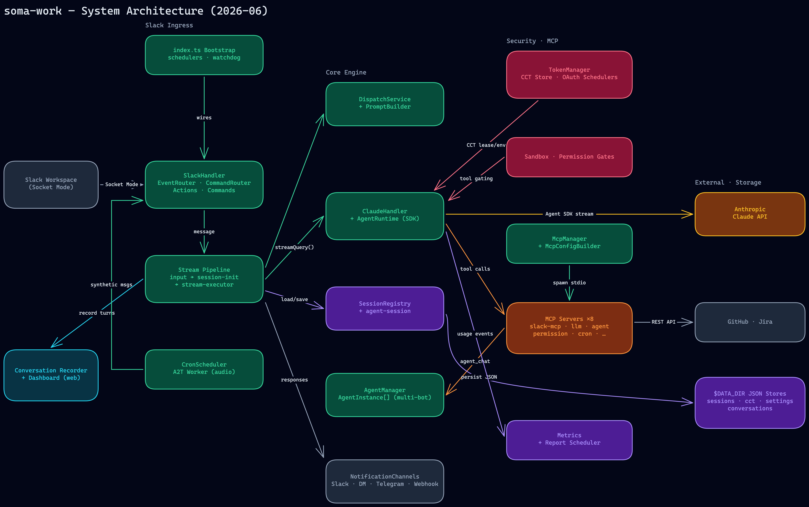

# Architecture Overview

soma-work (Slack multi-tenant AI Assistant) 아키텍처 문서. 2026-06-10 기준 전면 재작성.

> 편집 가능한 다이어그램 원본: [`architecture-diagram.excalidraw`](./architecture-diagram.excalidraw) (excalidraw.com에서 열기)



## Process Model

단일 Node 프로세스(`src/index.ts`, ~1,100 LOC)가 Slack Bolt(Socket Mode)로 기동하며, 부트스트랩 시 다음 백그라운드 컴포넌트를 와이어링한다:

| 컴포넌트 | 역할 | 위치 |
|----------|------|------|
| TokenManager + CCT Store | Claude OAuth 토큰 슬롯 풀, 자동 회전 | `src/token-manager.ts`(2.1k), `src/cct-store/` |
| OAuth/Usage Schedulers | 토큰 갱신·사용량 폴링 | `src/oauth/` |
| GitHub Auth | App installation 토큰 자동 갱신 | `src/github-auth.ts`, `src/github/` |
| McpManager | MCP 서버 프로비저닝 (stdio) | `src/mcp-manager.ts`, `src/mcp/` |
| PluginManager | 플러그인/마켓플레이스 라이프사이클 | `src/plugin/` |
| AgentManager | 멀티 에이전트 인스턴스 기동 | `src/agent-manager.ts`, `src/agent-instance.ts` |
| Claude Child Registry | Agent SDK 자식 프로세스 소유, 종료 시 bounded TERM→KILL 회수 | `src/agent-runtime/claude-child-process-registry.ts` |
| A2T Service | 음성→텍스트 (Python worker — faster-whisper, Apple Silicon에서는 mlx-whisper). 음성 메모용 1개 + 받아쓰기(서버 위스퍼)용 1개 | `services/a2t/worker.py`, `src/a2t/` |
| 브라우저 위스퍼 | 브라우저 Web Worker에서 transformers.js Whisper(WebGPU/WebAssembly) + 같은 `DictationStream` 소스(`dictationStreamSource()`) | `src/conversation/dictation-browser-client.ts` |
| 받아쓰기 스트림 | 브라우저 마이크(16 kHz) → `/ws/dictation` → `DictationStream`(0.5초마다 재전사, 연속 두 가설이 일치하는 앞부분 확정, 쉬면 구간 확정) → 글자 | `src/conversation/dictation-routes.ts`, `src/a2t/dictation-stream.ts`, `src/conversation/dictation-server-client.ts` |
| CronScheduler | 예약 synthetic 메시지 트리거 | `src/cron-scheduler.ts` |
| Release notes | deploy 워크플로우의 `release_notes` 디렉티브 → `StreamExecutor` (deploy 세션만 `routeReleaseNotes` 조회) → `postReleaseNotes`: 채널 루트 헤더 + 스레드 전문. 채널은 `SOMA_RELEASE_NOTES_CHANNELS` (`config.getReleaseNotesChannels` → `routeReleaseNotes`) | `packages/slack/src/directives/release-notes-directive.ts`, `packages/slack/src/release-notes-poster.ts`, `src/release-notes-routes.ts` |
| Conversation Recorder | 대화 기록 + 리플레이 웹 대시보드 | `src/conversation/` |
| Metrics Schedulers | 토큰/비용 텔레메트리 집계·리포트 | `src/metrics/` |
| Socket Watchdog | Socket Mode 헬스 모니터 | `src/slack-socket-watchdog.ts` |

부트스트랩 초반(`acquirePidLock(DATA_DIR)` 이후, 세션 복원 `slackHandler.loadSavedSessions()` 이전)에는 `src/deploy/`의
1회성 이관이 순서대로 돈다. 전 유저 opus 기본 모델 이관 바로 다음이 `migrate-all-users-minimal-once.ts`로, 모든 유저의
`defaultLogVerbosity`를 `minimal`로, `sessions.json`의 모든 세션 마스크를 `LOG_MINIMAL`로 바꾼다. 마커
(`.all-users-log-minimal-once-2026-10-16.json`)는 존재만 확인하고 데이터보다 먼저 기록하므로 다시 돌지 않으며, 이후 유저가
바꾼 값은 덮지 않는다. 세션 복원보다 먼저 돌기 때문에 복원된 세션은 바뀐 마스크를 읽는다.

## Controller Process (`somawork`)

데몬과 **별개의 프로세스**가 하나 더 있다. `dist/cli/index.js`(소스 `src/cli/`)는 설치된 런타임을
운영하는 컨트롤러이고, Slack 이벤트를 처리하지 않는다. 데몬이 "돌면서 일하는 쪽"이라면 컨트롤러는
"세팅하고 들여다보는 쪽"이다.

| 축 | 데몬 (`src/index.ts`) | 컨트롤러 (`src/cli/`) |
|---|---|---|
| 수명 | launchd가 유지하는 장기 프로세스 | 커맨드 하나당 한 번 |
| 입력 | Slack Socket Mode 이벤트 | argv |
| 상태 | 프로파일 config·data·session archive | 없음 (읽기 + materialize 후 종료) |
| 부수효과 | Slack·Claude·MCP·파일시스템 | 주입된 seam 경유 (`src/cli/production-seams.ts`가 유일한 실제 배선) |

컨트롤러의 온보딩 state machine은 `src/cli/setup/orchestrator.ts`에 있고, 단계마다 어댑터를
호출한다: llmux 기동 → Slack CLI 인가 → Slack 앱 생성/설치 + 훅으로 런타임 토큰 수집 →
`materialize.ts`가 프로파일 트리 작성(0700 디렉터리 / 0600 파일) → `doctor.ts` 게이트 →
`service.ts`가 launchd user agent 설치. 마커를 신뢰해 단계를 건너뛰지 않는다 — 매 실행마다
어댑터가 실제 상태를 다시 검증하고, 단계 N을 완료하면 그 뒤의 마커는 모두 잘라낸다.

프로파일은 `preview` / `production` 둘뿐이고 경로·서비스 레이블이 겹치지 않는다
(`src/cli/profile.ts`가 SSOT). 자격증명은 `<configDir>/secrets.env`(0600)에만 있고,
`.env`·argv·stdout·setup state 어디에도 들어가지 않는다.

## Runtime Bundle

`scripts/deploy/stage-bundle.sh`가 만드는 불변 트리를 두 소비자가 공유한다: 레거시 플릿 배포
(rsync 후 노드에서 `npm ci --omit=dev`)와 패키지 설치(런타임 루트). 런타임 루트 기준 고정 경로는
`dist/cli/index.js`(실행 비트) · `dist/run-with-rotating-logs.js` · `dist/index.js` ·
`config.default.json` · `.system.prompt.example` · `infra/slack/slack-app-manifest.json`.

계약의 실행 가능한 진술은 `scripts/smoke/setup-package.js`다 — staged 트리를 외부 소비자처럼
구동하고, 하드링크 사본에서 asset을 하나씩 제거해 실패를 확인한다. `scripts/smoke/deploy-bundle.js`는
배포/워크스페이스 패키지 쪽 계약을 계속 소유한다.

## Core Request Flow

```
Slack Event (Socket Mode)
  → SlackHandler (src/slack-handler.ts, 1.5k)
      EventRouter · CommandRouter · Actions(9) · Commands(20+)
  → Stream Pipeline (src/slack/pipeline/)
      input-processor → session-initializer → stream-executor
      ├ SessionRegistry.getOrCreate (src/session-registry.ts, 2.2k)
      ├ DispatchService 워크플로우 분류 + PromptBuilder 프롬프트 조립
      └ McpConfigBuilder 툴 목록 구성
  → ClaudeHandler + AgentRuntime (src/claude-handler.ts, src/agent-runtime/)
      ├ TokenManager: CCT lease + query env 주입 (src/auth/)
      ├ Sandbox·Permission 게이트 (src/sandbox/, somalib/permission/)
      └ Claude Agent SDK streaming
  → 스트림 이벤트 처리 (text / tool_use / tool_result)
      ├ MCP 툴 호출 → packages/mcp-servers/*
      ├ Metrics 이벤트 적재
      └ Conversation Recorder 기록
  → NotificationChannels (src/notification-channels/)
      Slack · DM · Telegram · Webhook 출력 라우팅
```

## Native assistant status

`packages/slack/src/assistant-status-manager.ts` owns native Slack status writes.
`SlackApiHelper.setAssistantStatus` sends them through
`WebClient.apiCall('agents.sessions.setStatus')`: nonempty status strings map to
`processing`, and the empty string maps to `active`. These strings express loading
intent, not custom lifecycle display text. Clearing legacy
`assistant.threads.setStatus` loading text does not clear the new agent-session
lifecycle. `active` means ready for the next input, not a closed session.

The epoch and writer guards are unchanged. Each `(channelId, threadTs)` has a turn
epoch, desired status, heartbeat and serialized writer in process memory. Set, heartbeat and clear share that writer; a completed
network request cannot restore an older desired status. Epoch-scoped setters reject
closed or superseded turns, and epoch-scoped stale clears are rejected.
Transient terminal clears get at most three attempts. Cleanup bounds the caller's
wait, not the network request: an ordered clear remains queued after timeout, but
remote removal is not guaranteed when requests hang or all retries fail.

`SlackHandler` starts a setup-owned status after command and working-directory
validation for real user input when the source thread has no active request.
Cleanup invalidates the captured source epoch and requests a clear on initialization
failure, halt or migration; it cannot clear the newer execution epoch on the same thread.
`TurnSurface.begin()` starts execution status independently of `chat.startStream`.
Live Slack QA showed that opening a stream resets the lifecycle to `active`.
After successful startup returns a stream timestamp, `TurnSurface` restores
`processing` with the captured `expectedEpoch`, only while the turn remains current
and is not closing. Closed or superseded callbacks cannot re-enable processing.
`end()` and `fail()` invalidate the epoch and request `active` before waiting for
stream or plan cleanup.
`StreamExecutor.execute()` keeps surface initialization and initial runtime-status
updates inside its terminal-cleanup boundary, including setup failures.

## Major Subsystems

### Multi-Agent (`src/agent-manager.ts`, `src/agent-instance.ts`, `src/agent-runtime/`, `src/agent-session/`)
- `AgentManager`가 config의 agent 항목마다 `AgentInstance` 소유
- 각 인스턴스는 격리된 Bolt App(별도 봇 토큰), SessionRegistry, PromptBuilder 보유
- 메인 에이전트의 Claude 턴에서 agent MCP(`packages/mcp-servers/agent/`)의 `agent_chat`으로 라우팅 — 단, 실제 Claude SDK query 통합은 아직 placeholder (agent-mcp-server.ts TODO). 직접 @멘션/DM 처리도 `SlackHandler` 통합 대기 중 (`src/agent-instance.ts` TODO)
- `agent-session/`: turn runner, session phase, continuation handler

### Auth / Token (`src/token-manager.ts`, `src/cct-store/`, `src/oauth/`, `src/auth/`)
- CCT 슬롯 풀: v2 스키마, CAS 기반 atomic slot flip
- OAuthRefreshScheduler가 5시간/7일 임계값으로 자동 회전 + Slack 알림
- 쿼리마다 `ensureActiveSlotAuth()` → lease → env 주입 → release
- **런타임 auth 백엔드 전환 (#1189)**: 라이브 모드는 `src/auth/auth-runtime.ts` 소유 (`data/auth-runtime.json` 영속, 우선순위 persisted > `AUTH_MODE` env > 부팅 llmux 프로브). `llmux` 모드는 CCT lease를 synthetic lease로 단락하고 `ANTHROPIC_BASE_URL`을 주입. Slack `auth` 카드/명령으로 무재시작 전환 (mutation은 admin 전용)
- **llmux SDK 인증 격리**: `buildQueryEnv`는 테넌트 URL/키를 한 쌍으로 전달하고 상속 환경과 운영자 overlay에서 OAuth·Bearer·다른 프로바이더 플래그를 제거한다. SDK는 이 맵을 자식 환경 전체로 사용하며 부모 환경을 재병합하지 않는다. `ANTHROPIC_CUSTOM_HEADERS`에서는 `authorization`/`x-api-key`만 제거한다. 다른 헤더와 CCT 동작은 유지한다. [실제 SDK 전송 계약](../../current/spec/llmux-sdk-auth.md).
- **`auth` 카드 용량 오버뷰 (#auth-capacity-overview)**: llmux 모드 렌더 와이어링은 `CommandRouter`/`/z auth` → `createAuthTopicBinding.renderCard` (`src/slack/z/topics/auth-topic.ts`) → `fetchLlmuxStatus` (`src/auth/llmux-client.ts`, `GET /llmux/status`) → 순수 그룹·용량 헬퍼 (`src/slack/auth/capacity.ts`) → `buildAuthCardBlocks` (`src/slack/auth/builder.ts`). 버튼·모달 핸들러는 `registerAuthActions` (`src/slack/auth/actions.ts`)가 공유 Bolt app에 등록. 기본 렌더는 admin 포함 전원 readonly 오버뷰이고 관리 표면은 [Admin mode] 클릭으로만 진입 — 네비게이션 버튼은 `{viewerMode,page}`를 카드에 인코딩하지만 매 클릭 서버에서 actor 권한을 재검증한다(위조/스테일 admin 스탬프는 readonly 강등). 데이터 계약과 상한(정규화 계정분 합계, Grok 합성 리셋 억제, usage_control 읽기 전용 등)은 `.prd/07-auth-capacity-spec.md`가 SSOT. 레거시 CCT는 `renderCctCard({embed})`로 슬롯 단위 페이지네이션하며 `cct/auth-origin.ts`가 버튼 값과 모달 metadata에 출처/페이지를 보존해 변경 후 `renderAuthCard`로 돌아온다. 직접 `cct` 경로는 기존 렌더를 유지한다.

### MCP (`src/mcp-manager.ts`, `src/mcp-config-builder.ts`, `packages/mcp-servers/`)
- 내장 서버(등록 조건은 `McpConfigBuilder`가 SSOT): slack-mcp, agent, model-command, server-tools, devops-tools, permission, cron, mcp-tool-permission
- devops-tools는 Slack 컨텍스트가 있는 세션에서 config.json에 `devops-tools` 섹션과 `permission` 맵이 있을 때만 등록 (`hasDevopsToolsConfig` / `buildDevopsToolsServer`, 콜 타임아웃 `DEVOPS_TOOLS_CALL_TIMEOUT_MS = 660_000` — 승인 카드 10분 + MCP 중계의 전체 대기 상한 655초보다 길게)
- devops-tools는 키를 갖지 않고 unix 소켓으로 `packages/devops-broker`에 중계한다. 브로커는 root 소유 코드로 별도 OS 유저로 돌고, `packages/devops-broker/install/install.sh`로 설치 (절차: `packages/devops-broker/install/README.md`)
- 외부 MCP는 config.json 기반 프로비저닝, GitHub 인증 주입

### Security (`src/sandbox/`, `somalib/permission/`, `src/dangerous-command-filter.ts`)
- 실행 문맥(#597, `src/agent-runtime/execution-context.ts`): 턴은 서버가 만든 `ExecutionContext`(사용자·관리자 여부·권한 모드·세션 키·작업 폴더) 아래에서만 돈다. 턴은 슬랙 이벤트의 사용자로 만든다(`executionContextFromSlack`). 문맥이 없으면 `ClaudeHandler.streamQuery`가 리스 전에 `ExecutionContextMissingError`로 거부하고(인시던트 시도는 자체 격리 옵션), `buildStreamOptions`는 문맥 없이는 도구 0개·SDK 기본 권한, `McpConfigBuilder`는 사용자 없이는 `NO_CONTEXT_PERMISSION_MODE`(`legacy`)·게이트 MCP 차단이다 — 예전 "슬랙 문맥 없음 → bypass, 정책 훅 없음"은 없다. 에픽 자식의 배치 폴더는 `taskDirectoryFor`(소유자 `/tmp/<ownerId>/` 안, 심링크 해석)로 쓰는 곳에서 다시 확인한다(`SessionInitializer` `placedDirOf`).
- 에픽(E4 ④, #854부터 Slack 세션 — 별도 태스크 경로 없음, `src/task-turn/epic-server.ts` · `epic-slack.ts` · `epic-tree-gate.ts`): 에픽은 새 작업 창의 에픽 스위치(소유자의 `epicTasks` 플래그, 라우트가 다시 확인)로 만든 Slack 스레드다 — `launchNewTask`가 메시지에 `epicOverride`를 싣고 `SlackHandler.placeInEpicTree`가 첫 턴 전에 `SessionRegistry.makeEpic`으로 엄격 저장한다(autogoal·autoz는 꺼짐). 같은 프로세스 SDK MCP 서버 `epic`은 **에픽 자신의 Slack 턴에만** 붙는다: `executionContextFromSlack({ epicTaskId })`(살아 있는 루트 에픽일 때만 `build-stream-options.ts`가 싣는다) → `attachesEpicServer` → `McpConfigBuilder`가 서버와 `allowedTools`의 `mcp__epic`을 더한다(계획 승인 전에는 `plan` 서버만). 자식 턴·일반 세션에는 없다(깊이 1). 도구 인자에는 신원이 없다 — 에픽 ID는 문맥에서 잡고 매 호출마다 호스트로 기록을 다시 읽는다. 호스트는 `index.ts`가 `setEpicHost(createSlackEpicHost(…))`로 꽂는다. `plan_write`·`child_status`는 레지스트리의 계획·자식·이벤트를 그대로 쓴다(`child_status(id)`의 마지막 답은 자식 작업 로그의 마지막 메인 final, `readLatestFinal`). `spawn_child(planNodeId, instruction, folder?, title?)`: 노드당 라이브 자식 하나(재호출은 `made: false`), 7개까지(닫힌 자식도 셈), 트리 한도(`EpicTreeGate.refusal({ newChild })`) → 폴더(생략하면 자식 스레드가 새 `session_*`, 주면 에픽 폴더 안 상대 경로 `resolveChildFolder` + 실행 중 형제와 겹침 거절, 첫 세션의 `workingDirectoryOverride`) → `reserveEpicChild`(자식 ID를 에픽 `childTaskIds`·노드 `spawned`에 먼저 엄격 저장) → 에픽 채널에 자식 스레드 루트 메시지(봇) → 소유자의 첫 지시를 `handleMessage`로(`epicChild` · `verbatimPrompt` · `autoGoalOverride: false`) — 새 세션이 첫 턴 전에 `bindEpicChild`로 예약 ID·부모·노드를 받는다. 스레드를 못 만들면 예약을 되돌린다(`unreserveEpicChild`). `started`는 수락 영수증(`SlackHandler.onTurnAccepted`: 턴이 모델에 닿거나 영속 큐에 저장)이다. `instruct_child(childId, instruction)`: 평문만(`/ % ! $`로 시작하면 거절), 자식 스레드에 소유자의 지시로 보낸다(`injectDashboardMessage`, 에코 라벨 "🧩 에픽의 지시", verbatim). 쉬는 자식은 트리 한도·폴더 겹침을 거쳐 바로 돌고, **일하는 자식은 그 스레드의 후속 대기열에 들어간다**(`queued: true` — 예전 태스크 경로의 409 대신). 자식의 체인 끝: `drainFollowups`의 마지막 보고를 `setChainSettledListener`가 받아(진행 중인 것이 없을 때만) `chainEndOf`로 결과를 정하고 `recordSessionChainEnd`가 자식의 `lastTurnOutcome`과 에픽의 대기 이벤트를 한 번에 엄격 저장한다 → 에픽 이벤트 리스너 → `createSlackEpicWaker`. 깨우기: 에픽이 한가하고(요청·대기열 없음) 끝나지 않았고 대기 이벤트가 있으면, 트리 한도 → 이벤트를 그 깨우기에 넘겨 저장(`consumeEpicWake`) → 고정 문구(`epicWakeText`)를 에픽 스레드에 보낸다(수락되지 않으면 `releaseEpicWake` + 한 번 재시도). 에픽 자신의 체인 끝과 부팅 스캔에서도 깨운다. 트리 한도(`epic-tree-gate.ts`): 동시에 도는 자식 3, 트리당 10분 30회, 비용 상한(`epicTreeCostUsd` — 닫힌 Slack 자식은 `SessionArchiveStore.latestByTaskId`). 닫기: 대시보드에서 Slack 에픽을 닫으면 도는 자식에 `closedBy: parent`를 남기고 그 턴을 멈춘다(`abortSession`), 자식을 닫으면 에픽에 `closed` 이벤트. 보드는 Slack 에픽 카드에 자식 카드를 묶고(`bundledChildrenOf`·`bundlingEpicOf` — Slack 자식은 task id로 에픽을 찾는다), 에픽 트리는 소유자(또는 관리자 모드의 관리자)만 지시한다.
- 작업 계획 모드(SSOT 2026-11-02, `src/task-turn/task-plan.ts` · `plan-server.ts` · `task-plan-decision.ts`, `src/conversation/task-plan-html.ts`): 새 작업 창의 "작업 계획" 토글(`plan: true` — 대시보드 작업, 그리고 #853부터 Slack 채널 작업도)로 만든 세션은 기록에 `taskPlan` 게이트(`drafting` → `awaiting` → `approved` | `cancelled`, `revision`)를 갖고 엄격 저장된다(`createTask({planMode})`, `submitTaskPlan`, `setTaskPlanGate` — 실패하면 되돌림, 로드·아카이브·되살리기에서 `sanitizeTaskPlanGate`). 승인 전 턴은 실행 문맥에 `planPending`이 실려 같은 프로세스 SDK MCP 서버 `plan`(`plan_submit` 하나)이 붙고 에픽 서버는 붙지 않는다(승인 전에 자식 없음). 컨트롤러는 승인 전 턴마다 `<task-plan-mode>` 안내(`planGateTurn` — SSOT·intent-first로 계획, 작업 금지, 제출 후 턴 종료)를 `StreamExecutor`의 `promptNotice`로 넘긴다: 모델 프롬프트 앞에만 붙고 대화 기록에는 유저 원문만 남는다. 승인 대기 중의 모든 지시는 직접 입력이다(게이트가 `drafting`으로 돌아가고 모델이 다음 버전을 제출, 시작하지 못하면 되돌림). 승인 전 턴(계획 턴)은 읽기만 하므로 소유자의 실행 슬롯(A0 `ownerChain`, 에픽 트리 슬롯)을 기다리지도 잡지도 않는다(2026-11-03 — 다른 태스크가 계획을 쓰는 동안 직접 입력이 429로 막히던 문제): 입장(`admit`)이 `isPlanPending`이면 슬롯 검사를 건너뛰고 체인을 슬롯에 올리지 않는다. 같은 태스크 409·시작 창(일반 태스크는 소유자 창 10분 10회, 에픽은 트리 창 10분 30회)·비용 상한은 그대로다. 계획 모드로 새 작업을 만들 때의 dry run도 `canStart(…, { planning: true })`로 같다. 시작(승인 뒤 턴)은 작업이라 슬롯을 쓴다. 계획은 모델이 마크업 없이 구조(한 줄 결론·의도 → 단계 → 작업 → 디테일 + 가정·위험·범위 밖·확인할 것)로 내고, 서버가 escape해서 그린다(`GET /api/dashboard/session/:key/plan` → `{state, revision, html}`, 전체 페이지 `GET /dashboard/plan/:key` — 스크립트 없는 CSP). `POST /api/dashboard/session/:key/plan {decision: start|cancel, revision}`(지시 권한, `setDashboardTaskPlanHandler`)은 본 버전만 결정한다: 시작은 입장 dry run → `approved` 저장 → 계획 전문을 담은 지시(`planApprovedText`, 12,000자)로 턴 시작(안 되면 `awaiting`으로 되돌림), 취소는 `cancelled` 저장(턴 없음). 보드는 대기 중인 계획을 NEEDS YOU 열에 두고 카드에 `taskPlan` 요약(상태·버전·결론·단계/작업 수)을 싣는다. "승인 전 작업 금지"는 `evaluateToolPolicy` 6c단계가 강제한다(`rules/permission.md` 단일 정책): `build-stream-options.ts`가 `planPending` 턴의 `ToolPolicyContext.checkPlanPending`에 `checkPlanPendingCall`(`src/agent-runtime/policy/plan-pending-guard.ts`)을 싣고, 모든 모드·관리자까지 쓰기 도구·서브에이전트(`Write`·`Edit`·`NotebookEdit`·`Artifact`·`EnterWorktree`·`Agent`·`Task`), 셸(Bash) 전부, 정확한 읽기 목록(`PLAN_READ_MCP_TOOLS`) 밖의 MCP 도구, 연구 도구 허용 목록 밖의 모든 도구를 거부한다(계획 턴의 훅은 catch-all; Read·Glob·Grep·WebFetch·`plan_submit`은 통과). Lean 모델은 `evaluateToolPolicyPlan`, 증명은 `verification/lean/SomaVerify/ToolPolicy/ProofsPlan.lean`(사유가 있으면 항상 거부, 없으면 기존 함수와 같음). Slack 세션(#853, 별도 태스크 경로 없음): 새 작업이 `plan: true`면 `parseNewTaskSubmission`이 autogoal·autoz를 끄고, `launchNewTask`가 메시지에 `planModeOverride`를 싣는다. `SlackHandler.handleMessage`가 세션 초기화 뒤 `applySessionPlanTurn`으로 게이트를 만들거나(`drafting`) 유저의 말을 직접 입력으로 반영하고(호스트 턴은 게이트를 바꾸지 않고 안내만), 저장한 뒤 그 안내를 `createAgentSession` → `executeParams.promptNotice`로 넘긴다. 계획 중인 세션은 goal로 승격하지 않는다. 실행 문맥은 `executionContextFromSlack({ planPending })`이라 같은 `plan` 서버와 6c 단계 가드가 붙는다. `plan_submit`은 세션 키로 `submitSessionPlan`에 저장하고(`setPlanHost.submitPlan`), Slack 스레드에 카드 링크가 담긴 안내(`notifyPlanWaiting`)를 남긴다. 계획 게이트는 모든 세션에 저장·로드·아카이브되고, 저장 필터에도 들어간다. 시작·취소는 `setDashboardTaskPlanHandler`가 세션 종류로 나눈다: Slack 세션은 `createSlackPlanDecider` — `approved` 저장 → 계획 전문을 `injectDashboardMessage`로 결정한 사람의 지시로 스레드에 보낸다(`verbatim`: 명령 해석 없이, 진행 중인 턴에 스티어되지 않고 자기 턴으로 — 진행 중인 턴이 있으면 그 뒤 대기열). 응답은 수락 영수증(`SlackHandler.onTurnAccepted` — 턴이 모델에 닿거나 영속 큐에 저장, 재시작 준비 중 보관 포함)을 받는 즉시 한다. 수락되지 않으면(초기화 중단·거절, 메모리에만 있는 압축 보관 포함) `awaiting`으로 되돌린다(502). 직접 입력은 유저의 말만이다(`userWord` — 호스트 턴·압축 뒤 재생·`/compact`는 아님). 보드·계획 읽기(`taskPlanToKanban`·`planAsks`·`planTaskOf`)도 세션 종류를 가리지 않는다. 화면(`dashboard.ts` 클라이언트): 새 작업 창의 "작업 계획" 스위치(모든 목적지, `_ntState.plan` 기본 true — 켜져 있으면 autogoal·autoz 스위치를 끄고 잠근다), 펼친 작업 카드의 계획 블록(`taskPlanCardHtml` — 버전·결론·크기 + 시작 · 취소 · 직접 입력), 접힌 면의 요약("작업 계획 vN — 시작할까요?", `cardAsks`), 디테일 카드 맨 위 상태 바의 시작 · 취소(`planHeadActions`), "입력 필요" 안의 계획 인라인(`renderPanelPlan` — 서버 HTML을 버전·상태별로 한 번 가져옴, `#panel-plan`), 맨 아래 입력창 위 막대(`#panel-plan-bar`). 버튼 값은 data 속성으로만 싣는다(`planButton`·`cardQuickAnswer`, 인라인 JS에 값 없음). 단순 질문(선택지 2–4개, 이름 16자 이하, `quickChoicesOf`)은 펼친 카드에 선택지 버튼으로 나와 한 번에 답한다(`answerChoice`). 결정이 생긴 내 카드는 보드에서 한 번 저절로 펼쳐진다(`autoOpenDecisions` — 디테일 카드는 열지 않음, 보드 요소 업그레이드·`/auth/me` 뒤에도 다시 시도). 시작하면 계획의 goal이 열린다(2026-11-03, `src/task-turn/task-goal.ts`, 결정기 `openGoal`). 목표는 계획의 버전·결론·의도·단계(`planGoalObjective`)이고, 누른 사람의 이어가기 한도를 쓴다. 시작이 안 되면 goal도 되돌린다. 그 뒤로는 대시보드 태스크의 goal 루프(`task-goal-loop.ts`, #861)가 태스크를 끝까지 이어 간다. 재시작이 끊은 태스크의 goal이 재개될 때는 첫 이어가기에 재시작 안내(`TASK_RESTART_NOTICE`, host 전용 `promptNotice`)가 붙는다(`index.ts` `startGoalTurn`, 끊긴 턴 뒤로 아무 턴도 돌지 않았을 때만, 시작이 받아들여질 때까지 유지). Slack 세션의 작업 계획(#853)도 시작하면 같은 goal이 열리고(`createSlackPlanDecider` `openGoal`), 스레드의 goal 루프가 이어 간다.
- 슬랙 없는 태스크(대시보드 작업 — #596–#600의 턴·출력·진입점·후속 큐·알림 전달기·"필요해요" 응답·대시보드 새 작업, 2026-11-03의 재시작 재개·goal 루프): #855에서 제거했다. 모든 작업은 슬랙 스레드이고 슬랙 세션의 경로 하나로 돈다. 저장돼 있던 슬랙 없는 기록(`slackless: true`)은 `SessionRegistry.loadSessions`가 불러오지 않고 보관한다(`terminated`, 한 번 로그) — 보드의 닫힘 열에서 읽힌다. 보류된 승인 요청 중 태스크 종류(`task-command`·`task-answer`)는 불러올 때 버린다.
- 대시보드 닫기(`src/task-turn/task-close.ts` `createDashboardCloseHandler`, E4 ⑦ D10 b·c, #854): 에픽 트리의 세션은 먼저 닫는 중 표시를 받는다(에픽은 자식의 끝으로 깨지 않고, 자식의 끝은 이미 전달된 것으로 기록 — 닫기가 실패하면 표시를 푼다). 에픽을 닫으면 실행 중인 자식마다 `closedBy: parent`를 저장한 뒤(실패는 로그만, 닫기는 계속) 그 턴을 멈춘다. 자식 세션은 지우지 않는다(`parentTaskId` 유지, 일반 시계). 다른 살아 있는 세션이 일하는 폴더는 닫힌 세션의 정리에서 지우지 않는다. 자식을 닫으면 먼저 에픽에 `closed` 이벤트를 붙인다. 닫힌 에픽은 깨우지 않는다.
- 새 작업의 목적지(#854): 대시보드 작업(슬랙 없는 태스크) 목적지는 없어졌다. 새 작업 문맥은 태스크 폴더를 싣지 않고(`epicTasks` 플래그만), `POST /api/dashboard/new-task`에 `destination: 'task'`가 오면 410으로 답하며 아무것도 만들지 않는다. 모든 새 작업은 고른 채널의 Slack 스레드이고, 에픽 스위치(`epic: true`)는 소유자의 플래그가 꺼져 있으면 403이다. 그 경로의 스택은 #855에서 지웠다.
- 도메인 allowlist, 툴 권한 레벨(admin/elevated/user), dangerous command 감지
- 쓰기 경계: SDK 샌드박스가 Bash(·`Monitor`) 쓰기를 작업 디렉터리 + `/tmp/{userId}`(`allowWrite`)로 묶고, 호출이 고른 로컬 경로에 쓰는 네이티브 도구(`NATIVE_WRITE_TOOLS`: `Write`/`Edit`/`NotebookEdit`, `Artifact`의 `out_dir` — 그 아래 저장 이름은 서버가 정하므로 action과 상관없이 거부, `EnterWorktree`·`Agent(isolation: worktree)`가 만드는 `.claude/worktrees/` — linked worktree면 메인 저장소 쪽도, 그리고 작업 디렉터리를 옮기는 `EnterWorktree` `path`·`Agent` `cwd` — 샌드박스가 현재 작업 디렉터리에 Bash 쓰기를 허용하므로)는
  `build-stream-options.ts` → `ToolPolicyContext.checkNativeWrite` → `evaluateToolPolicy` 3b단계가 같은 루트로 묶는다(비관리자, 샌드박스 ON일 때.
  `src/agent-runtime/policy/native-write-boundary.ts`: 경로는 SDK처럼(앞뒤 공백 제거, `~` 확장) 읽은 것·쓴 그대로·NFC 모두 검사, 대상은 realpath 해석, 루트는 `/`부터 한 이름씩 걸어 파일 시스템 표기(별칭·대소문자·유니코드)로 맞춰 서로 비교하고 루트 이름 자체나 루트 안의 심볼릭 링크를 거치면 루트를 신뢰하지 않고 그동안 네이티브 쓰기 전부 거부 · `..`·끊긴 심볼릭 링크·하드 링크 거부, 훅 매처는 `TOOL_POLICY_MATCHERS` 5번째 항목). 계획 파일은 `plansDirectory: .claude/plans`로
  작업 디렉터리 안에 둔다. 남은 틈: 판정과 SDK 쓰기 사이에 심볼릭 링크를 바꿔 끼우는 경합. Lean: `verification/lean/SomaVerify/ToolPolicy/ProofsNativeWrite.lean`
- devops-secret 가드(`src/agent-runtime/policy/devops-secret-guard.ts`, `tool-policy.ts` deny tier 1b): `gh auth token` · `gh auth status --show-token` · `gh auth git-credential` · `security` 키체인 비밀 읽기와 브로커 경로(`/usr/local/{libexec,var}/soma-devops`) 접근을 모든 권한 모드에서 admin 포함 거부. 어휘 검사라 방어 심층일 뿐이고, 실제 경계는 브로커의 별도 OS 유저
- 권한 승인 UI는 Slack 액션(`src/slack/actions/permission-action-handler.ts`)과 웹 대시보드(`POST /api/dashboard/session/:key/permission`) 두 곳. 둘 다 `src/permission-prompt-response.ts`의 `answerPermissionPrompt`로 응답한다 — 요청자 본인만, `kind: 'tool_permission'` 레코드만(같은 pending 디렉터리의 mcp-tool-permission grant 요청 제외), store claim으로 1회만.
- 다른 사람의 지시 승인(#767, `src/instruction-approval.ts`): 세션 소유자가 아닌 사람의 지시는 실행 전에 보류된다. 게이트는 `SlackHandler.holdForOwnerApproval` 하나 — `handleMessage` 입구(대기열 펜스·steer·셧다운 보관 앞)와 `processMessage` 백스톱(대기열 드레인·Send now) 두 곳에서 부른다. 대시보드 지시는 `injectDashboardMessage`가 스레드로 넣어 같은 게이트를 지나고(라우트는 `pendingApproval: true`로 답함), 슬랙 없는 태스크의 지시·답은 `index.ts`의 `setDashboardTaskCommandHandler`/`setDashboardTaskAnswerHandler`가 컨트롤러 앞에서 보류한다(202). 통과: 소유자, `session.approvedInstructors`(세션과 함께 저장), 소유자의 `trustedInstructors`(`user-settings-store.ts`), 승인된 요청 id(`routeContext.instructionApprovalId` — 저장소에서 승인·같은 소유자·같은 보낸 사람·같은 메시지인지 다시 확인). 요청은 `DATA_DIR/instruction-approvals.json`에 (세션, 보낸 사람)당 하나, 24시간. 소유자 DM은 `src/slack/instruction-approval-blocks.ts`(`instr_approval_*` 버튼 → `src/slack/actions/instruction-approval-action-handler.ts`), 대시보드는 카드의 `pendingInstructionApprovals` + `POST /api/dashboard/session/:key/instruction-approval`. 두 곳 다 `InstructionApprovals.answer` 하나로 답한다 — 소유자만, 1회만, 결정을 디스크에 쓴 뒤에만 DM 수정·스레드 알림·보류 지시 실행(보낸 사람 권한). 설정 페이지의 `trustedInstructors` 행은 빼기만 된다(`removeOnly`).
- 대시보드는 `src/conversation/permission-prompts.ts`가 웹 서버 listen 동안 1초마다 shared store의 pending 디렉터리를 다시 읽어 세션 스레드별 인덱스를 만들고, 바뀌면 보드를 푸시한다. 보드 페이로드에는 도구 입력이 없다(요청자 전용 `GET .../permission/:approvalId`).
- 환경 스킬(배포가 `plugin.envPlugins`로 표시한 플러그인의 스킬)은 어드민만 바로 쓴다. 모델의 `Skill` 호출과 그 플러그인 파일 읽기·쓰기(`Read`·`Glob`·`Grep`·`Bash`·`Write`·`Edit`·`NotebookEdit`)는 `evaluateToolPolicy` 6b단계가(비어드민 샌드박스 Bash에는 OS 수준 `denyRead`도), `$plugin:skill`은 `SkillForceHandler`가 같은 판정 함수(`src/env-skill-registry.ts`)로 막는다. 집행은 PreToolUse 훅의 `onEnvSkillDenied`(→ `ClaudeHandler.setEnvSkillPermissionRequester`, SlackHandler가 배선) → `src/slack/env-skill-permission-request.ts`(어드민 DM), 어드민 답은 `env_skill_perm_*` 액션(`src/slack/actions/env-skill-permission-action-handler.ts`). 허용 저장은 `user-skill-grants-store.ts`의 예약 소유자 `env-skills`. 운영 설명: `docs/runbook/add-new-deploy.md` §8.5.

### Observability (`src/metrics/`, `src/conversation/`)
- 이벤트 기반 텔레메트리(토큰·툴콜·레이턴시), 주기 리포트
- 대화 레코더 + 웹 대시보드(`src/conversation/dashboard.ts`). 세션 하나의 세 서피스(`.prd/13`): 접힌 카드 `renderCardFace`(분류) ·
  펼친 카드 `renderCardBody`(상태별 섹션, 에이전트 트리 compact 밀도, 컨트롤 줄 `sessionActionHtml`) · 패널(`repaintPanelSession` 하나가
  `renderPanelHead`·`renderPanelInfo`·`renderPanelGoal`·`renderPanelControls`·`repaintPanelScope`를 openPanel·WS·폴링에서 쓴다, 트리 rich 밀도).
  쓰기 중 상태는 `_busy[key|op]` 하나를 두 서피스가 읽는다.
- 패널 부제(`titleSub`, `src/conversation/title-sub.ts`): 비어 있으면 로그인한 누구나 `POST /api/dashboard/session/:id/ensure-title`로
  채운다(덮어쓰지 않음, 대화별 LLM 호출 1회, 실패 후 1분 쿨다운). 바꾸기는 `POST …/generate-title` — owner 또는 Admin mode admin만(#716 쓰기 게이트)
- 카드 제목(`displayTitle`, `@soma/common/format/display-title`): 첫 메시지에 텍스트가 없으면(음성 메모·이미지·파일만) dispatch가 돌지 않아
  호스트 임시 제목(`PLACEHOLDER_SESSION_TITLE` = "New Session", `SESSION_RESET_TITLE`, `SKIP_DISPATCH_TITLE`)이 들어간다. 임시 제목이 남아 있는 동안
  실제 유저 턴마다 `StreamExecutor`가 `<session-title-pending>` 안내(`packages/slack/src/pipeline/session-title-notice.ts`, 최대 3턴)를 프롬프트에 붙이고,
  모델이 의도(SSOT)를 파악하면 `UPDATE_SESSION { title, titleFillOnly: true }` → `SessionRegistry.fillPlaceholderSessionTitle`(임시 제목일 때만 덮어씀,
  `sanitizeSessionTitle`로 Slack 멘션·링크 제거)로 제목을 채운다. 일반 `UPDATE_SESSION { title }`은 기존대로 무조건 덮어쓴다
- 채팅 goal 명령: 스레드 입력·`@bot goal`·`@bot /z goal`(세션 있는 스레드는 `EventRouter.isThreadGoalCommand`가 ZRouter 대신 호스트로 넘김)·파일 업로드가
  모두 `CommandRouter.isGoalIntakeText` 하나로 판정 → follow-up fence의 `SlackHandler.runGoalCommandNow`가 즉시 처리(스티어링 큐 아님).
  상세 `docs/goal-command/spec.md` §Goal Commands While a Turn Runs
- 슬랙 지시 → 대시보드 태스크 입구(E2 ⑦·⑧, `/z taskentry`): #855에서 제거했다. 예전 설정 파일의 `slackTaskEntry`는 읽을 때 무시한다.
- **작업 큐 (#726, `packages/slack/src/work-queue/`)**: `src/index.ts`가 `setWorkQueuesConfig(appConfig.workQueues)`로 큐를 설치(키 없음 = 기본 dev2 배포 큐, `[]` = 끔; `config-loader`가 `workQueues`를 원문 그대로 통과시켜 플러그인 저장에도 남는다). `SlackHandler`가 프로세스당 `WorkQueueService` 하나를 만들고 `SessionInitializer`(deps `workQueue`)·`ActionHandlers`(ctx `workQueue`)에 넘긴다. 게이트는 `handleConcurrency` 두 곳(일반 경로 끝, `createBotInitiatedThread`의 새 키) 바로 앞에서 동기로 `decide` — 대상 브랜치를 `matchWorkQueue`(트리거 `repo source -> target` 파싱, 화살표가 없으면 대상 단어 탐색)로 찾거나 세션의 영속 `workQueueId`로 찾고, 자리가 없으면 `halted` + 바쁨 카드(`work_queue_wait`/`work_queue_cancel`). 자리 해제: holder 세션이 idle이 되면 즉시(`registerOnIdle`), 15초 스윕(`WorkQueueManager.tick`: 세션 없음 → 즉시, 턴 없음·10분 넘게 자기 질문 대기 → 60초 유예 뒤), 세션 삭제(`setBeforeSessionDelete` 콜백 안에서 `onSessionDeleted`). 대기 요청은 자리가 나면 원문을 `handleMessage`로 같은 스레드에 재생(`routeContext.skipAutoBotThread`)하고, 그 세션이 `new`로 다른 워크플로우가 됐으면 취소. 큐 표는 메모리만 — 재시작 뒤 진행 중이던 배포는 자동 재개되며 같은 게이트로 자리를 다시 잡는다
- **CRON 레인 (`.prd/12`)**: 크론 발동 이벤트가 `cron:{jobId, jobName}`을 싣고(`src/cron-scheduler.ts`), `SessionInitializer`의 디스패치 우회 분기가 새 세션에 `cronJob` 스탬프 + 잡 이름 임시 제목(`titleProvisional`)을 단다(`packages/slack/src/pipeline/cron-origin.ts`). 턴 요약 콜백은 `canApplySummaryTitle`(`src/session-title-policy.ts`)로 임시 제목을 교체한다. 잡·실행 기록은 `src/index.ts`가 `setDashboardCronSource(cronStorage)`로 대시보드에 주입 → `GET /api/dashboard/cron`(`src/conversation/cron-view.ts`, 프롬프트 비노출). 카드 `KanbanSession.cronJob`
- **LLM 가용량 (`.prd/12`)**: `GET /api/dashboard/capacity` = `fetchLlmuxStatus` → `buildCapacityView`(`src/conversation/capacity-view.ts`) + 티어 맵 `getLlmuxAccountTiers()`(`SOMA_LLMUX_ACCOUNT_TIERS` + `src/auth/llmux-tiers.ts` 기본값). v2(2026-10-25): 그룹마다 계정분(티어 `weight` × 잔여) `now`/`week`/`total`, 차단 원인별 추적, 계정별 이벤트 재생 `events[]`(cause `5h`·`7d`·`release`, `dNow`/`dWeek`)와 `units[]`; 구독 프로바이더(티어가 정의된 그룹)만. 클라이언트 `renderCapacityGroup`이 두 줄 헤더·칸 막대·계정별 막대·5h/주간 레인을 그린다. 30초 캐시·single-flight, llmux 실패는 고정 사유의 `available:false`(500 없음). 시험 이음매 `setCapacitySource`
- 작업 아이템 goal 목록: 카드 데이터 `KanbanSession.goal`(현재 goal·상태·대기 목록), 쓰기 `POST /api/dashboard/session/:key/goal`
  → `setDashboardGoalHandler` → `SlackHandler.handleHostGoalAction`(Slack goal 목록 Delete 버튼도 `setHostGoalActionHandler`로 같은 경로).
  새로 시작되는 goal의 첫 턴은 follow-up fence로 접수(`admitGoalOpeningTurn`). 상세 `docs/goal-command/spec.md` §Dashboard Goal List
- 세션 effort: 카드·세션 패널 상단 → `POST /api/dashboard/session/:key/effort` → `setDashboardEffortHandler`
  → `switchSessionEffort`(`src/session/effort-switch.ts`, `%effort`와 같은 세션 범위, 다음 턴부터). 카드 `effortEffective` = 모델이 낮춰 실행하는 값(`clampEffortToModel`)
- 개인 설정: `GET /api/settings`·`PATCH /api/settings/:key`(`src/conversation/settings-routes.ts`, 로그인 본인만, 쓰기 auth+CSRF)
  → `setSettingsRegistry(productionSettingsRegistry())` → `src/user-settings-registry.ts`(Slack `/z` 카드 `apply*`·같은 검증기 재사용).
  대시보드 top bar 기본 모델·effort 칩과 설정 페이지 `GET /dashboard/settings`(`src/conversation/settings-page.ts`, 탭 셸 + 개인 설정 탭)가 이 경로를 쓴다. `SLACK_SETTER_COVERAGE` 계약 테스트가 Slack 설정 명령 전수와 대조
- 개인 기억(설정 페이지 "기억" 탭): `src/conversation/memory-routes.ts` `/api/memory/*`(본인만, revision 조건부, 409 충돌) →
  `user-memory-store.editMemoryAt` · `hierarchicalMemoryStore.writePage/removePageAt/readEpisodicDay/editEpisodicEntry`.
  host·MCP·대시보드 모든 메모리 쓰기는 `somalib/model-commands/memory-lock.ts`(`{DATA_DIR}/{uid}/memory/.lock`: 소유자 파일 `owner-<token>.json`을 넣은 임시 디렉터리를 `rename`으로 올려 획득, 해제·회수는 그 파일의 `rename`(원자적 비교-삭제) 뒤 `rmdir`, 같은 호스트의 살아 있는 소유자는 나이로 회수하지 않음, 프로세스 내 재진입)를 잡는다.
  양식에 무손실로 담기지 않는 지식 페이지는 `PUT /api/memory/page/raw`(원문 markdown, revision 조건부)로만 고친다(`getPageWithRevision().representable`).
  `SLACK_MEMORY_COVERAGE` 계약 테스트가 Slack 메모리 쓰기 전수와 대조
- 공유 프로젝트 메모리: `src/project-memory-store.ts`(`DATA_DIR/project-memory.json`, 키 `owner/repo`, revision 조건부, atomicWriteJson) ←
  `src/conversation/project-memory-routes.ts` `/api/project-memory`(읽기: 로그인 사용자, 쓰기: `requireWriteAccess(req, reply, undefined)` 관리자 게이트 + CSRF, 인증 미설정(`mode:none`)은 쓰기 403).
  프롬프트 주입: `build-stream-options.ts`가 `<channel-repository>` 뒤에 `projectMemoryPromptBlock(slackContext.repos)`.
  `src/index.ts`가 채널 레지스트리(`getAllChannels`)를 저장소 목록 소스로, 변경 훅을 `SessionRegistry.invalidateSystemPromptWhere`(해당 저장소 채널 세션)로 연결
- **새 작업 (대시보드 New task, 2026-10-23)**: `GET /api/dashboard/new-task/context` · `POST /api/dashboard/new-task` (`dashboard.ts`, 로그인한 Slack 유저 본인으로만 — body의 userId·admin mode 무시, CSRF, 라우트 bodyLimit) →
  `setDashboardNewTaskProvider` ← `src/index.ts`의 `createNewTaskProvider` (`src/conversation/new-task-provider.ts`). 컨텍스트 = 대표 모델+공유 풀 배터리(`new-task-usage.ts`: llmux `/llmux/status` 또는 CCT 슬롯) ·
  유저 기본 effort/autogoal · 채널(ChannelRegistry repo 매핑 ∩ `users.conversations` 멤버십, 멤버십 미확인 시 빈 목록) · 기본 채널(`LastCommandChannelStore` → 최근 세션). 제출은 멱등 게이트(`createNewTaskGate`, requestId·유저당 동시 1건)와 fresh 멤버십 재검증(`parseNewTaskSubmission`) 뒤
  `launchNewTask` (`new-task-launcher.ts`): 채널 루트 게시 → `files.uploadV2`(스레드) → `SlackHandler.handleMessage`에 비-synthetic 유저 메시지
  `{thread_ts = ts = rootTs, modelOverride, effortOverride, autoGoalOverride, files, routeContext.skipAutoBotThread}` (autoz on → 지시 끝 `$autoz`). `setBotThread`는 부르지 않는다 — 루트에 지시 원문이 남고 진행 패널은 스레드 안에 생긴다.
  `effortOverride`는 `SessionInitializer`가 세션에, `autoGoalOverride`는 `SlackHandler`의 autogoal 판정에 적용한다.
- 작업 로그 방출 이음매: 턴 안의 항목(지시·서술·도구·최종 답변·오류, 임계치 자동 압축 예고)은
  `StreamContext.workLog` → `streamExecutorProviders.appendWorkLog(conversationId, entry)`로 턴의 `turnId`와 함께,
  대화 단위인 압축 시작/완료 공지는 compact-hooks가 `recordConversationWorkLog`로 `turnId` 없이 같은 provider에 넣는다. 출력 수준과 무관하게 항상 방출된다
  (타입 `packages/slack/src/work-log.ts`).
  권한 프롬프트 응답(2026-11-02)은 `answerPermissionPrompt`가 저장한 뒤 `permission` 항목(결정·도구·호출·AI 권고·응답자)으로 같은 provider에 넣는다 — 슬랙 프롬프트는 대화 단위, 태스크 프롬프트는 물어본 턴의 `turnId`로.
- 권한 프롬프트의 AI 권고(2026-11-02): 정책 훅이 `classify → ask`로 사람에게 넘길 때 가디언 판정의 권고(`recommendation`·`summary`·`risk`)를
  `permissionAdviceBoard`(`src/agent-runtime/policy/permission-advice.ts`)에 세션 키·도구·입력으로 남기고, 권한 프롬프트 도구가
  `McpConfigBuilder.setPermissionAdvisor`(ClaudeHandler가 연결)로 가져간다. 남은 게 없으면(legacy 모드) 가디언에게 직접 묻는다(최대 30초).
  권고는 `PendingApproval.advice`로 저장돼 슬랙 카드(초록/빨강 막대)와 대시보드 카드가 같은 권고를 보이고, `deny` 권고면
  `answerPermissionPrompt`가 첫 승인을 `confirm_required`로 돌려보내 `approve_confirmed`(2차 확인)만 실행한다.
- 에이전트 귀속 (spec 12, `.prd/12-dashboard-agent-tree-spec.md`): SDK 프레임의 `parent_tool_use_id`를 매퍼가 중립 이벤트의
  `parentToolUseId`로 싣고, 스트림 프로세서가 서브에이전트의 작업 로그 항목에 `agentId`(스폰 호출과 그 결과에는 `agentRef`)를 붙인다.
  서브의 TodoWrite는 `onTodoUpdate`(Slack 플랜 블록·세션 task ledger)가 아니라 `StreamCallbacks.onAgentEvent` →
  `streamExecutorProviders.recordAgentEvent(sessionKey, event)` → `src/index.ts` → `applyAgentEvent`로 세션의
  에이전트 레지스트리(`src/session/agent-registry.ts`, `ConversationSession.agents`, `sessions.json`·아카이브에 영속)에 들어간다.
  작업 로그 provider는 `stampWorkLogAgent`로 그 항목을 만든 에이전트의 task로 스탬프하고, 메인이 만든 `tool` 항목은 레지스트리 루트
  통계(`AgentRegistry.root`)에 센다. 카드 payload `KanbanSession.agents`(서브) + `agentRoot`(루트 = 메인 노드의 툴 수) — 대시보드는
  둘을 한 노드 타입의 트리로 재귀 렌더한다(spec 12 §4 rev 2).
  서브의 호출별 usage는 비용 합에만 들어가고 컨텍스트 점유율(`liveOccupancyCall`)에서는 빠진다(`sidechain`).
  태스크별 일(SSOT 2026-10-29 T5, `.prd/15`): 메인 task ledger(`src/session/task-ledger.ts`)는 새 목록을 슬롯으로 매칭한다(같은 문구 → 유사도·`activeForm`·위치 점수, 상태를 되돌리지 않고 문구 유사도 하한 있음, 합치기 없음). 첫 TodoWrite 전의 일은 `emptyTaskLedger`로 들고 있다.
  호출별 usage는 `onLiveUsage` → provider `notifyLiveUsage(sessionKey, call)` → `creditTaskUsage`로 진행 중 태스크들에 나눠 귀속(토큰 + `calculateTokenCost` 비용, 메인·서브 모두),
  실시간 프레임의 출력은 시작 시점 값이라 호출의 최종 usage로 교정한다: `src/session/task-usage-reconcile.ts`가 메인 transcript를 증분으로 읽어(호출마다 세션당 10초 1회 + `turn_end`) `recreditTaskUsage`(실시간으로 받은 호출만, 같은 태스크에 차액), 서브 호출은 `agent-spend` 리더의 `onCalls`가 같은 교정,
  서브의 `tool` 항목은 `recordAgentToolCall`로 메인 진행 중 태스크의 `agentToolCalls`에도 센다. 진행 중 태스크가 없을 때의 일은 다음 목록이 바로 완료한 태스크로, 없으면 `outside`.
  스트림 컨텍스트의 `sessionId`는 getter다(새 SDK 세션의 첫 턴 TodoWrite가 버려지지 않게).
  지출(spec 12 §2.5 rev 3): 서브마다 자기 transcript(`<CLAUDE_CONFIG_DIR>/projects/<cwd>/<sdkSessionId>/subagents/agent-<taskId>.jsonl`)를
  `src/session/agent-spend.ts`가 증분으로 읽어 `AgentRecord.spend`(토큰·API 환산 비용)를 채운다 — `recordAgentEvent`·서브 작업 로그
  항목이 계기(실행 중 10초 1회), `turn_end`가 봉인. 기동 시 `backfillAgentSpend`가 로드된 세션을 한 번 순차로 읽는다. task(카드) 합계는 같은 턴 지출을 받는 영속 `ConversationSession.taskUsage`
  (`creditTaskSpend`/`foldTaskSpend`, 리셋·재시작에도 유지)이고, 카드 payload는 `tokenUsage`(task 합계 + 진행 중 턴) +
  `subagentSpend`(서브 합계, 상한이 지운 레코드 포함)를 싣는다.
- **작업 로그 (spec §3.3)**: 유저 지시·모델 내레이션·툴 호출 등 verbose 스트림은 Slack이 아니라 대시보드 작업 로그로 간다. 스토어 `src/conversation/work-log.ts` = 대화별 append-only JSONL + seq 예약 사이드카(seq는 엄격 증가, 구멍 허용, 발행된 seq는 재사용하지 않음) + 항목 원문(툴 입력·결과 전체, 256 KiB 상한)을 담는 별도 append-only 파일(항목 줄은 그 레코드 위치만 가리켜 작게 유지). 조회 `GET /api/dashboard/session/:conversationId/worklog` (`work-log-routes.ts`, 대화 owner·admin만), 항목 하나의 원문 `GET /api/dashboard/session/:conversationId/worklog/:seq/raw` (같은 인증·권한, 원문 없음 404·스캔 예산 부족 503, 401·리다이렉트 포함 모든 응답 `Cache-Control: no-store`), 실시간 WS 이벤트 `work_log`(목록 항목처럼 `rawBytes`·`rawTruncated`만 싣고 원문과 그 위치는 싣지 않음). 발신 경로 = `src/index.ts`가 `setStreamExecutorProviders`로 `appendWorkLog`를 스트림 실행기에 주입(fire-and-forget). 로그인 후 원래 화면 복귀는 `soma_next` 쿠키(`src/conversation/oauth.ts`). 브라우저 로그인은 Google · Microsoft · Slack `dashboard` 링크뿐이다(토큰 로그인 폼·`POST /auth/token` 없음 — viewer token은 `Authorization` 헤더 API 접근용이고, 이전에 발급된 `bearer:` 쿠키는 만료 전까지만 인정). 이미 로그인된 브라우저의 `/login`은 계정 페이지다 — 현재 계정(이름·이메일·provider), 대시보드로, 다른 계정으로 로그인, 로그아웃(`GET /auth/logout`). 대시보드 상단 `Logged in as` 필이 이 페이지로 링크한다

- **세션 산출물 (SSOT 2026-10-23, 2026-11-02)**: 모델이 Slack에 보낸 파일(slack-mcp `send_file`/`send_media`). 최종 답변은 채팅의 것 — 산출물이 아니다(2026-11-02 T6: 기록하지 않고, 예전에 기록된 `final_answer`는 모든 읽기에서 숨김). 목록·카드 요약은 최신순(T3). 수집 = 같은 `appendWorkLog` provider 안에서 `captureArtifactFromWorkLog`(`src/conversation/artifact-capture.ts`)가 work-log 항목 전에 받는다 — `tool` 항목에서 `/tmp` 하위 일반 파일만 스냅샷(심링크·경로 탈출 거부, 100 MB 초과는 메타데이터만), 같은 `toolUseId`의 `tool_result`가 `uploaded: true`일 때만 기록. tool-use id는 `WorkLogInput.toolUseId`로 에미터(`packages/slack/src/stream-processor.ts`)가 싣고 work-log 스토어는 저장하지 않는다. 기능 도입 전 업로드는 `backfillArtifactsFromWorkLog`가 대화당 한 번 작업 로그에서 복구한다(목록 API 요청 시, 카드 빌드 시 직렬 큐). 스토어 `src/conversation/artifacts.ts`(`atomicWriteJson` 인덱스). 카드 데이터 `KanbanSession.artifacts`(개수·최신 몇 개), 조회 `GET /api/dashboard/session/:conversationId/artifacts`, 본문 `GET …/artifacts/:artifactId/content`(`artifact-routes.ts`: Range 206, `nosniff`, html은 `CSP: sandbox allow-scripts`(same-origin·팝업·폼·중첩 프레임 없음), svg·md·text는 `CSP: sandbox`). 권한 = 대화 턴과 같은 로그인 사용자 전체(#716). 실시간 WS 이벤트 `artifact_update` + 해당 카드 `sessionUpdated`. 데몬 자체 업로드(사용량 카드·시스템 프롬프트·스킬 파일)는 산출물이 아니다
- **패널 지시의 클라이언트 참조값 (#785)**: 패널은 보낸 지시를 먼저 낙관적 턴으로 그리고, 그 id를 `clientRef`로 `POST /api/dashboard/session/:key/command`에 싣는다. 라우트는 형식이 맞는 값만(`client-ref.ts` `isClientRef`, 아니면 버림) 핸들러에 넘기고, `injectDashboardMessage`가 이벤트의 `dashboardClientRef`로 → `slack-handler` `createAgentSession` → 실행 파라미터 `clientRef`(어댑터는 첫 디스패치 턴에만) → `StreamExecutor`가 사용자 턴 기록에 붙인다(soma-work가 넣은 턴에는 안 붙음). 페이지 응답과 실시간 push가 턴의 `clientRef`를 돌려주고, 클라이언트 `ptSameSend`는 참조값이 있는 턴을 그 전송의 기록으로 본다 — 서버가 문구를 바꿔 기록해도(routed continuation, follow-up prompt, directive remainder) 지시는 한 번만 보인다. 참조값이 없는 턴(Slack에서 친 지시, 이전 서버)은 같은 문장 + 같은 발신자로 맞춘다.
- **Executive Summary → 대시보드 (SSOT 2026-11-02 T7)**: 요약 타이머가 끝나 `SummaryService.displayOnThread`가 스레드 헤드에 TL;DR을 그릴 때 세션에 `executiveSummary`(TL;DR 줄·시각)를 남기고, 다음 입력의 `clearDisplay`가 지운다. `StreamExecutor.onSummaryTimerFire`가 provider `recordExecutiveSummary`를 부르면 호스트(`src/index.ts`)가 요약 전문을 대화에 답변 턴(`ConversationTurn.executiveSummary`, `recordExecutiveSummaryTurn` — 요약기·제목 재생성 없음)으로 기록하고 카드를 푸시한다. 카드 데이터 `KanbanSession.esTldr` → 페이지가 휴면·보관 카드가 아니면 `<ui-agent-inbox>` `card.tldr`로 넘기고(레이아웃 행과 무관하게 summary 다음), 요소의 `ui-dismiss`(×)는 브라우저 localStorage에 카드별로 기억한다.
- **하네스 플러그인 `local` (#857)**: `src/local`은 플러그인 `zworkflow`(마켓플레이스로 외부 배포, 범용 — 하네스 MCP 호출 금지, `harness-plugin.test.ts`)이고, soma-work 전용 스킬은 두 번째 번들 플러그인 `local`(`src/local-harness`, `BUNDLED_PLUGINS.local`, `DEFAULT_PLUGINS` `local@soma-work`, 빌드가 `dist/local-harness`로 복사, 마켓플레이스에 없음)에 있다. `local:auto-es` = `zworkflow:es` + 하네스 규칙(🆕 표시, ⚠️ TL;DR, 마지막 후속 섹션, §Card sync · §Card check — #836의 카드 확인도 여기로 옮겼고 using-ssot Hook 4는 포인터만). 하네스 프롬프트(`common.prompt` Task card)가 모든 es 요청을 `local:auto-es`로 보낸다. 턴 종료 요약(경로 B, 도구 없음)은 `SummaryService`의 `turnEndContract` 옵션으로 `auto-es/reference/turn-end.md`를 받아(`src/plugin/harness-skills.ts` `loadAutoEsTurnEndContract`, `slack-handler.ts`에서 주입) es 계약(`SUMMARY_PROMPT`) 뒤에 붙인다 — 파일을 못 읽으면 일반 es 계약으로 돌고 에러를 남긴다. `$local:<skill>`·스킬 로케이터는 `src/local/skills`를 먼저, 없으면 `src/local-harness/skills`를 본다.
- **미완료 후속 작업 → NEEDS YOU (#829)**: TL;DR에서 `⚠️`로 시작하는 줄 = 이 세션이 만든 이슈·PR이 완료가 아니라는 신호(es 계약). `followUpFromTldr`(`packages/slack/src/summary-service.ts`)가 그 줄(`local:auto-es` 계약)에서 사유를 뽑아 세션 `followUp`(`{reason, at}`)에 둔다 — 경로 B는 `displayOnThread`(TL;DR이 있을 때만 판정, 없으면 이전 판정 유지), 경로 A(모델이 실행한 es)는 `UPDATE_SESSION { executiveSummary: { tldr } }` → `StreamExecutor` → `ClaudeHandler.setExecutiveSummary` → `SessionRegistry.setExecutiveSummary`(카드 TL;DR도 함께). `clearDisplay`는 지우지 않고, 다음 요약이나 `/new`(`resetSessionContext`)만 지운다. 저장·복원(`restoreFollowUp`)된다. 대시보드 `sessionToKanban`은 idle 세션의 `followUp`을 권한 요청·계획 승인처럼 투영만 한다(`activityState: 'waiting'`, `pendingFollowUp`, `waitingSince`) — 세션의 activityState는 그대로라 후속 큐·goal 루프에 영향 없음. 카드 요약은 "후속 작업 필요: <사유>"(`cardSummary`·`cardAsks`). 경로 B 요약 뒤에는 컬럼 이동을 위해 보드 전체를 푸시한다(`recordExecutiveSummary` → `broadcastSessionUpdate`). 경로 A가 그 턴에 카드를 썼으면(`executiveSummary.source === 'es'`, `esWroteCardThisTurn`) 턴 종료 타이머를 아예 시작하지 않고, 스레드 헤드에는 es가 쓴 TL;DR을 그대로 올린다(#846 `displayEsTldrOnThread` — 포크 없음). 그 턴이 받아들인 스티어링 메시지(호스트 settlement의 `completed`) 중 es 쓰기가 나간 뒤에 밀어 넣은 것이 있으면 es 표시를 지워(`releaseEsCard`, TL;DR은 유지) 턴 끝 요약이 턴 전체를 다시 판정한다 — es 쓰기 시각은 model-command 서버의 `receiptId`에 든 시각(`executiveSummary.issuedAt`, 호스트가 늦게 적용한 시각이 아님), 메시지 시각은 `ClaudeHandler.steerTurn`이 기록한 push 시각(`steerPushedAt`)이고 비교는 `steerAfterEs`. 어느 쪽이든 모르면 예전처럼 다시 판정한다. es 쓰기 시각은 서버가 그 쓰기를 처리한 시각이라, es 쓰기가 든 툴 배치(앞선 툴 포함)가 도는 동안 들어온 메시지는 호스트가 구분할 수 없다 — `local:auto-es`가 카드를 쓴 뒤 받은 메시지는 답하고 카드를 다시 쓰게 한다(#881 B1). `issuedAt`은 저장·복원된다. 카드 상자는 계약의 굵게(`**x**`)만 벗기고 `__x__`는 식별자로 둔다(`plainTldrLine`, #846). 스레드에 올리는 전문 요약도 같다 — `**x**`만 `*x*`로 바꾸고 `__x__`는 그대로, 인라인 코드는 손대지 않는다(`formatSummaryForSlack`·`formatTldrLineForSlack`의 `outsideInlineCode`, #881 B3). `queued_turn_count`를 주지 않는 실행 환경에서는 settlement가 모든 스티어를 `completed`로 읽어 es 표시가 풀린다 — 호스트 요약이 한 번 더 도는 것뿐이라 그대로 둔다(#881 B2).
- **호스트 영수증 (#846)**: `GET_SESSION`은 model-command 서버의 사본이 아니라 호스트가 실제로 반영한 것을 돌려준다. 호스트는 턴 시작(`ClaudeHandler.buildModelCommandContext` — 컨텍스트에 `receiptFile`)과 `UPDATE_SESSION`을 처리한 직후(`StreamExecutor`)에 `SessionRegistry.writeModelCommandReceipt`(channel+thread)로 `DATA_DIR/model-command-receipts/<hash>.json`을 원자적으로 쓴다(`somalib/model-commands/host-receipt.ts`: 링크·시퀀스·카드 TL;DR·NEEDS YOU 사유·마지막 쓰기 결과). 서버는 쓰기마다 `receiptId`를 붙이고, `GET_SESSION`은 그 파일을 `host`로 싣는다 — 호스트가 그 `receiptId`를 아직 기록하지 않았으면 `hostPending: true`, 따라잡았으면 호스트의 스냅샷으로 자기 사본을 맞춘다(다음 `expectedSequence`가 호스트와 맞도록). 세션이 지워지면(로드 중 아카이브 포함) 파일도 지운다. 영수증에는 쓰기별 확인 원장(`acks`, 최근 20개, `receiptId`별)이 남아 다른 서버의 쓰기나 지난 턴의 늦은 콜백이 덮어써도 각 쓰기의 결과가 지워지지 않는다. 서버는 그 원장에 자기 `receiptId`가 있을 때만 호스트를 따라잡은 것으로 보고(`host.lastWrite` = 자기 쓰기의 결과) 자기 사본을 호스트 스냅샷으로 맞추며, 그 외(턴 시작·다른 턴의 영수증)는 참고로만 싣는다. 후속 작업은 `applyFollowUp` 한 곳에서 정한다 — 같은 ⚠️ 사유는 시각을 유지하고(유휴 시계·패널 알림이 다시 시작되지 않음), 새 사유는 지금부터 시작하며 옛 시계의 슬립 경고 상태를 지운다. 패널의 `입력 필요`에는 후속 작업이 읽기 전용 행 하나로 나온다(`acFollowUpHtml`, 잠든·닫힌 세션 제외). 유휴 시계가 다시 시작되는 곳(스레드 답글 `updateInitiator`·유휴 확인 "유지" 버튼·별·`/new`·새 ⚠️ 사유)은 경고 상태를 `releaseExpiryWarning` 한 곳에서 지우고, 이미 올라간 "만료 예정" 메시지는 `onWarningCleared` → `SessionUiManager.handleExpiryWarningCleared`가 블록까지 바꿔 "만료가 미뤄졌습니다"로 고친다(스레드 루트가 살아 있을 때만). 경로 B 요약은 `applyFollowUp`이 돌려준 ts를 `SummaryServiceOptions.onWarningCleared`로 같은 편집기에 넘긴다. "유지" 버튼은 자기 응답(`replace_original`)이 그 메시지를 바꾸므로 편집하지 않는다(`refreshSessionActivityByKey(key, { editWarning: false })`). 잠들 때는 기존대로 그 메시지가 sleep 알림이 된다(#881 D1). 같은 사유가 시각을 유지하므로, goal·cron 턴마다 ⚠️ 문구가 바뀌어야만 유휴 시계가 매 턴 다시 시작한다 — 턴 수가 상한이라 무한 연장은 아니다(#881 D2). 호스트는 쓰기를 늦게(바쁠 때 ~20초) 처리하므로, 확인 읽기는 `GET_SESSION { waitForAckMs }`(최대 30초)로 한다 — 서버가 영수증에 자기 `receiptId`의 ack가 생길 때까지 500ms마다 다시 읽고 `hostWaitedMs`로 기다린 시간을 알린다. 자기 쓰기가 없으면 기다리지 않는다(`runModelCommandAwaitingHost`, #881 A). 호스트는 스스로 링크를 기록할 때(`noteSessionLinks`)와 `/new`(`resetSessionContext`)에도 영수증을 다시 쓴다(#881 C2). 서버는 영수증에서 호스트가 쓰는 필드만 읽는다 — 모르는 키는 버리고, 현재 링크·지시 목록도 모양이 맞을 때만 싣는다(`readHostReceipt`, #881 C1). 지시 쓰기의 y/n에서 `y`가 커밋할 때 추가되는 지시의 `source`는 모델이 보낸 값이 아니라 호스트가 `user`로 찍는다(`InstructionConfirmActionHandler`, #881 B4).
- **지시 첨부 = 유저 미디어 (SSOT 2026-10-25)**: 유저가 지시와 함께 보낸 파일. 인덱스는 유저 턴 자체(`ConversationTurn.attachments`, 타입 seam `@soma/slack/user-media`), 바이트만 `src/conversation/user-media.ts`(`UserMediaStore`)가 보관한다. 수집 = 스트림 실행기가 유저 턴을 기록하기 직전, 모델 시작 전에 `streamExecutorProviders.captureUserMedia`(→ `recorder.captureUserMedia`)를 await — 이 프로세스가 받은 `slack-file-*`만(`realpath(os.tmpdir())`·`/tmp` 바로 아래, 심링크 거부), 3초·턴당 20개·200 MB 안에서 `.pending-<id>`로 복사, 넘으면 메타데이터만(`stored:false`). `recordUserTurn(…, attachments)`가 턴 저장 후 `commit`해 확정한다(사본 없는 첨부는 `<id>.remote` 표식, 1시간 넘은 pending은 정리). 첨부만 있는 메시지도 턴으로 기록된다. 실행 중 steering된 메시지는 `slack-handler.ts settleSteeredFollowup`이 SDK `completed`(소비 확인) 때 텍스트·파일을 같은 경로로 기록한다(되돌려진 메시지는 drain의 일반 턴이 기록). `FileHandler`는 영상·전사하지 않는 음성도 50 MB 상한 안에서 내려받고(프롬프트에는 그 경로를 싣지 않음), 50 MB 초과·다운로드 실패 파일은 지우지 않고 `unavailable` 메타데이터로 남긴다. 카드 데이터 `KanbanSession.userMedia.count`, 조회 `GET /api/dashboard/session/:conversationId/media`, 본문 `GET …/media/:mediaId/content`(`user-media-routes.ts`: 턴에 있는 id만, Range 206, `nosniff`, html·svg·md·text는 항상 `USER_MEDIA_CSP`(`sandbox; default-src 'none'` — 스크립트 없음), 공유 `sendStoredFile`의 `active`는 호출자가 명시). 권한 = 대화 턴과 같은 로그인 사용자 전체(#716). 실시간은 `conversation_update`의 유저 턴이 싣는다
- **문맥 되돌리기 (#743, `docs/current/spec/context-rollback.md`)**: `ClaudeHandler.streamSdkQuery`가 메인 에이전트의 SDK 프레임마다 `trackChainPoint`(`@soma/slack/context-anchor`)로 안전한 절단 지점(`tool_use` 없는 assistant, 열린 호출을 모두 닫는 `tool_result`)을 `session.contextAnchor`에 갱신하고, 턴 옵션을 만든 직후 `consumePendingRewind`로 대기 중인 되돌리기를 `options.resumeSessionAt`에 1회 싣는다. 실행기는 유저 턴(`ConversationTurn.anchor`)과 작업 로그 엔트리(`WorkLogEntry.anchor`)에 `turnStartAnchor(session)`을 함께 기록한다. 요청은 `requestContextRollback`(`src/session/context-rollback.ts`) 한 곳에서 판정한다(주인만, 턴 진행 중 금지, 같은 SDK 세션·압축 이후 지점만, transcript에 uuid가 있어야 함). 스레드 `rollback` 명령은 `RollbackHandler`.
- **유저가 입력하지 않은 턴 = 한 줄 (SSOT 2026-10-27)**: 유저 턴은 누가 넣었는지(`ConversationTurn.origin.by`)를 함께 기록한다 — 스트림 실행기가 `recordUserTurn(…, { origin })`에 넘기는 값으로, 호스트 턴(합성 이벤트·continuation, `isUserInput === false`)과 임계치 자동 압축(유저 이벤트의 텍스트를 `/compact`로 바꾸고 원문을 `pendingUserText`에 둔 턴)은 `system`, 나머지는 `user`. `/compact` 턴은 기록 때 대화의 직전 압축 시간을 `compact.estimateMs`로 싣고, 압축이 끝나면(`compact-hooks` 완료 경로, 사이클당 1회) `recordConversationCompact` → `streamExecutorProviders.recordCompactResult` → `recorder.recordCompactResult`가 그 턴에 `compact`(endedAt·durationMs·preTokens·postTokens·trigger)를 덧붙이고 `conversation_update`로 다시 보낸다(SDK가 일반 턴 안에서 스스로 압축한 경우엔 `/compact` 턴이 없어 기록하지 않는다). 세션 상세 API 두 곳(`/api/dashboard/session/:id`, `/api/conversations/:id`)이 유저 턴의 `origin`·`compact`를 싣는다. 대시보드 대화창(`renderTurn` → `sysTurnInfo`)은 텍스트로 종류를 읽어(출처가 없는 예전 턴 포함) `/compact`(자동 압축/압축 — 진행 중엔 경과/예상·진행률, 끝나면 전→후 토큰·소요 시간), 재시작 재개(`restart.prompt`), 오류 자동 재시도, goal continuation(`Goal #n/m`), cron(`[cron:<name>]`), background-work-resume(`[background-work-resume n/m]`, `background-wait.ts`), `/renew` 저장·불러오기, 그 밖의 `system` 턴을 뱃지 한 줄로 그리고 클릭하면 사실 목록과 원본 프롬프트를 펼친다. `origin.by === 'user'`인 턴은 `/compact`·`/renew` 외에는 시스템 턴으로 읽지 않는다. `<invoked_skills>` 블록(`$skill`·autoskill)은 지시 본문에서 떼어 `스킬명 · ≈토큰(추정)` 뱃지로 그리고, 뱃지를 누르면 그 스킬 본문을 처음 열 때 그린다. 인박스 카드의 지시 / 응답(`renderCardIo`, SSOT 2026-10-28)도 같은 판별을 쓴다: `fetchCardIo`가 마지막 유저 턴 전체(raw·origin·compact)를 싣고, `ioInstructionHtml`이 시스템 턴은 뱃지 한 줄(`<details class="io-sys">`)로, 사람 턴은 말 + 스킬 뱃지로 그린다. `/compact`면 응답 자리가 압축 진행률(`cpTick`이 카드 노드도 갱신)과 결과다. 카드 본문은 morph로 다시 그려지므로 펼침 상태는 대화별 `_ioOpen`에 두고 마크업에 반영한다. 작업 로그의 `instruction` 엔트리도 같다: 실행기가 `by`(턴 origin)와 `compactTurn`을 함께 남기고(`work-log.ts` 저장), `renderWorkLogEntry`가 시스템 턴은 뱃지 한 줄로, 사람 지시는 말 + 스킬 뱃지(행 밖)로 그리며, 행을 펼치면 사실 목록(`wlEntryFactsHtml`) 위에 원본을 보여 준다. 자동 압축 등으로 가로챈 호스트 턴(합성 이벤트)은 재생 경로 내내 `hostTurn`을 달고 가서(`pendingEventContext` → 재생 큐 → `routeContext.hostTurn` → 실행기) `system`으로 기록된다. 각 프롬프트 생산자의 문구는 `dashboard-system-turns-client.test.ts`가 소스에 고정한다

## Data Stores (`$DATA_DIR`, JSON 파일 기반)

| Store | 내용 |
|-------|------|
| `sessions.json` | 세션 상태·goal·instruction (SessionRegistry). `starred` = 대시보드 즐겨찾기 — sweep·재시작 로더가 sleep·archive하지 않음, `starClearedAt` = 별 해제 시각(유휴 시계의 하한). `followUp.at` = ⚠️ 후속 작업이 생긴 시각 — 이것도 유휴 시계의 하한이라, NEEDS YOU에 놓인 카드는 그때부터 한 주기를 온전히 받는다(#846, `idleSinceMs`). `taskId` = 작업 ID(#595) — 슬랙 채널·스레드가 아닌 작업 주소. 세션 생성 때 발급하고 `/new`·봇 스레드 이전·재시작·살리기에도 바뀌지 않는다(봇 스레드 이전은 원본 종료가 성공한 뒤에만 새 세션으로 옮긴다 — `adoptTaskId`. 로드·살리기에서 살아 있는 다른 세션이 그 ID를 쓰면 새로 발급). 조회는 `SessionRegistry.getSessionByTaskId`(O(1), 수명 계약은 그 주석). 이 필드가 없는 옛 파일은 첫 로드 때 발급해 바로 다시 저장한다. 슬랙 없는 태스크(`slackless: true`, `task:<taskId>` 키)는 #855에서 없어졌다: 로드가 그런 기록을 불러오지 않고 보관(`terminated`)한다 — 보드의 닫힘 열에서 읽힌다, 디스크의 폴더는 지우지 않는다. 에픽 관계(E4 ①, #854부터 슬랙 세션): `kind: 'epic'` = 에픽(`makeEpic`, 첫 턴 전 엄격 저장), `parentTaskId` + `planNodeId` = 자식(에픽이 `reserveEpicChild`로 예약한 ID를 새 스레드의 세션이 첫 턴 전에 `bindEpicChild`로 받는다 — 같은 소유자, 엄격 저장), `childTaskIds` = 에픽의 자식 ID 목록(예약과 같은 엄격 저장에서 덧붙이고, 아무 세션도 받지 않은 예약은 `unreserveEpicChild`로 되돌린다). 자식은 에픽일 수 없고 에픽만 자식 목록을 가진다(`sanitizeEpicRelation`). 저장·로드·아카이브·살리기를 따라가고, 부모 → 라이브 자식 조회는 `getChildTasks(parentTaskId)`. 대시보드 카드는 `kind`·`parentTaskId`·`planNodeId`를 싣는다(보드 묶음은 `src/task-turn/epic-board.ts` `epicBoardView` — `state`: `needs-input`(에픽이나 자식이 소유자를 기다림) > `running` > `done` > `idle`). 에픽 계획(E4 ②): `plan` = 계획 트리(issue 노드, 그 아래 sub 노드, 최대 50개, `done`·노드별 `accepted`), 쓰기는 `SessionRegistry.setEpicPlan(taskId, input, by)` 하나뿐(`applyPlanWrite`로 검사한 전체 교체를 엄격 저장 — 자식이 있었던 노드는 지울 수 없고, 지운 노드의 ID는 `retired`에 남는다. 라이브 자식이 일하거나 기다리는 동안 `done`은 거절). `spawned` = 그 노드로 만든 자식 ID(호스트만 쓴다 — `reserveEpicChild`). 노드 상태는 저장하지 않고 자식 상태로 계산한다(`epicNodeStatus`). `epicEvents` = 자식이 에픽에 갚을 이벤트(체인 끝·닫힘, 자식 텍스트 없음, 최대 100개). 자식의 체인 끝은 `recordSessionChainEnd`가 자식의 `lastTurnOutcome`과 **같은 엄격 저장**으로 붙인다(체인에 아무것도 돌지 않을 때만 — `SlackHandler.noteChainSettled`, `chainEndOf`). 닫힘은 `recordEpicChildClosed`(처음부터 `delivered`). 깨우기(E4 ⑥, #854, `createSlackEpicWaker`): 라이브·유휴·`done`이 아닌 에픽에 `pending` 체인 끝이 있으면 이벤트를 그 깨우기에 넘기고(`consumeEpicWake`, `consumedBy = wake:<at>`, 엄격 저장) 고정 템플릿 `Epic wake: N events — <노드>:<결과>, …`을 에픽 스레드에 host 턴으로 보낸다. 받아들여지지 않으면 되돌리고(`releaseEpicWake`) 1분 뒤 한 번 더. 에픽의 체인이 끝나면 그 체인이 돌린 깨우기를 정산한다(`settleEpicWakes`, 아직 보내는 중인 것은 남김). 정산 전에 재시작하면 로드가 그 이벤트를 `pending`으로 되돌려(`releaseCutEpicWakes`) 부팅 스캔이 다시 깨운다 — 깨우기는 최소 한 번이다. 수명(E4 ⑦): 라이브 에픽이 `done`이 아니거나 실행·대기 중인 자식이 있는 동안 트리는 잠들어도 아카이브하지 않는다(sweep `epicTreeExempt`, 로드 `exemptEpicTreeTaskIds`). `done` 뒤와 닫히는 중에는 일반 시계를 따른다. `closedBy: {by: 'parent', at}` = 에픽을 닫을 때 실행 중이던 자식(`markClosedByParent`, 엄격 저장 — 카드가 "부모가 닫음"을 그린다). `closing` = 대시보드 닫기가 진행 중이라는 메모리 표시(저장하지 않음, `markClosing`) — 닫히는 에픽은 깨우기·자식 이벤트(버림, 로그 info)·도구 호출·계획 쓰기를 받지 않고, 닫히는 자식의 체인 끝은 `delivered`로 붙는다 |
| `archives/{key}_{archivedAt}.json` | 종료·sleep 만료된 세션 스냅샷 (`src/session-archive.ts`). `sessionWorkingDir`·`incidentRequest`를 함께 남겨 대시보드 살리기(`POST /api/dashboard/session/:key/revive`)가 같은 SDK 세션으로 복원한다 — transcript가 없거나 cwd가 그 transcript로 이어지지 않으면 거절. `taskId`도 남겨 살리기가 같은 태스크 ID로 돌아온다(살아 있는 다른 세션이 그 ID를 쓰고 있으면 새로 발급). 단 태스크 ID가 없던 옛 sessions.json에서 로드 중 바로 아카이브된 세션은 ID 없이 남고, 살리기 때 새로 발급된다 |
| `cct-store.json` | OAuth 토큰 슬롯, 사용량 스냅샷 (v2) |
| `user-settings.json` | 유저별 model/effort/verbosity. `epicTasks` = 대시보드에서 에픽 작업을 만들 수 있음(E4 ④a-2, 기본 꺼짐, `/z epictasks on|off`·설정 창, 새 에픽을 만들 때만 읽음). `epicCostLimitUsd` = 에픽 트리 하나의 비용 상한(E4 ③, 달러, 기본 50, 최대 10,000 — 잘못 저장된 값은 기본으로 읽음. 설정 창 노출은 E4 ⑨) |
| `user-memory/{userId}.json` | 유저 메모리 |
| `user-skills/{userId}/` | 유저 정의 스킬 |
| `conversations/{id}.json` | 턴 단위 대화 기록 |
| `worklogs/{conversationId}.jsonl` | 대화별 작업 로그 (append-only). `worklogs/{conversationId}.seq`·`.seq.bak` = seq 예약 사이드카, `worklogs/{conversationId}.raw.jsonl` = 항목 원문 레코드(append-only, 격리 시에도 남음), `worklogs/{conversationId}.jsonl.corrupt-<ms>` = 손상된 로그 격리본 |
| `artifacts/{conversationId}/` | 세션 산출물. `index.json`(+`.bak`) = 목록·백필 표식, `<artifactId>` = 업로드 파일 사본(예전 마크다운 답변 원문은 남아 있되 읽히지 않음) |
| `user-media/{conversationId}/` | 지시 첨부(유저 미디어) 바이트. `<mediaId>` = 사본, `<mediaId>.remote` = 사본 없이 확정된 첨부 표식, `.pending-<mediaId>` = 턴 저장 대기(1시간 후 정리). 목록은 유저 턴의 `attachments` |
| `cron-storage.json` | 예약 작업 |
| `session-archive/` | 크래시/복구 세션 스냅샷 |
| `session-lifecycle.json` (+`.bak`) | 세션 수명 정책 — Sleeping 전환·Archive 전환·대시보드 Archive 표시 기간 (`src/session-lifecycle-policy.ts`, 대시보드 admin `PUT /api/dashboard/lifecycle`) |
| `last-command-channels.json` (+`.bak`) | 유저별 마지막 명령 채널 — 대시보드 새 작업의 기본 채널 (`src/last-command-channel-store.ts`, 비-synthetic 채널 메시지마다 기록) |

외부 스토어(선택, MCP 경유): ClickHouse(메트릭), MongoDB, Redis, MySQL.

## Repository Layout

```
src/                  # 메인 앱 (~130k LOC)
packages/
  common/             # 공유 상수·헬퍼
  process-shared/     # MCP 클라이언트, config 캐시
  mcp-servers/        # 내장 MCP 서버 (목록은 디렉터리가 SSOT)
  devops-broker/      # 별도 OS 유저 브로커 — gh 토큰·Cloudflare forge 키 보관, 자체 Slack 앱 카드로 admin 승인
  test-utils/         # 모킹 유틸
somalib/              # soma 계열 공유 라이브러리 (model-commands, permission, cron)
services/a2t/         # 음성 전사 Python worker
infra/                # docker, slack manifest, claude harness 설정
scripts/deploy/       # stage-bundle.sh · sync-bundle.sh · install-target.sh
scripts/smoke/        # deploy-bundle.js · setup-package.js
scripts/setup/        # DEPRECATED 셸 수집기 — 도달 불가, 번들 제외, 삭제 대기
```

## External Integrations

Slack(Bolt 4.x, Socket Mode) · Anthropic Claude Agent SDK · GitHub(App OAuth + REST) · Jira · Telegram(알림 폴백) · Webhook · esm.sh 기반 내부 렌더러 스킬.

## Design Principles

1. **Facade + Pipeline**: SlackHandler/ClaudeHandler가 진입 파사드, 실제 처리는 pipeline 3단계로 분리
2. **격리**: AgentInstance 단위 장애 격리, MCP 서버는 별도 프로세스(stdio)
3. **DI**: CommandRouter 등은 deps 주입으로 테스트 격리
4. **Event-driven**: 스트림 콜백 + 메트릭 이벤트 버스

## History

- 2026-09-16: `auth` 카드 llmux 용량 오버뷰 와이어링 노트 추가 (#auth-capacity-overview). 데몬 아키텍처는 변경 없음.
- 2026-08-25: 컨트롤러 프로세스(`somawork`)와 런타임 번들 계약 추가. 데몬 아키텍처는 변경 없음.
- 2026-06-10: 전면 재작성 (multi-agent, CCT v2, sandbox, metrics, notification-channels, a2t 반영). 이전 버전은 git history 참조.
